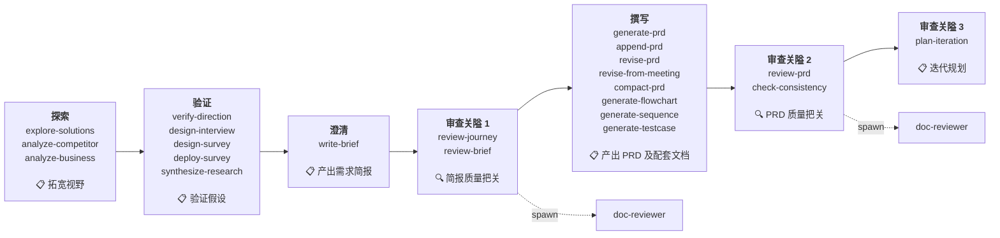
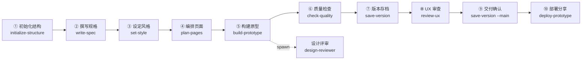

# pmcraft 产品工坊

[](CLAUDE.md)

产品经理的 AI 工作台——整合七大产品工作插件，覆盖从思维训练到开发交接的完整产品工作流。

---

## 七大模块

| 插件 | 用途 | 核心能力 |
|------|------|----------|
| **pmcraft-coach** | 思维训练 + 概念学习 + 方案拷问 | thinking-coach：结构化追问引导 PM 深度思考，6 层对话框架 + 4 维诊断；concept-coach：白话类比讲解新概念（讲讲 X），支持对比/学习路径/引导/检验/压缩/做成网页（可视化 HTML 概念卡）；grilling-coach：把方案映射成设计决策树逐轮拷问（拷问我的方案），每题附推荐答案，收敛输出决策清单 |
| **pmcraft-prompt** | 提示词工程 | 文字提示词和文生图提示词的设计与撰写，6 阶段流程（含技巧决策子阶段） |
| **pmcraft-req** | 需求工程 | 四阶段框架（探索→验证→澄清→撰写）+ 三道审查关隘 |
| **pmcraft-proto** | 原型设计 | 从初始化到部署的完整流水线，支持版本管理和 UX 审查 |
| **pmcraft-dev** | 开发交接 | 读取 PM 产出，输出预加工文件供 OpenSpec 消费 |
| **pmcraft-infra** | 基础设施 | 项目初始化——一句"启动pmcraft"自动注册路由大脑 |
| **pmcraft-test** | 自动化测试 | 从 PRD/测试用例生成 Playwright 脚本 → 执行 → 报告 → 体验走查 → 复盘，已知陷阱内嵌技能、用户经验外置累积 |

---

## 安装

```bash
# 0. 前置要求：Node.js（LTS，必装）
#    验证：node --version 能输出版本号（https://nodejs.org）

# 1. 克隆或解压到任意目录
cd <你的 pmcraft 根目录>

# 2. 运行安装脚本
setup.cmd
```

setup.cmd 会自动：
- **检查 Node.js（必须）**——缺失则终止安装并提示安装 LTS
- 卸载旧版 product-req-plugin / pm-gym（如已安装）
- 清理旧版独立 prepare-dev / prompt-writer 残留（技能目录/插件缓存/权限配置/旧 /prepare-dev 斜杠命令，如已安装）
- **移除旧市场 my-market 注册**（旧版 product-req-plugin 的市场）
- 注册 pmcraft marketplace
- 安装并启用全部 7 个插件
- 提示重启 Claude Code

### 卸载

```bash
uninstall.cmd
```

### 发布前自检

修改过 `.cmd/.bat/.json` 文件或准备打包分发前，双击 `release-check.cmd`：

- 校验全部批处理脚本行尾为 CRLF（LF 行尾会导致 cmd 解析错乱、双击闪退）
- 校验全部 JSON 可解析（损坏会导致插件静默加载失败，setup 也无法检测）
- 校验 hooks 加载链一致

全绿即可发布；有 FAIL 会列出具体文件并暂停，修复后重跑直至通过。

---

## 使用方式

pmcraft 是 Claude Code 插件，安装在用户环境。在任何项目目录下使用自然语言触发：

```
"启动pmcraft"
"思维训练" / "深度思考" / "月度回顾"
"拷问我的方案" / "拷问我的想法" / "grill me"
"讲讲 XX" / "解释一下 XX" / "什么是 XX"（讲解中可随时说「跟 XX 比着讲」「考考我」「做成网页」等扩展）
"写提示词"
"帮我写个需求"
"分析一下竞品"
"做一份问卷"
"部署问卷"
"生成 PRD"
"简版PRD" / "文档太长"
"修订PRD"
"审查PRD"
"审查简报"
"进度" / "清单" / "待办" / "下一步"（查看整体流程进度与待办清单，随时可查）
"一致性检查"
"迭代规划"
"会议评审"
"做个原型" / "改原型" / "修改原型"
"保存" / "保存版本" / "存档"
"加标注" / "更新标注" / "开始标注"
"加演示入口" / "场景演示入口" / "去掉演示入口" / "移除演示入口"
"初始化" / "规划页面" / "读简报"
"开发交接"
"跑测试" / "查看测试报告" / "复盘" / "体验走查" / "体验一下产品" / "找个人体验"
"UX审查"
"提取设计"
"记下这条"
"升级pmcraft"
"关闭服务"
```

（以上为常用触发示例，完整路由见 `pmcraft-infra` 注入的 CLAUDE.md 路由表；无法识别的请求会由路由大脑引导确认。）

pmcraft 会自动：
1. 从当前工作目录向上查找版本目录（`\d+\.\d+\.\d+`）
2. 确定项目根和版本号
3. 在版本目录下创建相应的产出（`brief/`、`prd/`、`prototype/` 等）

找不到项目时，会询问"在哪个项目？哪个版本？"

---

## 目录结构

### 1. 插件自身结构

```
pmcraft/                          ← 插件源码根目录
├── .claude/
│   ├── agents/                  ← 9 个 Agent 定义文件
│   └── settings.json            ← 项目设置
├── .claude-plugin/
│   └── marketplace.json         ← 插件市场定义
├── _shared/                     ← 项目级共享（跨插件调用）
│   ├── scripts/lib/             ← 共享库（encoding/json-output/port-finder/version-scanner/deploy-common/html-parser/tmpl/guard-rules/guard-preamble-insert）
│   ├── scripts/guard-chat.js    ← 路由层 Guard-Chat 守卫开关脚本（教练域/需求域，含 detect/purify 子命令）
│   ├── scripts/icon-get.js      ← 图标查询脚本（build-prototype 图标三级查找链）
│   ├── scripts/bundle-icons.js  ← 图标库打包脚本（发版维护用）
│   └── scripts/stop-services.js ← 路由层关闭服务脚本
├── pmcraft-coach/                ← 思维训练 + 概念学习 + 方案拷问插件（thinking-coach：6 workflow + references/ + templates/；concept-coach：白话讲解 + 6 个协议细则；grilling-coach：设计树 + 前沿轮询 + 决策清单）
├── pmcraft-prompt/               ← 提示词工程插件
├── pmcraft-req/                  ← 需求工程插件（24 技能 + _shared/ 插件级共享）
├── pmcraft-proto/                ← 原型设计插件（13 技能 + _shared/ 插件级共享：_common.css / annotations/ 标注层运行时 / demo/ 状态演示运行时 / icons/ 图标库（bundle 打包，svg 源文件备份于项目外 _icon）/ reference/ 参考 / scripts/lib/ / specs/ 设计规范 / vendor/element-plus 组件库）
├── pmcraft-dev/                  ← 开发交接插件（1 技能）
├── pmcraft-infra/                ← 基础设施插件（1 技能 + hooks/ SessionStart 钩子，新会话注入路由大脑）
├── pmcraft-test/                 ← 自动化测试插件（6 技能 + 工厂陷阱内嵌 + _shared/ checkpoint 框架）
├── CLAUDE.md                    ← 路由大脑
├── README.md
├── CHANGELOG.md                 ← 版本记录
├── setup.cmd                    ← 安装脚本（Node.js 必检、卸载旧版+旧市场、注册插件）
├── uninstall.cmd                ← 卸载脚本
└── release-check.cmd            ← 发布前自检（行尾/JSON/hooks 链完整性门禁）
```
> 每个插件目录（pmcraft-*）内部均含 `.claude-plugin/plugin.json`（插件定义）与 `skills/`（技能），插件自带引用资源放在技能内或插件级 `_shared/` 下。

### 2. 运行时产出结构

pmcraft 安装后，在用户项目目录中按版本管理产出文件。首次保存文档时自动初始化完整的版本目录树。

```
{功能顶级文件夹}/
├── CLAUDE.md                   ← 项目级路由大脑（init-project 创建，可升级同步）
├── .feature-name              ← 锁定功能名（save-doc 读取用）
├── _index.md                  ← 全版本文件索引（自动维护）

├── {版本号}/                   ← 如 1.0.0、1.1.0
│   ├── .checkpoint            ← write-brief 状态（phase=dialogue 进行中 / done 已完成）
│   │
│   ├── _进度清单.md            ← 整体流程进度与待办（路由大脑自动维护，说「进度 / 清单 / 待办」随时查看）
│   │
│   ├── brief/                 ← 需求简报 / 功能优化简报
│   │   └── {功能名}_{版本}_需求简报_E{N}.md
│   │
│   ├── prd/                   ← 产品需求文档
│   │   └── {功能名}_{版本}_PRD_E{N}.md
│   │
│   ├── decision/              ← 决策记录
│   │   └── {功能名}_{版本}_决策记录_E{N}.md
│   │
│   ├── report/                ← 审查报告；修订摘要、会议评审修订摘要为存量兼容（历史文件，新修订不再生成）；用户旅程审查报告、一致性检查报告自 2.1.0 起写入 pmcraft/temp/（存量兼容）
│   │   ├── {功能名}_{版本}_综合审查报告_E{N}.md
│   │   ├── {功能名}_{版本}_修订摘要_E{N}.md          ← 存量兼容（历史文件，仍被索引）
│   │   └── {功能名}_{版本}_会议评审修订摘要_E{N}.md   ← 存量兼容（历史文件，仍被索引）
│   │
│   ├── analysis/              ← 商业/竞品/研究分析报告
│   │   ├── {功能名}_{版本}_商业分析报告_E{N}.md
│   │   ├── {功能名}_{版本}_竞品分析报告_E{N}.md
│   │   └── {功能名}_{版本}_研究洞察报告_E{N}.md
│   │
│   ├── development/           ← 开发交接预加工文件（prepare-dev 产出）
│   │   └── {功能名}_{版本}_开发交接_E{N}/  ← 内含 pre_proposal.md / pre_specs.md / pre_design.md（供 OpenSpec 消费）
│   │
│   ├── _README/               ← 评审与开发必读指南（save-doc 自动维护：README.md 数据源 + README.html 门户，双击即读全部必读文档、原型直达）
│   │
│   ├── testcase/              ← 测试用例（支持中/高质量）
│   │   └── {功能名}_{版本}_测试用例[_中|_高]_E{N}.md
│   │
│   ├── screenshots/           ← 浏览器渲染截图（generate-prd / review-prd / check-consistency 采集；限量：主流程关键页，generate-prd ≤10 张，另两者默认 0；UX 审查 / 设计评审的临时截图留在 .playwright-mcp/，不写入版本目录）
│   │
│   ├── e2e/                   ← 自动化测试（生成→执行→报告）＋体验走查
│   │   ├── config.json        ← 测试项目配置（跨轮共享）
│   │   ├── traps.json         ← 项目级测试经验（跨轮累积）
│   │   ├── auth/              ← 登录态 storage.json
│   │   └── {时间戳}/          ← 每轮测试：scripts/ + logs/ + run_state.json + report/final-report.html + walkthrough/（走查发现与独立报告）
│   │
│   ├── meeting/               ← 会议记录归档
│   │   └── {评审会名称}_{日期}.md
│   │
│   ├── planning/              ← 产品迭代规划
│   │   └── {功能名}_{版本}_产品迭代规划_E{N}.md
│   │
│   ├── flowchart/             ← Mermaid 流程图
│   │   └── {功能名}_{版本}_流程图_E{N}.md
│   │
│   ├── sequence/              ← Mermaid 时序图
│   │   └── {功能名}_{版本}_时序图_E{N}.md
│   │
│   ├── survey/                ← 调研问卷（设计 + 部署）
│   │   ├── {功能名}_{版本}_调研计划与问卷_E{N}.md
│   │   └── web/               ← 部署后的网页问卷（index.html、admin.html、server.js）
│   │       └── mock/          ← 问卷服务器运行时（.server.pid、survey.json、settings.json、responses.jsonl）
│   │
│   └── prototype/             ← 原型文件
│       ├── working/           ← 施工区（当前工作副本）
│       │   ├── spec.md        ← 原型功能规格
│       │   ├── DESIGN.md      ← 设计系统（风格/组件/交互规范）
│       │   ├── design-system.css ← 设计系统样式
│       │   ├── page-inventory.md ← 页面清单
│       │   ├── pages/         ← 原型页面源文件（HTML/CSS/JS）
│       │   ├── components/    ← 组件库
│       │   ├── _common.css    ← 共享样式
│       │   ├── preview.html   ← 风格预览页（set-style 生成）
│       │   ├── feedback.md    ← 反馈记录（按需创建）
│       │   └── framework/     ← 框架壳（从全局基准 pmcraft/baseline/ 继承时存在）
│       ├── reference/         ← 设计参考（initialize-structure 创建，extract-design 产物归档）
│       ├── specs/             ← 全局设计规范副本（initialize-structure 从 pmcraft/specs/ 静默复制）
│       ├── E1/                ← 设计快照（含 UX审查报告）
│       ├── E2/
│       ├── E3/
│       ├── main/              ← 正式交付版本（含 UX审查报告）
│       │
│       └── {working,main,E*}/mock/  ← 原型部署运行时（.server.pid）

└── pmcraft/                    ← pmcraft 项目级数据（跨版本共享）
    ├── baseline/              ← 全局设计基线
    ├── specs/                 ← 品牌规范（用户手工放入）
    ├── lessons.md             ← 原型设计经验规则
    ├── temp/                  ← 过程性审查产物/临时文件区（不进 E 编号管理、不参与 _index.md）
    └── backup/                ← 升级前备份（init-project --upgrade 自动生成）
```

---

## 需求工程四阶段

从模糊想法到可交付 PRD 的完整链路，AI 与 PM 各司其职。



| 阶段 | AI 角色 | PM 角色 | 技能 | 产出 |
|:---:|------|------|------|------|
| 探索 | 搜索、结构化、对比 | **选方向** | explore-solutions, analyze-competitor, analyze-business | `analysis/` 商业/竞品/研究分析报告 |
| 验证 | 提取假设、设计实验 | **设计实验、判断结果** | verify-direction, design-interview, design-survey, deploy-survey, synthesize-research | `survey/` 调研计划与问卷 |
| 澄清 | 深度追问、补全盲区 | **最深介入** — 写核心故事、定规则 | write-brief | `brief/` 需求简报 / 功能优化简报 |
| 撰写 | **最高自主** — 模板生成、批量输出 | **验证** — AI 快但验证不能快 | generate-prd, append-prd, revise-prd, revise-from-meeting, compact-prd, generate-flowchart, generate-sequence, generate-testcase | `prd/` + `flowchart/` + `sequence/` + `testcase/` |

三道审查关隘：**Gate 1**（澄清后，spawn doc-reviewer）→ **Gate 2**（撰写后，spawn doc-reviewer）→ **Gate 3**（评审阶段，主对话执行迭代规划）

---

## 原型流水线

从零到交付的 10 步流水线，每一步有明确的输入、产出和确认机制。



| 步骤 | 技能 | 做什么 | 产出 | 谁执行 |
|:---:|------|------|------|:---:|
| ① | 初始化结构 | 创建 `working/` 目录骨架，确定平台（PC / 手机 / 平板）和框架（HTML / Vue + Element Plus） | `working/` 目录 | 主对话 |
| ② | 撰写规格 | 明确使用端、页面范围、核心功能清单、数据策略 | `spec.md` | 主对话 |
| ③ | 设定风格 | 确定字体、配色、圆角、间距、动效策略 | `DESIGN.md` | 主对话 |
| ④ | 编排页面 | 列出全部页面、路由、核心元素 | `page-inventory.md` | 主对话 |
| ⑤ | 构建原型 | 逐页生成可交互原型页面，流程页逐个确认，基础页批量生成；HTML 模式自动生成标注层（annotate-prototype，规则/状态/流程标注）与状态演示入口（demo 数据从标注 state 项派生，右下角「演示」开关） | `pages/*.html` | 主对话 |
| ⑥ | 质量检查 | 自动检查链接有效性、交互完整性、设计一致性、标注层与演示层资产（⑤内部自动触发，含维度 7 标注层 4 项 + 维度 8 状态演示层 5 项） | 检查报告 | 主对话 |
| — | 设计评审 | 独立上下文，5 维评分 + 反 AI 味检查（⑤完成后自动 spawn） | 评审报告 | spawn |
| ⑦ | 版本存档 | 将 working/ 固化为 E{N} 快照，生成变更记录 | `E{N}/` | 主对话 |
| ⑧ | UX 审查 | 针对已固化的 E 版本进行设计评审（spawn 执行） | `{功能名}_{版本号}_UX审查报告_E{编号}.md` | spawn |
| ⑨ | 交付确认 | 将 E{N} 提升为正式交付版本，同步到 main/（可选） | `main/` | 主对话 |
| ⑩ | 部署分享 | 启动局域网服务，生成分享链接，同网络 PM 可直接打开查看 | 访问链接 | 主对话 |

---

## 用户数据层（跨项目共享、升级不覆盖）

pmcraft 的用户级数据统一存放于 `%USERPROFILE%\.claude\user-data\` 下，跨项目共享、插件升级不触碰：

| 载体 | 位置 | 内容 | 升级行为 |
|------|------|------|----------|
| 思维训练记忆（coach） | `%USERPROFILE%\.claude\user-data\pmcraft-coach\` | thinking/concept/grilling 训练日志（`logs/thinking/`、`logs/concept/`、`logs/grilling/`）、用户级记忆（`_concepts.md`、`_patterns.md`、`_analogies.md`、`_field.md`）与概念卡（`cards/{概念}.html`） | **升级不触碰** |
| 架构参考（req） | `%USERPROFILE%\.claude\user-data\pmcraft-req\architecture\*.md` | 各业务域系统架构参考（generate-sequence 自动引用；PM 首次提供后自动拉入，多文件平铺） | **升级不触碰** |
| 测试经验（test） | `%USERPROFILE%\.claude\user-data\pmcraft-test\traps.json` | PM 经 review-tests 技能确认的跨项目通用测试经验 | **升级不触碰** |
| Guard-Chat 守卫状态（coach/req） | `%USERPROFILE%\.claude\user-data\pmcraft-guard-chat\` | 守卫开关持久状态（`guard-chat.json`）、每会话提示标记（`session.json`，SessionStart 钩子重置）、命中校准日志（`detect-log.jsonl`） | **升级不触碰** |

- **架构参考拉入**：generate-sequence 时 PM 提供架构文件路径 → 自动复制到 `architecture/`（同名追加序号不覆盖）→ 告知绝对路径 → 下次自动引用
- **设计意图**：放技能 `references/` 随升级丢失，放项目目录易被清理，用户数据层两者兼顾

---

## 测试经验库（工厂内嵌 + 用户累积）

pmcraft-test 的测试陷阱经验采用**技能内嵌 + 用户数据外置**双机制，升级不丢失用户经验：

| 载体 | 位置 | 内容 | 升级行为 |
|------|------|------|----------|
| 工厂陷阱（内嵌） | `pmcraft-test/skills/setup-tests/SKILL.md` "工厂陷阱（内置）"章节 + `pmcraft-test/skills/setup-tests/assets/scripts/gate-check.cjs` `FIXED_TRAPS` 数组 | 技能发布的已知陷阱（网络/框架/流程类） | 随插件升级自动更新 |
| 用户累积 | `%USERPROFILE%\.claude\user-data\pmcraft-test\traps.json` | PM 经 review-tests 技能确认的跨项目通用经验 | **升级不触碰** |
| 项目级 | `{版本目录}/e2e/traps.json` | 项目特有经验 | 不受插件升级影响 |

- **优先级**：用户累积 > 时间戳级 > 项目级（同 scope 去重，用户确认过的经验最高可信）
- **P0-8 机械检查**：执行 `node "{本技能源码目录}/assets/scripts/gate-check.cjs" --tsDir <时间戳目录>`（本技能源码目录 = `pmcraft-test/skills/setup-tests/`；内置 `FIXED_TRAPS` 静态 ∪ 用户级/项目级/当次 traps 动态合并，逐条 grep 复发）
- **发版约定**：发布新版本前，将用户累积经验中值得固化的条目合并进 SKILL.md"工厂陷阱（内置）"章节与 `gate-check.cjs` 的 `FIXED_TRAPS`，让所有用户受益

---

## Playwright MCP 配置（运行时验证依赖）

pmcraft 的 check-consistency / generate-prd / review-prd / build-prototype 技能依赖 Playwright MCP
（`mcp__playwright__*` 工具）做**渲染校验与运行时抽验**——验证原型能否跑起来、声明元素是否
真的渲染、实际操作的真实行为；**不承担交互元素枚举**（枚举由源码静态解析穷举，
PRD 需要的是可能性空间，一次渲染只有一条路径）。

pmcraft-test 域（setup-tests / run-tests）依赖 Playwright MCP 做页面侦察、登录、失败诊断；
测试执行本身走 `npx playwright test`（需 Node.js 与全局 `@playwright/test`，Chrome 优先作为浏览器引擎）。

- **安装**：mcp-server-playwright（详见 MCP 服务器市场或 npm）
- **配置**：在 Claude Code 的 `.mcp.json` / settings 中注册 playwright MCP 服务器
- **验证**：新会话中查询 `mcp__playwright__` 工具是否存在
- **未配置时**：技能自动降级为纯静态分析，报告/文档会明确标注降级原因与可信度降级

---

## 版本

**0.0.1** — 首个公开版本（2026-11-05）。
