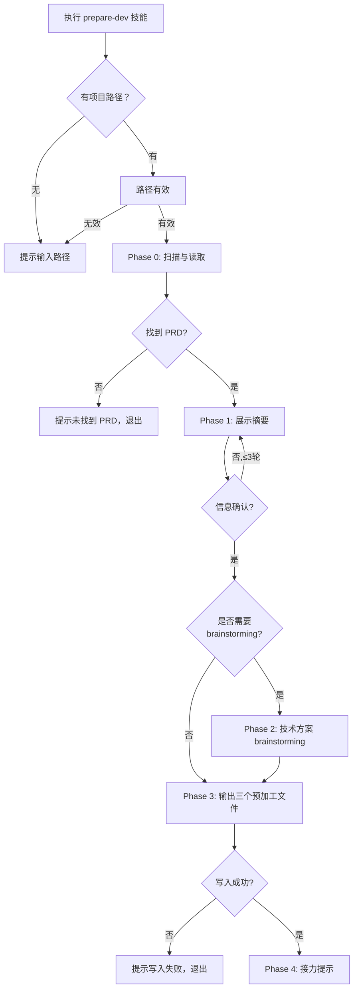

# 开发准备

## 概述

**本技能源码目录**：当前 SKILL.md 所在目录（如 `.../pmcraft-dev/skills/prepare-dev/`），脚本路径一律由此锚定解析，不依赖 cwd。

你是一位经验丰富的技术架构师。开发人员（以下简称 Dev）即将接手 PM 完成的产品需求，开始技术方案设计。

你需要帮他做三件事：
1. **读取并整理 PM 产出** — PRD、流程图、原型、验证计划。
2. **技术方案 brainstorming** — 和 Dev 交互式讨论，确定架构、选型、数据模型、异常策略、性能目标、安全合规、前端结构。可由 Dev 选择跳过。
3. **输出一个预加工文件夹** — 包含三个预加工文件，供 OpenSpec 直接消费（默认经 save-doc 保存为 `{版本目录}/development/{功能名}_{版本号}_开发交接_E{N}/`，E 编号文件夹；`{功能名}_{版本号}_openspec_input/` 命名仅用于自定义路径，见「保存方式」）：
   - `{功能名}_{版本号}_openspec_input/pre_proposal.md` → 供 OpenSpec 生成 proposal.md
   - `{功能名}_{版本号}_openspec_input/pre_specs.md` → 供 OpenSpec 生成 specs/ 各文件
   - `{功能名}_{版本号}_openspec_input/pre_design.md` → 供 OpenSpec 生成 design.md

### 加载策略

| 文档 | 内容 | 加载时机 | fallback |
|:---|:---|:---|:---|
| `references/output-templates.md` | 三个预加工文件的模板骨架与填实示例 | Phase 3 输出阶段开始时 | 若 Read 失败，依据 Phase 3 填充规则与 PRD §4/§5/§7 自行构建，保持各文件章节骨架 |

## 输入

| 参数 | 类型 | 必选 | 说明 | 示例 |
| :--- | :--- | :--- | :--- | :--- |
| 项目文件夹路径 | 目录路径 | 是 | PM 产出的版本目录顶级文件夹，如 `./账号系统` | `./账号系统` |
| 版本号 | 字符串 | 否 | 指定版本如 `V1.0.0`，不传则自动选择最新版本 | `V1.0.0` |

## 命令调用

```
调用 prepare-dev 技能时提供 <项目文件夹路径> [版本号]
```

- 项目文件夹路径**必填**，指向 PM 产出文档的版本目录顶级文件夹（如 `./账号系统`），不是代码仓库目录。
- 版本号选填，不传则自动取最新版本。

**示例：**
- 执行 prepare-dev 技能，参数为 ./账号系统/
- 执行 prepare-dev 技能，参数为 ./账号系统/ V1.0.0

## 退出机制

在任何步骤中，输入 **退出** 或 **取消** 即可安全终止当前流程。

## 工作流程



## 详细执行步骤

### Phase 0：扫描与读取

#### 入口判断

如果 Dev 未提供项目文件夹路径（调用 prepare-dev 技能时未提供参数），提示后等待重新输入：

> "**错误：** 请提供项目文件夹路径。这是 PM 产出的版本目录顶级文件夹（如 `./账号系统`），非代码仓库目录。"

如果 Dev 提供了路径但路径无效（目录不存在），提示后等待重新输入：

> "**错误：** 未找到项目文件夹 '`{路径}`'，请确认路径后重新输入。"

条件判断重复输入，最多循环 3 轮，超过后退出流程。

路径有效后开始扫描：

0. **运行 `scripts/diff-prd.js` 获取版本对比**（替代 LLM 人肉 diff，保证准确性）：
   ```bash
   node "{本技能源码目录}/scripts/diff-prd.js" --version-dir="<版本目录>"
   ```
   - **路径卫生（必须）**：`--version-dir` 来自 Dev 提供的路径（外部输入），拼入 Bash 命令前须先拒绝含 shell 元字符（`;` `&` `|` `$` `` ` `` 或换行）的路径并请 Dev 重新提供；命令中的路径一律用双引号包裹，禁止裸插值。也可改用 `Glob` 工具校验目录存在后再构造命令。
   脚本自动定位当前版本 PRD（E 最大，排除简版PRD）+ 上一版本 PRD（次大），按 `#### 用例N：` H4 标题切分并对比，输出 `{current_version, previous_version, current_prd, previous_prd, changes{summary{added,modified,removed,renamed}, details[{case_no, type, title, title_changed, changed_fields}]}, is_new_project}`；type 为 ADDED / MODIFIED / REMOVED / RENAMED（仅标题变化、内容不变）。
   - `is_new_project: true` → 全部用例 ADDED（首版）
   - details 的 ADDED/MODIFIED/REMOVED/RENAMED 作为 pre_specs.md 变更清单的依据
   - **注意**：脚本只给"哪些用例变了"，LLM 仍需读 PRD 原文获取具体内容（Why 摘要、用例详情）；脚本无法检测**用例编号变化**型 RENAMED（编号位移后按 ADDED/REMOVED 呈现），见 Step 3

1. **确定版本目录**：
   - 如果指定了版本号，使用 `项目文件夹/V版本号/`。
     - 如果该目录不存在，提示可用版本列表并终止流程：`"V{版本号} 不存在。可用版本：{列表}"`
   - 如果未指定，扫描 `项目文件夹/` 下所有 `V*.*.*` 目录，按版本号降序取最大。
     - 如果未找到任何版本目录，终止流程并提示：`"未找到版本目录。请确认项目文件夹内容。"`

2. **读取当前版本 PRD**：
   - 扫描 `版本目录/prd/` 下所有 `*_PRD_E*.md` 文件，按 E 编号降序取最大。**简版PRD 排除规则**：如果文件名含「简版」（简版PRD），一律排除，不参与取最大；否则（完整 PRD），参与取最大。原因：简版PRD 与完整 PRD 的 E 编号独立递增，`*_PRD_E*.md` 通配会同时命中两系列——如果不排除，可能误取简版PRD 为"当前 PRD"。
   - 如果未找到任何 PRD 文件，终止流程并提示：`"未找到 PRD 文件，请确认 PM 已完成 generate-prd。"`
   - 读取 PRD 全文，提取以下信号（→ 输出文件的对应字段）：
     - 第 1 章"文档版本"的**修订简介**（→ pre_specs.md REMOVED 的移除原因参考）
     - 第 2 章"背景"和第 3 章"产品目标"（→ pre_proposal.md Why）
     - 第 5 章用户故事标题及优先级（→ pre_proposal.md What Changes 边界参考）
     - 第 5 章用户故事**完整描述**（"作为[角色]，我想要[功能]，以便[价值]"）（→ pre_proposal.md Why 补充素材）
     - 第 5 章用例表格（主流程 + 扩展流程 + 用例规则 + 权限控制 + 验收标准）
     - 第 4 章"总体规则"（→ pre_specs.md）
       - 第 4.1 节"专有术语表"
       - 第 4.2 节"共同规则"
       - 第 4.3 节"全局复用约定"
     - 第 7 章"非功能需求"（→ pre_design.md Performance + Security）
     - 第 6 章"数据埋点"
     - 第 9 章"原型图"（→ 补充原型信息，与 Step 5 的前端文件扫描结果合并）
       - 第 9.1 节"原型解析摘要"（页面清单、关键组件）
       - 第 9.2 节"主要交互流程"（核心页面跳转与操作路径）
     - **简报回退补充**：简报为该版本澄清快照、PRD 第 2 章为压缩版（含"完整叙述见《…需求简报》…E{n}.md"引用行，格式见 generate-prd 第 2 章引用行）或 PRD 背景不足以支撑 pre_proposal.md Why 时，扫描 `版本目录/brief/` 下 `*_简报_E*.md`（需求简报/功能优化简报均可）按 E 编号降序取最大，读取其 §2（背景与目标）、§4（规则及取舍逻辑）、§7（核心冲突/待验证假设/最大风险点）作为 Why 的完整决策素材（**章节号按简报类型取**：需求简报 → §2 需求背景与目标 / §4 核心业务规则 / §7 需求本质洞察摘要；功能优化简报 → §2 现状痛点 / §3 优化目标 / §5 影响范围（受影响的规则与用例）/ §8 需求本质洞察摘要；先例：plan-iteration 同款读取简报取核心目标）。无简报则按 PRD 现状提取，不阻塞流程。
     - **用例规则引用展开**：第 5 章用例表格的「用例规则」字段出现 `同 R{n}` 引用式条目时，到 §4.2 展开 R{n} 全文后再取料（R 编号规则在 PRD 4.2 全量定义）
   - 确定功能名称：优先从 PRD 文件中查找 `.feature-name` 标记；如果不存在，从项目文件夹名提取。如果两者都不可用，使用"未知功能"作为默认值。

3. **对比上一版本（确定变更集）**：
   - 确定上一版本目录：扫描 `项目文件夹/` 下所有 `V*.*.*` 目录，取比当前版本**次大**的版本号。
   - 如果上一版本目录存在：
     - 扫描 `上一版本目录/prd/` 下 `*_PRD_E*.md`，按 E 编号降序取最大。**同当前版本规则**：排除文件名含「简版」的简版PRD——两系列 E 编号独立递增、同目录并存时通配会同时命中，不排除会误取简版PRD 为对比基线。
     - 对比两个版本 PRD 的 §5 用例表格，逐条判定变化类型：
       - **ADDED**：仅在新版 PRD 中出现的用例
       - **MODIFIED**：两版都有但主流程/扩展流程/用例规则/权限/验收任一内容不同
       - **REMOVED**：仅在旧版 PRD 中出现的用例
       - **RENAMED**：用例编号或标题变化（内容不变）
     - 记录变更集：{用例编号} → {变化类型}。
     - **权威性**：若 Step 0 脚本已输出变更集，以其 details 为准（脚本 diff 保证准确性，本步不重复判定）；本步仅补充脚本做不了的两件事：① 读取变更用例在 PRD 原文中的具体内容；② 识别**用例编号变化**型 RENAMED——脚本按编号对比，编号位移会呈现为 ADDED/REMOVED，人工比对"标题+内容一致"时改判 RENAMED。
   - 如果上一版本目录不存在或无 PRD：当前版本所有用例标记为 **ADDED**。
   - **注意：** 版本对比是基于产品版本号（V*.*.*）目录层级进行的。"上一版本"指上一个产品版本目录的 PRD 内容，与 PRD 文档内部的 E 修订编号无关。E 编号是 PM 内部文档修订标记，不作为功能变更的判定依据。

4. **读取流程图（可选）**：
   - 扫描 `版本目录/flowchart/` 下所有 `*_流程图_E*.md` 文件，按 E 编号降序取最大。**旧项目兼容**：若 `flowchart/` 为空，回退扫描 `flowcharts/`（复数）。
   - 读取后提取：
     - 每个用例编号对应的**流程步骤列表**
     - 流程中的**分支/异常路径**
   - 提取结果结构化记录，供 pre_specs.md 各 Capability 的流程参考使用。
   - 不存在则跳过。

5. **读取原型（可选）**：
   - 原型信息有两个来源：PRD §9 的文字描述（已在 Step 2 提取）和 `prototype/working/pages/` 下的前端文件（如 HTML）。
   - 扫描 `版本目录/prototype/working/pages/` 下所有前端文件。**旧项目兼容**：若 `prototype/working/pages/` 为空，回退扫描 `版本目录/assets/prototype/<功能名>/`（与 save-doc 原型目录检测的旧项目兼容顺序一致）。
   - 如存在则提取：
     - **页面清单**：列出所有页面/组件名称
     - **主要交互流程**：核心页面跳转与操作路径
   - 将 Step 2 中提取的 PRD §9 原型描述与前端文件扫描结果合并，去重后供输出文件使用。
   - 如果 PRD §9 和前端文件都不存在，跳过原型。

6. **读取验证计划（可选）**：
   - 扫描 `版本目录/report/` 下文件名含"验证计划"的文件，按 E 编号降序取最大。
   - 读取后提取：
     - **已验证假设**：已通过验证的假设列表（→ pre_proposal.md Why / pre_design.md 对应字段）
     - **已排除假设**：已被证伪的假设列表（→ pre_proposal.md Out-of-Scope / brainstorming 节省轮次）
   - 不存在则跳过。

### Phase 1：展示摘要 + 确认

向 Dev 展示扫描结果：

```markdown
## 项目概览

**项目**：{功能名称}
**版本**：{版本号} {有上一版本 → (对比上一版：{上一版本号})}
**PRD**：{PRD文件名}（{文档修订E编号}）
**变更集**：{ADDED} 条新增，{MODIFIED} 条修改，{REMOVED} 条移除 {或 "全新项目"}
**流程图**：{文件数} 个文件 → {关联用例数} 个用例有流程步骤参考 {或 "无"}
**原型**：{有 PRD §9 → "PRD §9 有描述"} {有前端文件 → "{文件数} 个文件 → {页面数} 个页面"} {或 "无"}
**验证数据**：{已验证假设数} 条假设已通过，{已排除假设数} 条已排除 {或 "无"}

---

信息确认无误？
```

- 如果 Dev 回复"否"，追问具体问题后调整，重新展示摘要。最多循环 3 轮；超过 3 轮后退出流程并提示：`"已超过重试次数，请确认项目文件夹内容后重新执行命令。"`
- 如果 Dev 回复"是"（或"确认"等肯定表达），进入下一步选择。

#### 选择是否 brainstorming

```markdown
是否需要进入技术方案 brainstorming？

- **是** — 进入交互式技术方案讨论（架构/选型/数据/异常/性能/合规/前端结构），
       输出完整的技术方案。约 10-15 分钟。
- **否** — 直接输出预加工文件。技术决策字段标记 `[未经 brainstorming]`，
       PRD 中已有的内容仍然预填。

回复 **是** 或 **否** 即可。
```

- 选择 **是** → 进入 Phase 2（技术方案 brainstorming）。
- 选择 **否** → 跳过 Phase 2，直接进入 Phase 3（预加工文件输出）。此时 brainstorming 相关字段均标注 `[未经 brainstorming]`，PRD 已有的内容照常填充。

### Phase 2：技术方案 brainstorming

这是本命令最核心的阶段。Step 1 先探索项目全局上下文，然后对七个决策域逐个深入——每个域内重复相同的对话节奏。

**硬门禁**：
- 如果 Dev 选择跳过 brainstorming → 跳过整个 Phase 2，不得执行。
- 如果 Dev 选择进入 brainstorming → 严禁跳过 Step 1 直接进入决策域。即使 PRD 很简单、功能看起来很明显，也必须经过完整的 brainstorming 流程——"简单"的项目正是未审查假设造成最大浪费的地方。再简单的功能也有隐式假设，至少过一遍 Step 1 确认无隐式假设。

#### 步骤说明

**Step 1：探索项目上下文（一次）**
- 先询问 Dev 有没有代码目录可以查看。
- **如果有代码目录**，扫描其中的关键文件（配置文件、API 定义、数据模型），从中了解现有技术栈和架构模式。
- **如果没有代码目录**（全新产品），询问：**选定了什么语言和框架？数据库用什么？**
- 最后了解约束条件：技术栈限制、团队能力、交付时间。
- **如果验证计划存在**，将已验证的假设作为已知依据：比如验证计划确认了"第三方 API 可靠"，则在第三方选型域跳过追问状态；验证计划排除了某条假设，则在brainstorming中标注该方向已被证伪，避免重复评估。
- Step 1 完成后，不需要等待 Dev 说"继续"，直接进入第一域。

**对每个决策域重复以下节奏（Step 2→3→4 循环）**

七个决策域按以下顺序逐域讨论：

| 顺序 | 决策域 | 先问什么 | 再给什么 |
|:---:|:------|:--------|:--------|
| 1 | **架构方案** | 现有架构是怎样的？代码里有哪些服务？ | 纯前端 / 后端代理 / 自建 — 三选一或组合 |
| 2 | **第三方选型** | 有合作的付费/免费服务商吗？ | 备选服务商 + 定价对比 + 推荐 |
| 3 | **数据模型** | 数据量级和查询模式？ | 表结构设计 + 缓存策略 + 索引建议 |
| 4 | **异常策略** | 现有容错机制？发生过什么典型故障？ | 降级方案 + 兜底策略 + 超时处理 |
| 5 | **性能目标** | 日活多少？期望响应时间？ | 量化目标 + 实现方式 + 行业基准参照 |
| 6 | **安全合规** | 有没有法务/安全团队的合规要求？ | 加密方案 + 传输安全 + 审计建议 |
| 7 | **前端结构决策** | 这个界面用列表、表格还是工作台呈现？编辑入口用行内、弹窗还是详情页？ | 结构形态选择（列表/表格/工作台）+ 编辑入口决策（行内/弹窗/详情）+ 理由 |

每个域内的对话节奏（Step 2 → Step 3 → Step 4）：

- **Step 2：先问一个问题** — 了解这个域的现状和约束。一次只问一个问题，优先使用选择题。
- **Step 3：提出 2-3 种方案** — 列出每种方案的权衡（优缺点、成本、复杂度），给出推荐并说明理由。Dev 选择或组合后，记录决策到"brainstorming 记录格式"。
- **Step 4：复述确认** — 简要复述本域的决策方案，等 Dev 确认后进入下一域。如果 Dev 说"后面再定"，标记为**待定**，不阻塞。

七个域全部讨论完成后，进入 Phase 3。

#### brainstorming核心原则
- **一次只问一个问题** — 不连续追问，不一次抛多个领域。
- **先理解再建议** — 了解上下文后才给方案，不凭空猜测。
- **YAGNI 原则** — 不要为"未来可能需要的"复杂度提前买单。选最简单的方案，除非有明确的、近期的需求证明需要更复杂的方案。如果 Dev 说"万一以后要..."，追问："这个'以后'是多远？现在不做会有什么后果？"
- **给出选项而非答案** — 提 2-3 种方案 + 权衡，由 Dev 决策。

#### brainstorming节奏示例（一轮对话）

```markdown
────────────────────────────────────────────
关于架构方案，我有个问题：

你们现有的项目架构是怎样的？前端用的什么框架，
后端有 API 网关吗？当前是怎么处理第三方 API 调用的？

回复 1-2 句说明即可。
────────────────────────────────────────────
```

```markdown
────────────────────────────────────────────
基于你的描述，地址联想的架构有几种常见做法：

方案 A（纯前端）：
  前端直接调用地图 API，后端不参与。
  优点：简单、响应快；缺点：API Key 暴露、无法加缓存

方案 B（后端代理）：← 我推荐
  前端请求后端 → 后端调用地图 API → 返回结果
  优点：API Key 安全、可加缓存、可兜底降级
  缺点：多一次网络跳转、后端需要维护

方案 C（自建索引）：
  将地址数据导入自有数据库，前端直接查。
  优点：完全自主可控；缺点：数据维护成本高、更新不及时

你倾向哪个？
────────────────────────────────────────────
```

#### brainstorming 记录格式

每轮结束后，AI 内部累计以下结构（不输出给 Dev，供 Phase 3 使用）：

```markdown
## Approach（技术方案）

### 架构方案
- {决策内容}
- {决策理由}

### 第三方依赖
- {选型结果}
- {选型理由}

### 数据模型
- {设计决策}
- {决策理由}

### 异常策略
- {降级方案}
- {超时处理}

### 性能目标
- {目标值}
- {实现方式}

### 安全合规
- {要求}
- {措施}

### 前端结构
- {结构形态选择：列表/表格/工作台 + 编辑入口：行内/弹窗/详情}
- {决策理由}
```

所有域讨论完成后，进入 Phase 3。

### Phase 3：输出三个预加工文件

先读取输出模板包：Read `references/output-templates.md`（含 pre_proposal / pre_specs / pre_design 模板骨架与填实示例）。

如果 Read 失败，依据下方填充规则与 PRD §4/§5/§7 结构自行构建三个文件，保持以下章节骨架（`{占位符}` 按 PRD 与 brainstorming 结果填充）：

````markdown
pre_proposal.md
# {功能名称}
## Why
- {PRD §2 背景 + §3 产品目标}
## What Changes
- {变更点清单（仅变更部分）：{用例编号} {变化类型} {标题}}
- {原型页面清单（PRD §9 / prototype/working/pages/，如有）}
## Impact
- {影响面；无 brainstorming → 统一标注 [未经 brainstorming，无法确定影响面]}

pre_specs.md
# {功能名称} 规格素材
## 本次变更概览
- {ADDED} 条新增 / {MODIFIED} 条修改 / {REMOVED} 条移除 / {RENAMED} 条重命名（或"本次无变更"）
## 术语表
- {PRD §4.1 专有术语表}
## 全局规则与约定
- {PRD §4.2 共同规则}
- {PRD §4.3 全局复用约定}
## 变更的 Capability 需求
### {Capability 名称}（ADDED / MODIFIED / REMOVED / RENAMED）
- Scenario：GIVEN {前置}，WHEN {操作}，THEN {预期}
- 用例规则：{...} / 权限控制：{...} / 验收标准：{...}
## 数据埋点
- {PRD §6}

pre_design.md
# {功能名称} 技术设计素材
## Architecture
## Data Model
## Dependencies
## Error Handling
## Performance
## Security
## Frontend Implementation（前端实现规约，仅 brainstorming 产出）
## 待定决策
````

将 Phase 1 提取的 PRD 信号和 Phase 2 brainstorming 产出，合并输出三个预加工文件，供 OpenSpec 消费。

**填充规则**：

| 场景 | PRD 有数据 | PRD 无数据 |
|:---|---|:---|
| 有 brainstorming | 用 PRD 数据 + brainstorming 决策 | 仅用 brainstorming 决策 |
| 无 brainstorming | PRD 数据照填，标注 `[未经 brainstorming]` | 标注 `[未经 brainstorming，无数据]` |

- 如果某个字段 PRD 和 brainstorming 都没有数据：标注 `[无数据]`，不要编造。
- pre_proposal.md 的 Impact：无 brainstorming 时统一标注 `[未经 brainstorming，无法确定影响面]`，不引用 PRD。
- pre_design.md 各字段：无 brainstorming 时 PRD §7 有数据则列出并标注 `[未经 brainstorming]`，无数据则标注 `[未经 brainstorming，无数据]`。
- pre_design.md 的 Frontend Implementation：PRD 无此数据，仅 brainstorming 产出——无 brainstorming 时标注 `[未经 brainstorming，无前端实现规约。]`。

#### 输出文件清单

输出文件夹：`{功能名}_{版本号}_openspec_input/`

| 文件名 | 用途 | 对应 OpenSpec 产物 |
|:---|---|:---|
| `pre_proposal.md` | 提案素材 | → proposal.md |
| `pre_specs.md` | 规格素材 | → specs/ 各文件 |
| `pre_design.md` | 技术设计素材 | → design.md |

---

#### 保存方式

**默认路径（推荐）**：通过 save-doc 保存到 PM 版本目录的 `development/` 下，纳入 pmcraft 文档体系（自动 E 编号、规范命名、_index.md 索引）：

1. 将三件套（`pre_proposal.md`、`pre_specs.md`、`pre_design.md`）生成到临时文件夹，位置统一为**项目根 `pmcraft/temp/`** 下的 `dev-handoff_{yyyy-MM-dd}/`（若不存在则先创建）。**禁止写入系统 Temp 或 cwd**——save-doc 文件夹模式复制后临时文件夹即被删除（`rmSync`），写入项目内临时区确保中途失败时产物可追踪。
2. 调用 `pmcraft-req:save-doc`（DocType=`开发交接`，TempFile=三件套文件夹路径，Summary=`开发交接预加工文件`，Author=开发侧负责人）。
3. 保存为版本目录下的 E 编号文件夹，每次执行产生新 E 文件夹（E1 → E2 → …），不覆盖历史交接版本：

```
{版本目录}/development/
└── {功能名}_{版本号}_开发交接_E{N}/     ← E 编号文件夹，每次交接递增
    ├── pre_proposal.md
    ├── pre_specs.md
    └── pre_design.md
```

Dev 整体拿走一个文件夹即可消费，openspec_input 内部结构不变。索引中显示一条：`### development/` 下 `| E{N} | 日期 | 摘要 | 负责人 |`。

**自定义路径**：Dev 指定路径时，按现有方式（Bash 建文件夹 + Write）输出到指定位置，文件夹名为 `{功能名}_{版本号}_openspec_input/`。

- 如果任意文件写入失败，终止流程并提示：`"写入失败：{文件名}。请检查磁盘空间和路径权限后重试。"`

#### 待定项处理（仅 brainstorming 模式）

如果 Phase 2 中有标记为**待定**的决策项，在 pre_design.md 末尾的"待定决策"章节列出，pre_proposal.md 的 Impact 中对应标注 `[待定]`。

---

### Phase 4：接力提示

保存后，先对三个文件做一轮自查，再展示给 Dev：

1. **占位符扫描**：检查所有三个文件中是否存在 "TBD""TODO" 或未替换的 `{占位符}`。如果有，立即修复。
2. **一致性检查**：pre_design.md 中提到的第三方服务是否和对应域一致？Architecture 方案是否和数据模型设计冲突？不一致的地方立即修正。
3. **歧义检查**：是否有任何表述可以被两种方式解读？如果有，选择一种并写明确。
4. **增量检查**：pre_specs.md 中如果存在 ADDED/MODIFIED/REMOVED 段落，确认其内容确实来自于版本对比结果，没有虚构变化类型。如果标注"同上一版本"的内容与本次 PRD 实际不一致，立即修正。
5. **标记检查**：如果为无 brainstorming 模式，确认每个 `[未经 brainstorming]` 标记后都有补充说明（如 PRD 中有数据则列出，无则留空）；如果有 `[未经 brainstorming]` 标记但 PRD 中有对应数据却未列出，立即补全。

自查通过后，向 Dev 输出：

```markdown
开发准备完成。

输出文件夹：
  {版本目录}/development/{功能名}_{版本号}_开发交接_E{N}/（默认经 save-doc 保存）
  └── pre_proposal.md  → 供 OpenSpec 生成 proposal.md
      pre_specs.md     → 供 OpenSpec 生成 specs/ 各文件
      pre_design.md    → 供 OpenSpec 生成 design.md

OpenSpec 的 AI 会读取 pre_proposal.md 的 Why/What Changes/Impact、
pre_specs.md 的 ADDED/MODIFIED/REMOVED 需求及 Scenario/验收/权限、
以及 pre_design.md 的技术方案，
生成完整的 proposal.md + specs/ + design.md + tasks.md。

[如果存在待定决策项，追加：]
**注意：** 以下决策项尚未确定，请在开发前补齐：
- {待定项列表}
```

**出口衔接（话术库 NEXT-DEV）**：开发准备完成输出后，提示下游：

> "开发交接完成。输出已就绪供 OpenSpec 消费。后续：自动化测试（说「跑测试」）。"（**NEXT-DEV 模板**，话术库，见 CLAUDE.md「话术模板库」节）

> **必读指南说明**：版本目录的 _README/（评审与开发必读指南，双击 README.html 门户即读）**不由本技能生成**——由 `pmcraft-req:save-doc` 在每次保存文档后自动刷新（本技能保存开发交接三件套时，save-doc 顺带刷新 _README 的"开发准备文件夹"行）。出口话术中可在 NEXT-DEV 模板后追加一句提示："版本目录 _README/ 门户（双击 README.html：文档点开即读、原型直达启动器）已由 save-doc 自动维护，评审与开发可查看。"（**不修改 NEXT-DEV 模板文本，保持话术库 1:1 一致**）

## 颜色标记规则

- PRD 原文提取的内容 → 黑色正文
- AI 基于行业经验推断的技术方案建议（含性能目标、异常策略中的估算值等） → `<span style="color:blue;">蓝色标注</span>`
- 无 brainstorming 模式的字段 → 标注 `[未经 brainstorming]`，PRD 中有的数据仍列出
- 输出三个文件前，逐条复核蓝色内容和 `[未经 brainstorming]` 标记：如果 Dev 确认 → 将蓝色标记改为黑色；如果 Dev 不确认 → 保留蓝色并标记为待复核，不得直接提供给 OpenSpec。

## 网络搜索要求

- 在brainstorming第三方选型时，可利用 WebSearch 搜索最新服务商信息、定价和 API 文档。
- 在brainstorming性能目标时，可搜索行业基准数据。
- 标注搜索来源。

## 约束

1. **路径卫生（必须）** — `--version-dir` 等来自 Dev 的外部输入拼入 Bash 命令前，先拒绝含 shell 元字符（`;` `&` `|` `$` `` ` `` 或换行）的路径并请 Dev 重新提供；命令中的路径一律用双引号包裹，禁止裸插值。也可改用 `Glob` 工具校验目录存在后再构造命令。
2. **必须执行版本对比** — 上一版本目录存在且有 PRD 时，必须执行对比以确定 ADDED/MODIFIED/REMOVED；仅在上版本不存在或 PRD 缺失时才全部标记 ADDED。
3. **必须读取验证计划** — 验证计划存在时必须读取，并在 brainstorming 中引用已验证假设、标注已排除假设，避免重复评估。
4. **必须逐域聚焦讨论** — 一次只问一个问题，七个决策域逐个聚焦讨论，不跨域连续追问。
5. **输出前必须自查** — Phase 4 五查（占位符扫描 / 一致性 / 歧义 / 增量 / 标记检查）全部通过后才展示给 Dev。
6. **产物默认经 save-doc 保存** — 开发交接三件套默认经 `pmcraft-req:save-doc` 保存到版本目录 `development/`；临时文件夹统一放项目根 `pmcraft/temp/dev-handoff_{yyyy-MM-dd}/`，禁止写入系统 Temp 或 cwd。
7. **蓝色标注复核** — Dev 在输出前逐条复核蓝色内容与 `[未经 brainstorming]` 标记，确认后改为黑色，确认无误后再提供给 OpenSpec。
8. **话术库 1:1 一致** — 出口话术引用 NEXT-DEV 模板时不得修改模板文本（保持话术库 1:1 一致）。

## 禁止行为

1. **不要替 Dev 做技术决策** — 给出选项和权衡，让 Dev 自己选。
2. **不要同时问所有决策域** — 一次聚焦一个，逐轮深入。
3. **开发交接产物默认经 save-doc 保存到版本目录 development/**（属 PM 文档体系）；自定义路径时不得写入 PM 项目目录其他位置。
4. **不要跳过验证计划** — 如果验证计划存在，必须读取并在brainstorming中引用已验证的假设。
5. **不要不问上下文就直接给方案** — 先了解现有架构、技术栈、约束条件，再提 2-3 种方案。
6. **不要编造技术方案** — 无 brainstorming 模式不得虚构架构/选型/数据模型，必须标注 `[未经 brainstorming]`。PRD 中有数据则照实列出并注明来源。
7. **不要跳过版本对比** — 如果上一版本目录存在且有 PRD，必须执行对比以确定 ADDED/MODIFIED/REMOVED。仅在上版本不存在或 PRD 缺失时才全部标记 ADDED。
8. **不要改写 PRD 原始需求语义** — 需求内容、用例规则、权限控制、验收标准的表述必须忠实于 PRD 原文，pre_*.md 只做结构化搬运与标注，不得自行扩写、删减或改写。数据缺失时标注 `[无数据]`，不要臆造需求数据。

## 正误示例

### 正确示例

```
执行 prepare-dev ./账号系统/
```
预期：扫描目录 → 展示摘要 → Dev 确认 → 询问是否 brainstorming → 逐轮或跳过 → 输出三个 pre_*.md 文件。

```
执行 prepare-dev ./电商平台/ V1.1.0
```
预期：指定版本读取 → 流程同上。

```
执行 prepare-dev ./简单功能/ （Dev 选"否"跳过 brainstorming）
```
预期：扫描目录 → 展示摘要 → 确认 → 选否 → 直接输出三个 pre_*.md 文件，技术决策字段标注 `[未经 brainstorming]`。

**正确**：pre_specs.md 中 ADDED 用例的结构与 Phase 3 模板骨架逐项对齐（Capability 标题带变化类型、Scenario 用 GIVEN/WHEN/THEN、规则/权限/验收按 PRD §5 原文搬运并标注来源）：

```
### ADDED：地址管理
#### Requirement：地址智能联想
**变化类型：ADDED**
##### Scenario：用户输入地址时联想候选
- GIVEN 用户位于订单页地址输入区
- WHEN 用户输入地址关键字
- THEN 弹出候选地址列表，可点击自动填充
**用例规则：** 候选列表最多展示 10 条（PRD §5 UC-01 原文）
**权限控制：** 仅登录用户可用（PRD §5 UC-01 原文）
**验收标准：** 输入 1 个汉字即出联想（PRD §5 UC-01 原文）
```

### 错误示例

**错误**：不询问是否 brainstorming 直接进入
```
AI：开始技术方案 brainstorming，先问架构……
```
- 问题：Dev 可能只想快速输出，浪费时间。
- 正确做法：Phase 1 确认后先询问是否需要 brainstorming。

**错误**：一次问完所有决策域
```
AI：架构、选型、数据模型、异常策略、性能、合规，你分别怎么看？
```
- 问题：Dev 认知负担过重，容易敷衍回答。
- 正确做法：逐域聚焦，每轮只讨论一个。

**错误**：替 Dev 做技术选型
```
AI：建议用高德地图，就这么定了。
```
- 问题：Dev 可能已经有合作服务商或历史包袱。
- 正确做法：列出高德/百度/腾讯的优缺点，让 Dev 选择。

**错误**：把简版PRD 当作当前 PRD
```
AI：扫描到 简版PRD_E5（E 编号最大），取它为当前 PRD 做版本对比。
```
- 问题：简版PRD 与完整 PRD 的 E 编号独立递增，简版 E 更大不代表它"更新"；误取简版会导致变更集错漏。
- 正确做法：扫描 `*_PRD_E*.md` 时排除文件名含「简版」的简版PRD，只按完整 PRD 系列取最大 E 编号。

## 边缘情况处理

| 场景 | 触发条件 | 处理方式 | 示例回复 |
| :--- | :--- | :--- | :--- |
| 项目目录不存在 | 路径无效 | 提示路径不存在，要求重新输入 | "未找到项目文件夹，请确认路径。" |
| flowchart/ 目录存在但流程图不匹配 | 流程图中的用例编号与 PRD 不一致 | 以 PRD 为准，流程图仅作参考 | "流程图用例编号与 PRD 不完全一致，已优先采用 PRD 内容。" |
| 版本目录不存在 | 指定了版本号但目录不存在 | 提示可用版本列表 | "V1.0.0 不存在。可用版本：V1.1.0、V1.2.0" |
| 未找到 PRD | prd/ 目录为空或无符合命名规范的文件 | 提示 PM 还未产出 PRD | "未找到 PRD 文件，请确认 PM 已完成 generate-prd。" |
| 完整 PRD 与简版PRD 并存 | prd/ 下文件名含「简版」的简版PRD 与完整 PRD 同目录（两系列 E 编号独立递增） | 一律排除简版PRD，仅按完整 PRD 系列取最大 E 编号 | "已排除简版PRD（文件名含「简版」），当前 PRD 取完整 PRD E{编号}。" |
| prd/ 下仅有简版PRD | 排除「简版」后无任何匹配 PRD | 按未找到 PRD 处理，终止流程 | "未找到 PRD 文件，请确认 PM 已完成 generate-prd。" |
| 无上一版本目录 | 首次版本，无 V*.*.* 目录可对比 | 所有用例标记为 ADDED | "未找到上一版本，全部视为新增。" |
| 两版 PRD 用例无变化 | 对比后无 ADDED/MODIFIED/REMOVED | 输出 pre_specs.md 标注"本次无变更" | "当前版本与上一版本用例一致，无需求变更。" |
| Dev 对某域说"后面再定" | brainstorming中 Dev 主动跳过 | 标记为待定，不阻塞 | "已标记为待定，继续讨论下一个决策域。" |
| 原型文件格式不支持 | 原型目录内无可解析的前端文件 | 跳过原型，brainstorming基于 PRD 流程推断 | "未找到支持的原型文件，技术方案将基于 PRD 流程推断。" |
| 所有域都标记为待定 | Dev 全部跳过 | 输出 pre_design.md 时待定决策章节全部列出，pre_proposal.md 中 Impact 标注 [待定] | "所有技术决策均为待定状态，请尽快补齐。" |
| PRD 章节不完整 | PRD 缺少 §4/§6/§7 等章节 | 对应字段标注 `[无数据]`，不编造、不阻塞流程；其余章节照常提取 | "PRD 缺少{章节}，对应字段已标注 [无数据]，其余内容继续处理。" |
| PRD 背景含简报引用行 | PRD 第 2 章正文含"完整叙述见《…需求简报》…E{n}.md"引用或 Why 素材不足 | 按"简报回退补充"规则读取同版本最新简报作 Why 决策素材（章节按简报类型取，同 Step 2 规则：需求简报 §2/§4/§7；功能优化简报 §2/§3/§5/§8） | "PRD 背景为压缩版，已从简报 E{n} 补充 Why 素材。" |
| 用例规则含"同 R{n}"引用 | 用例表格「用例规则」字段为引用式条目 | 到 §4.2 展开 R{n} 全文后取料，引用式不直接进入 pre_specs | "已按 §4.2 展开公共规则引用。" |
| OpenSpec 规范未知 | Dev 不熟悉 proposal/specs/design 约定 | 按「附录：OpenSpec 映射表」输出 pre_*.md；Phase 4 出口话术追加一句说明三文件与 OpenSpec 产物的对应关系，不中断流程 | "OpenSpec 消费方式：pre_proposal → proposal、pre_specs → specs、pre_design → design，tasks 由 OpenSpec 自动推导。" |

## 常见错误

1. **一次问完所有决策域** — Dev 无法集中思考，容易出现"都行"式回答。
2. **给方案不给选项** — "用高德"而不是"高德/百度/腾讯各有什么优劣，你倾向哪个？"
3. **忽略 PRD 中的约束** — PRD 可能已经指定了技术栈或服务商，brainstorming时应优先引用。

## 快速参考

| 步骤 | 说明 |
|:---|:-----|
| Phase 0 | 扫描目录、读取 PRD（含上一版本对比确定变更集）、流程图/原型/验证计划 |
| Phase 1 | 展示变更摘要、Dev 确认 → 选择是否 brainstorming |
| Phase 2 | 逐域 brainstorming（架构/选型/数据/异常/性能/合规/前端结构），或跳过 |
| Phase 3 | 输出三个预加工文件（pre_proposal.md / pre_specs.md / pre_design.md），仅含变更 |
| Phase 4 | 三文件自查后展示给 Dev，供 OpenSpec 消费（生成 proposal.md + specs/ + design.md） |

## 评价测试用例

### 正向触发（10条）
1. 执行 prepare-dev ./账号系统/ — 预期：扫描目录 → 展示摘要 → Dev 确认 → 询问是否 brainstorming
2. 执行 prepare-dev ./账号系统/ V1.1.0 — 预期：指定版本读取
3. Dev 选择"是"进入 brainstorming — 预期：逐域讨论，记录决策
4. Dev 选择"否"跳过 brainstorming — 预期：直接输出三个 pre_*.md 文件，技术字段标注 `[未经 brainstorming]`
5. Dev 在 brainstorming 中选择"用高德地图" — 预期：记录决策理由，进入下一域
6. 所有域讨论完成后输出三个 pre_*.md 文件 — 预期：pre_proposal.md 含变更摘要；pre_specs.md 仅含 ADDED/MODIFIED/REMOVED 变更部分；pre_design.md 含技术方案
7. 存在上一版本 V1.0.0 — 预期：对比两版 PRD，pre_specs.md 仅输出增量，pre_proposal.md What Changes 标注变化类型
8. Dev 指定保存路径 — 预期：输出到指定路径，文件夹名为 `{功能名}_{版本号}_openspec_input/`，内含 `pre_proposal.md`、`pre_specs.md`、`pre_design.md`
9. prd/ 下完整 PRD_E3 与 简版PRD_E5 并存 — 预期：排除文件名含「简版」的简版PRD，取完整 PRD_E3 为当前 PRD，变更集基于完整 PRD 生成
10. 开发准备完成输出后 — 预期：出口话术与话术库 NEXT-DEV 模板文本 1:1 一致，仅允许追加一句 README 自动维护提示（不修改模板文本）

### 负向触发（10条）
1. 调用 prepare-dev（无参数） — 预期：提示需要项目文件夹路径
2. 执行 prepare-dev ./不存在的文件夹/ — 预期：报错"未找到项目文件夹"
3. 版本目录 `V9.9.9` 不存在 — 预期：提示可用版本列表并终止
4. Dev 在 brainstorming 中说"后面再定" — 预期：标记为待定，继续下一域
5. 项目目录下无任何版本目录 — 预期：提示"未找到版本目录"
6. 所有决策域都待定 — 预期：pre_design.md 待定决策章节全部列出，pre_proposal.md 中 Impact 标注 [待定]
7. Dev 选"否"跳过 brainstorming 但 PRD §7 有性能数据 — 预期：pre_design.md Performance 章节列出 PRD 数据，标注 `[未经 brainstorming]`
8. 上一版本 PRD 与当前版本完全一致 — 预期：pre_specs.md 标注"本次无变更"，不输出空段落
9. 文件写入失败（磁盘满） — 预期：终止流程并提示写入失败
10. prd/ 下仅有简版PRD（无完整 PRD） — 预期：排除「简版」后无匹配，提示"未找到 PRD 文件，请确认 PM 已完成 generate-prd。"并终止流程

### 边界查询（7条）
1. 目录下有 5 个版本目录，指定 V1.1.0 — 预期：取 V1.1.0，对比次大 V1.0.0
2. 首次版本无上一版本 — 预期：所有用例标记为 ADDED
3. PRD 含 8 个用户故事、20+ 用例 — 预期：全部提取并对比，不截断
4. 存在验证计划且含已验证假设 — 预期：在 brainstorming 中引用验证结论
5. 流程图/原型/验证报告均不存在 — 预期：跳过对应步骤，不阻塞流程
6. 路径无效时反复输入错误超过 3 次 — 预期：退出流程，提示重试次数上限
7. prd/ 下完整 PRD_E3 与 简版PRD_E1 并存（简版 E 编号更小） — 预期：即使简版 E 更小也排除，仍取完整 PRD_E3；两系列 E 编号互不混淆

### 合约测试

1. 加载链测试 — Phase 3 入口的 Read `references/output-templates.md` 引用文件存在，可正常加载。
2. 单向性测试 — `references/output-templates.md` 不含任何 Read 指令（禁止嵌套加载）。
3. fallback 测试 — Phase 3 入口的 Read 指令带 "如果 Read 失败" 兜底说明，且兜底章节骨架保留 `{占位符}`。
4. 话术一致性测试 — Phase 4 出口话术与 CLAUDE.md「话术模板库」NEXT-DEV 模板文本 1:1 一致，本技能不得修改模板文本（仅允许追加 README 自动维护提示句）。

---

## 附录：OpenSpec 映射表

各输出物字段与 pre_*.md 的对应关系参考。

### proposal.md

| 输出物 | 字段 | 含义 | 信息来源 |
|:---|---|---|:---|
| proposal.md | **Why** | 变更原因——1-2 句话说明问题或机会 | pre_proposal.md Why |
| proposal.md | **What Changes** | 具体变更点列表（新增/修改/移除的能力） | pre_proposal.md What Changes（仅输出变更部分） |
| proposal.md | **Capabilities** | 声明本次变更影响的规范，分 New 和 Modified | pre_proposal.md What Changes 中变化的能力 + 原型信息（PRD §9 + prototype/working/pages/ 前端文件）定粒度 |
| proposal.md | **Impact** | 受影响的代码、API、文档等分析 | pre_proposal.md Impact |

### specs/{capability}.md

| 输出物 | 字段 | 含义 | 信息来源 |
|:---|---|---|:---|
| specs/{capability}.md | **ADDED Requirements** | 新增需求，每条含 `### Requirement:` + `#### Scenario:`（GIVEN/WHEN/THEN） | 仅新版 PRD 中出现的用例 → 主流程/扩展流程 → Scenario；用例规则 → Requirement 描述；权限控制 → 权限约束；验收标准 → 验收条件 |
| specs/{capability}.md | **MODIFIED Requirements** | 修改的需求块（需粘贴完整内容） | pre_specs.md 中标记 MODIFIED 的变更部分 |
| specs/{capability}.md | **REMOVED Requirements** | 移除的需求 + 原因及迁移方案 | pre_specs.md 中标记 REMOVED 的段落 |
| specs/{capability}.md | **RENAMED Requirements** | 重命名的需求（原 → 新） | pre_specs.md 中标记 RENAMED 的段落 |

### design.md

| 输出物 | 说明 | 信息来源 |
|:---|---|:---|
| design.md | 自由记录技术决策、架构图、选型对比等。专注实现机制，不写行为需求。 | pre_design.md 全部 + pre_proposal.md 技术方案 |

### tasks.md

| 输出物 | 字段 | 含义 | 信息来源 |
|:---|---|---|:---|
| tasks.md | `- [ ]` / `- [x]` | 未完成/已完成的任务项，CLI 通过复选框计算进度 | OpenSpec 根据 specs/ 自动推导；pre_design.md 任务分组；待定决策项→待补齐任务 |

---

## 参考文档

| 文档 | 内容 | 加载时机 | fallback |
|:---|:---|:---|:---|
| `references/output-templates.md` | pre_proposal / pre_specs / pre_design 模板骨架 + 填实示例 | Phase 3 输出阶段开始时 | 若 Read 失败，依据 Phase 3 填充规则与 PRD §4/§5/§7 自行构建，保持各文件章节骨架 |
