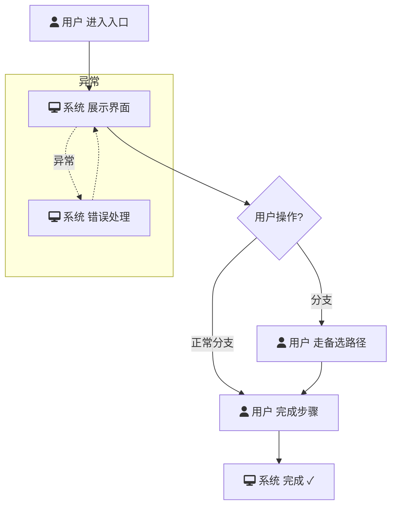

# 需求简报：[$ARGUMENTS]

## 1. 基本信息
- **业务名称**：[$ARGUMENTS]
- **场景类型**：全新功能 / 存量新增功能 / 功能优化
- **功能版本**：[1.0.0]
- **文档修订**：[E1]
- **创建日期**：[YYYY-MM-DD]
- **状态**：草稿 / 评审中 / 已确认
> 本简报为该版本需求澄清时点的**决策快照**：规则与用例以同版本 PRD 为准，PRD 修订轨迹见其第 1 章版本表与决策记录；澄清层变更（如待确认规则定案）经会议评审修订本文件并递增 E 编号。
- **负责人**：[昵称]<[工号]>

## 2. 需求背景与目标
### 背景摘要
[简要说明为什么要做这个功能，来源：用户反馈、业务规划、数据洞察等，200字以内]

### 核心目标
- **目标**：[一句话描述要达成的业务/用户价值]
- **成功指标**：[量化指标] + **归因逻辑**：[说明该指标如何归因于此功能]

## 3. 用户故事
| 角色 | 操作（想要...） | 价值（以便于...） | 来源 | 优先级 |
| :--- | :--- | :--- | :--- | :--- |
| [角色1] | [核心动作] | [获得的收益] | 用户提供 / AI补充 | P0 |
| [角色2] | [次要动作] | [获得的收益] | AI补充 | P1 |

> **优先级说明**：P0为本次必须上线，P1为建议包含，P2为后续迭代。

## 4. 核心业务规则
> **判定说明**：两问判定——①可判定（能写成「当 X 时系统必须/禁止/默认 Y」，或计算/契约）；②违反后是「错了」（数据错/越权/流程错/合规违规）而非「不一致」。仅双问通过者为规则、占 R 编号；其余为分流内容。

### 底线规则（不可妥协）
- [规则描述1]
  - **取舍逻辑**：[说明若取消该规则会带来什么风险或后果]

### 可妥协规则（可调整范围）
- [规则描述1]
  - **取舍逻辑**：[说明可以放宽的条件或妥协后的备选方案]

### 待确认规则（需澄清项）
> 规则含未定义判定参数（阈值/次数/时限）时列入本节。
- [规则描述1]
  - **待确认点**：[具体需要与业务/法务/技术澄清的问题]

### 分流内容（非规则——不占 R 编号，随流程/约定落地）
- `[类型-归属#X]` [触发方式/场景特化等，保留标记供 generate-prd 注入流程]
- `（约定）` [跨场景复用的统一做法（交互/显示），PRD 侧落 4.3 全局复用约定]

## 5. 主流程描述

用 Mermaid 流程图展示核心用户路径与关键分支，让读者快速理解功能运行方式：

> 示例说明：`[入口]` → `[步骤1]` → `{决策点}` → `[步骤2]` → `[完成]`。分支路径用实线，异常路径用虚线。角色图标使用 Font Awesome：`fa:fa-user` 代表用户，`fa:fa-desktop` 代表系统。
> **Mermaid 兼容性铁律**：边标签一律用引号形式 `|"文本"|`（裸 `|文本|` 遇全角标点会导致 mermaid v9 渲染失败）；子图必须带 ASCII ID + 引号标题 `subgraph SG1["标题"]`（裸中文标题 `subgraph 异常` 在 v9 下渲染失败）。

## 6. 原型与竞品参考
- **原型路径**：如本需求需制作原型，完成原型制作后补充原型路径。
- **竞品参考**：[竞品名称及核心参考点，可简述借鉴思路]

## 7. 需求本质洞察摘要
- **核心冲突**：[用户痛点与现有能力的矛盾点]
- **待验证假设**：[假如不成立会根本性改变需求方向或重要设计的判断；无则填"无。"]
- **最大风险点**：[上线前必须消除的不确定性]