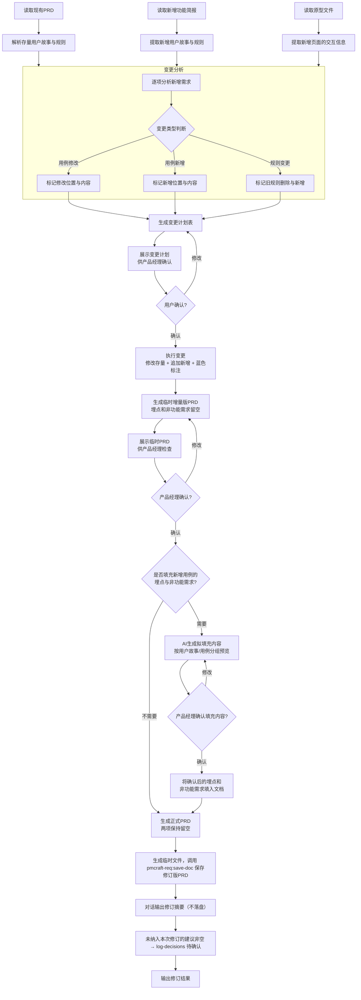

# PRD 增量修订 (append-prd)

## 概述

`append-prd` 是一个自动化文档修订技能，专门用于存量产品新增功能场景。它读取现有 PRD 和新增功能简报（以及可选的修改后的原型），生成增量修订版 PRD。

与 `pmcraft-req:generate-prd`（从零生成全新 PRD）和 `pmcraft-req:revise-prd`（根据审查报告修订 PRD）不同，`append-prd` 是在现有 PRD 的基础上进行**智能合并**：AI 逐项分析新增功能需求，自动判断哪些需要修改存量用例、哪些需要新增用例、哪些需要变更业务规则，生成变更计划供产品经理确认后执行。修改和新增的内容均以蓝色标注，与存量内容清晰区分。保存时通过 `pmcraft-req:save-doc` 统一管理版本目录和文件命名。由于版本目录和文档版本区分已经提供了完整的版本追溯，不再需要显式的原 PRD 备份步骤。

## Guard-Chat 守卫检查（第 0 步）

> 本小节为守卫开关检查，**不阻塞**主流程：执行完直接进入下一节。**子代理上下文**（被 spawn 执行、无法与用户交互，如 doc-reviewer/design-reviewer）整节静默跳过——不询问、不标记、不检测。

1. 运行 `node "{插件根}/_shared/scripts/guard-chat.js" status`，`{插件根}` = 从当前 SKILL.md 目录向上找第一个含 `_shared/scripts/guard-chat.js` 的祖先目录（source 环境=市场根，cache 环境=插件版本目录）。
2. 解析单行 JSON（契约：`{"status":"ok","data":{"enabled":bool,"prompted":bool,"dir":"…"}}`）：
   - `prompted=false` → 按话术库 GUARD-ASK（`enabled=false`）或 GUARD-ON（`enabled=true`）提示一次，然后运行 `node "{插件根}/_shared/scripts/guard-chat.js" mark-prompted`。用户紧随询问回复肯定意图（如「开启」），或任意轮次说「开启Guard-Chat」（路由表已注册）时，运行 `guard-chat.js enable`。
   - `prompted=true` → 跳过，不重复提示。
   - 话术库不可达（项目未跑 init-project、无大脑注入）→ 用兜底一句：「本会话可开启 Guard-Chat 守卫：开启后，你输入中可能影响判断的表述（如预设立场、权威宣称、逻辑谬误）会当场标注提醒；落盘文档中的对话填充语（如“好问题”、“希望对你有帮助”）会自动清除。说「开启Guard-Chat」开启（回复「开启」也可以），本会话只问一次。」（兜底非权威副本，有话术库时必须用话术库）
3. 脚本不可用（node 缺失/脚本缺失/JSON 解析失败）→ 静默跳过，继续主流程。
4. 本技能对话期间（仅 `enabled=true` 时）：① 每条用户消息经 `guard-chat.js detect`（stdin）检测，命中时单行简短标记，不打断流程；② 文档落盘前（save-doc 保存、直接写入报告文件）经 `guard-chat.js purify`（stdin）净化。规则见路由大脑「Guard-Chat 守卫行为」节。对话回复文风遵循 agent 定义的文风底线（无需脚本）。

## 加载策略总览

| 内容 | 加载时机 | fallback |
| :--- | :--- | :--- |
| `references/change-plan-template.md`（变更计划模板） | 第二步 2.3 生成变更计划时 | 依据 2.3 节"四种类型全部展示"规则与「变更类型说明」表自行构建同结构模板 |
| `references/revision-summary-template.md`（修订摘要模板 + 未纳入建议决策条目 JSON 模板） | 第五步步骤 4 对话输出修订摘要时 | 依据修订摘要必含字段（修订版本/修订日期/修订人/修改的存量用例/新增用户故事/新增用例/新增修改业务规则/文档版本变更/未纳入本次修订的建议）自行构建同结构模板 |

## 输入

| 参数 | 类型 | 必选 | 说明 | 示例 |
| :--- | :--- | :--- | :--- | :--- |
| 现有PRD路径 | 文件路径 | 是 | 存量PRD文档路径，符合模板格式 | `./账号系统/1.0.0/prd/账号系统_1.0.0_PRD_E2.md` |
| 新增功能简报路径 | 文件路径 | 是 | 新增功能需求简报路径 | `./账号系统/1.1.0/brief/账号系统_1.1.0_需求简报_E1.md` |
| 原型路径 | 目录路径 | 否 | 包含存量+新增页面的原型文件夹；未提供时基于简报推断以蓝色标注 | `./账号系统/1.1.0/prototype/` |

## 调用方式

```
append-prd <现有PRD路径> <新增功能简报路径> [原型路径]
```

- **现有PRD路径**：必选。存量 PRD 文档的完整路径，如 `./账号系统/1.0.0/prd/账号系统_1.0.0_PRD_E2.md`。
- **新增功能简报路径**：必选。新增功能需求简报的路径（由 `pmcraft-req:write-brief` 产出）。
- **原型路径**：可选。原型文件夹的路径（同一份原型，包含存量页面和新增页面的完整原型）。未提供时新增用例的主成功流程和交互描述基于简报和行业模式推断，以蓝色标注。

**示例**：
```
append-prd ./账号系统/1.0.0/prd/账号系统_1.0.0_PRD_E2.md ./账号系统/1.1.0/brief/账号系统_1.1.0_需求简报_E1.md ./账号系统/1.1.0/prototype/
```

## 输入要求

### 现有 PRD

- 必须严格遵循《产品需求文档模板》（`../../_shared/templates/prd_template.md`）格式。
- 包含完整的 `1. 文档版本`、`2. 背景`、`3. 产品目标`、`4. 总体规则`、`5. 用户故事` 等章节。
- 文档版本章节中记录了历史版本信息。
- 路径需要符合版本管理规范，技能将从中自动提取功能顶级文件夹和当前功能版本号（支持 `1.0.0` 和 `V1.0.0` 两种格式）。

### 新增功能简报

- 由 `pmcraft-req:write-brief` 命令产出的需求简报。
- 包含新增需求的背景、用户故事、核心业务规则等信息。
- 格式可参考 `examples/brief_example.md`。

### 原型文件

- 原型工具导出的前端资源文件夹，包含入口文件及关联的样式、脚本文件。
- 同一份原型，包含存量页面和本次新增的页面/组件。
- **支持的文件类型**：HTML、CSS、JavaScript；Vue 单文件组件（`.vue`）；React 组件（`.jsx`、`.tsx`）；以及相关的样式和脚本文件。

## 工作流程

该技能严格遵循以下处理流水线，与 `pmcraft-req:generate-prd` 一致，采用“先出结构，再按需填充细节”的模式：



## 详细步骤说明

### 第一步：读取与解析

1. **读取现有 PRD**：
   - **颜色标记检查**：详见 `../../_shared/templates/color_check_guideline.md` 中定义的检查流程。**若无法读取该指南文件** → 降级执行核心检查项：扫描文档中残留的 `<span style="color:blue;">` 标记数量与配对完整性（开闭标签一一对应），发现异常时在对话版修订摘要中标注"颜色标记检查降级执行"。
   - 解析文档结构，提取各章节内容。
   - 记录 `1. 文档版本` 中最新版本号（用于功能版本号递增）。
   - 记录 `5. 用户故事` 中所有现有用户故事标题，包括当前最大用户故事序号和最大用例序号。
   - 确定新增故事和用例的序号：新增用户故事序号 = 现有最大用户故事序号 + 1。新增用例序号 = 现有最大用例序号 + 1，后续用例序号依次递增（用例序号为全文统一排序，不按故事重置）。
   - 记录 `4. 总体规则` 中所有现有规则，确定新增规则的插入位置。
   - 从现有PRD路径中提取功能顶级文件夹和当前功能版本号。例如路径为 `./账号系统/1.0.0/prd/...`，则功能顶级文件夹为 `./账号系统`，当前版本为 `1.0.0`。

2. **读取新增功能简报**：
   - **颜色标记检查**：详见 `../../_shared/templates/color_check_guideline.md` 中定义的检查流程。**若无法读取该指南文件** → 降级执行核心检查项（蓝色标记配对完整性检查），发现异常时标注降级执行。
   - 提取新增需求的背景信息。
   - 提取新增用户故事列表（含角色、操作、价值、优先级）。简报中的用户故事应包含简短标题、故事描述、来源和优先级。
   - 提取新增核心业务规则。若规则内容包含 `[类型-归属#X]` 前缀标记（来自 pmcraft-req:write-brief 的分流标记），须在写入 PRD 前去除该标记，仅保留纯规则文本。
   - 提取主流程描述。

3. **读取原型文件**（可选）：
   - 若用户提供了原型路径，使用 `Read` 工具读取原型文件夹中的文件。
   - 支持的文件类型包括：HTML、CSS、JavaScript；Vue 单文件组件（`.vue`）；React 组件（`.jsx`、`.tsx`）；以及相关的样式和脚本文件。

   **原型目录结构解析（降级链）**：

   优先按以下顺序查找原型补充文件，使用最先匹配到的来源：

   1. **E-structure 目录（pmcraft-proto 产出）**：检查原型目录下是否存在 `E{max}/` 目录（即数字最大的 E 目录，如 `E3/`），若存在则从中读取：
      - `spec.md` — 原型功能规格说明
      - `page-inventory.md` — 页面清单（含页面名称、路由、核心元素）
      - `DESIGN.md` — 设计说明（含设计系统、组件规范、交互模式）
      - `pages/` — 页面文件目录（含各页面的 HTML/CSS/JS 源文件）
   2. **working 目录（传统原型）**：若无 E 目录，检查原型目录下是否存在 `working/` 目录，若存在则从中读取上述同名补充文件。
   3. **直接读取（传统模式）**：若以上均不存在，则直接读取原型目录下的页面文件（兼容旧版原型存放方式，无补充文件）。

   使用补充文件（spec.md、page-inventory.md、DESIGN.md）中的信息来增强对新增页面的交互理解，辅助变更分析中的交互信息提取。

   - 解析页面结构、组件模板和交互逻辑。
   - 提取与新增用户故事相关的页面、组件、弹窗、状态变化等交互信息。
   - **若未提供原型路径**，跳过此步骤，后续新增用例的主成功流程和交互描述基于简报和行业模式推断，以蓝色标注。

### 第二步：变更分析与计划确认

**核心理念**：AI 逐项分析新增功能需求，判断每项需求对存量 PRD 的影响类型，生成变更计划供产品经理确认，确保存量内容的修改得到人工许可。

> **决策记录参考**：在变更分析前，检查同版本目录 `decision/` 下是否存在决策记录文件。若存在，读取状态索引表。检查变更计划中是否有项目触碰已有决策的前提假设——若某条决策的前提假设在后续决策中被推翻或修改，主动向 PM 提示"此变更可能与旧决策前提冲突"，并展示相关决策编号和冲突摘要。

#### 2.1 确定功能版本号

- 从新增功能简报路径中提取版本号：若简报路径符合 `<顶级文件夹>/<版本号>/brief/` 模式（如 `./账号系统/1.1.0/brief/...`），提取其中的版本号（如 `1.1.0`）作为本次的功能版本号。
- 若简报路径无法推断版本号，则从现有 PRD 路径中提取当前功能版本号。
- 记录功能版本号，后续传递给第五步保存。

#### 2.2 变更分析

深入分析新增功能简报中的每项需求（若有原型则结合原型交互信息），对照存量 PRD 的所有用例、主成功流程、扩展流程、用例规则、总体规则，逐项判断变更类型：

| 类型 | 判定条件 | 处理方式 |
|:---|:---|:---|
| **用例修改** | 新功能是存量用例主流程的自然延伸，或对存量用例的某一步骤/规则/权限/验收标准进行补充或细化 | 在原用例中插入或修改，蓝色标注新增部分 |
| **用例新增** | 新功能独立于所有存量用例，有独立的参与者、主流程或业务目标 | 追加新用例到对应用户故事，或新建用户故事 |
| **规则变更** | 新功能导致第4章总体规则（专有术语/共同规则）需要修改/新增/废弃 | 旧规则保留加删除线并附原因，新规则用蓝色标注 |
| **数据与质量** | 新功能涉及数据埋点或非功能需求的补充，不影响现有用例和规则 | 追加到§6或§7表格，蓝色标注 |

**分析原则**：
- **规则归属判断**：用例表格内的"用例规则"属于用例私有，归为**用例修改**；第4章的总体规则（专有术语/共同规则）归为**规则变更**。
- 若不确定某项需求属于用例修改还是用例新增，优先判断为**用例新增**，避免误改存量内容。
- 若一项需求同时涉及修改和新增（如需要对存量步骤做前置修改，然后新增独立流程），拆分为"用例修改"和"用例新增"两个变更项分别标注。
- 原型中的新增页面不等于用例新增——如果新增页面的交互本质上是存量用例的扩展步骤，仍归为用例修改。

**范围边界检查**：分析变更时，逐项对照存量 PRD 第3章"产品目标"，判断新增需求是否与存量目标存在方向性冲突。若发现冲突：
> "此项新增需求与第3章产品目标'[目标描述]'存在潜在方向冲突（[冲突原因]）。建议确认：是否调整产品目标以覆盖此项需求，或将此项需求排除在本次范围之外？"

#### 2.3 生成变更计划

- 读取 `references/change-plan-template.md` 获取变更计划模板（变更类型说明图例表、四类变更表格模板、说明列写作要求、用户确认交互文案）。如果 Read 失败，依据本节"四种类型全部展示"规则与「变更类型说明」表自行构建同结构模板。

将分析结果整理为变更计划表，向用户展示。变更计划表必须严格遵循以下规则：
- **四种类型全部展示**，不得自行增删分类。没有变更的类型标注"本次无此项变更"。
- **分类图例表（类型/含义/操作方式）**必须与模板完全一致，不得修改表格行数和字段内容。
- **各类型的变更项**列在对应分类下方，按模板格式填写。

#### 2.4 用户确认

- 用户可逐条确认、修改或拒绝变更计划中的每一项。
- 若用户对某条有疑问，AI 展示该条在原文中的位置和上下文，解释变更理由。
- 用户确认后进入执行阶段。确认结果包括：
  - **采纳**：按计划执行
  - **修改**：按用户指示调整后执行
  - **跳过**：该项不做任何变更

### 第三步：执行变更并生成临时 PRD

**重要**：不要直接修改现有 PRD 文件。以下所有变更在 AI 上下文中构建完整内容，最后通过 pmcraft-req:save-doc 保存为新文件（E 编号递增），原文件始终保持不变。

**PRD 生成严格遵循《产品需求文档模板》（`../../_shared/templates/prd_template.md`）的以下规范：**

#### 3.1 执行存量用例修改

- 根据已确认的变更计划，逐一定位到存量用例的对应字段。
- **主成功流程新增步骤**：在原步骤列表中插入新步骤。新步骤的序号接续前一步，如原步骤最大为 3，新增从步骤 4 开始。新增步骤用 `<span style="color:blue;">` 包裹。若在现有步骤之间插入（如步骤 2 和 3 之间），将原步骤 3 及后续的步骤序号整体 +1，插入步骤标为 "2a" 或重新编号。
- **扩展流程新增分支**：在对应异常分类下追加新分支，用蓝色标注。
- **用例规则新增**：在存量规则后追加新规则，用蓝色标注。
- **权限控制补充**：在原有权限基础上补充新增角色的权限描述，用蓝色标注。
- **验收标准补充**：在对应分组（正常流程/异常流程/边界条件/权限控制）后追加新标准，用蓝色标注。
- **存量内容保持不变**：未被变更计划标记的存量文字保持原样和原颜色，不做任何改动。

#### 3.2 追加新增用例

- 在 `5. 用户故事` 章节末尾（或归属故事的末尾），追加新增用户故事或用例。
- 标题格式：`### 5.[序号] 故事[序号]：[故事标题]（优先级）`。
- 新增用例的起始序号 = 现有最大用例序号 + 1，全文统一排序。
- 用例具体内容以**两列表格**形式组织（左侧字段名，右侧内容），字段顺序如下：

   | 字段 | 内容格式要求 |
   | :--- | :--- |
   | **参与者** | 主要参与者（主）[、次要参与者（次）] |
   | **主成功流程** | 步骤列表，每步以 `1. ` 开头。优先结合原型交互描述；若无原型则基于行业模式推断并以蓝色字体标注。 |
   | **扩展流程** | 按**业务异常**、**系统故障**、**外部依赖异常**分组。AI 推断或补充的部分以蓝色字体标注。 |
   | **用例规则** | 列表形式。AI 推断的规则以蓝色字体标注。 |
   | **权限控制** | 列表形式。AI 推断的权限以蓝色字体标注。 |
   | **验收标准** | 按**正常流程**、**异常流程**、**边界条件**、**权限控制**分组。 |

   整个新增用例的内容（含所有字段）均用蓝色标注。

#### 3.3 执行规则变更

- 在 `4. 总体规则` 中定位到被变更的存量规则。
- **修改规则**：存量规则保留原文，在其后追加新规则。存量规则加删除线 `~~`，新规则用 `<span style="color:blue;">` 标注。
- **删除规则**：存量规则保留原文加删除线，后附原因 `（原因：...）`。
- **新增规则**：在 `4.2 共同规则` 末尾追加新的规则条目，用蓝色标注。若与存量规则有关联，在规则后添加备注说明（备注不需颜色标注）。带「(约定)」标记的条目不进 4.2——路由至 `4.3 全局复用约定` 末尾追加（蓝色标注，不占 R 编号，沿用来源编号或不编号）。

#### 3.4 更新文档版本记录

- 在 `1. 文档版本` 表格顶部新增一行（最新记录放最前）。
- 填入第二步确定的功能版本号和文档修订。
- 修订人、修订时间按 `../../_shared/templates/prd_template.md` 第 1 章填写说明填写；**修订简介按新格式**"来源：{输入源}<br>新增（{章节定位}）：…<br>修改（{章节定位}）：…<br>删除（{章节定位}）：…"填写——{输入源}取新增简报E{N}或功能优化简报E{N}（N 为简报文件名 E 编号），{章节定位}与变更位置一致；格式规则见 `../../_shared/templates/prd_template.md` 第 1 章填写说明。

#### 3.5 更新数据埋点与非功能需求章节

- 若存量 PRD 的第6章（数据埋点）和第7章（非功能需求）已有数据：
  - **用例修改**的新增埋点/NFR：以行形式追加到对应章节的表格中，用蓝色标注。
  - **用例新增**的新增埋点/NFR：暂留空（第三步填充）。
- 若存量 PRD 的第6章和第7章为空：保持空，等待第三步按需填充。

#### 3.6 文档结尾

- 以第 9 章原型图结束。若文档末尾存在模板之外的额外信息，保留原样不变。

**生成完成后，向用户展示临时增量版 PRD 的完整内容，并提示：**
“这是临时 PRD，已按变更计划执行修改和新增，但新增用例的数据埋点和非功能需求暂时留空。请检查变更内容是否准确，如有修改请告知。”

### 第四步：按需填充新增用例的埋点与非功能需求

1. **询问是否填充**：
   - 在用户确认临时 PRD 无误后，询问：“是否需要我补充新增用例的数据埋点和非功能需求？”

2. **如果用户回复“不需要”**：
   - 则这两项保持留空，直接进入保存阶段。

3. **如果用户回复“需要”**：
   - AI 根据新增用例的功能描述、流程、业务规则等，生成拟填充的**数据埋点**和**非功能需求**内容。
   - **展示格式**：拟填充内容按新增用例分组，每行对应第6章或第7章大表中的一行数据。
   - 生成时遵循新章节的表格格式规范：
     - 第6章数据埋点表头：`| 用户故事 | 用例 | 埋点主题 | 埋点内容（字段：触发时机，统计目标） |`
     - 第7章非功能需求表头：`| 用户故事 | 用例 | 需求内容 |`
   - 将拟填充的内容以 **蓝色字体** 呈现，按用例分组展示供用户确认。
   - 向用户展示拟填充内容，并说明：“以下是我建议的数据埋点和非功能需求，将填入第6章和第7章的独立表格中。你可以全盘采纳，或告诉我需要修改/删除哪些条目。”
   - 产品经理可以回复：
     - “确认” → 将内容以行形式填入第6章和第7章的独立表格中。
     - “把 [某条] 改成 [新内容]” → 按指示修改后填入。
     - “删除 [某条]” → 删除对应行后填入。
     - “全部不用” → 放弃填充，两项留空。
   - 依据最终确认结果，将内容写入正式 PRD 的第6章和第7章独立表格中。

### 第五步：输出与保存

1. **确定功能顶级文件夹**：
   - 技能已在第一步从现有PRD路径中提取功能顶级文件夹，此处直接使用。

2. **确认功能版本号**：
   - 直接使用第二步从简报路径提取的版本号（如 `1.1.0`），不再向用户确认。

3. **保存修订版 PRD**：
   - 调用 `pmcraft-req:save-doc` 前须执行预保存质量检查（详见 `../save-doc/SKILL.md#预保存质量检查`），包括 Mermaid 闭合、蓝色标签配对、占位符替换、版本号格式四项。
   - 将修订后的完整内容写入临时文件，位置统一为**项目根 `pmcraft/temp/`**（若不存在则先创建；命名 `{功能名}_PRD_增量修订_{yyyy-MM-dd}.draft.md`）。**禁止写入系统 Temp 或 cwd**——save-doc 复制后临时文件即被删除，写入项目内临时区确保中途失败时产物可追踪。
   - AI 根据变更内容自动生成内容摘要（如"追加直播带货用例，修改分润规则第3条"），从用户信息中获取负责人。
   - 调用 `Skill` 工具，技能名称为 `pmcraft-req:save-doc`，传入参数：
     - 功能顶级文件夹路径
     - 确认后的功能版本号（支持 `1.0.0` 和 `V1.0.0` 两种格式）
     - 文档类型 `PRD`
     - 临时文件路径
     - 内容摘要与负责人分别以 `--summary` 和 `--author` 参数传入（参数说明见 `../save-doc/SKILL.md` 参数表；`_index.md` 的摘要与负责人列由脚本据此维护）
   - `pmcraft-req:save-doc` 将自动创建完整的版本目录树、确定 E编号、完成保存、更新 `_index.md`，并返回最终路径。

4. **对话输出修订摘要**：
   - 读取 `references/revision-summary-template.md` 获取修订摘要模板与未纳入建议决策条目 JSON 模板。如果 Read 失败，依据修订摘要必含字段（修订版本/修订日期/修订人/修改的存量用例/新增用户故事/新增用例/新增修改业务规则/文档版本变更/未纳入本次修订的建议）自行构建同结构模板。
   - 按该模板结构在对话中输出修订摘要（修改的存量用例/新增用户故事/新增用例/新增修改业务规则/文档版本变更/未纳入本次修订的建议）。
   - **禁止写入临时文件，禁止调用 `pmcraft-req:save-doc`，禁止保存到 `report/`**——变更轨迹已并入 PRD 第 1 章修订简介。
   - 若「未纳入本次修订的建议」非空 → 执行第 4.5 步。

4.5 **未纳入建议记入决策记录**：调用 `Skill` 工具 `pmcraft-req:log-decisions`，参数 `action=append`、`version_dir` 为当前版本目录、`decisions_file` 为写入 `pmcraft/temp/` 的条目 JSON（每条建议一条，内容模板见 `references/revision-summary-template.md`）、`source=append-prd`；不传 `state_updates_file`。
   - **若 `decision/` 目录下尚无决策记录文件**（首次调用）：先以 `action=create` 创建决策记录（首条即本次条目），再以 `action=append` 追加其余条目——append-decisions.js 在无存量决策记录时会拒绝执行，必须先 create。create 模式须按 `pmcraft-req:log-decisions` 契约补齐必选参数：`brief_path`（新增功能简报路径）、`func_name`（功能名）、`scene_type`（场景类型，如 `存量新增功能`）、`author`（负责人）。

5. **向用户汇报**：
   ```
   ✅ 增量修订完成。
   - 修订版PRD：[pmcraft-req:save-doc 返回的路径]
   - 修订摘要：已在对话中展示（不落盘；{N} 条未纳入建议已记入决策记录）

   📝 新增内容（蓝色标注）：
   - 用户故事X：[故事标题]
   - 用例X：[用例标题]
   - 新增规则：[规则摘要]

   🔍 人工复核修订版PRD中的蓝色内容，确认后将蓝色改为黑色。
   ```

   **填充规则**：修订版PRD路径为 `pmcraft-req:save-doc` 实际返回的最终路径（E编号自动分配），不得使用临时文件路径；修订摘要不落盘，仅在对话中展示；{N} 为未纳入建议条数（为 0 时该短语省略）；"新增内容（蓝色标注）"清单只列本次变更计划中实际执行的项目（①用例修改/②用例新增/③规则变更），未执行的类型不列出；"人工复核"提示在每次保存后都必须输出。

6. **Gate 2 审查关隘入口**：
   - 保存完成后，向用户展示 **GATE-2 模板**（话术库，见 CLAUDE.md「话术模板库」节）：

   > "【PRD 审查】修订版 PRD 已完成。根据审查把关线（Gate 2），建议执行审查：
   > - **PRD 审查（review-prd）**：对修订版 PRD 进行完整性、风险性、逻辑性三维审查
   > - **一致性检查（check-consistency）**：验证修订版 PRD 与原型之间的一致性（需原型已产出）
   >
   > 请选择（可多选，如「1+2」）或回复 **跳过**：
   >
   > （评审提示：版本目录 `_README/`《评审与开发必读指南》由 save-doc 自动维护（双击 _README/README.html 门户即读），评审前可先打开获取全貌）"

   - 用户选择后，对每个选中的审查，通过 `Agent` 工具 spawn **doc-reviewer** 子智能体：
     - `subagent_type`: `"doc-reviewer"`
     - `prompt`: 传入审查技能名（`pmcraft-req:review-prd` / `pmcraft-req:check-consistency`）+ 刚保存的修订版 PRD 文件路径 + 原型路径（若适用）
     - **正式落盘指令**（必须，区分审查类型）：
       - **review-prd**（综合审查）：prompt 明确"审查报告完成编写后，**必须调用 `pmcraft-req:save-doc` 正式保存**（文档类型 `综合审查报告`，功能顶级文件夹与版本号从传入的 PRD 路径推断——其为正式路径，含 `<顶级文件夹>/<版本号>/` 结构）。**禁止只写临时区不落盘**——综合审查报告的正式保存是流程硬性要求，主对话不再补做"
       - **check-consistency**（一致性检查）：prompt 明确"审查报告写入**项目根 `pmcraft/temp/`**（若不存在则先创建），文件名 `{功能名}_一致性检查报告_{yyyy-MM-dd}.md`；若当天已存在同名文件，追加轮次后缀 `_r{N}`（N 从 2 递增），**禁止覆盖早轮报告**——收敛小循环同日多轮需保留每轮差异清单供单调性对比。**写入 `pmcraft/temp/` 即为最终产物，不再调用 `pmcraft-req:save-doc`**——无 E 编号、不进 `_index.md`"
     - **先后顺序（禁止并行）**：一致性检查的对象必须是定稿 PRD（见 CLAUDE.md「Gate 2 收敛小循环」），**禁止并行 spawn review-prd 与 check-consistency**——并行执行会导致修订后报告作废。先 spawn review-prd；若用户选择基于审查发现再次修订（`pmcraft-req:revise-prd`），定稿后再 spawn check-consistency；收敛复查最多 3 轮，超限输出剩余差异清单停止循环。
   - 如果用户回复"跳过"：进入后续流程
   - 审查完成后，展示报告路径，询问："是否基于审查发现修改修订版 PRD？"
     - 若是：建议使用 `pmcraft-req:revise-prd` 进行修订
     - 若否：流程结束

7. **出口衔接（话术库 NEXT-TAIL）**：修订完成后，输出收尾序列下一环（已产出环节跳过，按 流程图→时序图→测试用例 顺序）：

   > "增量修订已完成。req 域剩余收尾：流程图（若 flowchart/ 为空或已过期）→ 时序图（若 PRD 第 8 章待补充）→ 测试用例（若 testcase/ 为空或已过期）。直接说「继续收尾」即可。"


## 参考文档

| 文档 | 加载时机 |
|:---|:---|
| `../../_shared/templates/prd_template.md`《产品需求文档模板》 | 生成增量内容时（结构必须严格符合） |
| `../../_shared/templates/prd_guidelines.md`《产品需求文档指引》 | 撰写各章节时（写作规范） |
| `../generate-prd/SKILL.md`《PRD 生成》 | 用例格式规范对齐 |
| `../save-doc/SKILL.md`《文档保存》 | 通过 save-doc 保存文档时 |
| `references/change-plan-template.md` 变更计划模板 | 第二步 2.3 生成变更计划时；Read 失败按「四种类型全部展示」规则自建 |
| `references/revision-summary-template.md` 修订摘要与未纳入建议模板 | 第五步步骤 4 对话输出修订摘要时；Read 失败按节名与字段要求自建（"禁止落盘"约束常驻） |

## 禁止行为

1. **禁止直接修改原 PRD 文件** — 所有变更在 AI 上下文中构建完整内容，通过 `pmcraft-req:save-doc` 保存为新文件（E 编号递增），不覆盖历史版本
2. **禁止跳过变更范围分析** — 必须先明确"修改存量用例/新增用例/规则变更"的分类，再生成增量修订版 PRD
3. **禁止新增内容不标注蓝色** — 增量修订的蓝色标注规范须与 revise-prd 一致，确保只有本次新增为蓝色
4. **禁止编造未确认的新功能** — 变更范围必须来自简报/存量 PRD 确认，不得自行扩大需求边界
5. **禁止跳过修订摘要输出** — 每次保存后必须在对话中输出修订摘要（修改的存量用例/新增用户故事/新增用例/新增修改业务规则/文档版本变更/未纳入建议，结构见 `references/revision-summary-template.md`），供 PM 审阅；修订摘要仅对话展示，禁止落盘（禁止写入临时文件或调用 save-doc 保存到 report/）
6. **禁止遗漏未纳入建议** — 「未纳入本次修订的建议」非空时必须逐条追加为待确认决策条目，不得静默丢弃

## 正误示例

### 正确示例
```
append-prd ./账号系统/1.0.0/prd/账号系统_1.0.0_PRD_E2.md ./账号系统/1.1.0/brief/账号系统_1.1.0_需求简报_E1.md ./账号系统/1.1.0/prototype/
```
预期：读取三份输入，生成变更计划，确认后执行修订，保存修订版PRD；对话输出修订摘要（不落盘）；未纳入建议记入决策记录。

### 错误示例

**错误**: 使用新建功能的简报和全新PRD
```
append-prd ./新项目/1.0.0/prd/新项目_1.0.0_PRD_E1.md ./新功能简报.md ./prototype/
```
- 问题：append-prd 用于存量产品新增功能场景，需要已有 E1 以上的 PRD 文档。若该功能是全新功能，应使用 `pmcraft-req:generate-prd` 直接生成首次 PRD。
- 正确做法：全新功能使用 `pmcraft-req:generate-prd`；存量新增功能（PRD已有至少一个版本）使用 `append-prd`。

**错误**: 原型的版本与简报版本不匹配
```
append-prd ./账号系统/1.0.0/prd/... ./账号系统/1.1.0/brief/... ./账号系统/1.0.0/prototype/...
```
- 问题：原型应反映新增功能后的完整状态（包含存量+新增），应与简报版本一致。
- 正确做法：使用与简报相同版本目录下的原型路径。

**错误**: 变更计划未获用户确认即直接执行修订
```
append-prd ./账号系统/1.0.0/prd/账号系统_1.0.0_PRD_E2.md ./账号系统/1.1.0/brief/账号系统_1.1.0_需求简报_E1.md
```
- 问题：直接执行修订、跳过变更计划确认环节，在用户未逐条确认的情况下修改存量内容，违反「约束」第1条（禁止跳过变更计划确认）。
- 正确做法：先展示完整变更计划（四类变更全部展示），等待用户回复"确认"/"修改第N项为…"/"跳过第N项"后再进入执行阶段。

## 边缘情况处理

| 场景 | 触发条件 | 处理方式 | 示例回复 |
| :--- | :--- | :--- | :--- |
| 所有新增需求均为"用例修改" | 无独立新用例，全部为存量扩展 | 变更计划仅含"用例修改"类型，注明"本次无需新增用例" | "所有新增需求均可归入存量用例的扩展，无需新建用例。变更计划已列出所有修改位置。" |
| 原型文件不存在或无法读取 | 原型路径无效或目录为空 | 新增用例的主成功流程基于简报和行业模式推断，蓝色标注比例高 | "原型不可用，所有新增用例流程将基于简报描述和行业模式推断，蓝色标注比例较高。建议补充原型后重新生成。" |
| 简报路径无法提取版本号 | 简报路径不符合版本目录规范 | 从现有PRD路径提取版本号作为备用 | "无法从简报路径提取版本号，已使用现有PRD的版本号 1.0.0。如需使用新版本号请告知。" |
| 简报文件存在但内容为空 | 简报无用户故事或业务规则可提取 | 中止流程，提示用户先通过 pmcraft-req:write-brief 补全简报后重试 | "简报为空，无法提取新增需求。请先完成需求简报后再执行追加。" |
| 变更计划所有项均被跳过 | 用户对全部变更项回复"跳过" | 不执行任何变更，输出"未执行任何修订"，存量PRD保持不变 | "所有变更项均被跳过，本次未执行任何修订，存量PRD保持不变。" |

## 常见错误

1. **在全新功能上使用 append-prd** — 首次 PRD 应使用 `pmcraft-req:generate-prd`，`append-prd` 用于存量追加。
2. **原型版本与简报版本不匹配** — 原型应反映新增功能的完整状态，与简报同版本。
3. **确认变更计划前跳过所有项** — 若不执行任何变更，输出"未执行任何修订"。

## 快速参考

| 参数 | 说明 |
|:---|:---|
| 输入 | `append-prd <现有PRD> <新增简报> [原型]` |
| 变更类型 | 用例修改 / 用例新增 / 规则变更 / 数据与质量 |
| 输出 | 修订版 PRD（E编号+1）+ 对话版修订摘要（不落盘）+ 决策记录追加（未纳入建议） |

## 评价测试用例

### 正向触发（5条）
1. `append-prd <存量PRD> <新增简报> <原型>` — 预期：完整五步流程（读取解析→变更分析与确认→执行变更→按需填充→保存输出），生成修订版PRD
2. 新增需求同时涉及用例修改和用例新增 — 预期：变更计划正确分类，执行时修改和新增分别处理
3. 新增功能简报含新增业务规则 — 预期：在规则变更中列出，旧规则保留删除线
4. 用户选择填充新增用例的埋点/NFR — 预期：仅对新增用例生成填充建议，存量部分不动
5. 修订版PRD保存为E编号递增文件 — 预期：原PRD保持不变，新文件E编号+1

### 负向触发（5条）
1. `append-prd`（无参数） — 预期：提示需要PRD路径和简报路径
2. `append-prd ./不存在的PRD.md ./简报.md` — 预期：报错"PRD文件不存在"
3. `append-prd <PRD> ./不存在的简报.md` — 预期：报错"简报文件不存在"
4. `append-prd <PRD> <非append-prd兼容的简报> <原型>` — 预期：提示简报格式不符
5. 用户确认变更计划时跳过所有变更项 — 预期：不执行任何变更，输出"未执行任何修订"

### 边界查询（4条）
1. 存量PRD已有蓝色标注内容（来自之前修订） — 预期：存量文字与颜色保持原样（存量内容不变原则），仅本次新增/修改内容标蓝；需清理历史蓝色标注时提示由 `pmcraft-req:revise-prd` 统一处理（颜色标注清理由 revise-prd 管理，见注意事项#3 与 CLAUDE.md 执行纪律）
2. 新增功能涉及10+个用例修改和5+个用例新增 — 预期：变更计划全部列出，不截断
3. 简报中用户故事优先级与存量PRD中的规则冲突 — 预期：在变更计划中标注冲突，等待用户裁决
4. 「未纳入本次修订的建议」非空 — 预期：对话版摘要列出全部建议，每条追加为待确认决策条目（D 编号接续），report/ 下不产生新文件

## 约束

1. **禁止跳过变更计划确认** — 变更计划必须逐条向用户展示并获取明确确认（"确认执行"），不得在用户未确认的情况下直接执行变更。
2. **禁止跳过 PRD 模板结构** — 新增内容和修改部分的章节编号、标题名称、字段顺序、表格结构必须与 `../../_shared/templates/prd_template.md` 完全一致。
3. **禁止合并事实与推断** — AI 推断、补充的内容必须用蓝色标注，不得与黑色事实混用。
4. **禁止直接修改原文件** — 所有变更在 AI 上下文中构建完整内容，通过临时文件和 pmcraft-req:save-doc 保存为新文件（E编号递增），不得直接使用 Write 工具修改现有 PRD 文件。
5. **禁止在原型缺失时编造交互** — 原型缺失时新增用例的主成功流程基于简报和行业模式推断，并以蓝色标注；不得编造不存在的交互细节。
6. **禁止跳过 Mermaid 闭合检查** — 生成或修改包含 Mermaid 流程图的内容时，在调用 `pmcraft-req:save-doc` 前必须验证临时文件的每个 Mermaid 代码块均已正确闭合。使用 `tail -3 <临时文件> | grep -c '^```$'` 确认文档以闭合标记结束（计数为 1 即最后一行闭合，计数为 0 则未闭合），并全文核对每个 ```` ```mermaid ```` 起始标记都有对应的闭合行。

## 注意事项

1. **智能变更原则**：AI 逐项分析新增功能需求，自动判断属于"修改存量用例""新增用例""规则变更"或"无影响"，生成变更计划供产品经理确认后执行。变更计划未覆盖的存量内容保持原样，不做任何改动。
2. **用例序号全文统一**：新增用例的序号接续现有最大用例序号，全文连续递增，不因用户故事切换而重置。
3. **颜色标注规则**：蓝色 `<span style="color:blue;">` = AI 推断的新增或修改内容，统一用于所有新增用例、存量修改和规则变更。颜色标注清理由 `pmcraft-req:revise-prd` 统一管理。
4. **原型依赖**：需要原型路径有效且可正常预览。若原型读取失败，新增用例的主成功流程将仅基于简报描述和行业模式推断生成，蓝色文字比例较高。
5. **版本号来源**：版本号从新增功能简报路径中提取（反映 `pmcraft-req:write-brief` 阶段的产品经理决策），支持 `1.0.0` 和 `V1.0.0` 两种格式，直接使用无需确认。
6. **原型解析局限性**：原型为前端源码的静态分析，未在浏览器中实际运行。对于依赖 API 响应的动态渲染、异步数据流等交互行为，技能基于模板结构和逻辑进行推断，可能无法完全准确识别。推断内容以蓝色标注。
7. **文档结尾**：以第 9 章原型图结束。若原文档末尾存在额外信息，保留原样不变。
8. **填充确认**：新增用例的埋点和非功能需求的填充不是强制环节，完全由产品经理决定；若需填充，AI 提供的建议均需确认后才写入第6章和第7章独立表格中。
9. **结构化展示**：填充环节按用例组织数据埋点和非功能需求行，以表格行形式追加到第6章和第7章的大表中，没有建议填充的用例直接跳过。
10. **保存规范**：修订版 PRD 通过 pmcraft-req:save-doc 保存到 prd/ 目录下，E 编号自动管理；修订摘要不再落盘，仅在对话中展示。
11. **未纳入建议**：非空的未纳入建议必须记入决策记录（status 待确认），供后续迭代追溯。
