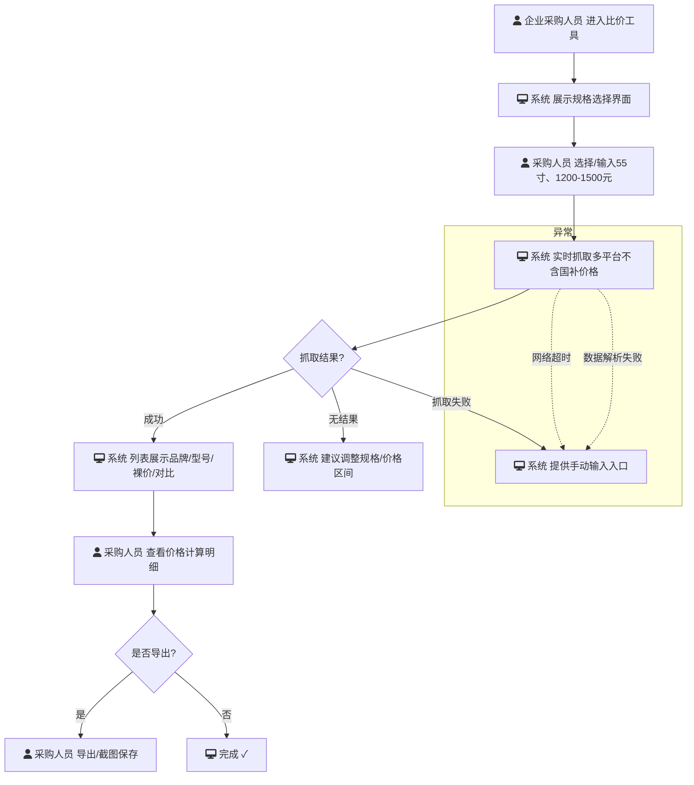

# 需求简报：电视比价

## 1. 基本信息
- **业务名称**：电视比价
- **场景类型**：全新功能
- **功能版本**：1.0.0
- **文档修订**：E1
- **创建日期**：2026-04-15
- **状态**：修订版
- **负责人**：王五<1003>

## 2. 需求背景与目标
### 背景摘要
企业采购电视时无法享受国家补贴，电商平台默认展示补贴后价格，导致采购人员难以快速获取不含国补的真实价格，手动比价耗时长、易出错。近期采购量上升，急需一个专门工具去除国补后对比55寸、1200-1500元价位电视的价格，以控制预算并提升效率。

### 核心目标
- **目标**：为企业采购人员提供快速、准确的不含国补电视价格对比工具。
- **成功指标**：比价耗时从当前约1小时缩短至1分钟内；价格准确性达到99%以上。归因逻辑：工具使用率与用户主动提交的比价结果满意度评分直接关联。

## 3. 用户故事
| 角色 | 操作（想要...） | 价值（以便于...） | 来源 | 优先级 |
| :--- | :--- | :--- | :--- | :--- |
| 企业采购人员 | 快速查看55寸电视在1200-1500元价位的不含国补价格 | 在预算内选择最具性价比的电视 | 用户提供 | P0 |
| 企业采购人员 | 对比不同品牌同规格电视的真实价格 | 向领导汇报时提供清晰的比价依据 | 用户提供 | P0 |
| 企业采购人员 | 当价格抓取失败时收到明确错误提示并手动输入参考价格 | 不中断采购流程 | AI补充 | P1 |
| 企业采购人员 | 当无符合条件电视时看到调整规格或价格区间的建议 | 重新制定采购计划 | AI补充（旅程审查强化） | P1 |
| 财务审批人员 | 查看比价历史记录和采购决策依据 | 审计时追溯采购合理性 | AI补充 | P1 |

> **优先级说明**：P0为本次必须上线，P1为建议包含，P2为后续迭代。

## 4. 核心业务规则
### 底线规则（不可妥协）
- 显示的价格必须去除国家补贴。
  - **取舍逻辑**：若保留国补，企业采购成本核算不准，预算偏差不可接受。
- 用户必须输入或选择55寸电视规格。
  - **取舍逻辑**：若允许其他尺寸，可能超出会议室标准或预算失控。
- 价格区间限定为1200-1500元。
  - **取舍逻辑**：若放宽区间，比价结果不聚焦，预算超支风险增加。

### 可妥协规则（可调整范围）
- 完成一次比价的时间目标应少于1小时。
  - **取舍逻辑**：可接受首次使用耗时略长，但需保证重复使用效率显著提升。
- 系统需同时支持电脑和手机访问。
  - **取舍逻辑**：首期可仅支持电脑，手机适配作为后续迭代项。
- 当价格抓取失败时，系统必须提供手动输入参考价格的备选方案。
  - **取舍逻辑**：手动输入虽降低体验，但保障核心流程不中断。
- 当无符合条件电视时，系统必须提供明确的引导和建议。
  - **取舍逻辑**：空结果无引导将导致用户流失，必须有替代路径。
- 系统应展示价格计算的透明依据。
  - **取舍逻辑**：透明度是建立信任的关键，不可完全省略，但展示形式可简化。

### 待确认规则（需澄清项）
- 比价结果的准确性要求达到99%。
  - **待确认点**：准确性99%是硬性指标还是可协商（如95%也可接受）？需要与技术评估抓取方案的可行性后确认。
- 系统需独立使用，不集成其他采购或审批系统。
  - **待确认点**：独立使用是否意味着完全不需要登录或权限验证？需与安全团队确认。
- 价格区间1200-1500元是固定值还是可动态调整？
  - **待确认点**：是否预留区间调整入口供用户自定义？需与业务方确认。
- 结果导出应支持哪些格式？
  - **待确认点**：优先支持截图、Excel还是其他格式？需与用户确认高频使用场景。

## 5. 主流程描述

## 6. 原型与竞品参考
- **原型路径**：`./1.0.0/prototype/`（本示例未实际制作原型）
- **竞品参考**：营客通（裸价展示）——借鉴其去除补贴后价格直接展示的方式，但需强化透明度与异常处理。

## 7. 需求本质洞察摘要
- **核心冲突**：企业采购需要去除国补的真实成本与电商平台展示补贴后价格的矛盾；高准确性要求（99%）与价格抓取技术风险之间的矛盾；参数严格限制（55寸/1200-1500元）与用户期望灵活性的矛盾。
- **待验证假设**：采购人员愿意使用独立比价工具（非集成系统）；55寸/1200-1500元价格区间固定且合理；比价时间可从1小时显著缩短；用户信任工具提供的价格准确性；异常状态下用户愿意使用手动输入备选方案。
- **最大风险点**：电商平台价格抓取稳定性与国补算法动态变化；价格信息滞后导致采购决策偏差；用户对工具准确性的信任度不足；异常状态下的用户流失。