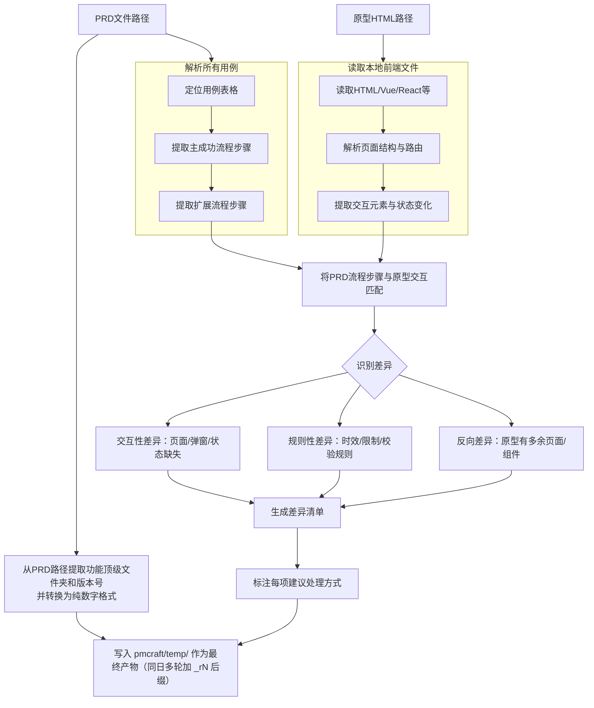

# 文档与原型一致性检查

## 概述

`check-consistency` 是一个文档与原型一致性校验技能。当你提供一份 **PRD 文档** 和对应的 **原型文件路径** 时，它会：

1. **解析 PRD 用例流程** — 提取所有用例的主成功流程与扩展流程中描述的交互步骤。
2. **解析原型交互元素** — 读取本地前端文件（支持 `.html`、`.vue`、`.jsx`、`.tsx`），提取实际存在的页面、弹窗、状态变化等交互组件。**这是正/反向匹配的穷举基线；Playwright 不再承担枚举**（见第二步）。
3. **对比分析** — 将 PRD 流程步骤与原型交互元素进行双向匹配，识别三类差异：
   - **交互性差异**：PRD 中提到但原型中未体现的页面、弹窗、状态变化等可视交互。
   - **规则性差异**：PRD 中定义但原型中无法直观体现的业务规则（如时效、限制条件）。
   - **反向差异**：原型中存在但 PRD 中未描述的可视交互（多余的页面、弹窗、组件），提示可能需要补充 PRD 或移除原型多余内容。
4. **输出差异清单** — 生成结构化差异报告，并为每一项差异标注建议处理方式（“需补充到原型”、“可仅在文档中备注”或“需确认PRD是否遗漏”）。
5. **落盘** — 将差异报告直接写入项目根 `pmcraft/temp/`（命名 `{功能名}_一致性检查报告_{yyyy-MM-dd}.md`，同日多轮加 `_r{N}` 后缀），作为过程性审查产物留存，不调用 `pmcraft-req:save-doc`、无 E 编号。

## Guard-Chat 守卫检查（第 0 步）

> 本小节为守卫开关检查，**不阻塞**主流程：执行完直接进入下一节。**子代理上下文**（被 spawn 执行、无法与用户交互，如 doc-reviewer/design-reviewer）整节静默跳过——不询问、不标记、不检测。

1. 运行 `node "{插件根}/_shared/scripts/guard-chat.js" status`，`{插件根}` = 从当前 SKILL.md 目录向上找第一个含 `_shared/scripts/guard-chat.js` 的祖先目录（source 环境=市场根，cache 环境=插件版本目录）。
2. 解析单行 JSON（契约：`{"status":"ok","data":{"enabled":bool,"prompted":bool,"dir":"…"}}`）：
   - `prompted=false` → 按话术库 GUARD-ASK（`enabled=false`）或 GUARD-ON（`enabled=true`）提示一次，然后运行 `node "{插件根}/_shared/scripts/guard-chat.js" mark-prompted`。用户紧随询问回复肯定意图（如「开启」），或任意轮次说「开启Guard-Chat」（路由表已注册）时，运行 `guard-chat.js enable`。
   - `prompted=true` → 跳过，不重复提示。
   - 话术库不可达（项目未跑 init-project、无大脑注入）→ 用兜底一句：「本会话可开启 Guard-Chat 守卫：开启后，你输入中可能影响判断的表述（如预设立场、权威宣称、逻辑谬误）会当场标注提醒；落盘文档中的对话填充语（如“好问题”、“希望对你有帮助”）会自动清除。说「开启Guard-Chat」开启（回复「开启」也可以），本会话只问一次。」（兜底非权威副本，有话术库时必须用话术库）
3. 脚本不可用（node 缺失/脚本缺失/JSON 解析失败）→ 静默跳过，继续主流程。
4. 本技能对话期间（仅 `enabled=true` 时）：① 每条用户消息经 `guard-chat.js detect`（stdin）检测，命中时单行简短标记，不打断流程；② 文档落盘前（save-doc 保存、直接写入报告文件）经 `guard-chat.js purify`（stdin）净化。规则见路由大脑「Guard-Chat 守卫行为」节。对话回复文风遵循 agent 定义的文风底线（无需脚本）。

## 输入

| 参数 | 类型 | 必选 | 说明 | 示例 |
| :--- | :--- | :--- | :--- | :--- |
| PRD路径 | 文件路径 | 是 | 符合模板格式的PRD文件路径，含完整用户故事和用例 | `./账号系统/1.0.0/prd/账号系统_1.0.0_PRD_E1.md` |
| 原型路径 | 文件或目录路径 | 是 | 前端原型文件或文件夹，支持 `.html`、`.vue`、`.jsx`、`.tsx` | `./账号系统/1.0.0/prototype/` |

## 调用方式

```
check-consistency <PRD路径> <原型路径>
```

**示例：**

```
check-consistency ./账号系统/1.0.0/prd/账号系统_1.0.0_PRD_E1.md ./账号系统/1.0.0/prototype/
```

## 输入要求

### PRD 文档要求

PRD 文档必须严格遵循位于 `../../_shared/templates/prd_template.md` 的《产品需求文档模板》格式，且需包含以下关键内容以便解析：

- 用户故事章节（`### 5.x 故事X：...`）
- 每个故事下的用例章节（`#### 用例X：[动作+客体]`）
- 用例表格内必须包含以下字段行：
  - `**主成功流程**`
  - `**扩展流程**`

流程描述需包含明确的交互步骤（页面跳转、弹窗触发、按钮点击、状态变化等）。

PRD 路径需要符合版本管理规范，技能将从中自动提取功能顶级文件夹和当前功能版本号（随后会统一为纯数字格式）。

### 原型文件要求

- 支持的前端文件格式：`.html`、`.vue`、`.jsx`、`.tsx`。
- 若路径为文件夹，技能将递归读取所有支持格式的文件。
- 原型应具备可解析的交互元素（DOM 元素、组件结构、路由配置等）。

## 工作流程

该技能严格遵循以下处理流水线：



## 加载策略

| 内容 | 加载时机 | fallback |
|:---|:---|:---|
| `references/report-template.md` 报告模板 | 第五步「保存报告」入口 | Read 失败 → 依据「输出格式」节结构描述（基本信息/差异统计摘要/spec 规则溯源/版本差异闭环/按用例逐项对比）自行构建 |
| `references/semantic-mapping.md` 中英文关键词映射表 | 第三步「对比分析」入口 | Read 失败 → 依据常见前端命名惯例（modal/dialog/toast/loading 等）自行推断映射 |
| `../../_shared/reference/prototype-verification.md` 原型读取与运行时验证契约 | 第二步「默认必选：Playwright 渲染校验与运行时真值抽验」入口 | Read 失败 → 逐页渲染校验改用 `browser_snapshot` 观察 + 每页 ≤3 点抽验；截图按 0 张处理并在报告「验证方式」标注"运行时验证降级执行" |

### 详细步骤说明

#### 前置检查（第 0 步）：输入与路径校验（最先执行，任一校验失败即终止）

1. 校验必选参数。**如果** PRD 路径或原型路径任一缺失 → 提示“缺少必选参数。调用格式：`check-consistency <PRD路径> <原型路径>`”，补齐后重新调用；**否则**继续。
2. 校验 PRD 文件存在性。**如果** PRD 路径指向的文件不存在 → 报错“PRD 文件不存在：{PRD路径}”并终止，不进入解析流程；**否则**继续。
3. 校验原型路径有效性。**如果**原型路径指向的文件或目录不存在 → 报错“原型路径无效：{原型路径}”并终止；**否则**继续。
4. 校验原型可解析性。**如果**原型为目录且其中无支持格式文件（`.html`/`.vue`/`.jsx`/`.tsx`），或为单个文件但扩展名不在支持格式内 → 按「边缘情况处理」中“原型目录为空”的输出提示终止；**否则**继续。
5. 校验 PRD 模板格式。**如果** PRD 缺少 `### 5.x 故事X：` 用户故事章节、`#### 用例X：[动作+客体]` 用例章节或用例表格字段（`**主成功流程**` / `**扩展流程**`）→ 提示“该文件缺少用例章节，请确认 PRD 符合 `../../_shared/templates/prd_template.md` 模板格式后重新调用”并终止；**否则**继续进入第一步。

#### 第一步：提取版本信息并解析 PRD 用例流程

- **颜色标记检查**：详见 `../../_shared/templates/color_check_guideline.md` 中定义的检查流程。**如果读取失败** → 执行核心检查项：扫描 PRD 中残留的 `<span style="color:blue;">` 标记配对完整性，发现异常时在报告「验证方式」字段标注“颜色标记检查降级执行”。

- 从 PRD 文件路径中提取功能顶级文件夹和当前功能版本号。例如路径为 `./账号系统/1.0.0/prd/账号系统_1.0.0_PRD_E1.md`，则功能顶级文件夹为 `./账号系统`，原始版本号为 `1.0.0`。
- **统一版本号格式**：若原始版本号以 `v` 或 `V` 开头，则移除该前缀（例如 `v1.0.0` → `1.0.0`，`V2.1.3` → `2.1.3`）。若原始版本号已是纯数字格式（例如 `1.0.0`），则保持不变。推荐版本号格式为纯数字 `1.0.0`。该标准化版本号用于报告「基本信息」的 PRD 版本描述，并在出口衔接调用 `pmcraft-req:revise-prd` / `pmcraft-proto:build-prototype` 时作为上下文传递。
- 定位 PRD 文档中所有用例章节。用例标题格式遵循模板：`#### 用例X：[动作+客体]`。
- 对每个用例，提取其表格中对应字段行的内容：
  - **主成功流程**：步骤列表，格式为 `1. [用户动作]，系统[反馈]。`
  - **扩展流程**：异常分支描述，按业务异常、系统故障、外部依赖异常分组。
- 将流程步骤拆解为独立的交互断言，例如：
  - 页面跳转（“跳转至 XX 页”）
  - 弹窗显示（“弹出 XX 弹窗”）
  - 状态变化（“按钮变为不可点击”、“显示加载动画”）
  - 提示信息（“提示 XX”）

#### 第二步：解析原型交互元素

- **working 新鲜度前置检查**（第二步入口最先执行，不阻塞）：用 Glob 比较 `prototype/working/pages/` 最新文件 mtime 与 `prototype/main/pages/`（无 main 则 `prototype/E{max}/pages/`）最新文件 mtime：
  - working 比基线新 → 对话提示 PM：“检测到 working/ 有未存档修改（自 {日期}），本次检查默认以 {main / E{max}} 快照为基线。建议：① 先保存版本（说「保存版本」）后重跑本检查；② 或直接以 working/ 为基线检查（报告「原型来源类型」将标注 'working 草稿'）。是否切换基线？”
    - PM 选 ② → 本次读取链基线切为 working/pages/，报告「原型来源类型」填 “working 草稿”；不自动切换（与 main 优先读取链、pmcraft-proto:deploy-prototype 默认策略对齐）。
  - 否则 → 静默继续。
- **main 优先读取链**（与版本对比、pmcraft-proto:deploy-prototype 默认策略对齐）：
  1. 检查原型路径下是否存在 `main/` 目录（正式交付基线），若存在则优先读取该目录下的页面文件，同时读取同级的 `page-inventory.md`（页面清单）作辅助参考。若 main/ 不存在，检查 `E{max}/pages/` 目录（取编号最大的 E 目录），若存在则读取该目录下的页面文件及同级辅助文件，并标注“无 main，以 E{max} 为基线”。
  2. 若不存在 E 目录，检查是否存在 `working/pages/` 目录，若存在则读取该目录下的页面文件及同级的 `page-inventory.md` 等辅助文件。
  3. 若以上目录均不存在，则回退到传统模式：直接进入原型目录，读取所有支持格式的文件。
  4. **spec.md 定位**：spec.md 是 working 施工区产物（pmcraft-proto:save-version EXCLUDES 含 spec.md，E 快照与 main/ 均不含），**一律从 `prototype/working/spec.md` 读取**（存在时），不再从 main/ 或 E{max}/ 快照同级尝试读取——快照下无 spec.md 属正常，不提示缺失；报告「补充参考文件」中 spec 来源标注为 “spec.md（working/ 施工区，快照不含）”。
- **分层取材解析（枚举主责，禁止整文件读）**：实测真实原型的 `<script>` 占 49%、`<style>` 占 28%、markup 仅占 23%——按四类定点读取源码片段，提取：
  - **页面清单**：所有可访问的页面/路由（如 `index.html`、`/login`、`/bind-phone`）；来源为 `Glob prototype/{main|E{max}|working}/pages/*.html` + `page-inventory.md` 路由字段。
  - **弹窗/模态框**：通过组件名、CSS 类名（如 `.modal`、`.dialog`）或 JSX 标签识别。
  - **交互状态**：加载中、禁用状态、成功/失败提示等。**优先取 `spec.md` 的「页面状态矩阵」/ `page-inventory.md` 的「状态」字段（声明集合）**，其次扫 CSS 类、条件渲染与状态变量——枚举需要的是可能性空间，一次渲染只看得到其中一条路径。
  - **关键组件**：按钮、表单、输入框及其行为（如 `onClick` 绑定的函数名）。
- **工具层排除（必做）**：读源码时一律排除 pmcraft 自己的标注层与演示面板——`annotations*/`、`demo*/`、`annotations-runtime.js`、`demo-panel-runtime.js`、`ui-a11y.js`、`design-system.css`、`_common.css`（判定依据 = 文件名前缀）。实测它们约 3000 行、接近页面本体的一半，且默认关闭、渲染时天然看不见——**不排除会产出成批的假「反向差异」**（把标注层当原型多余组件）。
- 构建原型实际交互能力清单。完整契约（三源分工、工具层排除、payload、截图限量）见 `../../_shared/reference/prototype-verification.md`；**如果读取失败** → 按本节四类取材口径与工具层前缀排除规则执行。

#### 默认必选：Playwright 渲染校验与运行时真值抽验

在进行静态对比之前，**默认必须执行**运行时验证。Playwright MCP 可用时不可跳过（除非 PM 明确要求跳过并说明原因）。

> **定位**：Playwright 在本技能只做两件事——① **渲染校验**（原型能否跑起来 / 白屏 / JS 报错 / 声明元素是否真渲染）② **运行时真值抽验**（与静态解析冲突时以渲染为准）。**枚举基线一律来自第二步静态分析，Playwright 不承担枚举。** 截图仅作差异留证（**默认 0 张，上限 3 张**）。执行契约见 `../../_shared/reference/prototype-verification.md`；**如果读取失败** → 逐页渲染校验改用 `browser_snapshot` 观察 + 每页 ≤3 点抽验，截图按 0 张处理并在报告「验证方式」标注“运行时验证降级执行”，本节及执行清单中所有「共享契约 §N」引用一并按此降级执行。

**【强制】检测 Playwright MCP 可用性**（第一步，不可跳过）：
1. 使用 `ToolSearch` 查询 `mcp__playwright__` 相关工具（`browser_navigate` / `browser_evaluate` / `browser_snapshot` / `browser_console_messages` / `browser_click` / `browser_take_screenshot` / `browser_wait_for` / `browser_close`）。
2. 检测结果决定流程分叉：
   - 工具存在且可用 → 进入「运行时验证」标准路径（默认必选）
   - 工具不存在/不可用 → 进入「降级标注」路径（回退静态 + 记录原因）
3. 检测结果与降级原因必须写入报告「验证方式」字段。

**若 Playwright MCP 可用**（按完整执行清单执行，确保“执行好”而非“打开了页面”）：
  1. 为原型目录启动本地 HTTP 服务器（如使用 `npx serve` 或 Python `http.server`），使原型可通过浏览器访问。**页面集合取第二步静态分析产出的清单，不靠浏览器遍历发现。**
  2. **逐页渲染校验**：`browser_navigate` 导航 → 用 `browser_wait_for` 等待加载就绪（未加载完就取 payload 会被 §3 白屏判据误判）→ 执行共享契约 §1 的 `browser_evaluate` payload（**逐字执行，每页恰 1 次**）→ 用 `browser_console_messages` 检查 JS 报错 → 按共享契约 §3 判定白屏 / 渲染异常。`browser_snapshot` 仅用于标题与渲染的交叉确认，**不作枚举来源**。
  3. **运行时真值抽验（每页 ≤3 点）**：只验①差异判定存疑的元素 ②PRD 交互断言依赖的元素（如失败弹窗、降级切换、加载态、禁用态）。用 `browser_click` 触发后复看 payload 或 snapshot 复核。冲突以渲染为准并标注。
  4. **留证截图（默认 0 张，上限 3 张）**：仅在某个「矛盾发现」差异需要视觉留证时拍，命名 `{基线标识}_{页面ID}_{场景}.png`（场景默认 `main`，补截用状态名如 `empty`）。**截图路径规范**：`filename` 必须传**绝对路径**存至 `{version_dir}/screenshots/`（目录不存在则先用 `Bash` 创建，如 `mkdir -p 1.0.0/screenshots`）。Playwright MCP 用相对文件名会保存到其 cwd（项目根目录），**禁止**裸文件名散落根目录。
  5. 使用 `browser_close` 关闭浏览器，**清理检查**：自查项目根目录散落 `*.png`，移至 `{version_dir}/screenshots/` 或删除（静默清理，不提示 PM）。
  6. 将渲染校验与抽验结果与 PRD 中描述的交互（页面跳转、弹窗、按钮状态等）进行交叉验证，确认 PRD 描述的交互在渲染后的原型中确实存在。
  7. 若发现运行时确认缺失 PRD 描述的交互元素，在差异报告中标注为“浏览器验证确认缺失”，提升差异可信度。

> **比对前置排除（硬约束）**：`truncated: true` 与 `unanchored` 两类**必须先排除**再做「缺失」判定——它们代表"未纳入清单"，不代表"未渲染"（见共享契约 §3）。

**若 Playwright MCP 不可用**（降级标注路径，不可静默）：
  1. 回退到 DOM 静态分析，但必须满足降级标注三要素：
     - 报告「验证方式」字段标注降级原因（如“MCP 未配置/连接失败”）
     - 差异可信度降级标注：交互性差异标注“中可信度，建议运行时补验”（而非默认高可信）
     - 报告末尾提示 PM：“Playwright 不可用，本次检查为纯静态分析。建议配置 Playwright MCP 后补做运行时验证，或人工在浏览器中核对关键交互。”

**两个信息源的职责边界**：

一致性检查的两个信息源各有侧重，第三步对比分析必须同时使用两者的结果，不可互相替代：

| 信息源 | 为对比分析提供什么 | 仅用此源的盲区 |
|:---|:---|:---|
| **第二步静态分析（分层取材）** | 原型中所有页面、组件、交互状态的**穷举清单**——这是正向匹配（PRD→原型）和反向匹配（原型→PRD）的完整基线 | 无法判断元素是否真的在运行时渲染（JS条件渲染）、实际交互行为是否与声明一致 |
| **运行时抽验（payload + 点击）** | 特定页面在浏览器中的**运行时真值**——PRD 描述的交互是否真的可见/可操作，源码声明但 JS 未渲染的元素会被揭露 | 只覆盖已访问路径与已抽验的点，可能遗漏条件触发的次要交互和非常规路径；**不承担枚举** |

**第三步对比分析的信息源优先级**：

在进行每条匹配判定时，按以下规则使用两个信息源：

- **交互元素存在性判定**（“原型是否有这个页面/弹窗/按钮？”）：
  - 以静态分析清单为主要基线（穷举所有声明元素）
  - 若静态清单中找到了 → 标记为“原型已声明”
  - 再用运行时抽验（payload 的 `hidden` 字段）验证**运行时是否真实渲染**：若已渲染 → 标记为“运行时已验证”；若声明了但 `hidden: true` 或未出现 → 标记为“运行时未渲染，需人工确认”
  - 若静态清单中未找到但运行时抽验中出现了 → 以运行时为准，同时标注“源码解析可能遗漏（JS 动态生成）”
  - **比对前置排除**：`truncated: true` 与 `unanchored` 两类必须先排除——它们代表"未纳入清单"，不代表"未渲染"，直接当缺失会产出错误的差异清单

- **交互行为验证**（“原型中的按钮真的有弹窗逻辑吗？”）：
  - 静态分析给出事件绑定声明（如 `onClick="showModal()"`）
  - 运行时实际操作（点击按钮）验证运行时行为
  - 若 Playwright 可用且已执行抽验 → 以运行时实际结果为准
  - 若 Playwright 不可用或该点未纳入抽验 → 以源码声明为准，标注“未运行时验证”

- **差异可信度分级**：结合两个信息源标注差异的可信度（三档词汇保持不变）：
  - 运行时抽验确认缺失 → **高可信度差异**
  - 仅静态分析发现缺失（无运行时验证）→ **中可信度差异**，标注“建议运行时验证”
  - 源码声明存在但运行时抽验显示不存在 → **矛盾发现**，标注为“需人工确认”并说明双方证据

#### 第三步：对比分析
- **加载语义映射表**：Read `references/semantic-mapping.md`，供「语义匹配」判定时中英文关键词对照。**如果 Read 失败** → 依据常见前端命名惯例（modal/dialog/toast/loading 等）自行推断映射。

- 将 PRD 流程步骤中的每条交互断言与原型交互清单进行匹配。
- **匹配算法**：按以下决策表逐条判定，优先级从高到低：

| 匹配结果 | 判定条件 | 处理方式 |
|:---|:---|:---|
| **精确匹配** | PRD 中的页面/组件名称与原型中的路由/组件名完全相同，或通过关键词包含匹配（如 PRD“绑定手机号页面”，原型路由含 `bind-phone`） | 标记为一致 |
| **语义匹配** | 名称不同但功能等价（如 PRD“确认弹窗” vs 原型组件 `ConfirmModal`）。判断标准：两者包含至少 1 个相同关键词（中英文映射表见 `references/semantic-mapping.md`） | 标记为一致，但标注“命名差异：[PRD名称] vs [原型名称]” |
| **原型缺失** | 在原型中完全找不到对应页面/组件/状态，且运行时抽验（若有）同样未显示；**已排除 `truncated` / `unanchored` 两类** | 标记为交互性差异 |
| **PRD 缺失** | 原型中的页面/组件在 PRD 反向搜索中完全无匹配 | 标记为反向差异 |
| **无法判定** | 原型动态生成（JS 条件渲染）或有运行时抽验但受限于登录态等无法完整验证 | 标记为“需人工确认”，不归入任何差异类型 |

**中英文关键词映射表**（语义匹配辅助）：见 `references/semantic-mapping.md`（第三步入口加载）。

- 匹配规则示例：
  - PRD 提到“跳转至绑定手机号页面” → 检查原型是否存在对应页面/路由。
  - PRD 提到“弹出绑定成功弹窗” → 检查原型是否存在对应弹窗组件。
  - PRD 提到“按钮进入倒计时不可点击状态” → 检查原型是否实现该禁用状态。
- **反向匹配**：遍历原型中提取的页面、弹窗、交互组件清单，逐个反向查找 PRD 中是否有对应描述。若原型中的页面/组件在 PRD 任何用例中均未提及，则标记为反向差异。
- 识别差异，并归类为：

| 差异类型 | 定义 | 示例 |
| :--- | :--- | :--- |
| **交互性差异** | PRD 描述了可视的交互，但原型中未找到对应实现。 | PRD 要求“点击后弹出确认弹窗”，原型中按钮无弹窗逻辑。 |
| **规则性差异** | PRD 定义了业务规则，原型中无法直观体现（通常无需在原型中实现）。 | PRD 要求“验证码有效期5分钟”，原型静态页面未体现。 |
| **反向差异** | 原型中存在可视交互（页面、弹窗、组件），但 PRD 中未描述对应功能。 | 原型存在“收货地址管理”页面，但 PRD 各用例均未提及此功能。 |

- **spec 规则溯源核对**（第三步末尾执行，仅提示不阻塞）：
  - 读取 `prototype/working/spec.md`（存在时）「核心业务规则」清单（R 编号或无编号按出现顺序）；逐条在 PRD（4.2 共同规则 + 各用例规则 + 扩展流程）中搜索语义对应（复用中英文关键词映射表辅助）。
  - 输出「未溯源规则清单」：spec 规则 → 未在 PRD 找到对应条款。可能原因：① spec 头部「关联 PRD」E 落后于最新 PRD E{N}（spec 基于旧版）；② PRD 修订时遗漏规则。
  - **仅提示不阻塞**：不进入差异统计、不影响收敛循环终止条件；在报告末尾提示 PM：“以下 {N} 条 spec 规则未在 PRD 中找到对应条款：{清单}。需补入 PRD → 说「修订PRD」；spec 已过时 → 重跑 `pmcraft-proto:write-spec` 确认覆盖。”

#### 第四步：输出差异清单

- 按用例分组输出差异项。
- 每项差异包含：
  - **用例定位**：所在用例编号及标题（如“用例1：筛选查看不含国补价格”）。
  - **PRD 描述**：引用 PRD 中相关流程原文。
  - **原型现状**：说明原型中的实际表现。
  - **差异类型**：交互性差异 / 规则性差异 / 反向差异。
  - **可信度**：高可信度 / 中可信度（标注“建议运行时验证”）/ 矛盾发现（标注“需人工确认”并说明双方证据）——三档词汇见第三步「差异可信度分级」，降级执行时按三要素同步降级。
  - **建议处理方式**：
    - 交互性差异：**需补充到原型**。
    - 规则性差异：**可仅在文档中备注**。
    - 反向差异：**需确认PRD是否遗漏**（原型多余页面/组件可能属于其他功能，或PRD需要补充对应描述）。

#### 第五步：保存报告
- **加载报告模板**：Read `references/report-template.md`，按模板结构生成完整报告。**如果 Read 失败** → 依据「输出格式」节的报告结构描述（基本信息/差异统计摘要/spec 规则溯源/版本差异闭环/按用例逐项对比）自行构建。

- 将生成的完整报告写入**项目根 `pmcraft/temp/`**（若不存在则先创建；命名 `{功能名}_一致性检查报告_{yyyy-MM-dd}.md`）。**禁止写入系统 Temp 或 cwd**——报告是收敛小循环的过程性审查产物，写入项目内临时区确保可点击访问、可追踪。
- **同日多轮防覆盖**：写入前检查 `pmcraft/temp/` 下是否已存在同名文件。若存在，在文件名追加轮次后缀 `_r{N}`（如 `{功能名}_一致性检查报告_{yyyy-MM-dd}_r2.md`，N 从 2 递增），**禁止覆盖早轮报告**——收敛小循环一天内可能执行多轮一致性检查，保留每轮报告供「单调性保证」对比（差异列表只减不增）。
- **落盘前自查**：报告内含 ```` ```mermaid ```` 时，确认每个 mermaid 块均有配对闭合标记；蓝色标签配对、占位符替换、版本号格式按「输出格式」章节逐项核对。
- **产物定位**：写入 `pmcraft/temp/` 即为最终产物——**不调用 `pmcraft-req:save-doc`**，无 E 编号、不进 `_index.md`、不参与 `<版本号>/report/` 版本目录。
- 向用户展示保存结果：
  ```
  ✅ 一致性检查报告已写入。
  📁 报告路径：pmcraft/temp/{功能名}_一致性检查报告_{yyyy-MM-dd}.md
  📝 说明：过程性审查产物，无 E 编号；同日复查将生成 _r{N} 后缀新文件，不覆盖本轮报告。
  ```

## 出口衔接

报告保存完成后，**按差异类型询问处理**：
- 若发现规则性差异 → “是否调用 `pmcraft-req:revise-prd` 将差异写入修订计划？[是/否]”
- 若发现交互性差异 → “是否调用 `pmcraft-proto:build-prototype` 补充原型交互？[是/否]”
- 若用户选”是” → 调用对应技能；选”否” → 流程结束，提示差异清单可后续处理
- **反向差异待办登记（话术库 FLOW 族）**：若报告差异统计反向差异 >0 且本轮未闭环（用户选”否”/暂不改，或流程在此结束）→ 按 CLAUDE.md「流程清单（进度与待办）」节登记协议，将「反向差异 {n} 项待确认」登记到 `{版本目录}/_进度清单.md` 登记区（行键 `consist|E{M}_r{N}|反向差异`——E{M} = 本次被检查 PRD 的 E 编号，N = 报告轮次后缀，无 `_r{N}` 时省略），按 **FLOW-REG** 播报单行
- **复查清零关闭**：后续复查轮（check-consistency 重新执行）差异统计清零（含原反向差异清零）→ 按 **FLOW-CLOSE** 关闭此前登记的 `consist|…|反向差异` 行

> 注：登记/关闭语句在**主对话上下文**执行——本技能报告产出可经 doc-reviewer spawn，差异处理编排在调用方（generate-prd step 7 / CLAUDE.md「Gate 2 收敛小循环」），清单登记随编排所在上下文执行即可。

## 输出格式

差异报告按以下完整结构输出（报告模板见 `references/report-template.md`，第五步入口加载；若 Read 失败，按下列结构描述自行构建）：

**报告结构**：① 基本信息（PRD/原型路径、检查日期、版本对比、原型来源类型、补充参考文件、working 新鲜度、spec 规则覆盖、验证方式）② 差异统计摘要（按差异类型计数，合计为 0 时显示无差异提示）③ spec 规则溯源核对（仅提示，不阻塞）④ 版本差异闭环建议 ⑤ 按用例逐项对比（每用例独立表格）。

**占位符填充规则：**
- `{原型来源类型}`：根据第二步检测到的目录结构填写——枚举值：main（正式交付基线）/ E{编号} 归档 / working 草稿 / 传统平铺目录 / 未指定
- `{验证方式}`：若 Playwright 可用且已执行，填“Playwright 渲染校验与运行时抽验”；否则填“纯静态 DOM 分析”并注明原因（如“MCP 不可用”）
- `{N}`：填写实际统计数量
- 无差异的用例同样列出，标注“✅ 无差异”
- `{PRD 版本}` / `{原型版本}` / `{版本对比结论}`：版本对比对象固定为 `prototype/main/`（正式交付基线）——main 是当前有效交付基线，E 快照是历史存档不参与对比。若无 main/，fallback 到最新 E{max}/（并标注“无 main，以 E{max} 为基线”）。版本新旧由文件时间戳比较得出（PRD 最新修订时间 vs main/ 更新时间），不依赖任何 E 编号映射。无法获取时间戳时标注“无法判定”。

## 禁止行为

1. **禁止跳过解析直接输出** — 必须先完整解析 PRD 用例和原型交互，再生成差异清单
2. **禁止修改 PRD 或原型内容** — 本技能仅做差异分析，不修改任何源文件
3. **禁止在原型为空时强行对比** — 原型目录下无支持格式的文件时，输出”无法解析原型”并终止
4. **禁止匹配模糊时直接判定为差异** — 语义等价但命名不同（如”确认弹窗” vs “ConfirmDialog”）必须标注”需人工确认”而非直接归类为差异
5. **禁止 Playwright 不可用时阻塞流程** — 回退 DOM 静态分析不中断主流程，但必须降级标注（验证方式原因 + 可信度降级 + PM 提示三要素缺一不可）
6. **禁止跳过 Playwright 可用性检测** — ToolSearch 检测 Playwright MCP 为强制第一步，不得直接进入静态分析
7. **禁止 Playwright 可用时跳过运行时验证** — MCP 可用时必须执行完整执行清单（逐页 payload 渲染校验 + 报错检查 + ≤3 点抽验），除非 PM 明确要求跳过并说明原因
8. **禁止回退静态时不做降级标注** — 降级三要素（验证方式、可信度、PM 提示）缺一不可
9. **禁止截图散落项目根目录** — `browser_take_screenshot` 的 `filename` 必须传**绝对路径**存至 `{version_dir}/screenshots/`（目录不存在先用 `Bash` 创建），禁止相对文件名（会保存到 MCP server 的 cwd 即项目根目录）。浏览器验证完成后自查项目根目录，发现散落 `*.png` 立即移至 `{version_dir}/screenshots/` 或删除，静默清理不提示 PM
10. **禁止替 PM 直接处理差异项** — 自动识别结果可能存在误判，最终处理方式由 PM 决定
11. **禁止调用 `pmcraft-req:save-doc` 保存一致性检查报告** — 报告为过程性审查产物，直接写入项目根 `pmcraft/temp/`；无 E 编号、不进 `_index.md`、不参与 `<版本号>/report/` 版本目录
12. **禁止写入系统 Temp 或 cwd** — 报告必须落盘于项目根 `pmcraft/temp/`（目录不存在先创建），确保可点击访问、可追踪
13. **禁止用浏览器做交互元素枚举或页面遍历发现** — 枚举基线唯一来源是第二步静态分析；页面集合取其产出清单，不得靠 `browser_navigate` 逐页探索来"发现"页面，也不得把 `browser_snapshot` 当枚举来源
14. **禁止把截图当分析输入** — 截图仅作「矛盾发现」的视觉留证（默认 0 张、上限 3 张），不得用截图或多模态读图做交互元素枚举与页面结构分析
15. **禁止整文件读原型源码** — 按第二步「分层取材」四类定点读取，并排除工具层（`annotations*/`、`demo*/` 等前缀），否则会产出成批假「反向差异」
16. **禁止把 `truncated` / `unanchored` 当作"未渲染"** — 比对前必须先排除，它们代表"未纳入清单"而非"未渲染"

## 正误示例

### 正确示例
```
check-consistency ./账号系统/1.0.0/prd/账号系统_1.0.0_PRD_E1.md ./账号系统/1.0.0/prototype/
```
预期：解析 PRD 用例流程和原型交互，输出严格遵循「输出格式」模板结构的差异报告（基本信息、差异统计摘要、按用例逐项对比表），写入项目根 pmcraft/temp/（命名 {功能名}_一致性检查报告_{yyyy-MM-dd}.md，同日多轮加 _r{N} 后缀），不调用 save-doc。

### 错误示例

**错误**: 原型路径指向纯图片稿件
```
check-consistency ./账号系统/1.0.0/prd/账号系统_1.0.0_PRD_E1.md ./design/screenshot.png
```
- 问题：技能仅支持声明式 UI（.html/.vue/.jsx/.tsx），无法解析图片或设计稿。
- 正确做法：使用可解析的前端原型文件，或导出为 HTML 格式。

**错误**: PRD 不符合模板格式
```
check-consistency ./自由格式的说明文档.md ./prototype/
```
- 问题：无标准模板格式的 PRD（缺少 `#### 用例X：` 标题、用例表格字段），解析可能失败或遗漏内容。
- 正确做法：确认 PRD 符合 `../../_shared/templates/prd_template.md` 格式后重新执行。

**错误**: 调用 `pmcraft-req:save-doc` 保存一致性检查报告
```
check-consistency ./账号系统/1.0.0/prd/账号系统_1.0.0_PRD_E1.md ./账号系统/1.0.0/prototype/  →  再用 pmcraft-req:save-doc 保存报告
```
- 问题：一致性检查报告是收敛小循环的过程性审查产物，不走 E 编号管理；调用 save-doc 会将其错误写入 `report/` 版本目录并生成 E 编号，破坏版本目录纯净性。
- 正确做法：报告直接写入项目根 `pmcraft/temp/`（命名 `{功能名}_一致性检查报告_{yyyy-MM-dd}.md`，同日多轮追加 `_r{N}` 后缀），不调用 `pmcraft-req:save-doc`。

## 边缘情况处理

| 场景 | 触发条件 | 处理方式 | 示例回复 |
| :--- | :--- | :--- | :--- |
| 原型目录为空 | 原型路径下无可解析文件 | 无法进行交互对比，输出提示并建议使用 pmcraft-proto 生成标准原型 | “原型目录下未发现可解析的前端文件（.html/.vue/.jsx/.tsx），请确认路径正确或提供有效原型。如需生成标准原型，可使用 `pmcraft-proto` 技能自动产出。” |
| 参数缺失 | 调用时缺少 PRD 路径或原型路径（两参数均为必选） | 提示两个参数均为必选并展示调用格式，补齐后重新执行 | “缺少必选参数。调用格式：`check-consistency <PRD路径> <原型路径>`，请补齐后重新调用。” |
| PRD 文件不存在 | PRD 路径指向的文件不存在 | 报错终止，不进入解析流程 | “PRD 文件不存在：{PRD路径}。请核对路径后重新调用。” |
| 原型路径无效 | 原型路径指向的目录不存在 | 报错终止，提示核对路径 | “原型路径无效：{原型路径}。请核对路径后重新调用。” |
| 全部为规则性差异 | 所有差异均为规则性（原型无法直观体现），无交互性差异 | 输出报告，注明“本次检查未发现交互性差异，以下差异均可在文档中备注” | “✅ 未发现交互性差异。共发现 N 条规则性差异，可仅在文档中备注处理。” |
| PRD 用例无交互步骤 | 用例流程描述不包含可匹配的交互元素（如页面跳转、弹窗） | 标记为“无法匹配”，在报告中注明该用例流程为纯逻辑描述 | “用例X 的流程描述未包含可识别的交互步骤（页面/弹窗/状态变化），已跳过交互对比。” |
| PRD 与原型术语/语言不同 | 同一元素在 PRD 和原型中使用不同命名（如中文 vs 英文） | 使用中英文关键词映射表进行语义匹配，标注“命名差异” | “检测到命名差异：PRD 描述为“确认弹窗”，原型组件为 ConfirmModal。已按语义匹配判定为一致，若有歧义请核实。” |
| 原型含第三方组件库导致解析噪音 | 原型中大量 CSS 类名、组件名来自第三方库（如 Bootstrap、Element UI） | 过滤已知第三方库前缀，仅提取自定义组件和页面级元素 | “原型解析中已过滤第三方组件库（{检测到的库名}）的通用类名，仅分析自定义交互元素。” |
| 浏览器验证后截图散落项目根目录 | `browser_take_screenshot` 传了相对文件名（保存到 MCP server 的 cwd） | 自查并静默清理：移至 `{version_dir}/screenshots/` 或删除后继续，不提示 PM | “（静默清理，不提示）” |
| 同日多轮一致性检查 | `pmcraft/temp/` 下已存在本轮同名报告 | 追加轮次后缀 `_r{N}`（N 从 2 递增）写入新文件，**禁止覆盖早轮报告**，供收敛小循环「单调性保证」对比 | “检测到今日已有报告 `{功能名}_一致性检查报告_{yyyy-MM-dd}.md`，本轮写入 `{功能名}_一致性检查报告_{yyyy-MM-dd}_r2.md`，早轮报告保留。” |
| 快照下无 spec.md | 基线为 main/ 或 E{max}/（pmcraft-proto:save-version EXCLUDES 含 spec.md） | 属正常：spec 一律从 working/spec.md 读取，报告「补充参考文件」标注来源 | （正常读取，无提示） |
| 留证截图超预算 | 已拍 3 张仍有「矛盾发现」需视觉留证 | 立即停止截图，保留已得，报告标注“截图按预算截断（上限 3 张）”，改用文字描述双方证据 | “留证截图已达上限 3 张，剩余矛盾发现以文字证据呈现。” |
| 原型含 pmcraft 工具层文件 | 原型页面引用了 `annotations*/`、`demo*/` 等标注层与演示面板文件 | 读源码时按文件名前缀排除，不纳入交互能力清单、不参与正/反向匹配（否则产出成批假「反向差异」） | （静默排除，不提示） |

## 常见错误

1. **原型路径指向图片/设计稿** — 只支持 `.html/.vue/.jsx/.tsx` 格式，无法解析图片。
2. **PRD 不符合模板格式** — 缺少用例章节时解析失败。
3. **原型目录为空** — 无可解析文件时输出提示，并建议使用 `pmcraft-proto` 生成标准原型。
4. **误调用 `pmcraft-req:save-doc` 保存一致性检查报告** — 报告为过程性审查产物，直接写入项目根 `pmcraft/temp/`（命名 `{功能名}_一致性检查报告_{yyyy-MM-dd}.md`，同日多轮追加 `_r{N}` 后缀），不调用 save-doc、无 E 编号、不进 `_index.md`。

## 快速参考

| 操作 | 命令 |
|:---|:---|
| 对比 PRD 与原型 | `check-consistency <PRD路径> <原型路径>` |
| 差异类型 | 交互性差异（需补充原型）+ 规则性差异（仅文档备注）+ 反向差异（需确认 PRD 是否遗漏） |
| 支持的原型格式 | HTML、Vue、JSX、TSX |

## 评价测试用例

### 正向触发（5条）
1. `check-consistency ./账号系统/1.0.0/prd/账号系统_1.0.0_PRD_E1.md ./账号系统/1.0.0/prototype/` — 预期：解析 PRD 用例流程与原型交互，输出严格遵循「输出格式」模板的报告（基本信息/差异统计摘要/按用例逐项对比），写入项目根 `pmcraft/temp/账号系统_一致性检查报告_{yyyy-MM-dd}.md`；不调用 save-doc、无 E 编号。
2. `check-consistency ./电商平台/1.0.0/prd/电商平台_1.0.0_PRD_E2.md ./电商平台/1.0.0/prototype/` — 预期：同时识别交互性差异（建议“需补充到原型”）与规则性差异（建议“可仅在文档中备注”）；出口按差异类型询问是否调用 `pmcraft-req:revise-prd` / `pmcraft-proto:build-prototype`。
3. PRD 有多个用例，原型完整（`main/` 存在） — 预期：按 main 优先读取链读取 `main/` 页面 + 同级 `page-inventory.md`；`spec.md` 一律从 `prototype/working/spec.md` 读取（快照不含属正常，不提示缺失）；每个用例独立成表逐项对比，无差异用例标注“✅ 无差异”；报告「原型来源类型」填“main（正式交付基线）”。
4. 原型包含 Vue/React 组件（`.vue`/`.jsx`/`.tsx`） — 预期：解析组件模板结构并提取交互元素；经中英文关键词映射表做语义匹配，命名差异（如“确认弹窗” vs `ConfirmModal`）标注“命名差异”而非直接判为差异。
5. PRD 和原型完全一致 — 预期：差异统计摘要合计为 0，输出“✅ 未发现差异。PRD 描述与原型实现在本次检查范围内一致。”；报告仍落盘 `pmcraft/temp/`。

### 负向触发（5条）
1. `check-consistency`（无参数） — 预期：提示两个必选参数缺失，展示调用格式 `check-consistency <PRD路径> <原型路径>`，补齐后重新调用。
2. `check-consistency ./PRD.md`（缺原型路径） — 预期：提示原型路径为必选参数，补齐后重新调用。
3. `check-consistency ./不存在的PRD.md ./prototype/` — 预期：报错“PRD 文件不存在：./不存在的PRD.md”并终止，不进入解析流程。
4. `check-consistency ./PRD.md ./不存在的原型/` — 预期：报错“原型路径无效：./不存在的原型/”并终止。
5. `check-consistency ./brief.md ./prototype/`（简报而非PRD） — 预期：提示“该文件缺少用例章节”，确认 PRD 符合 `../../_shared/templates/prd_template.md` 模板格式后重新调用。

### 边界查询（3条）
1. PRD 用例数超过20个，原型文件超过50个 — 预期：全部用例与原型文件处理完毕后一次性输出完整报告，不截断、不省略用例对比表。
2. 原型包含动态渲染逻辑（JS 条件渲染） — 预期：静态分析（枚举基线）+ 运行时抽验（payload 的 `hidden` 字段）交叉验证；源码声明但运行时 `hidden: true` 或未出现 → 标注“运行时未渲染，需人工确认”；Playwright 不可用时 → 标注“原型解析受限”并按降级标注三要素处理。
3. PRD 和原型路径在不同盘符 — 预期：路径解析不受盘符影响，正常提取功能顶级文件夹与版本号（统一为纯数字格式）并输出报告。

## 注意事项

1. **原型解析深度有限**：对于复杂交互逻辑（如通过 API 响应的动态变化），技能可能无法完全识别，此时将提示“原型解析受限”。
2. **规则性差异的判定**：若某项规则在原型中已有隐含体现（如通过静态文案说明时效），技能会判断为“原型已隐含”，建议处理方式为“可仅在文档中备注”。
3. **差异项需人工确认**：自动识别结果可能存在误判，建议产品经理逐项复核。
4. **支持的原型格式**：技能主要针对声明式 UI（HTML/Vue/React），若原型为纯图片或设计稿，技能将无法解析，需提前说明。
5. **PRD 模板遵循要求**：PRD 必须符合 `../../_shared/templates/prd_template.md` 格式，否则用例解析可能失败或遗漏内容。
6. **保存规范**：一致性检查报告直接写入项目根 `pmcraft/temp/`（命名 `{功能名}_一致性检查报告_{yyyy-MM-dd}.md`；同日已存在同名文件时追加 `_r{N}` 轮次后缀，不覆盖早轮报告）。报告为过程性审查产物，**不调用 `pmcraft-req:save-doc`**、无 E 编号、不参与 `report/` 与 `_index.md`。功能顶级文件夹和版本号仍从 PRD 路径自动提取（版本号统一转换为纯数字格式，用于报告「基本信息」及出口衔接传递）。

## 参考文档

| 文件 | 内容 | 加载位置 |
|:---|:---|:---|
| `references/report-template.md` | 一致性检查报告完整模板（基本信息/差异统计摘要/spec 规则溯源/版本差异闭环/按用例逐项对比） | 第五步「保存报告」入口 |
| `references/semantic-mapping.md` | 中英文关键词映射表（9 组中文关键词→英文命名） | 第三步「对比分析」入口 |
| `../../_shared/reference/prototype-verification.md` | 原型读取与运行时验证契约（三源分工、源码分层取材与工具层排除、`browser_evaluate` payload、渲染校验判定、截图限量规则） | 第二步「默认必选：Playwright 渲染校验与运行时真值抽验」入口 |
