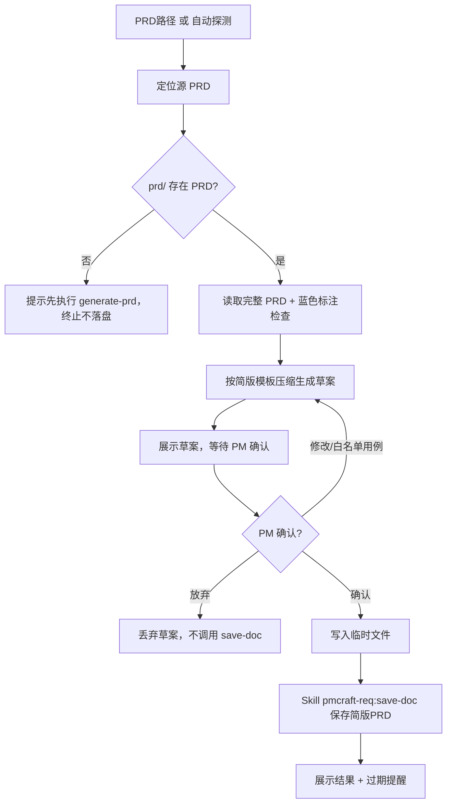

# 简版 PRD 生成 (compact-prd)

## 概述

`compact-prd` 是 PRD 的按需压缩技能：当完整 PRD 已产出、开发需要快速抓住功能重点时，基于已有完整 PRD 生成一份**折中版简版 PRD**（约原稿 1/3 篇幅，开发 2 分钟内扫完），保存到版本目录 `prd/` 目录（与完整 PRD 同目录，文件名注明"简版"），供开发快速抓住功能重点。

**压缩原理**：内容取舍优先（不是均匀压缩）——只保留"开发不知道会做错"的信息：

| 层 | 内容 | 处理 |
| :--- | :--- | :--- |
| 零损耗层 | 共同规则、全局复用约定（4.3）、用例规则、故事/用例编号、功能清单 | **全量保留**（硬依赖，不知道会做错） |
| 要点层 | 主流程、关键分支、验收要点 | 合并同类、去 UI 文案、一条一行的密度表达 |
| 删除层 | UI 文案（toast/按钮抖动/加载动画）、埋点事件明细、术语表（≤5 条核心）、修订历史、参与者、跨用例重复分支 | 删除或一句概述 |

**取舍原则**：只保留"开发不知道会做错"的信息。**语义损耗诚实标注 ~10-15%**——被删的边界细节可凭编号回查完整版（故事/用例编号与完整版逐一对齐，是防损耗的对照锚点）。

## Guard-Chat 守卫检查（第 0 步）

> 本小节为守卫开关检查，**不阻塞**主流程：执行完直接进入下一节。**子代理上下文**（被 spawn 执行、无法与用户交互，如 doc-reviewer/design-reviewer）整节静默跳过——不询问、不标记、不检测。

1. 运行 `node "{插件根}/_shared/scripts/guard-chat.js" status`，`{插件根}` = 从当前 SKILL.md 目录向上找第一个含 `_shared/scripts/guard-chat.js` 的祖先目录（source 环境=市场根，cache 环境=插件版本目录）。
2. 解析单行 JSON（契约：`{"status":"ok","data":{"enabled":bool,"prompted":bool,"dir":"…"}}`）：
   - `prompted=false` → 按话术库 GUARD-ASK（`enabled=false`）或 GUARD-ON（`enabled=true`）提示一次，然后运行 `node "{插件根}/_shared/scripts/guard-chat.js" mark-prompted`。用户紧随询问回复肯定意图（如「开启」），或任意轮次说「开启Guard-Chat」（路由表已注册）时，运行 `guard-chat.js enable`。
   - `prompted=true` → 跳过，不重复提示。
   - 话术库不可达（项目未跑 init-project、无大脑注入）→ 用兜底一句：「本会话可开启 Guard-Chat 守卫：开启后，你输入中可能影响判断的表述（如预设立场、权威宣称、逻辑谬误）会当场标注提醒；落盘文档中的对话填充语（如“好问题”、“希望对你有帮助”）会自动清除。说「开启Guard-Chat」开启（回复「开启」也可以），本会话只问一次。」（兜底非权威副本，有话术库时必须用话术库）
3. 脚本不可用（node 缺失/脚本缺失/JSON 解析失败）→ 静默跳过，继续主流程。
4. 本技能对话期间（仅 `enabled=true` 时）：① 每条用户消息经 `guard-chat.js detect`（stdin）检测，命中时单行简短标记，不打断流程；② 文档落盘前（save-doc 保存、直接写入报告文件）经 `guard-chat.js purify`（stdin）净化。规则见路由大脑「Guard-Chat 守卫行为」节。对话回复文风遵循 agent 定义的文风底线（无需脚本）。

## 加载策略总览

| 内容 | 加载时机 | fallback |
| :--- | :--- | :--- |
| `references/compact-template.md`（简版 PRD 模板，1-9 章骨架含全部 `{占位符}`） | 第二步"读取完整 PRD 并压缩生成"时 | 依据「输出模板」节结构备忘自行构建同结构模板，不得缺章 |

## 防误压缩规则（8 条）

压缩是 AI 判断，"合并同类/删细节"可能误判导致重要语义丢失（实测案例：校验超时重试对象被合并吞掉、双卡切换重试被截半、其他手机号登录入口整体丢失）。以下规则是压缩的判定标准，**每次生成必须逐条执行**：

### 压缩判定类（合并/删除时用）

1. **行为一致性判定（合并的唯一依据）** — 两条分支可合并，仅当处理行为完全一致（触发条件可不同，处理不可不同）。合并后自查："开发只看合并后这一条，实现是否与原文一致？"不一致必须分列。**反例**：`登录接口失败→重试登录` 与 `取号失败→重试取号` 行为不同（重试对象不同），禁止合并为"失败→重试"。
2. **行为归属不丢** — 处理动作的归属对象（重试对象为登录/取号、操作者为谁）属于行为差异，合并时禁止吞并。
3. **边界条件完整保留** — 保留的边界必须"条件+处理"成对出现，禁止截半。**反例**：`双卡设备默认使用默认数据卡取号` 必须带 `切换数据卡后可重新取号`，禁止只留前半。
4. **用户可见入口零丢失** — 原文功能中出现过的入口（其他手机号登录/返回/重试/直达按钮等）简版必须保留其存在性（可合并到分支或验收一句话），即使细节删除。
5. **数字与阈值零改写** — 次数（3 次/10 次）、时长（超时阈值/500ms）、百分比（95%）、字数（69 字）等硬标准禁止删除、改写、四舍五入。
6. **否定性规则优先保留** — "不得/禁止/不可/必须"类规则（不得隐藏短信入口、不得静默降级、不可直接进入账号）优先于肯定性规则保留；删除任何否定性规则须在 PM 确认环节明示。
7. **不确定即保留（兜底）** — 无法判断某内容是否影响实现时，倾向保留（多一行优于丢语义），并标注"压缩不确定项"供 PM 确认。

### 执行保障类

8. **压缩自检（生成后、PM 确认前必做，五项对照原文）**：
   - 合并清单逐条复核行为一致性（规则 1/2）
   - 边界清单逐条复核"条件+处理"完整性（规则 3）
   - 入口清单对照原文逐项勾选（规则 4）
   - 数字清单对照原文逐项核对（规则 5）
   - 否定性规则逐条确认在场（规则 6）
   自检未通过 → 修正后重新生成，**不得带病进入 PM 确认**。

**边界**（与相邻技能区分）：
- `generate-prd`：简报 → 创建 PRD（无 PRD 时用）
- `append-prd`：给存量 PRD 扩展新功能
- `revise-prd`：修订 PRD 内容
- **本技能 `compact-prd`：只读源 PRD 并压缩，不修改它**。完整 PRD 始终是权威文档。

## 输入

| 参数 | 类型 | 必选 | 说明 | 示例 |
| :--- | :--- | :--- | :--- | :--- |
| PRD路径 | 文件路径 | 否 | 待压缩的完整 PRD 文件路径；缺省自动探测版本目录下最新 PRD | `./账号系统/1.0.0/prd/账号系统_1.0.0_PRD_E3.md` |

## 调用方式

```
compact-prd <PRD路径>
```

**示例：**
```
compact-prd ./账号系统/1.0.0/prd/账号系统_1.0.0_PRD_E3.md
```

缺省参数时自动探测：按 CLAUDE.md「路径解析」从 cwd 向上找版本目录 → 取 `prd/` 下 E 编号最大的 PRD（最新修订）→ 多份时向 PM 确认。

## 输入要求

- 源 PRD 需符合 `../../_shared/templates/prd_template.md` 章节结构（章节定位依赖编号：1 文档版本 / 2 背景 / 3 产品目标 / 4 总体规则 / 5 用户故事（含用例）/ 6 数据埋点 / 7 非功能需求 / 8 时序图 / 9 原型图）。
- 版本目录 `prd/` 下至少存在一份 `{功能名}_{版本}_PRD_E{编号}.md`。

## 工作流程



### 详细步骤

#### 第一步：定位源 PRD

1. **有 `<PRD路径>` 参数**：校验文件存在且可读——如果文件存在但读取失败或内容为空，提示"源 PRD 为空或损坏"并终止（不落盘）；文件名匹配 `{功能名}_{版本}_PRD_E{编号}.md` 规范**且不含「简版」字样**——简版PRD 是压缩产物、不能作为压缩源，文件名含「简版」时提示核对完整版 PRD；不是 PRD → 提示核对，如传了简报/报告文件。从路径提取功能顶级目录与版本号（保留原始大小写）。
2. **无参数**：
   - 按 CLAUDE.md「路径解析」从 cwd 向上遍历找 `[Vv]?\d+\.\d+\.\d+` 子目录：找到 1 个 → 确定版本目录；多个 → 让用户选择；找不到 → 询问"在哪个项目？哪个版本？"
   - Glob `{version_dir}/prd/*_PRD_E*.md`（该模式会同时命中 `*_简版PRD_E*.md`，**必须剔除文件名含「简版」的文件**——仅完整 PRD 可作压缩源，两系列 E 编号独立、混用会取错源），再按 E 编号降序取最大（最新修订）
   - 多份 PRD 时向 PM 确认："检测到 {n} 份 PRD（E{列表}），将基于最新修订 E{max} 生成简版，确认？"
3. **prd/ 不存在或为空**：提示"未找到 PRD，请先使用 `pmcraft-req:generate-prd` 生成"，终止（不落盘、不占 E 编号）。

#### 第二步：读取完整 PRD 并压缩生成

- **章节结构检查**：如果源 PRD 缺少 4/5/6/7 章中任一章（与 `../../_shared/templates/prd_template.md` 结构不符），提示"源 PRD 结构不完整"并询问 PM：按存在的章节继续生成（缺失章节在简版中注明"完整版无此章节"）或终止；否则按标准结构压缩。
- **蓝色标注检查**：按 `../../_shared/templates/color_check_guideline.md` 流程执行（读取失败则降级核心检查：扫描蓝标配对完整性）。源 PRD 中已有的蓝色内容（AI 推断部分）在简版中**保留蓝色**并提示 PM 复核。
- 读取 `references/compact-template.md` 获取简版 PRD 模板（1-9 章骨架）。如果 Read 失败，依据「输出模板」节结构备忘自行构建同结构模板，不得缺章。
- 在 AI 上下文中完成压缩（**不改源文件**），严格按模板结构产出简版草案。
- **压缩自检**：按「防误压缩规则」第 8 条执行五项对照自检（合并一致性/边界完整性/入口在场/数字核对/否定性规则），自检未通过则修正后重新生成。自检结果（哪些合并了、哪些删除了）在 PM 确认时一并展示。

#### 第三步：PM 确认（对话中核对取舍清单）

展示简版草案 + **在对话中展示压缩取舍清单**（清单随草案同步产出、逐行对照原文，**不写入简版文档**），确认话术：

> "简版已生成。以下为压缩取舍清单（本简版相对完整版删/合并的内容，仅供确认，不写入文档）：
> {清单表格：原文位置 | 压缩处理 | 被删/合并内容 | 可恢复途径}
> 逐行确认可接受吗？有哪条不能删，指出来我保留。"

PM 可选择：
- **确认**（清单全部可接受）→ 进入保存
- **指出某条不可删** → 保留该项后重新生成简版与清单，再次确认
- **修改某处** → 按意见调整后重新确认
- **某用例按原始表格保留** → 支持"白名单用例"：该用例保留完整六字段原始表格格式（参与者/主成功流程/扩展流程/用例规则/权限控制/验收标准）而非要点块（如该用例为演示/讲解重点），标题后标注"（完整版保留）"
- **放弃** → 丢弃草案，不调用 save-doc，不产生 E 编号
- **迭代上限**：确认-调整循环最多 3 轮（与收敛循环惯例一致）；3 轮仍未通过 → 终止并请 PM 决定保留当前草案或放弃（均不落盘）。

> PM 确认的对象是**对话中的取舍清单**而非整份简版（30 秒扫完 10-15 行）——人侧兜底 AI 系统性盲区（见防误压缩规则前言）。清单不落盘：它是生成过程审计信息，开发阅读简版不需要看到"压缩了什么"。

#### 第四步：临时文件 + save-doc 保存

1. 将简版写入临时文件，位置统一为**项目根 `pmcraft/temp/`**（若不存在则先创建；命名 `{功能名}_简版PRD_{yyyy-MM-dd}.draft.md`）。**禁止写入系统 Temp 或 cwd**。
2. AI 生成内容摘要（如"简版PRD：短链生成与管理（基于完整PRD E2）"），从用户信息中获取负责人。
3. 调用 `Skill` 工具，技能名称 `pmcraft-req:save-doc`，传入参数：
   - 功能顶级文件夹路径（从源 PRD 路径提取）
   - 当前功能版本号（**与源 PRD 同值同格式**，如 `1.0.0` 或 `V1.0.0`）
   - 文档类型 `简版PRD`
   - 临时文件路径
   - 内容摘要与负责人分别以 `--summary` 和 `--author` 参数传入（参数说明见 `../save-doc/SKILL.md` 参数表）
4. `pmcraft-req:save-doc` 自动保存到 `prd/` 目录：文件名 `{功能名}_{版本}_简版PRD_E{N}.md`，E 编号从 E1 独立递增（与完整 PRD 的 E 序列完全隔离，永不覆盖），`_index.md` 的 `### prd/` 下生成 `**简版PRD**` 子分组。
5. **保存失败回退**：如果 save-doc 返回失败或提示参数缺失 → 按其交互式引导补全参数后重试一次；连续两次失败 → 终止并提示 PM 手工调用 `pmcraft-req:save-doc` 保存临时文件。
6. 展示结果。

#### 第五步：出口提示

展示保存路径后，输出提醒：

> "简版已保存。注意：完整 PRD 后续修订（revise-prd / append-prd / revise-from-meeting）后，本简版基于 E{源编号} 会过期——save-doc 保存新修订版时会自动提示（NEXT-COMPACT-STALE），直接说「简版PRD」即可重新生成。"

## 输出模板

简版 PRD 必须严格使用以下骨架（约原稿 1/3 篇幅；语义损耗 ~10-15%，被删细节凭编号回查完整版）。完整模板见 `references/compact-template.md`（第二步读取）。

**结构备忘**（Read 失败时使用）：简版结构：1 文档版本 → 2 背景 → 3 产品目标 → 4 总体规则（4.1 术语≤5/4.2 共同规则全量/4.3 全局复用约定）→ 5 用户故事与用例要点（主流程一条/关键分支/规则全量/验收要点 3-5 条）→ 6 数据埋点一句 → 7 非功能需求 1-3 条 → 8 时序图引用 → 9 原型图引用。

**注意：压缩取舍清单不写入简版文档**——它是生成过程的审计信息，服务于 PM 确认环节，仅在对话中展示（见工作流程第三步），落盘的简版只含 1-9 章正文。

**填充规则**：

- **故事/用例编号与完整版完全一致**（5.1/5.2…、用例1/用例2…）——这是对照原文阅读的锚点。模板中的 `{n}` 为序号记号，正文必须替换为实际序号数字、禁止原样保留（`{n}` 不在 save-doc 预检占位符清单内，漏替换会静默通过）。
- 章节 1-7 与完整版一一对应；第 6 章埋点**一句概述**（覆盖的核心目标，禁止罗列事件明细）；第 8/9 章**整体删除**仅保留引用行（必须写明源 E 编号与章节号）；第 7 章仅保留影响开发决策的 1-3 条（性能/安全/合规关键指标），其余引用原文；**第 2 章若含"完整叙述见《…需求简报》…E{n}.md"引用行（格式见 generate-prd 第 2 章引用行）则保留该行**（源 PRD 为压缩背景 + 简报引用时，简版读者经此追溯完整背景），仅压缩正文句。
- **用例要点块取舍规则**：
  - 主流程：合并为一条（步骤编号细节、UI 文案删除）
  - 关键分支：合并同类（如"接口失败"与"校验超时"可合并为"接口失败/超时→可重试"）、去 UI 文案（toast 内容/按钮抖动删除）；**与前一用例重复的分支写"同用例{n}"**，不重复罗列
  - 验收要点：3-5 条；**必须包含最影响实现的边界条件 2-3 条**（双卡默认数据卡/连续失败置灰/换号场景等），其余边界细节省略（按编号回查完整版）
- **压缩取舍清单规则（对话展示，不落盘）**：
  - 由「防误压缩规则」第 8 条压缩自检产出，**每个压缩动作（合并/删除/截留）占一行**，逐行对照原文填写
  - 列：原文位置 | 压缩处理（合并/分列/截留/一句概述）| 被删/合并内容（写明"删了什么"，如"登录接口失败与校验超时分列（重试对象不同）"）| 可恢复途径（完整版 E{源编号} 对应章节）
  - 未压缩的内容**不列入**清单（清单只披露压缩动作，长度控制在 10-15 行）
  - **清单只在 PM 确认环节的对话中展示，禁止写入简版文档**（开发阅读不需要看到压缩过程）
- 未映射的章节（如自由附录）压缩为一行说明并指向原文，向 PM 提示。
- 蓝色标注：源 PRD 中已有的蓝色内容保留蓝色并提示复核；简版为可读性新增的衔接/推断语句，一律用 `<span style="color:blue;">` 包裹。
- **简版不含 Mermaid**（第 8 章为引用行），预保存检查天然通过。

## 禁止行为

1. **禁止无源 PRD 强行生成** — prd/ 为空必须终止并引导 `pmcraft-req:generate-prd`，不产生空文档、不占 E 编号
2. **禁止跳过 PM 确认** — 简版草案必须经 PM 确认后才保存
3. **禁止压缩中改变语义** — 压缩是变换不是新增；改语义 = 新增表述，必须蓝色标注
4. **禁止直接 Write 版本目录** — 必须通过 `pmcraft-req:save-doc` 保存
5. **禁止在简版中引入 Mermaid** — 第 8 章为引用行，简版不含流程图
6. **禁止省略影响实现的关键分支** — 分支可合并同类、去 UI 文案，但"会造成实现差异"的分支（如取号失败降级/绑定不一致拦截/建号失败引导）必须保留
7. **禁止省略关键边界条件** — 验收要点必须含最影响实现的边界 2-3 条（双卡/连续失败置灰/换号场景等），禁止只留正常流程验收
8. **禁止删除引用目标** — 第 8/9 章引用必须写明源 E 编号与章节号
9. **禁止故事/用例编号与完整版不一致** — 编号即对照锚点，也是"防简版丢失细节"的校验手段
10. **禁止篇幅失控** — 简版目标篇幅为原稿约 1/3；若超出原稿一半，须重新压缩后再进入 PM 确认

## 约束

1. 源 PRD 必须符合 `../../_shared/templates/prd_template.md` 结构（章节定位依赖编号）。
2. `--version` 与版本目录格式一致（`1.0.0` 或 `V1.0.0`，禁止小写 v），否则 E 编号扫描失效。
3. 临时文件必须写入项目根 `pmcraft/temp/`，禁止系统 Temp 或 cwd。
4. 压缩来源只读不改——任何情况下不得修改完整 PRD 文件。

## 正误示例

### 正确示例

**指定路径调用**:
```
compact-prd ./账号系统/1.0.0/prd/账号系统_1.0.0_PRD_E3.md
```
预期：读取 E3，生成简版草案，确认后保存至 `prd/账号系统_1.0.0_简版PRD_E1.md`。

**无参数自动探测**（cwd 在版本目录内）:
```
compact-prd
```
预期：自动取 `prd/` 下 E 编号最大的 PRD，确认后生成。

### 错误示例

**错误 1**: 传简报文件而非 PRD
```
compact-prd ./账号系统/1.0.0/brief/账号系统_1.0.0_需求简报_E1.md
```
- 问题：文件名不匹配 `{功能名}_{版本}_PRD_E{编号}.md` 规范，简报不是压缩源。
- 正确做法：传入 `prd/` 目录下的完整 PRD 文件。

**错误 2**: 无参数且 cwd 不在项目内
```
compact-prd
```
- 问题：无法定位版本目录与 PRD。
- 正确做法：进入版本目录（含 `[Vv]?\d+\.\d+\.\d+` 子目录）再调用，或指定 PRD 路径。

**错误 3**: 跳过 PM 确认直接保存（或绕过 save-doc 直接 Write 版本目录）
- 问题：未确认取舍清单即落盘，压缩误判失去人侧兜底（见防误压缩规则）；直接 Write 版本目录则破坏 E 编号管理。
- 正确做法：草案先在对话中展示，PM 确认取舍清单后再经 `pmcraft-req:save-doc` 保存。

## 边缘情况处理

| 场景 | 触发条件 | 处理方式 | 示例回复 |
| :--- | :--- | :--- | :--- |
| 版本目录里有多份 PRD | `prd/` 下存在 E1-E5 | 默认取 E 最大（最新修订）并向 PM 确认；用户指定路径则以其为准；探测与校验均排除文件名含「简版」的文件 | "检测到 5 份 PRD（E1-E5），将基于最新修订 E5 生成简版，确认？" |
| 误选/误传简版PRD | 探测结果或显式传入的文件名含「简版」 | 提示简版PRD 不能作为压缩源，重新定位完整版 PRD 后继续 | "检测到 `账号系统_1.0.0_简版PRD_E1.md` 为简版PRD，不能作为压缩源。请传入完整版 PRD（如 `账号系统_1.0.0_PRD_E3.md`）。" |
| PRD 不存在 / prd/ 为空 | 无符合规范的 PRD 文件 | 终止并引导 generate-prd，不落盘 | "未找到 PRD，请先使用 pmcraft-req:generate-prd 生成。" |
| 源 PRD 含未清理蓝色标注 | 蓝色标签配对异常或残留 | 按 color_check_guideline 三选一（忽略/已修订/取消），简版按选择保留/清理蓝色 | "源 PRD 含未清理蓝色标注：1）保留并提示复核 2）按已修订处理 3）取消本次生成" |
| PM 要求某用例完整保留 | 确认环节点名"用例X全量保留" | 该用例保留完整六字段表格，标题后标注"（完整版保留）" | "用例3 已按完整版保留：参与者/主成功流程/扩展流程/用例规则/权限控制/验收标准。" |
| 简版重复生成 | 同一版本多次执行 | E 编号独立递增（E1→E2…），不覆盖旧简版（save-doc 防覆盖机制） | "已保存 E2。历史简版 E1 保留。" |
| 相邻用例分支重复 | 用例2 的分支与用例1 相同（同一功能不同账号场景） | 重复分支写"同用例{n}"，仅列差异分支 | "用例2 与用例1 相同分支不再罗列，写「同用例1」；差异分支（如自动登录失败回退）单独列出。" |
| 完整 PRD 后续修订 | 简版基于的 E{源编号} 已非最新 | 提示基于 E{源编号} 生成，修订后需重新生成；save-doc 保存修订版后会自动提示 | "完整 PRD 已修订至 E{新}，当前简版基于 E{旧} 已过期，建议重新生成简版（save-doc 修订落盘后会自动提示，说「简版PRD」）。" |
| 功能名含正则元字符 | 如 `账号+验证` | save-doc.js 已正则转义，正常保存 | （正常流程，无特殊处理） |
| 源 PRD 为空/损坏 | 文件存在但读取失败或内容为空 | 提示源 PRD 为空或损坏，终止不落盘 | "源 PRD 为空或无法读取，已终止（未落盘）。请确认文件后重试。" |
| save-doc 调用失败 | 参数缺失或保存报错 | 按交互式引导补全参数重试一次；连续两次失败终止并提示手工保存 | "save-doc 保存失败：{原因}。已重试一次仍失败，请手工调用 pmcraft-req:save-doc 保存。" |

## 常见错误

1. **无源 PRD 强行生成** — 必须先有完整 PRD（`pmcraft-req:generate-prd` 产出）。
2. **压缩中引入新语义未标蓝** — 简版原则上不新增语义；新增衔接语必须蓝色标注。
3. **用例编号与完整版不一致** — 编号是对照锚点，必须逐一对齐。
4. **引用行未写源 E 编号** — 第 6/8/9 章引用必须写明 E{源编号} 与章节号，否则开发无法定位原文。

## 快速参考

| 操作 | 命令 |
|:---|:---|
| 生成简版（指定路径） | `compact-prd <PRD路径>` |
| 生成简版（自动探测） | 进入版本目录后 `compact-prd` |
| 保存机制 | `Skill(pmcraft-req:save-doc)`，doc-type `简版PRD` → `prd/`，E 编号独立递增 |

## 评价测试用例

### 正向触发（5条）

1. `compact-prd ./账号系统/1.0.0/prd/账号系统_1.0.0_PRD_E3.md` — 预期：探测成功，生成简版草案，确认后保存至 `prd/账号系统_1.0.0_简版PRD_E1.md`，`_index.md` 的 `### prd/` 下出现 `**简版PRD**` 子分组
2. 无参数调用且 cwd 在版本目录内 — 预期：自动取 prd/ 下 E 最大 PRD 并确认
3. PRD 含 5 故事 8 用例 — 预期：全部要点化（每用例 4-6 行：主流程一条+关键分支+规则全量+验收要点 3-5 条），故事/用例编号与完整版一致
4. 完整 PRD 第 6 章有埋点事件 — 预期：简版第 6 章为一句概述（如"埋点覆盖取号成功率与转化率基线"），不罗列事件明细；第 8/9 章以"详见完整 PRD E{编号} 第 X 章"引用，不含 Mermaid
5. PM 对草案提出"用例3按原始表格保留" — 预期：用例3 保留完整六字段原始表格而非要点块，修改后重新确认再保存

### 负向触发（6条）

1. `compact-prd`（无参数，cwd 无版本目录）— 预期：询问"在哪个项目？哪个版本？"
2. 版本目录 `prd/` 为空 — 预期：提示"未找到 PRD，请先使用 pmcraft-req:generate-prd"，终止不落盘
3. `compact-prd ./账号系统/1.0.0/brief/账号系统_1.0.0_需求简报_E1.md`（简报而非 PRD）— 预期：文件名不匹配 PRD 规范，提示核对
4. `compact-prd ./不存在的文件.md` — 预期：报错终止
5. PM 确认环节回复"放弃" — 预期：丢弃草案，不调用 save-doc，不产生 E 编号
6. `compact-prd ./账号系统/1.0.0/prd/账号系统_1.0.0_简版PRD_E1.md`（传入简版PRD 而非完整版）— 预期：文件名含「简版」，提示"简版PRD 不能作为压缩源"，要求核对完整版 PRD

### 边界查询（5条）

1. `prd/` 下多份 PRD（E1-E5）— 预期：默认取 E5 并向 PM 确认
2. 源 PRD 含未清理蓝色标注 — 预期：触发颜色检查三选一，简版按选择保留/清理蓝色
3. 简版重复生成 — 预期：E1、E2 并存递增，不覆盖旧简版
4. 功能名含正则元字符（如 `账号+验证`）— 预期：save-doc.js 已正则转义，正常保存
5. save-doc 调用失败（参数缺失）— 预期：按交互式引导补全参数重试一次；连续两次失败则终止并提示 PM 手工保存

## 注意事项

1. **简版非权威文档** — 完整版才是；简版第 1 章引用头已声明源文件与过期提醒。
2. **完整 PRD 修订后简版需重新生成** — 生成时与出口均提示基于 E{源编号}。
3. **E 编号独立** — 简版 E 序列与完整 PRD 完全隔离，历史简版保留。
4. **按需调用** — 本技能不属于 req 域强制流水线（流程图/时序图/测试用例）环节；状态检测（NEXT-COMPACT / NEXT-COMPACT-STALE）与收敛出口（EXIT-CONVERGE）会在完整 PRD 产出后（无简版时）或简版过期时提示可选项，generate-prd 出口与 save-doc 保存修订版后也会自动提示，PM 也可随时显式调用。

## 参考文档

| 文档 | 加载时机 |
|:---|:---|
| `references/compact-template.md` 简版 PRD 模板 | 第二步生成简版草案时读取；Read 失败按「输出模板」节 1-9 章结构备忘自建（不得缺章） |
