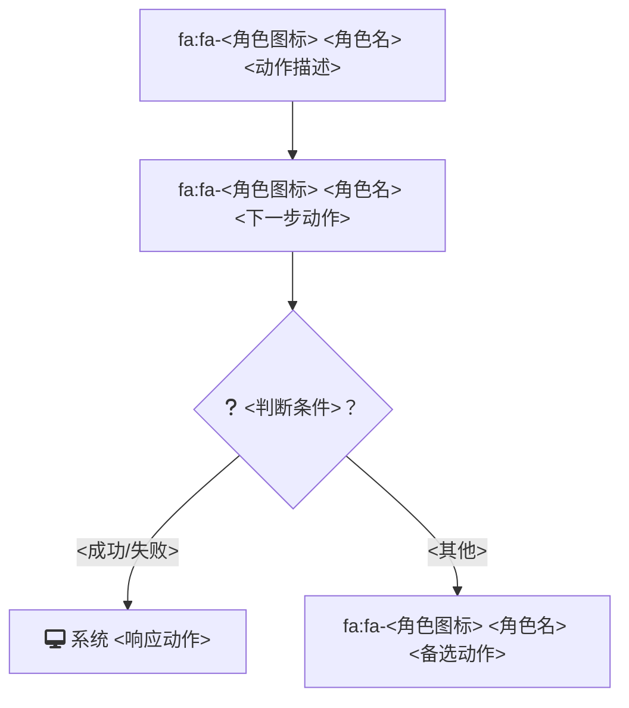
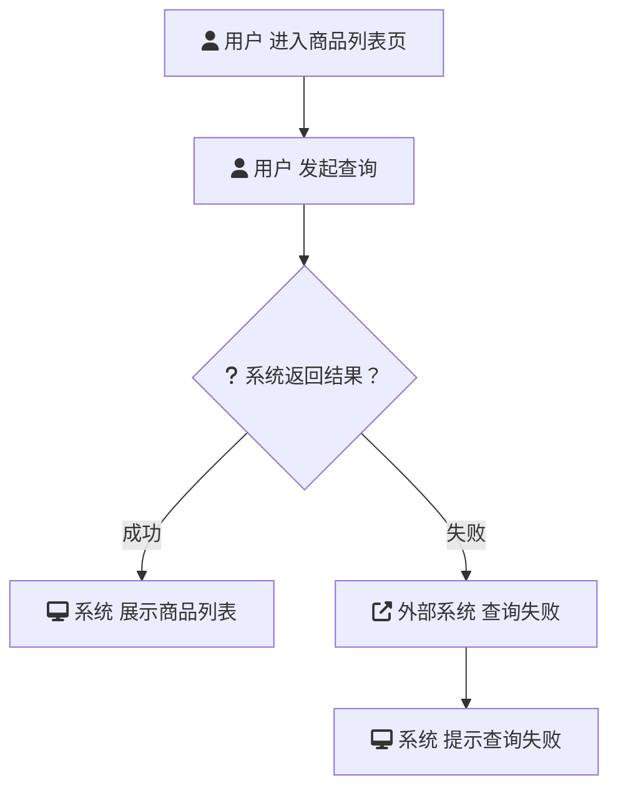

# 流程图生成 (generate-flowchart)

## 概述

读取一份 PRD 文件，解析其中每个用户故事下的每个用例的参与者、主成功流程和扩展流程，生成 Mermaid `flowchart TD` 流程图，最终组装为一份完整的 `.md` 文件并通过 `pmcraft-req:save-doc` 保存到 `flowchart/` 目录。

## Guard-Chat 守卫检查（第 0 步）

> 本小节为守卫开关检查，**不阻塞**主流程：执行完直接进入下一节。**子代理上下文**（被 spawn 执行、无法与用户交互，如 doc-reviewer/design-reviewer）整节静默跳过——不询问、不标记、不检测。

1. 运行 `node "{插件根}/_shared/scripts/guard-chat.js" status`，`{插件根}` = 从当前 SKILL.md 目录向上找第一个含 `_shared/scripts/guard-chat.js` 的祖先目录（source 环境=市场根，cache 环境=插件版本目录）。
2. 解析单行 JSON（契约：`{"status":"ok","data":{"enabled":bool,"prompted":bool,"dir":"…"}}`）：
   - `prompted=false` → 按话术库 GUARD-ASK（`enabled=false`）或 GUARD-ON（`enabled=true`）提示一次，然后运行 `node "{插件根}/_shared/scripts/guard-chat.js" mark-prompted`。用户紧随询问回复肯定意图（如「开启」），或任意轮次说「开启Guard-Chat」（路由表已注册）时，运行 `guard-chat.js enable`。
   - `prompted=true` → 跳过，不重复提示。
   - 话术库不可达（项目未跑 init-project、无大脑注入）→ 用兜底一句：「本会话可开启 Guard-Chat 守卫：开启后，你输入中可能影响判断的表述（如预设立场、权威宣称、逻辑谬误）会当场标注提醒；落盘文档中的对话填充语（如“好问题”、“希望对你有帮助”）会自动清除。说「开启Guard-Chat」开启（回复「开启」也可以），本会话只问一次。」（兜底非权威副本，有话术库时必须用话术库）
3. 脚本不可用（node 缺失/脚本缺失/JSON 解析失败）→ 静默跳过，继续主流程。
4. 本技能对话期间（仅 `enabled=true` 时）：① 每条用户消息经 `guard-chat.js detect`（stdin）检测，命中时单行简短标记，不打断流程；② 文档落盘前（save-doc 保存、直接写入报告文件）经 `guard-chat.js purify`（stdin）净化。规则见路由大脑「Guard-Chat 守卫行为」节。对话回复文风遵循 agent 定义的文风底线（无需脚本）。

## 输入

| 参数 | 类型 | 必选 | 说明 | 示例 |
| :--- | :--- | :--- | :--- | :--- |
| PRD路径 | 文件路径 | 是 | 符合模板格式的PRD .md文件路径，包含5.x用户故事和用例章节 | `./电商平台/1.0.0/prd/电商平台_1.0.0_PRD_E1.md` |

## 调用方式

```
generate-flowchart <PRD路径>
```

**示例：**

```
generate-flowchart ./电商平台/1.0.0/prd/电商平台_1.0.0_PRD_E1.md
```

## 角色图标映射

根据 PRD 用例中的「参与者」角色类型，自动选择对应的 Font Awesome 图标：

| 角色类型 | Font Awesome 图标 | 关键词匹配 |
|----------|-------------------|-----------|
| 用户 / 采购员 / 商家 | `fa:fa-user` | 用户、采购、商家、顾客、会员 |
| 管理员 / 主管 / 审批人 | `fa:fa-user-tie` | 管理员、主管、审批、经理 |
| 系统 / 平台 | `fa:fa-desktop` | 系统、平台、后台 |
| 外部系统 / 第三方 | `fa:fa-external-link-alt` | 外部、第三方、银行、支付 |

## 工作流程

### 第一步：读取 PRD 并解析用例

1. 用 `Read` 工具读取 PRD 文件。
2. 按用户故事（`### 5.x 故事X：`）和用例（`#### 用例X：`）层级遍历。
3. 对每个用例提取：
   - **名称**：位于 `#### 用例X：[动作+客体]` 中的动作+客体
   - **参与者**：主要参与者、次要参与者的角色名称
   - **主成功流程**：数字步骤列表
   - **扩展流程**：按业务异常 / 系统故障 / 外部依赖异常分组
4. 根据参与者名称中的关键词，从图标映射表中选择对应图标。

### 第二步：生成 Mermaid 流程图

**生成规则：**

- 使用 `flowchart TD`（自上而下方向）。
- **节点格式**：节点文字以图标开头，格式为 `fa:fa-图标 角色 动作`。
  - 若文字包含特殊字符（括号 `()`、引号 `""`、冒号等），整个节点用双引号包裹。
  - 示例：`A["fa:fa-user 采购员 进入电视列表页"]`
  - 简单文字：`A[fa:fa-user 采购员 进入列表页]`
- **判断节点**用菱形 `{}`，如 `C{"fa:fa-question 条件判断？"}`。
- **边标签必须加双引号**：`C -->|"成功"| D`，格式 `|"文本"|`。裸标签 `|文本|` 遇全角标点（（）、／等）会导致 mermaid v9 渲染失败（Lexical error）。
- **subgraph 必须带 ASCII ID + 引号标题**：`subgraph SG1["异常处理"]`。裸中文标题 `subgraph 异常` 在 mermaid v9 下渲染失败。
- **主成功流程**：用顺序箭头 `-->` 连接每一步。
- **扩展流程**：
  - 在对应步骤处岔出分支。例如第 2 步可能失败：
    ```
    B --> C{系统返回结果？}
    C -->|"成功"| D[fa:fa-desktop 显示商品列表]
    C -->|"失败"| E[fa:fa-external-link-alt 调用价格服务]
    E --> F[fa:fa-desktop 提示网络异常]
    ```
  - 业务异常、系统故障、外部依赖异常分别处理。
- **节点编号**：用字母 + 数字（A、B、C、A1、B1…），避免使用中文节点 ID。
- **每个用例独立一张图**，以 ` ```mermaid ` 代码块包裹。

### 第三步：组装文档

按以下结构组装完整的 `.md` 文件：

````markdown
# {功能名} — 流程图

> 源 PRD：`{功能名}_{版本}_PRD_E{源编号}.md`（与流程图同存本版本目录；生成时该文件为最新修订）。

## {故事1标题}（{P0/P1/P2}）

### {用例1：动作+客体}



### {用例2：动作+客体}


## {故事2标题}
...
````

**占位符填充规则**：
- `{功能名}`：取 PRD 标题中的功能名（如"电商平台"）。
- `{版本}` / `{源编号}`：取源 PRD 文件名（第一步解析的 PRD 路径）中的版本号与 E 编号。
- `{故事X标题}`：取 PRD 中 `### 5.x 故事X：` 标题原文，优先级（P0/P1/P2）一并保留。
- `{用例X：动作+客体}`：取 PRD 中 `#### 用例X：` 标题原文，逐字一致，不改写。
- `{角色图标}`：按「角色图标映射」表匹配参与者关键词；无匹配时用默认 `fa:fa-user`。
- `{角色名}` / `{动作描述}` / `{判断条件}` / `{成功/失败}`：全部取自该用例主成功流程与扩展流程步骤原文，不增删不臆造。

### 第四步：确定版本信息并保存

1. **确定功能顶级文件夹和版本号**：从 PRD 路径中提取。如果 PRD 路径符合 `<顶级文件夹>/<版本号>/prd/` 模式，则自动提取；否则（路径不含版本目录或位于其他目录结构），询问用户确认功能顶级文件夹和版本号后再继续，不猜测。
2. **生成内容摘要**：AI 根据流程图内容自动生成摘要（如"直播带货全流程：含筛选、下单、支付用例"），从用户信息中获取负责人。
3. **生成临时文件**：用 `Write` 工具将完整 .md 内容写入**项目根 `pmcraft/temp/`**（若不存在则先创建；命名 `{功能名}_流程图_{yyyy-MM-dd}.draft.md`）。**禁止写入系统 Temp 或 cwd**——save-doc 复制后临时文件即被删除，写入项目内临时区确保中途失败时产物可追踪。
- 预保存质量检查（Mermaid 闭合、蓝色标签配对、占位符替换、版本号格式四项）由 `pmcraft-req:save-doc` 保存前自动执行（详见 `../save-doc/SKILL.md#预保存质量检查`），调用方无需手动检查；不合格时脚本拒绝保存并返回精确行号。
4. **调用 `pmcraft-req:save-doc`**：执行以下命令保存文档（路径替换为实际值）。**参数安全（Bash 注入防护）**：`--summary` 为 AI 生成的摘要（文件内容拼接），构造 Bash 命令前须剔除 `"` `` ` `` `$` `;` `&` `|` `(` `)` 等 shell 元字符，参数值一律用双引号包裹后传入（详见 `../save-doc/SKILL.md#第四阶段：运行 save-doc.js（核心保存操作）`）：
   ```bash
   node "{save-doc 技能目录}/scripts/save-doc.js" \
     --base-dir="<功能顶级文件夹绝对路径>" \
     --version="1.0.0" \
     --doc-type="流程图" \
     --temp-file="<项目根>/pmcraft/temp/{功能名}_流程图_{yyyy-MM-dd}.draft.md" \
     --summary="<自动生成的摘要>" \
     --author="<负责人>"
   ```
5. **展示保存结果**：输出保存路径给用户。

**出口衔接（NEXT-TAIL 话术库）**：保存完成后提示：

> "流程图已完成。req 域剩余收尾：{缺失环节，按 时序图→测试用例 顺序}。直接说「继续收尾」即可。"（**NEXT-TAIL 模板**，话术库，见 CLAUDE.md「话术模板库」节）

## 禁止行为

1. **禁止为简单用例跳过生成** — 即使用例仅 1 步主流程，仍需生成简化流程图，不跳过
2. **禁止直接修改 PRD 文件** — 本技能仅读取 PRD，不写入任何修改
3. **禁止使用非标准 Mermaid 语法** — 只使用 `flowchart TD`，节点 ID 用字母+数字
4. **禁止合并多个用例到同一张图** — 每个用例独立生成一张流程图
5. **禁止臆造流程内容** — 节点文字、参与者、判断条件、分支标签必须来自 PRD 用例原文，不得编造 PRD 中不存在的步骤或用例

## 约束

1. 源 PRD 必须符合 PRD 模板结构（`### 5.x 故事X：` 用户故事 + `#### 用例X：` 用例层级），用例解析依赖该标题层级。
2. `--version` 与版本目录格式一致（如 `1.0.0`），否则 E 编号扫描失效。
3. 临时文件必须写入项目根 `pmcraft/temp/`，禁止写入系统 Temp 或 cwd。
4. 源 PRD 只读不改——任何情况下不得修改 PRD 文件。

## 正误示例

### 正确示例
```
generate-flowchart ./电商平台/1.0.0/prd/电商平台_1.0.0_PRD_E1.md
```
预期：读取 PRD 中所有用户故事和用例，为每个用例生成 Mermaid 流程图，合并为一份 .md，通过 pmcraft-req:save-doc 保存到 `flowchart/`。

**符合模板的输出片段**（单用例，图标与分支标签均来自图标映射表和 PRD 原文）：

````markdown
### 用例1：用户查看商品列表


````

### 错误示例

**错误**: 传入需求简报而非 PRD
```
generate-flowchart ./账号系统/1.0.0/brief/账号系统_1.0.0_需求简报_E1.md
```
- 问题：需求简报缺少 PRD 模板中的"用例"章节（主成功流程、扩展流程等），无法提取生成流程图所需的步骤信息。
- 正确做法：先使用 `pmcraft-req:generate-prd` 基于简报生成 PRD，再对 PRD 执行 `generate-flowchart`。

**错误**: 传入不存在的文件路径
```
generate-flowchart ./不存在的目录/PRD.md
```
- 问题：文件不存在，技能无法读取。
- 正确做法：确认 PRD 文件路径正确且文件已生成。

**错误**: PRD 文件不含任何用例
```
generate-flowchart ./空模板.md
```
- 问题：PRD 中无 `#### 用例X：` 标题，无法提取流程步骤。
- 正确做法：确认 PRD 已完整填充用户故事和用例章节后再生成流程图。

## 边缘情况处理

| 场景 | 触发条件 | 处理方式 | 示例回复 |
| :--- | :--- | :--- | :--- |
| PRD 无主成功流程 | 用例仅有扩展流程而无正常流程步骤 | 生成简单节点图，仅包含开始和结束节点，标注"主成功流程缺失" | "用例X 缺少主成功流程，已生成简化图并标注缺失。请补充后重新生成。" |
| 参与者无匹配图标 | 参与者名称不匹配任何图标映射关键词 | 使用默认 `fa:fa-user` 图标，并在节点中保留原始角色名 | （静默降级，流程图中使用默认图标） |
| PRD 使用非标准标题层级 | 用例标题不是 `#### 用例X：` 格式 | 尝试模糊匹配，若失败则跳过该用例，在输出中标注跳过的用例 | "以下用例因标题格式不标准未能解析：[列表]。请调整为 `#### 用例X：[动作+客体]` 格式后重新生成。" |
| PRD 路径无法提取版本信息 | PRD 路径不含 `<顶级文件夹>/<版本号>/prd/` 模式 | 询问用户确认功能顶级文件夹和版本号，不猜测 | "未从路径中识别出版本目录，请确认功能顶级文件夹和版本号。" |
| save-doc 保存失败 | 预保存质量检查不合格或脚本报错 | 展示脚本返回的错误信息与精确行号，保留 `pmcraft/temp/` 中的临时文件供排查，修复后重试 | "保存失败：[错误信息]。临时文件已保留在 pmcraft/temp/，请修复后重新调用 save-doc。" |

## 常见错误

1. **传入需求简报而非 PRD** — 简报缺少用例章节，无法生成流程图。先用 `pmcraft-req:generate-prd` 生成 PRD。
2. **PRD 无主成功流程** — 仅有扩展流程时生成简化图，标注缺失。
3. **传入不存在的文件路径** — 技能无法读取，检查路径后重试。

## 快速参考

| 操作 | 命令 |
|:---|:---|
| 生成流程图 | `generate-flowchart <PRD路径>` |
| 含多个故事/用例 | 自动为每个用例生成独立 Mermaid 图 |
| 角色图标映射 | 参与者名称自动匹配 Font Awesome 图标 |

## 评价测试用例

### 正向触发（5条）
1. `generate-flowchart ./电商平台/1.0.0/prd/电商平台_1.0.0_PRD_E1.md`（含多个故事和用例） — 预期：为每个用例生成独立流程图
2. `generate-flowchart ./账号系统/1.0.0/prd/账号系统_1.0.0_PRD_E2.md`（含蓝色标注内容） — 预期：正常生成流程图，忽略颜色标记
3. `generate-flowchart ./简单功能/1.0.0/prd/简单功能_1.0.0_PRD_E1.md`（仅1个故事1个用例） — 预期：生成单张流程图
4. 多次对同一PRD执行 `generate-flowchart` — 预期：每次生成新文件，E编号递增
5. PRD 含有多角色参与者（用户、管理员、外部系统） — 预期：每个角色使用对应图标

### 负向触发（5条）
1. `generate-flowchart`（无参数） — 预期：提示需要 PRD 路径
2. `generate-flowchart ./不存在的文件.md` — 预期：报错"文件不存在"
3. `generate-flowchart ./需求简报.md`（非PRD） — 预期：提示"该文件缺少用例章节，请提供完整PRD"
4. `generate-flowchart ./`（传入目录而非文件） — 预期：提示"请提供PRD文件路径，而非目录"
5. `generate-flowchart ./index.md`（非PRD文件） — 预期：无法解析用例，提示格式不符

### 边界查询（3条）
1. PRD 中一个用例有20+步主成功流程 — 预期：生成多节点流程图，步骤不截断
2. PRD 中用例的扩展流程包含嵌套分支 — 预期：Mermaid 中正确表达嵌套条件分支
3. PRD 路径包含中文和空格 — 预期：正确解析路径，生成和保存不受影响

## 注意事项

- 所有用例全部生成流程图，不筛选简单用例。
- 若某用例的主成功流程为空或仅有 1 步，仍生成简单流程图，不跳过。
- 若 PRD 中使用了蓝色标记（`<span style="color:blue;">`），说明流程中存在 AI 推断内容，在生成流程图时同样用蓝色推断逻辑处理，但流程图中不刻意标注颜色。
- 流程图文件名通过 pmcraft-req:save-doc 自动确定 E 编号，与 PRD 的 E 编号互不关联。
- **Mermaid 闭合自查**：在调用 `pmcraft-req:save-doc` 前建议自查临时文件中每个 Mermaid 代码块是否闭合（save-doc 保存前也会自动检查闭合，此为提前自查，非必须）。使用以下命令全局计数：
  ```bash
  OPEN=$(grep -c '^```mermaid' "<临时文件>")
  CLOSE=$(grep -c '^```$' "<临时文件>")
  ```
  确保 `OPEN == CLOSE`（每个 `` ```mermaid `` 都对应一个 `` ``` `` 闭合标记），而非仅检查文件末尾。
