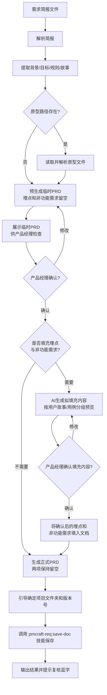

# PRD 生成 (generate-prd)

## 概述

`generate-prd` 是一个自动化文档生成技能。当你提供一份**需求简报**时，它会：

1.  **解析简报** — 提取背景、目标、业务规则、用户故事列表及原型路径（若提供）。
2.  **读取原型（可选）** — 若简报指定了原型文件路径，则解析本地前端文件（支持 `.html`、`.vue`、`.jsx`、`.tsx` 等常见前端组件），提取交互元素与状态变化。**交互元素与页面清单以源码静态解析穷举为准；Playwright 仅做渲染校验与运行时抽验**（见第二步）。
3.  **生成临时 PRD** — **严格按照《产品需求文档模板》**（位于 `../../_shared/templates/prd_template.md`）的章节结构、字段顺序和格式规范生成文档，但**数据埋点和非功能需求暂时留空**，等待后续按需填充到第6章"数据埋点"和第7章"非功能需求"的独立表格中。
4.  **产品经理检查临时 PRD** — 展示临时 PRD 供你逐项核对。
5.  **按需填充埋点与非功能需求** — 根据你的选择，AI 生成拟填充内容供确认，确认后填入第6章"数据埋点"和第7章"非功能需求"的独立表格中；或直接跳过填充。
6.  **规范保存** — 引导你确定项目文件夹和版本号（支持 `1.0.0` 和 `V1.0.0` 两种格式），最终通过 `pmcraft-req:save-doc` 将正式 PRD 保存到规范目录。

## Guard-Chat 守卫检查（第 0 步）

> 本小节为守卫开关检查，**不阻塞**主流程：执行完直接进入下一节。**子代理上下文**（被 spawn 执行、无法与用户交互，如 doc-reviewer/design-reviewer）整节静默跳过——不询问、不标记、不检测。

1. 运行 `node "{插件根}/_shared/scripts/guard-chat.js" status`，`{插件根}` = 从当前 SKILL.md 目录向上找第一个含 `_shared/scripts/guard-chat.js` 的祖先目录（source 环境=市场根，cache 环境=插件版本目录）。
2. 解析单行 JSON（契约：`{"status":"ok","data":{"enabled":bool,"prompted":bool,"dir":"…"}}`）：
   - `prompted=false` → 按话术库 GUARD-ASK（`enabled=false`）或 GUARD-ON（`enabled=true`）提示一次，然后运行 `node "{插件根}/_shared/scripts/guard-chat.js" mark-prompted`。用户紧随询问回复肯定意图（如「开启」），或任意轮次说「开启Guard-Chat」（路由表已注册）时，运行 `guard-chat.js enable`。
   - `prompted=true` → 跳过，不重复提示。
   - 话术库不可达（项目未跑 init-project、无大脑注入）→ 用兜底一句：「本会话可开启 Guard-Chat 守卫：开启后，你输入中可能影响判断的表述（如预设立场、权威宣称、逻辑谬误）会当场标注提醒；落盘文档中的对话填充语（如“好问题”、“希望对你有帮助”）会自动清除。说「开启Guard-Chat」开启（回复「开启」也可以），本会话只问一次。」（兜底非权威副本，有话术库时必须用话术库）
3. 脚本不可用（node 缺失/脚本缺失/JSON 解析失败）→ 静默跳过，继续主流程。
4. 本技能对话期间（仅 `enabled=true` 时）：① 每条用户消息经 `guard-chat.js detect`（stdin）检测，命中时单行简短标记，不打断流程；② 文档落盘前（save-doc 保存、直接写入报告文件）经 `guard-chat.js purify`（stdin）净化。规则见路由大脑「Guard-Chat 守卫行为」节。对话回复文风遵循 agent 定义的文风底线（无需脚本）。

## 输入

| 参数 | 类型 | 必选 | 说明 | 示例 |
| :--- | :--- | :--- | :--- | :--- |
| 简报路径 | 文件路径 | 是 | 需求简报文件路径，含背景、目标、用户故事及可选的原型路径 | `./账号系统/1.0.0/brief/账号系统_1.0.0_需求简报_E1.md` |

## 调用方式

```
generate-prd <简报路径>
```

**示例：**

```
generate-prd ./账号系统/1.0.0/brief/账号系统_1.0.0_需求简报_E1.md
```

## 工作流程

该技能严格遵循以下处理流水线，各步骤之间有确认与等待机制：



### 加载策略总览

| 文件 | 内容 | 加载时机 | fallback |
| :--- | :--- | :--- | :--- |
| `references/prd_output_template.md` | PRD 文档骨架（第 1-9 章章节结构、表格、占位符） | 第三步入口 | 依据 `../../_shared/templates/prd_template.md` 章节结构自行构建 |
| `../../_shared/reference/prototype-verification.md` | 原型读取与运行时验证契约（三源分工、工具层排除、`browser_evaluate` payload、渲染校验判定、截图限量） | 第二步读取原型时（有原型路径才加载） | 按第二步「静态解析（枚举主责）」四类取材口径 + 第二步「Playwright 渲染校验与运行时抽验」执行清单执行；截图按 0 张处理并标注"运行时验证降级执行" |

### 详细步骤说明

#### 第一步：解析简报

-   **文件存在性检查**：读取前先确认简报文件存在且为 `.md` 格式。如果文件不存在或无法读取 → 提示"简报文件不存在：{路径}"，终止流程，请用户核对路径后重新提供；如果为非 Markdown 格式 → 提示文件格式不支持，要求提供 Markdown 格式简报。
-   从简报文件中提取结构化信息。
-   **颜色标记检查**：详见 `../../_shared/templates/color_check_guideline.md` 中定义的检查流程。**如果读取失败** → 执行核心检查项：扫描简报中残留蓝色标记（`<span style="color:blue;">`）的配对完整性，发现异常时按边缘情况表"[1]忽略 [2]已修订 [3]取消"三选一处理，并在生成时标注"颜色标记检查降级执行"。
-   若某项必需字段缺失，技能会提示补充后再执行。
-   **总体规则提炼**：根据简报中出现的业务规则及模板规范，提炼出：
    -   **4.1 专有术语表**：只收录"会读错、且读错会判错的词"——过三门槛（全文实际出现 ≥2 次 / 非团队普遍秒懂的大众词 / 是"词"而非模型/规则/显示格式约定）+ 两问（问 A 读者离开解释可能误读：易混词对/一词多义/缩写黑话/新造概念；问 B 误读影响理解或验收判定）。解释按"本质 + 与易混词的分界 + 本文档取义声明"三要素写，须能当裁判。逐条过筛后无词入选则写"无。"。
    -   **4.2 共同规则**：仅收录通过**两问判定**的规则——①可判定（能写成「当 X 时，系统必须/禁止/默认 Y」，或计算/契约；可被违反、可进验收）；②违反后是「错了」而非「不一致」（数据错/越权/流程错/合规违规）。「跨功能复用」「暂不确定归属」是放置条件，不是算规则的条件。
    -   **4.3 全局复用约定**：跨功能复用但不构成行为判定的统一做法（交互/视觉/显示格式），违反后仅致不一致；不占 R 编号，沿用来源编号（D/C）或不编号。简报中带「(约定)」标记的规则条目路由至此。
    -   **非规则分流**：模型/结构定义→可凝缩为一句话时随核心词词条入 4.1（如 RBAC0 附着「权限」）、仅出现一次则行内括注、整段归 2. 背景；范围/不做的事→3.2 不可为清单；功能能力→5. 用户故事/用例；预置数据/上线任务→2. 背景。含规则内核的条目改写为规则保留（如「18 页面均建权限项」→「权限树必须覆盖全部菜单/页面」）。
-   若简报未明确提供规则，技能将根据上下文推断并以蓝色字体标注。
-   **分流标记解析**：在读取简报的「核心业务规则」章节时，扫描每条规则是否包含 `[类型-归属#X]` 前缀标记。若有，提取以下信息：
    - 类型（触发变体 / 异常降级 / 质量属性 / 场景特化 / 后续步骤）
    - 归属故事序号（如 #1 表示归属5.1故事1）
    - 规则原文（去前缀后的纯文本）
    - 将解析结果保存为**分流上下文表**，供第三步生成用例时使用。无标记的规则按现有逻辑处理（进入4.2共同规则或用例规则）。
    - **「分流内容」小节**（新模板简报第4章非规则小节）：带 `[类型-归属#X]` 标记的条目同上入分流上下文表（注入主成功流程/扩展流程）；带 `（约定）` 标记的条目路由至 4.3 全局复用约定（不占 R 编号）；该小节条目一律不进 4.2 共同规则/用例规则。旧简报无该小节时按上述全文扫描逻辑，兼容不变。

#### 第二步：读取原型（若提供路径）

-   进入指定原型目录，读取支持格式的文件。
-   若未提供路径，则默认使用当前版本目录下的 `prototype/` 文件夹。

**原型目录结构解析（降级链）**：

优先按以下顺序查找原型补充文件，使用最先匹配到的来源，用其中的信息丰富 PRD 第 9 章原型图部分的描述：

1. **E-structure 目录（pmcraft-proto 产出）**：检查当前版本目录下是否存在 `E{max}/` 目录（即数字最大的 E 目录，如 `E3/`），若存在则从中读取：
   - `page-inventory.md` — 页面清单（含页面名称、路由、核心元素）
   - `DESIGN.md` — 设计说明（含设计系统、组件规范、交互模式）
   - `pages/` — 页面文件目录（含各页面的 HTML/CSS/JS 源文件）
   - `spec.md` **不从快照读取**——pmcraft-proto:save-version 按排除规则跳过 spec.md（E 快照与 main/ 均不含，属正常，不提示缺失），**一律从 `prototype/working/spec.md` 读取**（存在时；口径同 check-consistency「spec.md 定位」行）
2. **working 目录（传统原型）**：若无 E 目录，检查当前版本目录下是否存在 `working/` 目录，若存在则从中读取上述同名补充文件。
3. **直接读取（传统模式）**：若以上均不存在，则直接读取原型目录下的页面文件（兼容旧版原型存放方式，无补充文件）。

使用补充文件来增强后续的原型解析摘要（第 9.1 节）和主要交互流程（第 9.2 节）。

**静态解析（枚举主责）**：

本步是**交互元素与页面清单的唯一穷举来源**——PRD 需要的是「可能性空间」（全部分支、全部状态），源码里这些是*声明*，一次读完即全集；渲染只能看到其中一条路径。

**分层取材（禁止整文件读）**：实测真实原型的 `<script>` 占 49%、`<style>` 占 28%、markup 仅占 23%，整读源码的绝大部分预算花在与 PRD 无关的样式和脚本上。按四类定点取材：

-   **页面清单**：`Glob prototype/{main|E{max}|working}/pages/*.html` + `page-inventory.md` 的路由字段。
-   **交互元素**：逐页读 HTML 的 markup 部分 + JS 中的 `querySelector` / `innerHTML` / 模板字符串（动态挂载的元素声明）。提取按钮、链接、输入框、表单及其关键属性。
-   **状态提示**：**优先**取 `spec.md` 的「页面状态矩阵」/ `page-inventory.md` 的「状态」字段（声明集合）；**其次**扫条件渲染分支与状态变量。覆盖加载中、成功、失败、空数据等 UI 状态。
-   **页面跳转逻辑**：`a[href]` + `location.href` / `window.open` 赋值 + 路由表。

**工具层排除（必做，源码级 + 运行时级两层都要排）**：pmcraft 自己的标注层与演示面板，读源码时一律排除——`annotations*/`、`demo*/`、`annotations-runtime.js`、`demo-panel-runtime.js`、`ui-a11y.js`、`design-system.css`、`_common.css`（判定依据 = 文件名前缀）。实测它们约 3000 行、接近页面本体的一半，且默认关闭、**与页面功能混在同一目录**——**不排除会把标注层当成页面功能写进 PRD**。

> 源码级前缀排除**拦不到运行时注入的节点**：标注层与演示面板由 `annotations-runtime.js` / `demo-panel-runtime.js` 在页面加载后**动态注入 DOM**（源码里根本没有这些节点），且开关按钮本身是可见控制件——**「渲染时天然看不见」不成立**。运行时级排除由共享契约 §1 payload 的 `isToolLayer()` 承担（按 `pm-anno-*` / `pm-demo-*` 前缀族 + 祖先判定剔除，`summary.toolLayerSkipped` 非 0 即生效）——**不排会同时污染元素清单与状态线索**（如 `pm-demo-empty` 伪造出不存在的空态）。

> 完整契约（三源分工、工具层排除、合并规则）见 `../../_shared/reference/prototype-verification.md` §0。**如果读取失败** → 按本节四类取材口径与工具层前缀排除规则执行。

**Playwright 渲染校验与运行时抽验（默认必选）**：

> **定位**：Playwright 在本技能只做三件事——① **渲染校验**（原型能否跑起来 / 白屏 / JS 报错 / 元素是否真渲染）② **运行时真值抽验**（与源码声明冲突时以渲染为准）③ **主流程关键页截图**。**交互元素枚举与页面清单由静态解析承担，Playwright 不再用于枚举**（同 `pmcraft-test` setup-tests 的 DOM 快照降格口径）。执行契约见 `../../_shared/reference/prototype-verification.md`；**如果读取失败** → 按本清单执行，截图按 0 张处理并标注"运行时验证降级执行"。

-   **【强制】检测 Playwright MCP 可用性**（第一步，不可跳过）：使用 `ToolSearch` 查询 `mcp__playwright__` 相关工具（`browser_navigate` / `browser_evaluate` / `browser_snapshot` / `browser_console_messages` / `browser_click` / `browser_take_screenshot` / `browser_wait_for` / `browser_close`）。工具存在且可用 → 进入运行时验证路径；不存在/不可用 → 进入降级标注路径。
-   **若 Playwright 可用**（按完整执行清单执行）：
    1. 使用 `Bash` 工具在本地启动 HTTP 静态文件服务器（如 `python -m http.server` 或 `npx serve`），托管原型页面目录。**页面集合取静态解析产出的页面清单，不靠浏览器遍历发现。**
    2. **逐页渲染校验**：`browser_navigate` 导航 → 用 `browser_wait_for` 等待加载就绪（**未加载完就取 payload 会被共享契约 §3 的白屏判据误判**）→ 执行共享契约 §1 的 `browser_evaluate` payload（**逐字执行，每页恰 1 次**）→ 用 `browser_console_messages` 检查 JS 报错 → 按共享契约 §3 判定白屏 / 渲染异常。`browser_snapshot` 仅用于标题与渲染的交叉确认，**不作枚举来源**。
    3. **运行时真值抽验（每页 ≤3 点）**：只验①与源码声明冲突的元素 ②主成功流程第一步依赖的元素。用 `browser_click` 触发后复看 payload 或 snapshot 复核。冲突以渲染为准并标注。
    4. **截图限量（≤10 张）**：按共享契约 §4 的选页规则取图——主链路涉及页面去重、**入口页与终止页必取**、每页恰 1 张只截默认初始态、超预算在 9.2 标注「未截图（以文字描述为准）」。**截图只作交付物，不作分析输入。**
    5. **截图前先确定保存位置**：截图统一保存至 `{version_dir}/screenshots/`（目录不存在则先用 `Bash` 创建，如 `mkdir -p 1.0.0/screenshots`）。文件名规范：`{基线标识}_{页面ID}_{场景}.png`（如 `E3_login_main.png`、`main_order_empty.png`）。
    6. **使用绝对路径截图（关键）**：Playwright MCP 的 `browser_take_screenshot` 用相对文件名时保存到 **MCP server 的 cwd（即 Claude Code 启动目录，通常是项目根目录）**，Bash 的 `cd` 不影响 MCP server 的 cwd。因此 `filename` 必须传**绝对路径**（如 `C:/项目/1.0.0/screenshots/E3_login_main.png`），确保截图落在 `{version_dir}/screenshots/` 而非项目根目录散落。
    7. 将本次**已截取**的截图以文件路径引用的方式附加到 PRD 第 9 章原型图部分：**主链路每条链路末附截图引用行**，未截图的链路在 9.2 显式标注「未截图（以文字描述为准）」——**不得为「每条交互流程配图」而突破第 4 点的 ≤10 张预算**。**截图引用使用相对 PRD 文件的相对路径**（如 `../screenshots/E3_login_main.png`），保证链接可点击。
    8. 使用 `browser_close` 关闭浏览器，**清理检查**：检查项目根目录（cwd）是否有本次生成的散落 `*.png`，若有则移至 `{version_dir}/screenshots/` 或清理；随后关闭本地 HTTP 服务器。
-   **若 Playwright 不可用**（降级标注路径，不可静默）：
    -   仅使用静态分析结果，不阻塞流程，但必须降级标注：
      1. PRD 第 9 章注明"基于静态源码分析，未获取运行时渲染验证"**及降级原因**（如"MCP 未配置 / 连接失败"）
      2. 交互性结论（交互元素、页面跳转链）标注"中可信度，建议运行时补验"
      3. 报告/输出提示 PM："Playwright 不可用，本次为纯静态分析。建议配置 Playwright MCP 后补做运行时验证，或人工在浏览器中核对关键交互。"

**双信息源合并规则（源码穷举 + 运行时抽验）**：

PRD 第 9 章原型图和用例主成功流程的生成，必须同时基于两个信息源。两者是**分工**关系，不可互相替代：

| 信息源 | 为 PRD 提供什么 | 仅用此源的盲区 |
|:---|:---|:---|
| **静态解析（分层取材）** | **穷举主干**：全部页面清单、每个页面的交互元素全集、组件树结构、事件绑定声明、状态声明、路由声明 | 无法判断元素运行时是否真的可见（JS 条件渲染）、实际渲染效果 |
| **运行时抽验（payload + 点击）** | **校验纠偏**：元素是否真渲染、实际操作触发的页面变化、加载/空数据/错误态的真实呈现 | 只覆盖已访问路径与已抽验的点，**不承担枚举** |

**合并规则**：
- **主成功流程步骤**：以静态解析的交互元素清单为基线确定每步涉及的元素 → 用运行时抽验确认这些元素**真实渲染**（`hidden: false`）→ 若源码声明了交互元素但运行时显示未渲染，标注"`[原型中未见渲染，可能为条件触发]`"
- **第 9.1 章 原型解析摘要**：页面清单与元素以静态解析为准（穷举）；**每个页面的状态描述（加载/空数据/错误）以 `spec.md` 状态矩阵 / `page-inventory.md` 状态字段的声明集合为准**——`stateHooks` 仅作补充线索。**不以"截图里看到的样子"为准**：一次渲染只有一条路径，看不到的状态不等于不存在
- **第 9.2 章 主要交互流程**：路由跳转链以静态解析的路由声明为主（穷举），运行时抽验修正断链（`href` 真值）
- **差异处理**：两源矛盾时（如源码声明了按钮但运行时未渲染），**优先采信运行时的实际状态**，在 PRD 中标注并提示 PM 确认原型实现是否完整。**比对前先排除 `truncated` 与 `unanchored` 两类**——它们代表"未纳入清单"，不代表"未渲染"
- **截图引用路径**：PRD 中截图统一以相对路径引用（如 `../screenshots/E3_login_main.png`），截图文件始终位于 `{version_dir}/screenshots/`，不引用项目根目录下的散落文件
- **仅静态可用时**：基于 PRD 模板标准推断交互流程，全部推断内容以蓝色标注，并在第 9 章注明"基于静态源码分析，未获取运行时渲染验证"

**无原型时的处理**：

-   若既无原型路径，默认目录也为空，且未找到任何 E-structure 或 working 目录：
    -   提示用户："未检测到原型文件。建议先使用 `pmcraft-proto` 生成标准原型，以获得更准确的交互流程描述和页面截图。是否继续基于行业模式推断生成 PRD？"
    -   若用户选择继续，所有主成功流程基于 AI 推断并以蓝色标注。
    -   若用户选择先获取原型，暂停流程，等待用户提供原型后重新进入第二步。

-   生成 **原型解析摘要** 及 **主要交互流程**，用于：
    -   填充 PRD 第 9 章原型图部分的描述。
    -   辅助生成用例主成功流程的步骤。

#### 第三步：预生成临时 PRD（不含埋点和非功能需求）

> **加载 PRD 文档骨架**：进入本步时 Read `references/prd_output_template.md` 获取 PRD 第 1-9 章骨架（`{占位符}` 在生成时替换，AI 推断内容用 `<span style="color:blue;">` 包裹）。如果 Read 失败，依据 `../../_shared/templates/prd_template.md` 的章节结构自行构建骨架。

**PRD 生成严格遵循《产品需求文档模板》（`../../_shared/templates/prd_template.md`）的以下规范：**

1.  **文档版本**（暂用占位符）
    -   功能版本号暂填 `[待确认]`，文档修订暂填 `E1`，修订人为 AI。
    -   表格包含列：功能版本、文档修订、修订人、修订时间、修订简介、关联工单中心工单。
    -   修订简介暂填 `[待确认]`，关联工单列留空待填。

2.  **背景**
    -   素材来源包括：
        -   简报第2章「需求背景与目标」：背景摘要、核心目标、成功指标
        -   简报第4章「核心业务规则」：驱动需求的业务现状和约束条件
        -   简报第7章「需求本质洞察摘要」：核心冲突、待验证假设、最大风险点
    -   **待验证假设"无。"处理规则**：简报第7章「待验证假设」为"无。"（write-brief 第三阶段判定标准与质量门确认的权威空态，非信息缺失）时：不引用、不推断假设内容，不追问 PM；驱动力仅基于核心目标（见下），3.2 非量化目标不从此来源提取（见第3条）。非"无。"时按常规从假设提取素材。
    -   **防复读硬约束（阅读成本治理）**：
        -   **字数帽**：背景正文 ≤4 句——现状与问题 ≤2 句、数据与事实 ≤1 句、驱动力 ≤1 句。
        -   **禁逐字复读**：背景正文与简报任何既有段落不得存在连续 ≥15 字的相同片段（专有名词与数字指标除外）。若只能照抄简报原句才能表达，说明该信息属决策叙述而非规格事实——正文不写，改用引用行。
        -   **引用行格式**：需保留的简报决策叙述（完整背景、风险判断、假设等）以正文末尾引用块呈现：`> 需求背景、成功指标归因与风险判断的完整叙述见《{功能名}需求简报》（../brief/{功能名}_{版本}_需求简报_E{n}.md）§2、§7。`——E{n} 取第一步解析的简报文件名 E 编号，路径为相对 PRD 文件的相对路径。
        -   **事实点守恒**：压缩不得丢规格事实——现状/数据/驱动力/不可为清单等必须出现在正文、术语表（4.1）或经引用行可达处。例如"多游戏共用/全局通行证"若已在 4.1 术语表定义，背景正文可不再复述。
    -   AI 基于简报推断和展开的内容用蓝色标注。

3.  **产品目标**
    -   分为两个子章节：
        -   **3.1 量化目标**：从简报的成功指标和归因逻辑中提取，格式为 `[指标]：[目标值]，归因逻辑：[说明]`。若无量化目标则写"无。"（量化目标句为验收标尺锚点，允许与简报同句，不视为复读）。
        -   **3.2 非量化目标**：只收 PRD 有产权的验收语言——功能对标、验收证据、不可为清单，必要时加一句话风险边界（如"换号老玩家自动建新号"类验收相关风险）。**禁止整段转述简报第7章决策叙述**（核心冲突、最大风险点、运营判断、归因分析），超一句话即从正文删除，保留入口在背景引用行（引用格式同第2条）。若无则写"无。"；待验证假设为"无。"时，不从此来源提取内容（见第2条"无。"处理规则）
    -   AI 补充的内容用蓝色标注。

4.  **总体规则**
    -   按模板输出三个子章节：
        -   **4.1 专有术语表**：表格形式，包含术语、解释。**逐条过筛后无术语入选则写"无。"**（不输出表格；对齐 3.1/3.2 空态句式）。解释按第一步「总体规则提炼」的收录规则与三要素写作，禁止字典式注水。
        -   **4.2 共同规则**：列表形式，每条规则以粗体标题开头；条目须通过两问判定（见第一步「总体规则提炼」），非规则内容按分流表归位。
        -   **4.3 全局复用约定**：列表形式，跨功能复用的交互/视觉/显示约定，不占 R 编号，沿用来源编号（D/C）或不编号。
    -   内容提炼自简报，不足部分由 AI 以蓝色字体补充。

5.  **用户故事与用例**
    -   **用户故事序号为全文统一排序**（5.1、5.2、5.3…），与简报中的“故事X”顺序一致。
    -   每个故事标题格式：`### 5.x 故事X：[故事标题]（优先级）`。
    -   故事描述、来源、优先级、涉及角色以引用块形式置于标题下方。
    -   **用例序号为全文统一排序**，不按故事重置。例如：
        -   故事1下的用例为“#### 用例1：[动作+客体]”
        -   故事2下的用例为“#### 用例2：[动作+客体]”
    -   用例具体内容以**两列表格**形式组织（左侧字段名，右侧内容），字段顺序严格遵循模板。
    -   **用例表格字段规范**：

| 字段 | 内容格式要求 |
| :--- | :--- |
| **参与者** | 主要参与者（主）[、次要参与者（次）] |
| **主成功流程** | 步骤列表，每步以 `1. ` 开头，格式：`[步骤编号]. [用户动作]，系统[反馈]。` |
| **扩展流程** | 按**业务异常**、**系统故障**、**外部依赖异常**分组，每项格式：`- [步骤]a. [条件]：[处理动作]` |
| **用例规则** | 列表形式，每条规则以 `- ` 开头；**仅收本用例私有规则**（与 4.2 公共规则同句的条目改引用式，见下注） |
| **权限控制** | 列表形式，说明各角色操作权限、数据权限及越权处理 |
| **验收标准** | 按**正常流程**、**异常流程**、**边界条件**、**权限控制**分组，内容为纯文本列表（无 `[ ]` 标记） |

    **用例规则引用式注（阅读成本治理）**：
    -   若规则已收录于 4.2 共同规则（R 编号），**禁止**在该用例「用例规则」字段全句重录。写法：`同 R{n}：{本用例内的约束呈现一句话}`（如 `同 R4：勾选合并协议前置，未勾选时点「一键登录」提示先勾选。`），或当本用例适用多条公共规则时写一行 `（适用公共规则：R1/R3/R4/R5，均见 §4.2；无本用例私有规则）`。引用式保留规则编号与适用性，generate-testcase/prepare-dev 可沿 R 编号到 §4.2 取全文。
    -   与 4.2 规则语义不同或为单用例特化的约束才是私有规则，保留全句。
    -   主成功流程/扩展流程/验收标准不受此约束（步骤级演绎与检查点保持内联自包含，不引用）。

    **AI 推断标注**：
    -   主成功流程优先结合原型交互描述；若无原型，则基于行业模式推断并以蓝色字体标注。
    -   扩展流程由 AI 结合行业通用模式穷举，并与原型中已有异常状态对照补充，补充部分以蓝色字体标注。
    -   所有 AI 推断、补充的内容均用 `<span style="color:blue;">{内容}</span>` 标记。

    **分流内容注入逻辑**：生成每个用户故事的用例时，查询分流上下文表，筛选归属当前故事序号的条目，按以下规则注入：

    - **触发变体注入主成功流程**：在主成功流程步骤列表之前，增加一段触发方式说明：
      - 格式：`本用例支持以下触发方式：<br>• [方式A描述]<br>• [方式B描述]<br>以下流程不区分触发入口：`
      - 其后保持原有步骤列表不变。
      - 若分流上下文表中有多个触发变体归属同一故事，全部列出。

    - **异常降级注入扩展流程**：在扩展流程的「业务异常」分组末尾，按扩展流程格式追加条目：
      - 格式：`- [步骤编号扩展]. [条件]：[处理动作]`
      - 步骤编号使用当前扩展流程的最后步骤号加后缀（如已有 `1a.`、`1b.`，则新增 `1c.`）。
      - 同时根据规则内容提炼验收标准的异常流程描述，追加到验收标准的异常流程分组。

    - **后续步骤追加主成功流程**：将后续步骤拆解为 1-2 步追加到主成功流程步骤列表末尾：
      - 格式与现有步骤一致：`[步骤编号]. [用户动作]，系统[反馈]。`
      - 若后续步骤中包含用户决策点，拆为两步（用户选择 → 系统响应）。

    - **质量属性**：按现有规则处理方式，写入用例规则或 4.2 共同规则：
      - 若 `[质量属性-归属#X]` 中 #X 指向单一故事，则写入该故事用例的「用例规则」字段。
      - 若指向多个故事或未指定故事，则写入 4.2 共同规则。

    - **场景特化**：根据内容判断：
      - 若含条件判断（"如果…则…"）→ 按异常降级方式处理，注入扩展流程。
      - 若不涉及新条件（仅上下文不同）→ 在主成功流程末尾追加一条说明：`[场景特化说明：本流程在[特定场景]下同样适用。]`

    **非分流内容**（无标记的规则）按现有逻辑处理，不受影响。

-   **时序图**（模板第8章）：按模板格式输出路径：`./<顶级文件夹>/<版本号>/sequence/`（使用 `pmcraft-req:generate-sequence` 技能可自动生成到此目录）。

-   **原型图**（模板第9章）：
    -   若此前读取了原型文件，则自动填入原型文件夹路径，并按模板补充：
        -   **9.1 原型解析摘要**：页面清单、关键组件识别结果；**状态描述（加载/空数据/错误）取 `spec.md` 状态矩阵 / `page-inventory.md` 状态字段的声明集合**（`stateHooks` 仅作补充线索），**不写"截图所见"**——一次渲染只有一条路径（口径见第二步「双信息源合并规则」）。
        -   **9.2 主要交互流程**：以页面跳转链为主（主链路 + 降级/返回分支，每链路 ≤3 行），**不逐条重述用例主成功流程步骤**——单步交互与异常细则标注"见用例 N 主成功流程/扩展流程"；主链路每条链路末附截图引用行，9.2 末尾列 `| 页面 | 截图 |` 小表，**截图总量 ≤10 张，未截图页显式标注「未截图（以文字描述为准）」**。
    -   若未读取原型，则输出：`[待补充原型图文件夹路径]`，并在子章节中留空或标注待补充。

-   **文档结尾**：以第 9 章原型图结束，不添加任何版本信息、完成时间、评审时间、负责人等额外信息。

**生成完成后，向用户展示临时 PRD 的完整内容，并提示：**
“这是临时 PRD，已跳过数据埋点和非功能需求。请检查是否准确，如有修改请告知。”

> **决策记录参考**：在向 PM 展示确认之前，检查同版本目录 `decision/` 下是否存在决策记录文件。若存在，读取状态索引表，检查是否有标记为「妥协」的规则决策（代价字段非空）。若有，在对应规则的异常分支描述中增强防御性——补充降级方案的触发条件和回退路径，确保 PRD 反映了决策时的妥协意图。

#### 第四步：按需填充埋点与非功能需求

1.  **询问是否填充**：
    -   在用户确认临时 PRD 无误后，询问：“是否需要我补充数据埋点和非功能需求？”

2.  **如果用户回复“不需要”**：
    -   则这两项保持留空，直接进入确定版本信息与保存阶段。

3.  **如果用户回复“需要”**：
    -   AI 根据 PRD 中已生成的功能描述、用例流程、业务规则等，为每个用例生成拟填充的**数据埋点**和**非功能需求**内容。
    -   **展示格式**：拟填充内容按用例分组，每行对应第6章或第7章大表中的一行数据，展示"故事、用例、埋点内容/需求内容"的三列格式。
    -   生成时遵循新章节的表格格式规范：
        -   第6章数据埋点表头：`| 用户故事 | 用例 | 埋点主题 | 埋点内容（字段：触发时机，统计目标） |`
        -   第7章非功能需求表头：`| 用户故事 | 用例 | 需求内容 |`
    -   将拟填充的内容以 **蓝色字体** 呈现，按用例分组展示供用户确认。
    -   向用户展示拟填充内容，并说明：“以下是我建议的数据埋点和非功能需求，将填入第6章和第7章的独立表格中。你可以全盘采纳，或告诉我需要修改/删除哪些条目。”
    -   产品经理可以回复：
        -   “确认” → 将内容以行形式填入第6章和第7章的独立表格中。
        -   “把 [某条] 改成 [新内容]” → 按指示修改后填入。
        -   “删除 [某条]” → 删除对应行后填入。
        -   “全部不用” → 放弃填充，两项留空。
    -   依据最终确认结果，将内容写入正式 PRD 的第6章和第7章独立表格中。

#### 第五步：确定版本信息并保存

1.  **确定功能顶级文件夹**：
    -   自动尝试从简报路径推断：若简报路径符合 `<顶级文件夹>/<版本号>/brief/` 模式，提取顶级文件夹部分并提示用户确认。
    -   若无法推断，向用户询问：“请输入本功能项目的顶级文件夹路径（例如 `./账号系统`）。如果文件夹还未创建，我会自动建立。”
    -   使用 `Bash` 工具检查路径是否存在，若不存在则自动创建。

2.  **确定功能版本号**：
    -   从简报路径中提取版本号：若简报路径符合 `<顶级文件夹>/<版本号>/brief/` 模式（如 `./账号系统/1.0.0/brief/...`），提取其中的版本号（如 `1.0.0`）作为本次 PRD 的功能版本号。
    -   若简报路径无法推断版本号（如路径不符合规范模式），默认使用 `1.0.0`。

3.  **确定修订简介**：
    -   首版（E1）修订简介固定写“初稿创建”（首版固定写法，无换行，见 prd_template.md 第 1 章填写说明），**不再询问用户**；自定义简介仅适用于后续修订场景（由 revise-prd / append-prd 等维护）。

4.  **更新 PRD 内容**：
    -   将预生成 PRD 内容中的功能版本号占位符 `[待确认]` 替换为本步（第五步第 2 点）确定的版本号（如 `1.0.0`）。
    -   文档修订列保持 `E1`（新功能版本的首份 PRD 文档修订始终从 E1 开始）。
    -   将修订简介占位符 `[待确认]` 替换为“初稿创建”。
    -   修订时间填当前日期（格式 `YYYY/MM/DD`，如 `2026/08/17`），修订人根据 `pmcraft-req:write-brief` 阶段收集的昵称填写（若未收集，填"产品策划"）。

- 预保存质量检查由 save-doc 脚本保存前自动执行（四项：Mermaid 闭合、蓝色标签配对、占位符替换、版本号格式，详见 `../save-doc/SKILL.md#预保存质量检查`），**无需手动预检**；若脚本返回「预保存质量检查未通过」，按 detail 中行号修复后重试保存。

5.  **生成临时文件并调用 `pmcraft-req:save-doc`**：
    -   将更新后的完整 PRD 内容写入临时文件，位置统一为**项目根 `pmcraft/temp/`**（若不存在则先创建；命名 `{功能名}_PRD_{yyyy-MM-dd}.draft.md`）。**禁止写入系统 Temp 或 cwd**——save-doc 复制后临时文件即被删除，写入项目内临时区确保中途失败时产物可追踪。
    -   AI 根据 PRD 内容自动生成内容摘要（如"直播带货全流程 PRD"），从用户信息中获取负责人。
    -   调用 `Skill` 工具，技能名称为 `pmcraft-req:save-doc`，传入参数：
        -   功能顶级文件夹路径
        -   确认后的功能版本号
        -   文档类型 `PRD`
        -   临时文件路径
        -   在调用上下文中准备 `内容摘要` 和 `负责人`，通过 save-doc 的 `--summary` 和 `--author` 命令行参数传递给脚本（参数契约见 `../save-doc/SKILL.md`）
    -   `pmcraft-req:save-doc` 将自动创建完整的版本目录树、确定 E编号、完成保存、更新 `_index.md`，并返回最终路径。

6.  **展示保存结果**：
    -   解析 `pmcraft-req:save-doc` 返回的 JSON，向用户输出：
        ```
        ✅ PRD 初稿已生成并保存。
        📁 保存路径：[返回的路径]
        📝 功能版本：[版本号，如 1.2.1] | 文档修订：[E编号]
        🔍 AI 推断或补充的文字已用蓝色标注，请逐条复核。

        ```

7.  **Gate 2 审查关隘入口**：
    -   保存完成后，向用户展示 **GATE-2-FULL 模板**（话术库，见 CLAUDE.md「话术模板库」节）：

    > "审查把关线（Gate 2）采用收敛小循环：
    > ① PRD 审查 → 对话决策 → 修订定稿 → ② 一致性检查 → ③ 自动处理差异 → ④ 复查直至差异清零。
    > 循环由 AI 自动执行，您在入口决策、反向差异、收敛出口 3 个点确认。
    > 收敛上限：④ 复查最多 3 轮；3 轮后仍有差异 → 输出剩余差异清单并停止循环，由您决策（继续人工修复 / 接受现状）。
    > 请选择：1）执行完整循环（推荐）2）仅质量审查 3）仅一致性检查 4）跳过
    > （评审提示：版本目录 `_README/`《评审与开发必读指南》由 save-doc 自动维护（双击 _README/README.html 门户即读），评审前可先打开获取全貌）"

    -   用户选择后，按**收敛循环顺序**通过 `Agent` 工具 spawn **doc-reviewer** 子智能体（**禁止并行 spawn review-prd 与 check-consistency**——一致性检查的对象必须是定稿 PRD，并行执行会导致修订后报告作废，见 CLAUDE.md「Gate 2 收敛小循环」）：
        -   `subagent_type`: `"doc-reviewer"`
        -   `prompt`: 传入审查技能名（`pmcraft-req:review-prd` / `pmcraft-req:check-consistency`）+ 当前 PRD 文件路径 + 原型路径（若适用）；**review-prd 的 prompt 同时注明源简报路径，要求聚焦简报之后的新增内容**（用例/验收/埋点/非功能/第9章），第 2/3/4/5 章继承自简报的部分仅核对一致性不重复评审（阅读成本治理）
        -   **正式落盘指令**（必须，区分审查类型）：
            -   **review-prd**（综合审查）：prompt 明确"审查报告完成编写后，**必须调用 `pmcraft-req:save-doc` 正式保存**（文档类型 `综合审查报告`，功能顶级文件夹与版本号从传入的 PRD 路径推断——其为正式路径，含 `<顶级文件夹>/<版本号>/` 结构）。**禁止只写临时区不落盘**——综合审查报告的正式保存是流程硬性要求，主对话不再补做"
            -   **check-consistency**（一致性检查）：prompt 明确"审查报告写入**项目根 `pmcraft/temp/`**（若不存在则先创建），文件名 `{功能名}_一致性检查报告_{yyyy-MM-dd}.md`；若当天已存在同名文件，追加轮次后缀 `_r{N}`（N 从 2 递增），**禁止覆盖早轮报告**——收敛小循环同日多轮需保留每轮差异清单供单调性对比。**写入 `pmcraft/temp/` 即为最终产物，不再调用 `pmcraft-req:save-doc`**——无 E 编号、不进 `_index.md`"
        -   **spawn 顺序**：
            -   完整循环（1）：**先 spawn review-prd** → 报告返回后按下述"审查完成后"逻辑处理 [采纳] 条目（用户确认后调用 `pmcraft-req:revise-prd` 修订定稿）→ **定稿后再 spawn check-consistency**（对象为修订后的 PRD 文件）→ 按"审查完成后"逻辑处理差异（交互性差异经 `pmcraft-req:revise-prd` / `pmcraft-proto:build-prototype` 修订）→ 若产生新的修订则**复查** check-consistency（最多 3 轮）
            -   仅质量审查（2）：只 spawn review-prd，不 spawn check-consistency
            -   仅一致性检查（3）：只 spawn check-consistency（对象为当前 PRD 文件）
    -   如果用户回复"跳过"：进入后续流程
    -   审查完成后，按以下逻辑处理：
        -   若 check-consistency 报告发现交互性差异 > 0：
            > "一致性检查发现 {N} 处交互性差异（原型缺失）。是否现在调用 `pmcraft-req:revise-prd` 将这些差异写入修订计划并评估原型同步？[是/否]"
        -   若 review-prd 报告发现 [采纳] 条目 > 0：
            > "PRD 审查发现 {N} 条可采纳修改项。是否现在调用 `pmcraft-req:revise-prd` 应用修改？[是/否]"
        -   用户选"是" → 直接调用 Skill(pmcraft-req:revise-prd) 传入 PRD 路径
        -   用户选"否" → 流程结束
        -   **待办登记（话术库 FLOW 族）**：若 review-prd 报告 [采纳] >0 且用户选"否"（或流程在此结束未应用）→ 结束前按 CLAUDE.md「流程清单（进度与待办）」节登记协议，将「采纳待应用：{N} 条（综合审查报告 E{M}）」登记到 `{版本目录}/_进度清单.md` 登记区（行键 `report|E{M}|采纳`，M = 报告 E 编号；登记行 7 列格式见该节「微观待办登记协议」），并按 **FLOW-REG** 播报单行（关闭条件：revise-prd 应用该报告后由修订技能显式关闭）

8.  **出口衔接（话术库 NEXT-TAIL）**：Gate 2 审查收敛完成后，输出收尾序列下一环（已产出环节跳过，按 流程图→时序图→测试用例 顺序）：

    > "PRD 已完成。req 域剩余收尾：流程图（若 flowchart/ 为空或已过期）→ 时序图（若 PRD 第 8 章待补充）→ 测试用例（若 testcase/ 为空或已过期）。可选项：生成简版PRD 给开发快速阅读（说「简版PRD」）。直接说「继续收尾」即可。"

    - 若全部收尾完成：提示"PRD 与原型已收敛一致。req 域剩余收尾：{缺失环节列表，按 流程图→时序图→测试用例 顺序，已产出跳过}。建议新开会话继续，上下文更干净。直接说「继续收尾」即可。"（**EXIT-CONVERGE 模板**，话术库，见 CLAUDE.md「话术模板库」节）

## 输出模板（PRD 文档骨架）

生成内容严格遵循《产品需求文档模板》（`../../_shared/templates/prd_template.md`）的章节编号、顺序与格式。PRD 文档骨架（第 1-9 章完整章节结构、表格与占位符）见 `references/prd_output_template.md`，在第三步入口按需加载（`{占位符}` 在生成时替换，AI 推断内容一律用 `<span style="color:blue;">` 包裹）；如果 Read 失败，依据 `../../_shared/templates/prd_template.md` 的章节结构自行构建骨架。

**填充规则**：

1. `{功能版本号}` → 第五步从简报路径提取（如 `1.0.0`）；无法推断时默认 `1.0.0`。
2. `{修订简介}` → 首版（E1）固定"初稿创建"（见 prd_template.md 第 1 章填写说明，首版固定写法，不再询问用户）；`修订时间` 填当前日期（格式 `YYYY/MM/DD`，如 `2026/08/17`）；`修订人` 填昵称（未收集时填"产品策划"）。
3. `{术语}`、`{规则名称}`、用例各字段 → 从简报提炼；简报未提供时由 AI 推断并以蓝色标注。
4. 第 6/7 章临时 PRD 阶段保持留空，第四步按用户选择填充（"确认/修改/删除/全部不用"四种回复决定）。
5. 第 8/9 章无对应产物时输出占位路径并标注待补充，不编造内容。

## 输出示例（用例部分，临时 PRD 不含埋点和非功能需求）

```markdown
### 5.1 故事1：快速查看55寸电视不含国补价格（P0）

> **故事描述**：作为企业采购人员，我想要快速查看55寸电视在1200-1500元价位的不含国补价格，以便在预算内选择最具性价比的电视。
> **来源**：用户提供
> **优先级**：P0
> **涉及角色**：企业采购人员

#### 用例1：筛选查看不含国补价格

| 字段 | 内容 |
| :--- | :--- |
| **参与者** | 企业采购人员（主） |
| **主成功流程** | 1. 用户进入电视列表页，系统展示商品卡片（含型号、尺寸、含国补价格）。<br>2. 用户在筛选栏选择尺寸“55寸”、价格区间“1200-1500元”，并勾选“显示不含国补价格”。<br>3. 系统刷新列表，商品卡片价格切换为不含国补价格，并更新排序。 |
| **扩展流程** | **业务异常**<br>- 2a. 筛选后无结果：系统显示“暂无符合条件商品”占位图。<br>**系统故障**<br>- 1a. 列表接口超时：系统提示“网络异常，请稍后重试”。<br>**外部依赖异常**<br>- 3a. 价格计算服务异常：系统提示“价格更新失败，请刷新重试”。 |
| **用例规则** | <span style="color:blue;">- 不含国补价格 = 商品原价 - 国补金额，由后端计算后下发。</span><br>- 切换价格显示模式后，排序规则不变，仅前端展示价格变化。 |
| **权限控制** | <span style="color:blue;">- 所有已登录采购人员均可查看不含国补价格。</span><br><span style="color:blue;">- 未登录用户仅可见含国补价格，“显示不含国补价格”选项置灰不可选。</span> |
| **验收标准** | **正常流程**<br>- 勾选“显示不含国补价格”后，列表中所有商品价格立即切换为不含国补价格。<br>- 取消勾选后恢复含国补价格显示。<br>**异常流程**<br>- 筛选结果为空时显示友好占位提示。<br>- 接口超时时显示明确错误信息，并提供重试入口。<br>**边界条件**<br>- 商品原价等于国补金额时，不含国补价格显示为0，前端展示“0元”或“免费”。<br>**权限控制**<br>- 未登录状态下，“显示不含国补价格”选项不可用。 |
```

### （第四步填充确认阶段的展示格式示例）

```markdown
#### 第6章：数据埋点（新增数据）

| 用户故事 | 用例 | 埋点主题 | 埋点内容（字段：触发时机，统计目标） |
| :--- | :--- | :--- | :--- |
| 故事1：快速查看55寸电视 | 用例1：筛选查看不含国补价格 | 分析比价流程转化率 | <span style="color:blue;">`filter_no_subsidy_toggle`：用户勾选/取消"显示不含国补价格"时触发，统计用户切换价格显示模式的频率。<br>`list_view_no_subsidy`：列表展示不含国补价格时触发，统计不含国补价格列表曝光量。</span> |

#### 第7章：非功能需求（新增数据）

| 用户故事 | 用例 | 需求内容 |
| :--- | :--- | :--- |
| 故事1：快速查看55寸电视 | 用例1：筛选查看不含国补价格 | <span style="color:blue;">**性能**：列表刷新响应时间 ≤500ms。<br>**安全**：价格数据通过 HTTPS 加密传输。</span> |
```

## 参考资料

-   **《产品需求文档模板》**：`../../_shared/templates/prd_template.md`。本技能生成的所有 PRD 必须严格符合该模板结构。
-   **《产品需求文档指引》**：`../../_shared/templates/prd_guidelines.md`。提供各章节的详细写作规范。
-   **PRD 文档骨架**：`references/prd_output_template.md`。PRD 第 1-9 章章节骨架（第三步入口按需加载；加载失败时依据《产品需求文档模板》自行构建）。
-   **《原型读取与运行时验证契约》**：`../../_shared/reference/prototype-verification.md`。req 域三技能公共规范——三源分工、源码分层取材与工具层排除（源码级 + 运行时级两层）、需求域 `browser_evaluate` payload、渲染校验判定、截图限量规则、降级机制。读取原型时按需加载；**如果读取失败** → 按第二步「静态解析（枚举主责）」四类取材口径 + 「Playwright 渲染校验与运行时抽验」执行清单执行，截图按 0 张处理并标注"运行时验证降级执行"。

## 禁止行为

1. **禁止跳过 PRD 模板结构** — 生成内容的章节编号、标题名称、字段顺序、表格结构必须与 `../../_shared/templates/prd_template.md` 完全一致
2. **禁止合并事实与推断** — AI 推断、补充的内容必须用 `<span style="color:blue;">...</span>` 标注，不得与黑色事实混用
3. **禁止在数据不足时编造规则** — 若简报未提供业务规则，AI 推断的规则需用蓝色标注，不得以黑色正文呈现
4. **禁止直接修改已保存的 PRD** — 所有变更在 AI 上下文中构建完整内容后通过 `pmcraft-req:save-doc` 保存为新文件，不覆盖原文件
5. **禁止跳过用户确认环节** — 临时 PRD 展示和埋点/NFR 填充均需用户确认后方可进入下一步
6. **禁止跳过 Playwright 可用性检测** — ToolSearch 检测 Playwright MCP 为强制第一步，不得直接进入静态分析
7. **禁止 Playwright 可用时跳过运行时验证** — MCP 可用时必须执行完整执行清单（逐页 payload 渲染校验 + 报错检查 + ≤3 点抽验 + 限量截图），除非 PM 明确要求跳过并说明原因
8. **禁止回退静态时不做降级标注** — Playwright 不可用时，PRD 第 9 章必须标注"基于静态源码分析"及降级原因，交互性结论标注"中可信度，建议运行时补验"，并提示 PM 补做运行时验证（三要素缺一不可，不可静默）
9. **禁止截图散落到项目根目录** — `browser_take_screenshot` 必须传绝对路径保存至 `{version_dir}/screenshots/`，不得使用相对文件名（会保存到 MCP server 的 cwd 即项目根目录）
10. **禁止 check-consistency 报告调用 `pmcraft-req:save-doc` 落盘** — 一致性检查报告写入项目根 `pmcraft/temp/` 即为最终产物，无 E 编号、不进 `_index.md`、不进 `report/`（主对话不再补做）
11. **禁止覆盖同日轮次的一致性检查报告** — 同日已存在同名报告时追加轮次后缀 `_r{N}`（N 从 2 递增），保留每轮差异清单供收敛单调性对比
12. **禁止 review-prd 报告只写临时区不落盘** — 综合审查报告必须调用 `pmcraft-req:save-doc` 正式保存（文档类型 `综合审查报告`，落盘 `report/`），主对话不再补做
13. **禁止 Gate 2 审查报告散落其他位置** — 合法落盘位置仅两个：综合审查报告 → save-doc 落盘 `report/`；一致性检查报告 → `pmcraft/temp/`。不得写入项目根目录或系统 Temp
14. **禁止将非规则内容写入 4.2 共同规则** — 模型/结构定义（→凝缩一句话随词入 4.1，整段归 2. 背景）、功能能力（→用户故事）、范围声明（→3.2 不可为清单）、预置数据/上线任务（→背景）、交互/视觉/显示约定（→4.3）均不是规则。「跨功能复用」「暂不确定归属」是放置条件而非资格条件；条目必须通过两问判定：①可判定，②违反后是「错了」（数据错/越权/流程错/合规违规）而非「不一致」
15. **禁止叙述性复读简报** — PRD 第 2 章背景超过 4 句、3.2 整段转述简报第 7 章决策叙述、第 9.2 章逐条重述用例主成功流程、用例规则全句重录 4.2 公共规则，均属违规（见第三步第 2/3 条与「用例规则引用式注」）。豁免：规则句（4.2 R 编号）、3.1 量化目标句、5.x 故事描述行为语义必要锚点，允许与简报同文
16. **禁止 4.1 专有术语表注水** — 大众词/项目名/字典式百科句、与 4.2 规则或用例流程重复的行为句、整段模型定义、显示格式约定（→4.3）均不得占 4.1 行；术语须过三门槛两问才入库（见第一步「总体规则提炼」），逐条过筛后无词入选则写"无。"，不强行造词、不输出空表格
17. **禁止用截图或多模态读图做交互元素枚举或页面结构分析** — 截图只作 PRD 第 9 章视觉锚点与差异留证，**不进分析输入**；交互元素枚举唯一来源是静态解析（第二步）
18. **禁止用浏览器做交互元素枚举或页面遍历发现** — 页面集合取静态解析产出的页面清单，不得靠 `browser_navigate` 逐页探索来"发现"页面
19. **禁止逐页逐状态全量截图** — 截图总量 ≤10 张（入口页与终止页必取、每页恰 1 张只截默认初始态），超预算即违规；状态空间由 9.1 状态描述与用例扩展流程用文字承载
20. **禁止整文件读原型源码** — 按第二步「分层取材」四类定点读取，并排除工具层（`annotations*/`、`demo*/` 等前缀）

## 约束

1. **模板结构强约束** — 输出 PRD 的章节编号、标题名称、字段顺序、表格结构必须与 `../../_shared/templates/prd_template.md` 完全一致；AI 推断或补充的内容一律用 `<span style="color:blue;">` 标注，不得与黑色事实混用。
2. **版本号格式约束** — 功能版本号支持 `1.0.0` 与 `V1.0.0` 两种格式（提取时剥离 `V` 前缀统一为无前缀格式），保存路径必须与版本号格式一致。
3. **用例序号全文统一** — 用例编号（用例1、用例2…）在整个 PRD 中连续递增，不因用户故事切换而重置；用户故事序号（5.1、5.2…）与简报"故事X"顺序一致。
4. **保存路径约束** — 正式 PRD 必须通过 `pmcraft-req:save-doc` 保存到版本规范目录；临时文件统一写入项目根 `pmcraft/temp/`，禁止写入系统 Temp 或 cwd。
5. **截图路径与限量约束** — `browser_take_screenshot` 必须传绝对路径保存至 `{version_dir}/screenshots/`；**总量 ≤10 张**，入口页与终止页必取、每页恰 1 张只截默认初始态；PRD 内引用使用相对 PRD 文件的相对路径（如 `../screenshots/xxx.png`），不引用项目根目录散落文件。
6. **审查落盘位置约束** — 综合审查报告必须经 `pmcraft-req:save-doc` 落盘 `report/`；一致性检查报告写入项目根 `pmcraft/temp/` 即为最终产物，无 E 编号、不进 `_index.md`。
7. **Playwright 检测约束** — 使用 `ToolSearch` 检测 Playwright MCP 为强制第一步；MCP 可用时不得跳过**渲染校验与运行时抽验**（不承担交互元素枚举），不可用时必须降级标注并提示 PM 补做运行时验证。

## 正误示例

### 正确示例
```
generate-prd ./账号系统/1.0.0/brief/账号系统_1.0.0_需求简报_E1.md
```
预期：解析简报，可选读取原型，生成临时PRD，经确认后填充埋点/NFR，通过pmcraft-req:save-doc保存。

### 错误示例

**错误**: 传入目录而非简报文件
```
generate-prd ./账号系统/1.0.0/brief/
```
- 问题：技能需要具体的简报文件路径来解析内容。
- 正确做法：提供完整的简报文件路径。

**错误**: 简报中缺失用户故事章节
```
generate-prd ./仅有背景描述的文档.md
```
- 问题：无用户故事无法生成完整的 PRD 用例章节，生成结果可能严重不完整。
- 正确做法：先通过 `pmcraft-req:write-brief` 生成包含用户故事的需求简报。

**错误**: 将一致性检查报告经 `pmcraft-req:save-doc` 保存到 report/
```
（Gate 2 spawn check-consistency 的 prompt 中）"审查报告完成后请调用 pmcraft-req:save-doc 正式保存"
```
- 问题：check-consistency 是过程性审查产物，写入 `pmcraft/temp/` 即为最终产物；经 save-doc 会获得 E 编号并进入 `_index.md`，污染正式文档管理。
- 正确做法：prompt 中明确"写入项目根 `pmcraft/temp/`（命名 `{功能名}_一致性检查报告_{yyyy-MM-dd}.md`），不调用 save-doc"。

**错误**: review-prd 报告只写入临时区不落盘
```
（Gate 2 spawn review-prd 的 prompt 中）"审查报告完成后写到 pmcraft/temp/ 即可"
```
- 问题：综合审查报告的正式保存是流程硬性要求，主对话不再补做；只写临时区会导致正式审查文档链缺失。
- 正确做法：prompt 中明确"审查报告完成后必须调用 `pmcraft-req:save-doc` 正式保存（文档类型 `综合审查报告`）"。

**错误**: PRD 第 2 章整段复读简报背景
```
（简报 2.1 背景摘要 200 字）→ 原样粘贴为 PRD 第 2 章正文
```
- 问题：PRD 第 2 章与简报重复叙述，PM 在 PRD 中需再次阅读已读内容，增加阅读成本（用户反馈"PRD 里面不少内容是在简报上读过的"）。
- 正确做法：压缩为 ≤4 句客观事实（字数帽），末尾加引用行 `> …完整叙述见《{功能名}需求简报》（../brief/…_E{n}.md）§2、§7。`，规格事实不可丢。

## 边缘情况处理

| 场景 | 触发条件 | 处理方式 | 示例回复 |
| :--- | :--- | :--- | :--- |
| 简报未指定原型路径且默认目录为空 | 简报无原型路径且 `prototype/` 不存在或为空，且无 E-structure/working 目录 | 提示用户可使用 `pmcraft-proto` 生成标准原型；若用户选择继续，则按无原型模式进行，主成功流程基于AI推断并以蓝色标注 | "未检测到原型文件。建议先使用 pmcraft-proto 生成标准原型以获得更准确的交互流程。是否继续基于行业模式推断生成 PRD？" |
| 简报含无法解析的颜色标记格式 | 简报中颜色标记不符合 `<span style="color:">` 标准格式 | 触发颜色标记检查选项，由用户选择处理方式 | "[1]忽略 [2]已修订 [3]取消 — 请选择如何处理文档中的颜色标记。" |
| 用户拒绝所有AI生成的埋点/NFR建议 | 填充确认阶段用户回复"全部不用" | 两项留空，直接进入正式PRD生成 | "已跳过数据埋点和非功能需求填充。两项章节保持留空。" |
| 简报文件不存在或路径无效 | 路径指向的文件不存在或不可读 | 提示"简报文件不存在"，终止流程，请用户核对路径后重新提供 | "简报文件不存在：{路径}。请核对路径后重新提供。" |
| 简报非 Markdown 格式 | 传入 `.pdf`/`.docx` 等非 `.md` 文件 | 提示文件格式不支持，要求提供 Markdown 格式简报 | "不支持的文件格式。请提供 Markdown 格式的需求简报。" |
| 简报路径无法推断版本号 | 简报路径不符合 `<顶级文件夹>/<版本号>/brief/` 模式 | 默认使用 `1.0.0`，并提示用户手动确认版本号 | "无法从简报路径推断版本号，默认使用 1.0.0。如需其他版本请告知。" |
| 简报路径含 `V1.0.0` 格式版本号 | 路径如 `./账号系统/V1.0.0/brief/...` | 提取版本号时剥离 `V` 前缀，统一为无前缀格式（如 `1.0.0`） | "已提取功能版本号 1.0.0（源格式 V1.0.0）。" |
| 同日多轮一致性检查（收敛复查） | 当天已存在 `{功能名}_一致性检查报告_{yyyy-MM-dd}.md` | 追加轮次后缀 `_r{N}`（N 从 2 递增），禁止覆盖早轮报告，保留每轮差异清单供单调性对比 | "已存在早轮一致性检查报告，本轮保存为 {功能名}_一致性检查报告_{yyyy-MM-dd}_r2.md" |
| 收敛循环复查超 3 轮仍有差异 | ④ 复查第 4 轮仍存在差异（超收敛上限） | 输出剩余差异清单并停止循环，交由 PM 决策（继续人工修复 / 接受现状），不自动无限循环 | "复查已达 3 轮上限，剩余差异 {N} 项：{清单}。请选择：继续人工修复 / 接受现状" |
| Gate 2 仅选中一种审查类型 | 用户回复"仅质量审查"或"仅一致性检查" | 只 spawn 对应 doc-reviewer，不 spawn 未选中的审查 | "已选择仅质量审查，将只执行 review-prd 并跳过一致性检查。" |
| 未提供简报路径（无参数调用） | `generate-prd` 未携带任何参数 | 提示需要简报文件路径，并展示调用方式示例，等待用户补充后重新执行 | "请提供需求简报文件路径，如 generate-prd ./账号系统/1.0.0/brief/账号系统_1.0.0_需求简报_E1.md" |
| 简报为存量业务改写且已存在同功能 PRD | 简报描述已有功能改扩建，且 `prd/` 下已存在同功能 PRD | 正常生成，但先提示用户确认：新建 PRD 还是使用 `pmcraft-req:append-prd` 做增量扩展 | "检测到同功能已有 PRD。确认新建 PRD，还是改用 pmcraft-req:append-prd 增量扩展？" |

## 常见错误

1. **传入目录而非简报文件** — 需要具体文件路径来解析内容。
2. **简报缺失用户故事** — 无故事无法生成完整 PRD 用例章节。
3. **未确认就跳过埋点/NFR 填充** — 按需填充，非强制环节，完全由产品经理决定。
4. **一致性检查报告错误调用 save-doc 落盘** — check-consistency 报告写入 `pmcraft/temp/` 即最终产物，无 E 编号、不进 `_index.md`。

## 快速参考

| 步骤 | 说明 |
|:---|:---|
| 输入 | `generate-prd <简报路径>` |
| 原型读取 | 可选，从简报中指定的路径或默认 `prototype/`；支持 E-structure/working 降级链；**枚举以静态解析分层取材为准，Playwright 只做渲染校验与运行时抽验**（每页 1 次 payload + ≤3 点抽验 + ≤10 张截图）；无原型时建议先用 pmcraft-proto 生成 |
| 输出 | 临时 PRD → 确认 → 填充埋点/NFR → pmcraft-req:save-doc 保存 |
| Gate 2 | 保存后展示 GATE-2-FULL 四选一；按收敛循环顺序 spawn doc-reviewer（**先 review-prd → 修订定稿后 check-consistency，禁止并行**）：review-prd → 经 save-doc 落盘 report/；check-consistency → 写入 pmcraft/temp/（同日轮次 `_r{N}` 递增） |

## 评价测试用例

### 正向触发（5条）
1. `generate-prd ./账号系统/1.0.0/brief/账号系统_1.0.0_需求简报_E1.md`（含完整用户故事） — 预期：生成完整PRD
2. `generate-prd ./电商平台/1.0.0/brief/电商平台_1.0.0_需求简报_E1.md`（简报含原型路径） — 预期：读取原型并融合交互描述
3. 简报含多优先级用户故事（P0/P1/P2） — 预期：按简报顺序组织用例，保留优先级标注
4. 用户选择填充埋点/NFR — 预期：按用例分组展示拟填充内容，确认后写入第6/7章
5. 简报路径含语义化版本号（如 `1.0.0` 或 `V1.0.0`） — 预期：自动提取版本信息，无需手动输入

### 负向触发（5条）
1. `generate-prd`（无参数） — 预期：提示需要简报路径
2. `generate-prd ./不存在的文件.md` — 预期：报错"简报文件不存在"
3. `generate-prd ./需求简报.pdf`（非.md文件） — 预期：提示文件格式不支持
4. 简报使用非标准命名（无法推断版本号） — 预期：引导用户手动确认版本号
5. 简报路径不包含顶级文件夹模式 — 预期：引导用户手动输入顶级文件夹路径

### 边界查询（3条）
1. 简报含10+用户故事，每个故事含多个用例 — 预期：全部处理，PRD篇幅正常增长
2. 简报中所有用户故事均为已有业务的改写（已有PRD存在） — 预期：正常生成，但提示用户确认是否为新建还是应使用pmcraft-req:append-prd
3. 原型为Vue/React组件但未构建 — 预期：基于模板结构和逻辑推断交互，注明"原型未运行，基于静态源码分析"

### 新增（分流内容消费 v2.0.0）

#### 正向触发（3条）
6. 简报中的「核心业务规则」含 `[触发变体-归属#1]` 和 `[后续步骤-归属#1]` — 预期：用例1主成功流程包含触发方式说明和追加步骤
7. 简报中的「核心业务规则」含 `[异常降级-归属#2]` — 预期：故事2的用例扩展流程的业务异常分组包含该条目
8. 简报规则含 `[质量属性-归属#1]` — 预期：该规则写入故事1用例的用例规则字段

#### 负向触发（2条）
6. 简报规则无任何分流标记 — 预期：所有规则按现有逻辑处理，不受影响
7. 分流标记的归属故事号超出简报故事范围（如 `[触发变体-归属#99]`） — 预期：忽略该标记，按正常规则处理

#### 边界查询（2条）
4. 同一故事同时有触发变体 + 异常降级 + 后续步骤三种分流内容 — 预期：全部正确注入，各自进入对应位置，不冲突
5. `[质量属性-归属#1,#3]` 归属多个故事 — 预期：写入 4.2 共同规则（跨多故事），而非单用例规则

### 新增（Gate 2 审查关隘 v2.1.0）

#### 正向触发（3条）
9. 保存完成后用户选择"1）执行完整循环" — 预期：**先 spawn review-prd**，报告经 save-doc 正式落盘 report/（文档类型 `综合审查报告`）；用户确认 [采纳] 并经 revise-prd 修订定稿后，**再 spawn check-consistency**（对象为修订后的 PRD 文件），报告写入 pmcraft/temp/，无 E 编号、不进 _index.md；两审查**不并行 spawn**（一致性检查对象必须是定稿 PRD）
10. 收敛循环中同日第二次 check-consistency（复查） — 预期：报告保存为 `{功能名}_一致性检查报告_{yyyy-MM-dd}_r2.md`，不覆盖首轮，供单调性对比
11. 用户选择"2）仅质量审查"或"3）仅一致性检查" — 预期：只 spawn 对应审查类型，不 spawn 未选中的审查

#### 负向触发（2条）
8. 用户选择"4）跳过" — 预期：不 spawn 任何审查，直接进入出口衔接话术（NEXT-TAIL / EXIT-CONVERGE）
9. 一致性检查报告误调 save-doc 落盘（违反禁止行为 10） — 预期：被禁止行为拦截，改为写入 pmcraft/temp/，不进入 report/ 与 _index.md

#### 边界查询（2条）
6. 收敛循环 3 轮复查后仍有差异 — 预期：输出剩余差异清单并停止循环，由 PM 决策（继续人工修复 / 接受现状），不自动无限循环
7. 用户对"是否调用 `pmcraft-req:revise-prd` 应用修改"不回复或回复无关内容 — 预期：停留在确认点，等待明确是/否，不自动修订

### 新增（待验证假设"无。"语义闭环 v2.1.0）

#### 正向触发（2条）
12. 简报第7章「待验证假设」为"无。"（write-brief 质量门确认的权威空态，零假设） — 预期：PRD 背景·驱动力仅基于核心目标撰写，不引用、不推断假设内容；3.2 非量化目标不从此来源提取；全程不追问 PM 假设
13. 简报第7章「待验证假设」含 1-3 条假设（非"无。"） — 预期：驱动力综合核心目标与假设说明动机；"无。"处理规则仅约束空态，不改变非空路径的处理

#### 负向触发（1条）
10. 简报「待验证假设」为"无。"时 AI 仍凭行业模式推断假设内容写入背景/3.2（违反"无。"处理规则） — 预期：被拦截——"无。"为质量门确认的权威空态，不引用、不推断假设内容，驱动力仅基于核心目标

#### 边界查询（1条）
8. 「待验证假设」为"无。"但「核心冲突」「最大风险点」内容详实 — 预期："无。"仅排除假设来源：现状与问题仍从核心冲突提取，最大风险点仍供 3.2 提取，背景生成不阻塞、不降级

### 新增（规则口径 v2.1.1）

#### 正向触发（3条）
14. 简报规则含「支持角色/用户关键字搜索」（功能能力描述） — 预期：不写入 4.2；能力归用户故事/用例，匹配类规则（如「按昵称/工号模糊匹配」）写入用例规则
15. 简报规则含「所有弹窗点击遮罩不关闭（约定）」 — 预期：写入 4.3 全局复用约定，不占 R 编号，沿用来源编号（D/C）或不编号
16. 简报规则含「未配置权限的用户默认无权限」 — 预期：通过两问判定（可判定 + 违反=越权错误），写入 4.2 共同规则

#### 负向触发（1条）
11. 简报含「系统采用 RBAC0 模型」被写入 4.2（违反禁止行为 14） — 预期：被拦截——模型定义不占 4.2 也不单独占 4.1 术语行：可凝缩为一句话时随「权限」等核心词词条入 4.1，仅出现一次则行内括注，整段归 2. 背景；「无角色层级继承」类范围声明分流 3.2 不可为清单

#### 边界查询（2条）
9. 一条内容一半是规则一半是定义（如「权限树按菜单→页面两层组织；5 菜单 18 页面均建立页面级权限项」） — 预期：拆分——结构描述不单独占行：可凝缩为「权限」等核心词词条内一句话则随词入 4.1，否则归 2. 背景；覆盖性约束改写为规则（「权限树必须覆盖全部菜单/页面」）入 4.2
10. 候选条目通过问 1（可判定）但违反后仅致不一致（如「弹窗遮罩不关闭」能写成「必须禁止遮罩关闭」） — 预期：问 2 判定为约定，归 4.3，不占 R 编号

### 新增（简报复读治理）

#### 正向触发（4条）
17. 简报背景含完整叙述（200 字），原型与用例信息齐全 — 预期：PRD 第 2 章背景 ≤4 句且无 ≥15 字连续雷同片段，正文末尾含指向简报的引用行（相对路径可点击），规格事实（数据指标/术语）仍在正文或 4.1 可达
18. 简报第 7 章含详实核心冲突与最大风险点 — 预期：PRD 3.2 不整段转述，只保留可验收语言（功能对标/验收证据/不可为清单/一句话风险边界）；决策叙述经背景引用行 §7 可达
19. 简报 4.2 规则 R1-R5 均为跨用例公共规则 — 预期：用例「用例规则」字段以"同 R{n}"引用或一行"适用公共规则"声明，不出现与 4.2 同句的全句重录；私有规则仍全句保留
20. 原型含多页面跳转（主链路+降级分支） — 预期：PRD 9.2 为页面跳转链（每链路 ≤3 行），不逐条重述用例主成功流程步骤，标注"见用例 N"

#### 负向触发（2条）
12. 背景含与简报 ≥15 字连续雷同的叙述句或超过 4 句 — 预期：被禁止行为 15 拦截，改写或改引用
13. 3.2 出现对简报第 7 章核心冲突/最大风险点的整段转述 — 预期：被拦截，仅一句话风险边界可保留

#### 边界查询（2条）
11. 简报背景仅 2 句（已极简）— 预期：字数帽不强制削句，但禁止添加简报没有的展开叙述（推断展开须蓝色标注）
12. 用例规则同时含公共与私有规则（如「同 R1」+「本用例特化：XX」）— 预期：公共规则引用式、私有规则全句，混合保留不冲突

### 新增（术语表词条治理）

#### 正向触发（4条）
21. 简报含易混词对（如"工单"与"投诉"分界不清，全文多处使用） — 预期：入选 4.1，解释含分界句（"与「X」区分——……"）
22. 简报含一词多义名词（如"用户"可能指终端用户也可能指签约主体） — 预期：入选 4.1，解释含本文档取义声明（"本文档一律指……"）
23. 简报含专有组合简称（如"合并协议"= 用户/隐私/一键登录三份协议单次勾选） — 预期：入选 4.1 定义组成，正文重复列举处回收为简称引用
24. 模型句可凝缩且附着核心词（如"采用 RBAC0 模型"→「权限」词条内一句本质） — 预期：随核心词词条入 4.1，不单独占行

#### 负向触发（3条）
14. 项目名/大众词（如功能名"一键登录"、行业词"灰度发布"）被写入 4.1（违反禁止行为 16） — 预期：被拦截——问 A 不过（通篇语境无歧义）或门槛 2 不过（团队普遍秒懂），删除不占行
15. 与 4.2 规则同句的行为描述（如"取号失败后展示「重新获取」按钮"）被写入 4.1 — 预期：被拦截——行为句归 4.2 规则或用例流程，术语表不重复规则
16. 号码掩码类显示格式入 4.1（如"掩码：手机号中间四位打码展示 138****5678"） — 预期：被拦截——改入 4.3 全局复用约定（显示格式统一），不占术语行

#### 边界查询（2条）
13. 候选词逐条过筛后全不过（功能简单、无歧义词） — 预期：4.1 输出"无。"（对齐 3.1/3.2 空态），不强行造词、不输出空表格
14. 一条内容一半词义一半行为（如"全局账号是平台级账号；换号老玩家自动建新号"） — 预期：拆分——词义句留词条，行为句改写入 4.2 规则或用例流程

### 新增（原型三源分工）

#### 正向触发（4条）
25. 简报指定原型路径，原型含 8 个页面与多个条件渲染分支 — 预期：交互元素与页面清单由源码分层取材**穷举**（不靠浏览器遍历发现页面）；每页恰 1 次 `browser_evaluate` payload 渲染校验 + 报错检查 + ≤3 点抽验；截图 ≤10 张、入口页与终止页必取、每页恰 1 张只截默认初始态
26. 需在 PRD 9.1 描述某页的加载/空数据/错误态 — 预期：状态描述取 `spec.md` 状态矩阵 / `page-inventory.md` 状态字段的声明集合，`stateHooks` 仅作补充线索；不写"截图里看到的样子"
27. 原型页面运行时注入了标注层与演示面板节点（如 `pm-demo-empty`） — 预期：源码级前缀排除 + payload `isToolLayer()` 运行时剔除双重生效，工具层节点不进 PRD 元素清单、不伪造空态（`summary.toolLayerSkipped` 非 0）
28. Playwright MCP 不可用（ToolSearch 查不到 `mcp__playwright__`） — 预期：降级三要素齐备——第 9 章标注"基于静态源码分析"及降级原因、交互性结论标"中可信度，建议运行时补验"、报告末尾提示 PM 补做运行时验证；不静默跳过

#### 负向触发（3条）
17. 逐页逐状态全量截图（>10 张，如为每个状态各截一张）（违反禁止行为 19） — 预期：被拦截——只取主链路去重页面、入口页与终止页必取、每页恰 1 张默认初始态，超预算部分在 9.2 标注「未截图（以文字描述为准）」
18. 把 png 截图读回上下文做页面结构或交互元素分析（违反禁止行为 17） — 预期：被拦截——截图只作 PRD 第 9 章视觉锚点与差异留证，不进分析输入；枚举唯一来源是静态解析
19. 用 `browser_navigate` 逐页遍历来"发现"页面集合（违反禁止行为 18） — 预期：被拦截——页面集合取静态解析产出的页面清单

#### 边界查询（2条）
15. PRD 9.2 主链路涉及页面 14 个（超 ≤10 张预算） — 预期：按共享契约 §4 选页规则去重取图，入口页与终止页不可被预算挤掉，超出部分标注「未截图（以文字描述为准）」；分支页（降级/返回）默认不截，由 9.2 文字链承载
16. 工具层排除判定失效（页面自身含同前缀类名，或原型用别的前缀族注入工具层） — 预期：`summary.toolLayerSkipped` 为 0 时不得默认"无工具层"，须人工核对元素清单与状态线索，不把注入节点当业务功能写入 PRD；必要时同步扩展 `isToolLayer()` 判定

## 注意事项

1.  **模板强制遵循**：输出文档的章节编号、标题名称、字段顺序、表格结构必须与模板完全一致。
2.  **原型解析为增强功能**：未提供原型时技能仍可正常工作，但流程描述将完全依赖 AI 推断，蓝色文字比例较高。建议优先使用 `pmcraft-proto` 生成标准原型后再执行 PRD 生成。
3.  **AI 标蓝内容需人工复核**：蓝色文字仅为 AI 基于最佳实践的推断，产品经理必须逐条验证并修改。
4.  **用例序号全文统一**：用例编号（用例1、用例2…）在整个 PRD 中连续递增，不因用户故事切换而重置。
5.  **填充确认**：埋点和非功能需求的填充不是强制环节，完全由产品经理决定；若需填充，AI 提供的建议均需确认后才写入正式文档的第6章和第7章独立表格中。
6.  **结构化展示**：填充环节按用例组织数据埋点和非功能需求行，以表格行形式追加到第6章和第7章的大表中，没有建议填充的用例直接跳过。
7.  **版本信息确认**：保存前必须引导用户确定项目文件夹和版本号（支持 `1.0.0` 和 `V1.0.0` 两种格式），最终通过 `pmcraft-req:save-doc` 统一管理，默认原型目录为 `<版本目录>/prototype/`。
