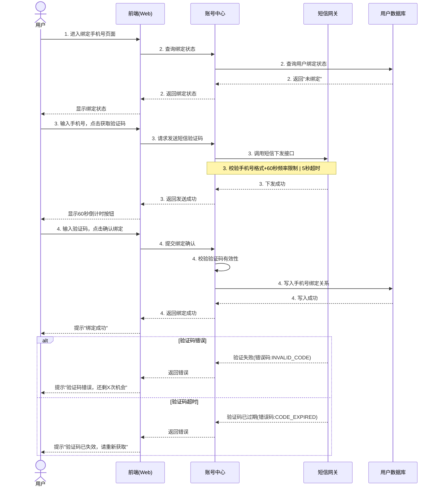

# 时序图生成 (generate-sequence)

## 概述

`generate-sequence` 扮演**系统分析员**角色——理解 PRD 中的用户故事和用例，结合系统架构参考文件，将用户操作步骤翻译为系统间的消息交互序列，生成 Mermaid `sequenceDiagram` 时序图，最终通过 `pmcraft-req:save-doc` 保存到 `sequence/` 目录。

与 `pmcraft-req:generate-flowchart`（用户操作视角的流程图）互补且粒度不同：
- **流程图** = 用户视角，按用例对齐（一个用例 = 一张流程图）。用例本身就是以"用户动作→系统反馈"为单位的叙事单元。
- **时序图** = 系统协作视角，按用户故事对齐（一个故事 = 一张时序图）。PRD 的主成功流程以参与者视角写作、有意排除后台逻辑；同一故事下的多个用例共用同一组系统、同一条调用链，合并为一张图才能让开发看到完整的系统间协作全景。

## Guard-Chat 守卫检查（第 0 步）

> 本小节为守卫开关检查，**不阻塞**主流程：执行完直接进入下一节。**子代理上下文**（被 spawn 执行、无法与用户交互，如 doc-reviewer/design-reviewer）整节静默跳过——不询问、不标记、不检测。

1. 运行 `node "{插件根}/_shared/scripts/guard-chat.js" status`，`{插件根}` = 从当前 SKILL.md 目录向上找第一个含 `_shared/scripts/guard-chat.js` 的祖先目录（source 环境=市场根，cache 环境=插件版本目录）。
2. 解析单行 JSON（契约：`{"status":"ok","data":{"enabled":bool,"prompted":bool,"dir":"…"}}`）：
   - `prompted=false` → 按话术库 GUARD-ASK（`enabled=false`）或 GUARD-ON（`enabled=true`）提示一次，然后运行 `node "{插件根}/_shared/scripts/guard-chat.js" mark-prompted`。用户紧随询问回复肯定意图（如「开启」），或任意轮次说「开启Guard-Chat」（路由表已注册）时，运行 `guard-chat.js enable`。
   - `prompted=true` → 跳过，不重复提示。
   - 话术库不可达（项目未跑 init-project、无大脑注入）→ 用兜底一句：「本会话可开启 Guard-Chat 守卫：开启后，你输入中可能影响判断的表述（如预设立场、权威宣称、逻辑谬误）会当场标注提醒；落盘文档中的对话填充语（如“好问题”、“希望对你有帮助”）会自动清除。说「开启Guard-Chat」开启（回复「开启」也可以），本会话只问一次。」（兜底非权威副本，有话术库时必须用话术库）
3. 脚本不可用（node 缺失/脚本缺失/JSON 解析失败）→ 静默跳过，继续主流程。
4. 本技能对话期间（仅 `enabled=true` 时）：① 每条用户消息经 `guard-chat.js detect`（stdin）检测，命中时单行简短标记，不打断流程；② 文档落盘前（save-doc 保存、直接写入报告文件）经 `guard-chat.js purify`（stdin）净化。规则见路由大脑「Guard-Chat 守卫行为」节。对话回复文风遵循 agent 定义的文风底线（无需脚本）。

## 输入

| 参数 | 类型 | 必选 | 说明 | 示例 |
| :--- | :--- | :--- | :--- | :--- |
| PRD路径 | 文件路径 | 是 | 符合模板格式的PRD .md文件路径，包含5.x用户故事和用例章节 | `./电商平台/1.0.0/prd/电商平台_1.0.0_PRD_E1.md` |

## 调用方式

```
generate-sequence <PRD路径>
```

**示例：**

```
generate-sequence ./电商平台/1.0.0/prd/电商平台_1.0.0_PRD_E1.md
```

## 工作流程

### 第一步：检索架构参考文件（技能目录 + 用户文件夹 + 询问用户路径）

架构参考有三个来源，按优先级：**PM 本次提供 > 用户文件夹 > 技能 `references/`**。用户文件夹是用户级共享层（跨项目共享、升级不覆盖），路径为 `%USERPROFILE%\.claude\user-data\pmcraft-req\architecture\`（Bash 下 `$HOME/.claude/user-data/pmcraft-req/architecture/`，路径一律正斜杠）。

1. 用 `Glob` 扫描技能 `references/*.md`，列出所有 `.md` 文件。
2. **过滤指引文件**：从扫描结果中排除文件名以下划线 `_` 开头的文件（如 `_架构参考指引.md`），这些是指引文件而非架构参考。过滤后的剩余文件即为技能自带候选架构参考文件。
3. **扫描用户文件夹**：用 `Glob` 扫描 `%USERPROFILE%\.claude\user-data\pmcraft-req\architecture\*.md`，列出所有 `.md` 文件。**目录不存在时静默跳过**（视为"无用户级文件"，行为与旧版一致），不报错。
4. **询问 PM 是否还有其他路径的架构参考文件**：
   > 架构参考来源：技能自带 {无 / 文件列表}；用户文件夹 {无 / 文件列表}。
   > 是否还有其他路径的架构参考文件（如项目目录下的 .md 文件）？有请提供路径，无则按 Enter 跳过。
5. **PM 提供路径** → 校验文件存在（不存在则提示"路径不存在，请重新提供"，回到第 4 步，**最多 3 次**；3 次后仍未提供有效路径则跳过该询问，直接按后续优先级选择架构参考）。校验通过后：
   - **路径卫生（必须）**：PM 提供的路径是外部输入，拼入 Bash 命令前须先拒绝含 shell 元字符（`;` `&` `|` `$` `` ` `` 或换行）的路径并请 PM 换路径；命令中的路径一律用单引号包裹（如 `cp '<源路径>' '<目标路径>'`），禁止裸插值。也可改用 `Read`/`Glob`/`Write` 工具代替 `ls`/`cp` 等 shell 命令。
   - **拉入用户文件夹**：`Bash mkdir -p` 创建用户级目录（如不存在），`cp` 复制到 `%USERPROFILE%\.claude\user-data\pmcraft-req\architecture\`，文件名保留。**同名冲突**：若目标已存在同名文件，追加序号（如 `架构参考_2.md`），不覆盖旧文件。复制后 `wc -l` 对比源/目标行数一致，失败则重试（最多 2 次，仍失败则停止该文件处理并提示"复制校验失败，请手动复制到用户文件夹"）。
   - 告知 PM：
     > 架构参考已保存到用户文件夹（跨项目共享、升级不丢失）：
     > 📁 {用户级目录绝对路径}/{文件名}
     > 下次生成时序图会自动引用。如有新版架构文件，随时提供即可，同样会拉入。
   - **优先使用 PM 提供的文件**（PM 本次提供 > 用户文件夹 > 技能自带）。
6. **PM 跳过** → 选择架构参考文件：
   - **用户文件夹有文件** → 使用用户文件夹文件：
     - 多个 → 列清单让 PM 选（复用多文件展示模式）：
       > 检测到用户文件夹中的系统架构参考文件：
       > 1. 账号系统架构.md
       > 2. 电商平台架构.md
       > 请输入序号选择，或按 Enter 使用默认（第1个）。
     - 1 个 → 直接使用。
     - 使用用户文件夹文件时，提醒：
       > 本次引用用户文件夹的架构参考：{文件名}。若有新版，提供路径即可更新。
   - **用户文件夹无文件** → 使用技能自带文件（沿用旧逻辑）：
     - 多个 → 列清单让 PM 选择（复用用户文件夹多文件展示模式，默认第 1 个）
     - 1 个 → 直接使用
     - 无 → 展示格式建议，提示：
       > 未提供架构参考文件。请在项目目录（如 `pmcraft/`）下放置一份描述各系统职责的 .md 文件，或放入用户文件夹 `%USERPROFILE%\.claude\user-data\pmcraft-req\architecture\`（跨项目共享、升级不丢失）后重新运行本技能。
       >
       > 参考文件格式建议：
       >
       > ```markdown
       > # 系统架构参考
       >
       > ## 系统清单
       > | 系统名称 | 归属 | 职责 | 接口类型 | 备注 |
       > |:---|:---|:---|:---|:---|
       > | 账号中心 | 本项目组 | 用户注册、登录、手机绑定、密码管理 | HTTP API | home 子系统 |
       > | 短信网关 | 非本项目组 | 短信验证码下发与校验 | RPC | 第三方：阿里云短信 |
       > | 前端(Web) | 本项目组 | 用户交互界面 | — | React SPA |
       > ```
7. 选定后，用 `Read` 工具读取该架构参考文件，内部消化记录：每个系统名称、归属（本项目组/非本项目组）、职责边界、对外接口类型（HTTP/RPC/MQ 等）。**如果 Read 失败** → 提示"架构参考文件读取失败，请重新提供路径或另选文件"，回到第 4 步重新询问。
8. **架构参考与 PRD 术语表的优先级**：若 PRD 第 4.1 节「专有术语表」中定义了与架构参考同名的系统，以**架构参考文件为准**——架构参考是专门为时序图准备的技术元数据。PRD 术语表仅用于理解用例中出现的非系统业务概念（如"验签令牌""国补价格"等专有名词），不作为系统 participant 的来源。

> **设计意图**：架构参考文件不与单个 PRD 绑定，而是复用——一个业务域一份架构参考，该域下所有 PRD 共用。架构参考有三个来源：技能 `references/`（随插件分发、运行时自动扫描）、用户文件夹 `%USERPROFILE%\.claude\user-data\pmcraft-req\architecture\`（跨项目共享、升级不覆盖，PM 首次提供后自动拉入）、项目目录（运行时提供路径，推荐，不随插件升级丢失）。用户文件夹是唯一跨项目持久层——放技能 references/ 随升级丢失，放项目目录易被项目文件清理，用户文件夹两者兼顾。PM 在首次使用前准备，后期有变化时直接更新即可。

### 第二步：读取 PRD 并解析用例

1. 用 `Read` 工具读取 PRD 文件。**如果 Read 失败或路径不存在** → 提示"文件不存在，请确认 PRD 路径"，终止流程，不进入后续步骤。
2. 按用户故事（`### 5.x 故事X：`）和用例（`#### 用例X：`）层级遍历。
3. 对每个用例提取：
   - **名称**：位于 `#### 用例X：[动作+客体]` 中的动作+客体
   - **参与者**：主要参与者、次要参与者的角色名称
   - **主成功流程**：数字步骤列表
   - **扩展流程**：按业务异常 / 系统故障 / 外部依赖异常分组

### 第三步：检测已有时序图（增量生成基线）

从 PRD 路径提取**功能顶级文件夹**和**当前版本号**后，按以下优先级查找基线：

1. **本版本查找**：用 `Glob` 扫描 `<功能顶级文件夹>/{当前版本}/sequence/*时序图*.md`。
   - **若存在**：读取最新 E 编号文件作为基线。逐个故事提取已有 participant 声明（名称、别名、排列顺序）。进入**本版本增量**模式。**如果读取失败** → 按全新推演模式处理，并在输出文档顶部标注"基线文件读取失败，本次为全新推演"。
2. **跨版本查找**（本版本无时序图时）：用 `Glob` 扫描 `<功能顶级文件夹>/*/sequence/*时序图*.md`，筛选与当前版本**同主版本号**（如当前 1.1.0，只看 1.x.x）中版本号最高的时序图。
   - **若找到**：读取该文件的 participant 声明作为参考基线。AI 基于架构参考文件独立推断当前版本的生命线，与基线对比后向 PM 展示：
     > 检测到 {基线版本} 的时序图，生命线：{基线生命线列表}
     > 本版本（{当前版本}）AI 推断的生命线：{当前推断生命线列表}
     > 变化：{新增/删除的系统}
     > 是否沿用 {基线版本} 的生命线顺序？回复 **是** 继承基线，或输入 **重新推断**。
   - PM 确认"是"后，进入**跨版本增量**模式：沿用基线的生命线列表和顺序，新增系统追加到末尾，删除的系统移除，然后根据当前 PRD 全新推演消息流。
   - PM 确认"重新推断"或**未找到**：进入全新推演模式。
3. **主版本变化**：若当前版本与已有文件的主版本号不同（如已有 1.x.x，当前为 2.0.0），跳过跨版本检测，直接进入全新推演模式。

> **设计意图**：修订版递增（1.0.0→1.0.1）和次版本递增（1.0.0→1.1.0）时架构通常不变，但跨版本不自动继承——让 PM 看一眼差异再决定。主版本递增（1→2）假设架构已变，不提示以避免误导。

### 第四步：架构推演（核心）

AI 以**系统分析员**身份，基于选定的架构参考文件，对每个用户故事执行以下推演。**同一故事下的所有用例合并为一张时序图**：

1. **提取故事概览** — 记录用户故事标题、优先级、角色。读通该故事下所有用例的主成功流程和扩展流程，建立完整的业务叙事理解。
2. **确定涉众系统**：
   - **增量模式**（本版本或跨版本继承基线）：直接复用基线中的生命线列表和顺序。若 PRD 中新增了涉及新系统的用例，将新系统追加到生命线末尾。不得调整已有生命线的顺序。
   - **全新模式**：将故事中所有用例涉及的参与者与架构参考文件中的系统匹配，合并为一份系统清单。

   **架构参考粒度不足时的拆分规则**：当 PRD 文本明确区分了同一架构系统的不同交互边界时（判定标准：PRD 步骤中该"系统"作为**不同动作的主体或接收方**——如"玩家在 Steam 商店购买"→玩家是动作者，"账号中心向 Steam 查询"→账号中心是动作者），可将该架构系统拆为多个 participant。拆分后的 participant 以蓝色文字标注"架构参考未独立列出，基于 PRD 文本拆分"。
3. **拆解消息流** — 将故事下所有用例的主成功流程按逻辑顺序串联为系统间消息交互。用 `opt` 块包裹各用例的非必然步骤，保持清晰的"哪个用例触发了哪段交互"的追溯性。
   - PRD 步骤"用户点击确认绑定，系统提示成功"翻译为：
     - 前端 → 账号中心：提交绑定请求
     - 账号中心 → 数据库：写入绑定关系
     - 数据库 → 账号中心：写入成功
     - 账号中心 → 前端：返回绑定成功
     - 前端 → 用户：显示成功提示
4. **定位异常边界** — 对故事下所有扩展流程，判断异常发生在哪个系统边界，用 `Note over` 标注异常场景和处理策略。仅在主成功流程的核心分岔（如缓存命中/未命中）使用一个 `alt` 块。
   - "验证码错误"发生在账号中心的校验逻辑边界。
   - "短信网关超时"发生在短信网关边界。

   **扩展流程的时序图体现决策标准**：遍历所有扩展流程，按以下规则判断是否画入图中：
   - ✅ **画入**：消息路由切换（如缓存未命中→改为实时查询）、响应来源替换（如 Steam 超时→降级返回缓存）、链路断裂（如某系统不可达）。这些会改变开发对"消息怎么走"的理解。
   - ❌ **不画**：同一消息链路的业务结果分支（如鉴权返回"无权限"、查询返回"无变化"）。这些不影响消息路径，仅影响 UI 展示状态——应留给原型和验收标准覆盖。
   - **判定口诀**：忽略这条扩展，开发会误解消息路由吗？会→画。不会，只是少知道一种 UI 展示状态→不画。
5. **补充架构隐式交互** — 补全 PRD 中未写但架构上必然发生的交互，如鉴权校验、数据持久化、日志记录等。
6. **补充共同规则交互** — 回顾 PRD §4.2 共同规则和 §4.1 专有术语表。若某条规则描述了系统间交互（如"定期同步"、"异步通知"、"定时刷新"），但所有用例的主成功流程均无对应步骤，则以 `-)` 异步箭头 + `Note` 形式补充，标注引自 `§4.x`。此为"规则驱动"的隐式交互——PM 已声明的业务规则，即使未分配到用例步骤，也须在时序图中体现。

**推演原则：**
- 每个用户故事生成一张时序图。同一故事下的多个用例合并，用例间用 `opt` 块区分或按顺序自然衔接。
- 每条 PRD 步骤至少拆解为 1 对请求→响应。
- 主动识别 PRD 步骤中隐含的系统间调用（如"显示历史记录"隐含了一次后端查询）。
- 异常分支锚定到具体系统边界，不要笼统归为"系统故障"。
- 不确定归属的系统调用以 <span style="color:blue">蓝色文字</span> 标注。

### 第五步：生成 Mermaid sequenceDiagram

**生成规则：**

- 使用 `sequenceDiagram` 语法。
- **图名标注**：图名、版本等信息在第六步的图信息表格中已标明，Mermaid 代码块内不再重复标注。
- **actor 声明**：人类用户用 `actor` 声明，系统用 `participant` 声明。
- **生命线数量**：单张图涉众系统控制在 **2–7 条**。若超过 7 条，说明场景过大，应提示用户考虑拆分为多个子用例。
- **生命线排列**：按消息传递方向从左到右排列——actor 在最左侧，数据库在最右侧，交互频繁的系统相邻放置以减少线条交叉。
- **系统命名**：使用架构参考文件中的正式系统名作为 Mermaid participant 标签。
- **消息箭头**：
  - 请求：`->>`（实线箭头）
  - 响应 / 返回：`-->>`（虚线箭头）
  - 仅对关键结果画返回消息（如查询结果、状态码），不为简单的 setter/getter 画无意义返回。
- **消息命名**：每条消息必须表达**业务意图**而非技术实现细节。粒度标准：
  - ❌ 太细：`getInputText()`、`setValue()`
  - ✅ 刚好：`校验手机号格式`、`计算订单折扣`
  - ❌ 太粗：`处理登录`
- **消息加 PRD 步骤号前缀** — 各交互的**第一条请求消息**以 PRD 主成功流程步骤号开头（如 `1. Steam登录`、`3. 查询本地缓存`），方便对照 PRD 追溯。该步骤内后续的系统间消息和响应消息共用此步骤号。
- **禁止使用 `activate`/`deactivate`** — `alt`/`else`/`opt` 分支场景下 Mermaid 无法正确跨分支追踪激活状态，必导致 "inactive participant" 错误。系统内部处理用 `X->>X:` 自调用表达，消息箭头本身已清晰表达调用方向。
- **异常分支**：仅对主成功流程的**核心分岔**使用一个 `alt`/`else` 块（如缓存命中/未命中）。其余异常分支用 `Note over` 描述。
- **可选步骤**：用 `opt` 块包裹非必然发生的步骤，如 `opt 使用优惠券`。
- **循环**：非异常类的重复逻辑（如"遍历购物车商品"）用 `loop` 块包裹，标注终止条件。重试、超时等异常类重复不用 `loop`，遵循简化原则用 `Note over`。
- **注释**：用 `Note over 系统1,系统2: 注释文字` 标注关键业务规则（解释"为什么"而非重复消息"做什么"）。
- **非功能性约束**：耗时或系统状态约束（如"5秒超时"、"[状态=正常]"）优先写入箭头消息或合并到管道符 Note 中，跟随被标注的消息就近放置，不单立 Note。
- **每个用户故事生成一张图**，以 ` ```mermaid ` 代码块包裹。同一故事下所有用例的消息流串联到同一张图中。

- **简化原则**（参考人工绘制风格）：
  - **一个 `alt` 上限**：每张图最多一个 `alt` 块，只表达最核心的业务分支。其余异常分支用 `Note` 描述。
  - **嵌套深度 ≤2**：`alt`→`else` 即为最深，禁止 `alt` 内嵌 `alt`/`loop`/`opt`。
  - **异常不展开**：重试/超时/服务不可用等异常用 `Note over` 标注场景和处理策略，不画 `loop`/`alt` 分支。
  - **异步用 `-)`**：后台同步/定期任务用 `-)` 异步箭头 + `Note`，不展开同步流程。
  - **自调用用 `X->>X:`**：系统内部处理不用激活框，直接用自调用消息。
  - **场景切换用 `Note over`**：标注阶段过渡（如 `Note over P,GC: 玩家回到游戏内`），而非重复消息语义。
  - **Note 收敛**：Note 是辅助手段，优先将信息嵌入箭头消息。收敛手段：
    - **消息吸纳**：说明性文字（校验规则、去重逻辑、触发方式等）优先写入箭头消息文案中，不单立 Note。
    - **管道符合并**：多条同类异常 Note 合并为一条，用 `|` 分隔（如 `Note over A,S: 3a. 异常X→处理 | 3b. 异常Y→处理`）。
    - **元信息不重复**：前置条件、触发方式等已在图信息表格中标明的内容，图内不再用 Note 重复。
    - **就近放置**：异常 Note 紧跟被标注的系统/步骤，不堆在末尾。

**示例输出：**



### 第六步：组装文档

按以下结构组装完整的 `.md` 文件——每个用户故事一张时序图：

```markdown
# {功能名} — 时序图

> **架构参考**：{文件名}（{技能目录 / 用户文件夹 / PM 提供的路径}）
> **版本**：{版本号}
> **生成日期**：{YYYY/MM/DD}
> **模式**：{首次生成 / 本版本增量 / 跨版本增量（基于 {基线版本}）}
> **源 PRD**：`{功能名}_{版本号}_PRD_E{源编号}.md`（生成时该文件为最新修订；后续修订后本图可能过期，请重新生成）
> **本次变更**：{增量模式时填写，首次生成留空}

## {故事1标题}（{P0/P1/P2}）

> 覆盖用例：{用例1：动作+客体}、{用例2：动作+客体}...

| 图信息 | |
|:---|:---|
| 图名 | sd {故事标题} |
| 关联故事 | {故事编号}：{故事标题}（含 {N} 个用例） |
| 前置条件 | {从故事所有用例的参与者/规则中综合提取} |
| 后置条件 | {故事中核心用例最终步骤的完成态} |
| 参与系统 | 系统A → 系统B → 系统C（按消息流方向排列） |

```mermaid
sequenceDiagram
    ...
```

## {故事2标题}（{P0/P1/P2}）
...
```

- 前置条件综合故事下所有用例的参与者字段和规则推导（如"用户已登录，积分 ≥ 100"）。
- 后置条件为该故事核心用例最终步骤的完成状态（如"订单状态=已创建，积分已扣减"）。
- 参与系统按消息传递方向排列，架构不确定的系统以 <span style="color:blue">蓝色文字</span> 标注。
- 同一故事下的多个用例自然串联，用例间用 `opt` 块或 `Note` 标注用例边界。用例边界标注不计入 Note 数量上限。
- 头部占位符填充：`{功能名}` 取 PRD 标题中的功能名；`{版本号}` 取源 PRD 文件名中的版本号；`{源编号}` 取源 PRD 文件名中的 E 编号（PRD 路径由第一步解析）。

### 第七步：确定版本信息并保存

1. **提取功能顶级文件夹和版本号**：从 PRD 路径解析。若路径符合 `<顶级文件夹>/<版本号>/prd/` 模式，则提取顶级文件夹路径和版本号。
2. **预保存质量检查**：四项质量指标（Mermaid 闭合、蓝色标签配对、占位符替换、版本号格式）由 `pmcraft-req:save-doc` 保存前自动执行（详见 `../save-doc/SKILL.md#预保存质量检查`），调用方无需手动检查；不合格时脚本拒绝保存并返回精确行号。
3. **生成内容摘要**：AI 根据时序图内容自动生成一句话摘要（如"账号系统绑定手机号时序图"），从已有用户信息中获取负责人。
4. **生成临时文件**：用 `Write` 工具将完整 .md 内容写入**项目根 `pmcraft/temp/`**（若不存在则先创建；命名 `{功能名}_时序图_{yyyy-MM-dd}.draft.md`）。**禁止写入系统 Temp 或 cwd**——save-doc 复制后临时文件即被删除，写入项目内临时区确保中途失败时产物可追踪。
5. **调用 `pmcraft-req:save-doc`**：执行以下命令保存文档（路径替换为实际值）。**参数安全（Bash 注入防护）**：`--summary` 为 AI 生成的摘要（文件内容拼接），构造 Bash 命令前须剔除 `"` `` ` `` `$` `;` `&` `|` `(` `)` 等 shell 元字符，参数值一律用双引号包裹后传入（详见 `../save-doc/SKILL.md#第四阶段：运行 save-doc.js（核心保存操作）`）：
   ```bash
   node "{save-doc 技能目录}/scripts/save-doc.js" \
     --base-dir="<功能顶级文件夹绝对路径>" \
     --version="1.0.0" \
     --doc-type="时序图" \
     --temp-file="<项目根>/pmcraft/temp/{功能名}_时序图_{yyyy-MM-dd}.draft.md" \
     --summary="<自动生成的摘要>" \
     --author="<负责人>"
   ```
6. **展示保存结果**：解析脚本返回的 JSON，向用户输出保存路径：`✅ 时序图已保存为：<路径> | 版本：<x.x.x> | 文档修订：<E编号>`。

**出口衔接（NEXT-TAIL 话术库）**：保存完成后提示：

> "时序图已完成。req 域剩余收尾：{缺失环节，按 测试用例 顺序}。直接说「继续收尾」即可。"（**NEXT-TAIL 模板**，话术库，见 CLAUDE.md「话术模板库」节）

## 禁止行为

1. **禁止无架构参考时强行生成** — 若技能 `references/` 目录为空且 PM 未提供其他路径，应跳过生成，不得使用硬编码的通用系统模型替代
2. **禁止直接修改 PRD 文件** — 本技能仅读取 PRD，不写入任何修改
3. **禁止使用非标准 Mermaid 语法** — 只使用 `sequenceDiagram`，不混合其他图表类型
4. **禁止将同一故事的用例拆成多张图** — 每个用户故事生成一张时序图，同一故事下所有用例合并，多个用例间用 `opt` 块区分或按逻辑顺序衔接
5. **禁止编造系统交互** — 所有消息流必须基于 PRD 流程步骤推演，不确定的系统归属以蓝色标注
6. **禁止使用裸技术术语或过于笼统的消息名** — 消息名使用"动作+客体"中文短语（如"校验手机号格式"），各交互的第一条请求消息以 PRD 步骤号开头，该步骤内后续的系统间消息和响应消息共用此步骤号
7. **禁止使用 `activate`/`deactivate`** — Mermaid 在分支中无法正确追踪跨分支激活状态，系统内部处理用 `X->>X:` 自调用
8. **禁止跨版本自动搬运基线** — 增量模式下不得自动调整已有生命线顺序；跨版本增量须经 PM 确认后才继承，主版本变化时禁止跨版本检测
9. **禁止嵌套深度超过 2 层** — 每张时序图最多使用一个 `alt`/`else` 块，禁止 `alt` 内再嵌套 `alt`/`loop`/`opt`
10. **架构参考文件中的系统名必须原样使用** — 不得自行缩写或改名。同一份输出中，同一系统的名称必须在所有时序图中保持一致。**例外**：当 PRD 文本明确区分了架构系统中不同交互边界的子概念时，可按第四步拆分规则将单一架构系统拆为多个 participant，拆分后以蓝色文字标注。
11. **保存前必须执行 Mermaid 闭合检查** — 验证临时文件中每个 ` ```mermaid ` 都有对应的 ` ``` ` 闭合标记。详见 `../save-doc/SKILL.md#预保存质量检查`。
12. **单张图生命线不超过 7 条** — 若识别出的涉众系统超过 7 个，该故事场景过大，应提示用户考虑拆分为多个子用例。
13. **每张图 Note 块不超过 3 个** — Note 过多会导致时序图视觉碎片化（Mermaid 中 Note 为黄色块）。超出时必须执行 Note 收敛：合并到箭头消息、多项用管道符合并为一条 Note、或删除与图信息表格重复的内容。

## 约束

1. **架构参考不可缺失** — 技能 `references/` 为空且 PM 未提供其他路径时，禁止强行生成，不得使用硬编码的通用系统模型替代。
2. **一张故事一张图** — 每个用户故事生成一张时序图，同一故事下所有用例必须合并为一张图，不得拆成多张。
3. **图规模上限** — 单张图生命线 2–7 条（超过 7 条提示用户考虑拆分为多个子用例）；每张图最多一个 `alt` 块、Note 不超过 3 个、嵌套深度 ≤2。
4. **Mermaid 语法约束** — 仅使用 `sequenceDiagram`；禁止 `activate`/`deactivate`；异常分支用 `Note over` 或单个 `alt` 表达，核心分岔之外的异常不展开分支。
5. **命名规范** — 系统名须原样使用架构参考文件中的正式名称（不得缩写改名）；消息名用"动作+客体"中文短语，各交互的第一条请求消息以 PRD 步骤号开头。
6. **只读 PRD** — 本技能仅读取 PRD，禁止直接修改 PRD 文件。

> 完整细则见上方「禁止行为」13 条。

## 正误示例

### 正确示例
```
generate-sequence ./电商平台/1.0.0/prd/电商平台_1.0.0_PRD_E1.md
```
预期：扫描技能 `references/` 并询问 PM 其他路径选择架构参考 → 读取 PRD 解析用户故事和用例 → 架构推演 → 每个用户故事生成一张时序图（同故事下多用例合并），通过 pmcraft-req:save-doc 保存到 `sequence/`。输出示例：
```
✅ 时序图已保存为：./电商平台/1.0.0/sequence/电商平台_1.0.0_时序图_E1.md
📝 版本：1.0.0 | 文档修订：E1
📋 共生成 3 张时序图，覆盖 3 个用户故事。
```

### 错误示例

**错误**: 传入需求简报而非 PRD
```
generate-sequence ./账号系统/1.0.0/brief/账号系统_1.0.0_需求简报_E1.md
```
- 问题：需求简报缺少 PRD 模板中的"用例"章节，无法提取主成功流程和扩展流程。
- 正确做法：先使用 `pmcraft-req:generate-prd` 基于简报生成 PRD，再对 PRD 执行 `generate-sequence`。

**错误**: 技能目录为空且 PM 未提供路径时仍强行生成
- 问题：无架构参考，AI 无法知道涉及哪些系统及其职责边界。
- 正确做法：提示 PM 先准备架构参考文件（项目目录或技能目录）。

**错误**: 传入不存在的文件路径
```
generate-sequence ./不存在的目录/PRD.md
```
- 问题：文件不存在，技能无法读取。
- 正确做法：确认 PRD 文件路径正确且文件已生成。

## 边缘情况处理

| 场景 | 触发条件 | 处理方式 | 示例回复 |
| :--- | :--- | :--- | :--- |
| references/ 有多个架构文件 | Glob 扫描结果 > 1 | 列出清单，请 PM 选择一个 | "检测到以下架构参考文件：[列表]。请输入序号选择。" |
| PM 提供技能目录之外的文件路径 | 询问环节 PM 提供路径 | 校验存在后优先使用该文件 | "使用您提供的架构参考文件：{路径}" |
| references/ 为空且 PM 未提供路径 | Glob 扫描结果 = 0 且询问跳过 | 展示格式建议，不降级生成 | "未提供架构参考文件。请在项目目录（如 `pmcraft/`）下放置一份架构参考 .md 文件，或放入技能 `references/` 后重新运行本技能。" |
| PRD 用例仅有主成功流程 | 扩展流程为空 | 仅生成主成功流程的同步交互。缺失标注在图信息表格的"后置条件"行体现（如"异常分支待补充"），图内不用 Note | "用例X 缺少扩展流程，异常分支将在图信息表格中标注。" |
| 架构文件中无匹配系统 | PRD 步骤中的动作在架构文件中找不到对应系统 | 以蓝色文字标注该消息，使用 PRD 原文描述作为临时系统名 | （消息以蓝色标注，提示"此系统在架构文件中未找到匹配项"） |
| PRD 使用非标准标题层级 | 用例标题不是 `#### 用例X：` 格式 | 尝试模糊匹配，若失败则跳过该用例，在输出中标注 | "以下用例因标题格式不标准未能解析：[列表]。请调整为 `#### 用例X：[动作+客体]` 格式后重新生成。" |
| 部分用例解析失败 | PRD 中部分用例格式不规范导致无法解析 | 跳过失败用例，继续生成成功的用例。在输出文档顶部添加"部分用例未能生成"警告，列出失败用例及原因 | "⚠️ 以下 {N} 个用例未能生成时序图：[列表及原因]。其余 {M} 个用例已正常生成。" |
| 已有时序图（本版本增量） | `sequence/` 目录已有同名时序图 | 读取最新版本为基线，继承生命线和顺序，仅根据 PRD 变更更新消息流；E 编号递增保存 | "检测到已有时序图 E{N}，将以增量模式重新生成。生命线结构保持不变，仅更新消息流。" |
| 跨版本检测到先前版本时序图 | 本版本 `sequence/` 为空，同主版本号下存在其他版本的时序图 | 展示基线生命线与当前 AI 推断的差异，请 PM 确认是否继承 | "检测到 1.0.0 的时序图（生命线：用户→前端→账号中心），本版本推断新增'支付网关'。是否沿用 1.0.0 的生命线顺序？" |
| PRD 新增故事但基线中无对应图 | 增量模式下 PRD 新增了基线中不存在的用户故事 | 新增故事用全新推演模式生成，已有故事用增量模式 | "用户故事'{故事标题}'在基线中不存在，将以全新模式生成该故事时序图。" |
| PRD 删除了基线中已有的故事 | 增量模式下基线中某故事在 PRD 新版本中被移除 | 该故事对应的时序图不再生成；在输出文档顶部标注已移除的故事 | "以下故事已在 PRD 新版本中移除，对应时序图不再生成：[列表]。" |

## 快速参考

| 操作 | 命令 |
|:---|:---|
| 生成时序图 | `generate-sequence <PRD路径>` |
| 粒度 | 每个用户故事生成一张时序图，同故事多用例合并 |
| 架构参考 | 自动扫描技能目录 + 询问 PM 其他路径（用户路径优先） |
| 系统名称 | 原样使用架构参考文件中的正式系统名 |

## 评价测试用例

### 正向触发（6条）
1. `generate-sequence ./电商平台/1.0.0/prd/电商平台_1.0.0_PRD_E1.md`（技能目录有架构文件，PM 跳过询问） — 预期：每个用户故事生成一张含完整系统消息交互的时序图，同故事多用例合并
2. `generate-sequence ./账号系统/1.0.0/prd/账号系统_1.0.0_PRD_E2.md`（含多角色——用户、管理员、外部系统） — 预期：每种角色在时序图中正确表现为 actor 或 participant
3. references/ 仅有 1 个架构文件且 PM 无其他路径 — 预期：静默选用
4. PRD 含 3 个故事 8 个用例 — 预期：每个故事一张图，共 3 张时序图（同故事多用例合并）
5. 故事下用例含完整的扩展流程（业务异常/系统故障/外部依赖异常） — 预期：核心分岔用 `alt`/`else` 表达，其余异常用 `Note over` 标注
6. PM 在询问环节提供项目目录下的架构参考路径 — 预期：校验存在后优先使用该文件

### 负向触发（5条）
1. `generate-sequence`（无参数） — 预期：提示需要 PRD 路径
2. `generate-sequence ./不存在的文件.md` — 预期：报错"文件不存在"
3. `generate-sequence ./需求简报.md`（非 PRD） — 预期：提示"该文件缺少用例章节，请提供完整 PRD"
4. references/ 为空且 PM 未提供路径 — 预期：提示准备架构参考文件，不降级生成
5. `generate-sequence ./`（传入目录而非文件） — 预期：提示"请提供 PRD 文件路径，而非目录"

### 边界查询（4条）
1. 一个用户故事下有 5 个用例、累计 20+ 步主成功流程 — 预期：合并为单张时序图，用 `opt` 区分用例边界，完整拆解不截断
2. 架构文件中有 10+ 个系统但某用例仅涉及其中 2 个 — 预期：participant 声明仅包含涉众系统，不列出无关系统
3. PRD 路径包含中文和空格 — 预期：正确解析路径，生成和保存不受影响
4. 已有时序图文件，PRD 仅修改了一条用例规则 — 预期：增量模式，生命线不变，仅更新对应消息，E 编号递增

## 注意事项

- 所有用户故事全部生成时序图，不筛选简单故事。
- 同一故事下的多个用例合并到一张图，用例间用 `opt` 块或 Note 标注边界，保持可追溯。
- 若 PRD 中使用了蓝色标记（`<span style="color:blue;">`），说明流程中存在 AI 推断内容，生成时序图时对应交互也以蓝色标注。
- 时序图文件名通过 pmcraft-req:save-doc 自动确定 E 编号，与其他文档类型的 E 编号互不关联。
- **生成后自检**：每张图生成完毕，AI 内部执行六向对照——① 故事下所有用例的主成功流程步骤是否都有对应消息支撑？② 所有符合筛选标准的扩展流程是否用 `Note` 或一个 `alt`/`else` 框住，纯业务结果分支是否正确排除？③ 确认时序图中无 `activate`/`deactivate` 残留（grep 结果应为零）。④ 同一故事多用例是否正确合并（无遗漏）？⑤ Note 数量是否 ≤3 个？超出则执行 Note 收敛后再写临时文件。⑥ 架构参考与 PRD 文本的参与者粒度是否一致？不一致时是否已按拆分规则处理并以蓝色标注？

## 参考资料

- **产品需求文档模板** — 本技能依赖的 PRD 结构，详见 `../../_shared/templates/prd_template.md`。
- **产品需求文档指引** — 用户故事与用例写作规范，详见 `../../_shared/templates/prd_guidelines.md`。
- **文档保存** — 本技能通过 `pmcraft-req:save-doc` 统一管理文档保存，详见 `../save-doc/SKILL.md`。
- **流程图生成** — 与 `generate-sequence` 互补的技能，详见 `../generate-flowchart/SKILL.md`。
