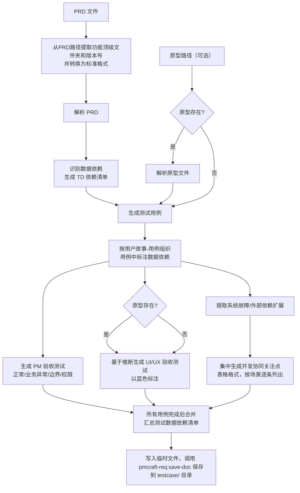

# 测试用例生成 (generate-testcase)

## 概述

`generate-testcase` 是一个面向产品经理的测试用例自动生成技能。读取一份已完成的 **PRD**（必须符合团队模板）和可选的**原型文件**后，它会：

1. **解析 PRD** — 遍历所有用户故事及其用例，提取主流程、异常、边界、权限与验收标准。
2. **解析原型（可选）** — 若提供前端文件路径，则提取页面、组件、交互与样式，用于提炼 UI/UX 验收要点；若未提供，则基于 PRD 描述与行业通用模式推断，并以蓝色文字明确标注。
3. **按 PRD 层级生成测试用例** — 输出分三部分：**PM 验收测试**（正常/业务异常/边界/权限，可执行）、**UI/UX 验收测试**（视觉/交互/文案）、**开发协同关注点**（系统故障/外部依赖，需与开发协同验证）。
4. **质量等级可选** — 支持 `--quality` 参数：`high`（完整格式）、`medium`（三行简练格式供快速验收）、`both`（同时生成中+高两份文件）。**未指定时默认 both（中+高两份）**，不再询问用户。
5. **优先级颜色标识** — 依据故事优先级（P0/P1/P2）将测试用例分别标记为 <span style="color:red">红色</span>、<span style="color:#d97706">橙色</span>、<span style="color:green">绿色</span>，不用符号，一目了然。
6. **UI/UX 中文本地化** — 所有英文专业术语（如按钮文案、状态提示、组件名称等）在 UI/UX 验收用例中必须翻译为中文，并可在括号内保留英文原文。
7. **统一用例编号规则** — 所有测试用例采用全局唯一的编号，按类型分配前缀，数字部分全文连续递增，不受用户故事或文档结构影响。
8. **规范保存** — 生成完毕后，从 PRD 路径自动提取版本信息并转换为标准格式（如 `1.0.0`），通过 `pmcraft-req:save-doc` 技能将测试用例保存到对应的版本目录下。
9. **测试数据依赖管理** — 解析 PRD 后自动识别用例所需的数据依赖（实体 × 状态 × 数量），在用例中显式标注，并汇总到"测试数据依赖清单"章节（含获取方式分类）。**禁止 AI 编造具体数据值**——具体值由执行方获取（pmcraft-test 实测采集 / 测试环境预置 / 人工准备）。

## Guard-Chat 守卫检查（第 0 步）

> 本小节为守卫开关检查，**不阻塞**主流程：执行完直接进入下一节。**子代理上下文**（被 spawn 执行、无法与用户交互，如 doc-reviewer/design-reviewer）整节静默跳过——不询问、不标记、不检测。

1. 运行 `node "{插件根}/_shared/scripts/guard-chat.js" status`，`{插件根}` = 从当前 SKILL.md 目录向上找第一个含 `_shared/scripts/guard-chat.js` 的祖先目录（source 环境=市场根，cache 环境=插件版本目录）。
2. 解析单行 JSON（契约：`{"status":"ok","data":{"enabled":bool,"prompted":bool,"dir":"…"}}`）：
   - `prompted=false` → 按话术库 GUARD-ASK（`enabled=false`）或 GUARD-ON（`enabled=true`）提示一次，然后运行 `node "{插件根}/_shared/scripts/guard-chat.js" mark-prompted`。用户紧随询问回复肯定意图（如「开启」），或任意轮次说「开启Guard-Chat」（路由表已注册）时，运行 `guard-chat.js enable`。
   - `prompted=true` → 跳过，不重复提示。
   - 话术库不可达（项目未跑 init-project、无大脑注入）→ 用兜底一句：「本会话可开启 Guard-Chat 守卫：开启后，你输入中可能影响判断的表述（如预设立场、权威宣称、逻辑谬误）会当场标注提醒；落盘文档中的对话填充语（如“好问题”、“希望对你有帮助”）会自动清除。说「开启Guard-Chat」开启（回复「开启」也可以），本会话只问一次。」（兜底非权威副本，有话术库时必须用话术库）
3. 脚本不可用（node 缺失/脚本缺失/JSON 解析失败）→ 静默跳过，继续主流程。
4. 本技能对话期间（仅 `enabled=true` 时）：① 每条用户消息经 `guard-chat.js detect`（stdin）检测，命中时单行简短标记，不打断流程；② 文档落盘前（save-doc 保存、直接写入报告文件）经 `guard-chat.js purify`（stdin）净化。规则见路由大脑「Guard-Chat 守卫行为」节。对话回复文风遵循 agent 定义的文风底线（无需脚本）。

## 输入

| 参数 | 类型 | 必选 | 说明 | 示例 |
| :--- | :--- | :--- | :--- | :--- |
| PRD路径 | 文件路径 | 是 | 符合模板格式的PRD文件路径 | `./账号系统/1.0.0/prd/账号系统_1.0.0_PRD_E1.md` |
| 原型路径 | 文件或目录路径 | 否 | 前端原型路径，用于提炼UI/UX验收要点 | `./账号系统/1.0.0/prototype/` |
| 质量等级 | `--quality` | 否 | 可选值：`high`（完整格式）、`medium`（三行简练格式）、`both`（同时生成中+高两份）。**未指定时默认 both（中+高两份）** | `--quality medium` |

> **测试数据**：本技能会解析 PRD 并识别用例所需的数据依赖（实体 × 状态 × 数量），在用例中显式标注并汇总到"测试数据依赖清单"章节。**不收集、不编造具体数据值**——具体值由执行方获取：自动化测试由 `pmcraft-test` 实测采集，无法实测的数据由测试环境预置或人工准备。

## 调用方式

```
generate-testcase <PRD路径> [原型路径] [--quality medium|high|both]
```

**示例：**

```
generate-testcase ./账号系统/1.0.0/prd/账号系统_1.0.0_PRD_E1.md ./design/login/prototype.html
```

或仅 PRD（无原型）：

```
generate-testcase ./账号系统/1.0.0/prd/账号系统_1.0.0_PRD_E1.md
```

或指定质量等级：

```
generate-testcase ./账号系统/1.0.0/prd/账号系统_1.0.0_PRD_E1.md --quality medium
generate-testcase ./账号系统/1.0.0/prd/账号系统_1.0.0_PRD_E1.md --quality both
```

> **注意**：PRD 路径中的版本号可能是小写 `v` 开头，`generate-testcase` 会自动移除前缀字母（如 `v1.0.0` → `1.0.0`）再传递给 `pmcraft-req:save-doc`，无需人工干预。推荐版本号格式为 `1.0.0`。

## 输入要求

### PRD 文件

- **必须遵循团队《产品需求文档模板》**，包含完整的用户故事和用例章节。
- 技能将从中提取：
  - 文档版本、背景、产品目标
  - 专有术语表、共同规则
  - 所有用户故事（标题、优先级 P0/P1/P2、涉及角色）
  - 每个故事下的所有用例（参与者、主成功流程、扩展流程分类、用例规则、权限控制、验收标准分组）
- 若 PRD 中缺失必需字段，生成结果可能不完整。
- PRD 路径需要符合版本管理规范，技能将从中自动提取功能顶级文件夹和当前功能版本号（并统一为标准 `1.0.0` 格式）。

### 原型文件（可选）

- 支持格式：`.html`、`.vue`、`.jsx`、`.tsx`
- 若传入文件夹路径，将递归读取所有支持类型的文件
- 解析目标：页面清单、交互组件（按钮、表单、弹窗等）、跳转逻辑、UI 元素属性（文字、颜色、尺寸、状态等）
- 若未提供，UI/UX 验收部分将全部基于推断生成，并以 <span style="color:blue">蓝色文字</span> 标注。**建议**：可首先使用 `pmcraft-proto` 生成标准原型，再基于原型执行 `generate-testcase`，以获得更准确的 UI/UX 测试用例。

## 用例编号规则（必须严格遵循）

| 测试类型 | 前缀 | 含义 | 编号示例 |
| :--- | :--- | :--- | :--- |
| 正常流程测试 | TC-F- | Function / Flow | TC-F-1, TC-F-2, TC-F-3… |
| 业务异常测试 | TC-E- | Exception (业务异常) | TC-E-1, TC-E-2, TC-E-3… |
| 边界条件测试 | TC-B- | Boundary | TC-B-1, TC-B-2, TC-B-3… |
| 权限控制测试 | TC-P- | Permission | TC-P-1, TC-P-2, TC-P-3… |
| 系统故障关注点 | CD-S- | Concern — System failure | CD-S-1, CD-S-2, CD-S-3… |
| 外部依赖关注点 | CD-D- | Concern — Dependency failure | CD-D-1, CD-D-2, CD-D-3… |
| UI/UX-布局与视觉验收 | TC-UI-L- | Layout & Visual | TC-UI-L-1, TC-UI-L-2… |
| UI/UX-交互与反馈验收 | TC-UI-I- | Interaction | TC-UI-I-1, TC-UI-I-2… |
| UI/UX-文案与样式验收 | TC-UI-T- | Text & style | TC-UI-T-1, TC-UI-T-2… |

**编号规则要点：**

- 数字部分为全文统一序号，从 1 开始自然递增，各类型共用同一个计数器。
- 同一类型内的编号可以不连续（因全局递增），但保证唯一。
- 编号顺序与文档中测试用例出现的先后顺序一致（先 PM 验收测试，后 UI/UX 验收测试，最后开发协同关注点）。
- 生成时不得因用户故事切换而重置计数器。

## 工作流程



**加载策略总览：**

| 参考文件 | 加载时机 | fallback |
|:---|:---|:---|
| `references/output-template.md` | 第四步入口 Read（生成用例前） | 如果 Read 失败，依据第四步生成规则与第五步统计需求自行构建模板骨架 |

## 详细步骤说明

### 第一步：提取版本信息并解析 PRD

1. 从 PRD 文件路径中提取功能顶级文件夹和当前功能版本号。例如路径为 `./账号系统/1.0.0/prd/账号系统_1.0.0_PRD_E1.md`，则功能顶级文件夹为 `./账号系统`，原始版本号为 `1.0.0`。
2. **统一版本号格式**：若原始版本号带有前缀字母 `v`，则移除前缀（例如 `v1.0.0` → `1.0.0`），推荐版本号格式为 `1.0.0`。该标准化版本号将作为参数传递给 `pmcraft-req:save-doc`。
3. **颜色标记检查**：详见 `../../_shared/templates/color_check_guideline.md` 中定义的检查流程。**如果读取失败** → 执行核心检查项：扫描 PRD 中残留蓝色标记的配对完整性，发现异常时向 PM 提示，并在测试用例文档顶部标注"颜色标记检查降级执行"。
4. 读取 PRD 文档，提取版本号、背景、产品目标。
5. 遍历所有 **用户故事**（5.1、5.2…），记录：
   - 故事标题、优先级（P0/P1/P2）、涉及角色
6. 遍历每个故事下的 **用例**（用例1、用例2…），注意用例本身无优先级字段，后续生成的测试用例 **直接继承该用例所属故事的优先级**。
7. 对每个用例抽取：
   - 参与者（主 / 次）
   - 主成功流程（步骤列表）
   - 扩展流程：按"业务异常""系统故障""外部依赖异常"分组
   - 用例规则（私有业务规则；**遇 `同 R{n}` 引用式条目时到 §4.2 展开 R{n} 全文**——被引用的公共规则同属本用例适用规则）
   - 权限控制（角色权限说明及越权处理）
   - 验收标准：正常流程、异常流程、边界条件、权限控制

### 第二步：识别数据依赖

0. **引用展开**：若用例「用例规则」含 `同 R{n}` 引用式条目，先到 §4.2 取出 R{n} 全文，与本用例私有规则合并后再参与后续识别（被引用公共规则的实体约束同属本用例 TC-B 覆盖范围，引用式本身不直接作为 TC 断言）。
1. **扫描内容区域**：对每个用例，扫描以下区域识别"需要具体业务数据实体支撑"的依赖：
   - **主成功流程**：输入、查询、修改、删除等涉及具体实体的动作
   - **业务异常条件**：条件描述涉及实体特定状态（如"未注册""已注销""已过期"）
   - **边界条件验收标准**：边界值涉及实体或输入数据（如"金额为0""超长字符串"）
   - **用例规则**：规则描述涉及实体约束（如"已注销账号不可登录"）
   - **权限控制**：角色对应的可操作实体（如管理员账号、普通用户账号）
2. **归类维度**：按 **实体 × 状态 × 数量** 归类生成依赖项。同一"实体+状态"组合被多个用例引用时**合并为一个依赖项**（引用用例列追加）。数量基于用例步骤推断（通常为 1 个；边界测试可能需要"至少 N 个"）。
3. **明确排除**：CD-S/CD-D（系统故障/外部依赖模拟）不产生数据依赖——模拟故障不需要具体业务数据。
4. **每个依赖项分配唯一编号**：`TD-{N}`（N 从 1 开始，全文连续递增，独立于 TC/CD 编号）。
5. **标注获取方式**（结合用例场景判定，见下表）：
   | 获取方式 | 判定 | 说明 |
   |:---|:---|:---|
   | **实测采集** | 实体在系统中通常已存在（已注册账号、列表数据、正常记录） | 由 `pmcraft-test` 实测采集（打开页面取真实值）；正常流程/列表查询类多为此类 |
   | **环境预置** | 系统无此实体/特殊状态（未注册、已注销、超长字符串、0 值） | 需在测试环境造数据或由测试/开发预置；异常/边界/特殊状态类多为此类 |
   | **人工准备** | 需特定角色或外部账号（管理员、审核员、第三方账号） | PM 手动验收或 `collect-manual` 人工验证时准备；权限/多角色类多为此类 |
6. **禁止编造具体值**：识别依赖时**不得**为任何依赖项编造具体数据值（如账号、密码、手机号、订单号）。只标注"实体 × 状态 × 数量"，具体值由执行方获取。

### 第三步：解析原型（若提供）

- 若 `原型路径` 存在且有效，按以下优先级读取原型文件：
  1. **E 结构优先**：首先检查 `<原型路径>/E{max}/pages/`、`<原型路径>/E{max}/page-inventory.md`、`<原型路径>/E{max}/spec.md`（E{max} 为最大 E 编号目录）
  2. **working 目录**：若未发现 E 目录，则检查 `<原型路径>/working/pages/`、`<原型路径>/working/page-inventory.md`、`<原型路径>/working/spec.md`
  3. **传统模式**：若以上均不存在，直接读取原型路径下的文件（传统模式，如 `.html`、`.vue`、`.jsx`、`.tsx` 等）
- 解析前端文件，提取：
  - 页面清单与组件结构
  - 交互组件及状态变化（如加载中、成功、失败、空数据等）
  - 跳转逻辑与路由
  - UI 元素属性（文案、状态与视觉语义，如"启用状态=绿色标识""模块间距统一"）
- 生成原型解析摘要，用于辅助提炼 UI/UX 验收要点。**提取仅用于理解页面结构与状态体系——禁止将具体色号、像素/字号数值、组件库名及其 API/属性/指令名（如 v-loading、empty-text）等实现细节带入解析摘要与用例文本**（输出侧硬约束见第四步"UI/UX 验收测试"）。
- 若 `原型路径` 不存在或未提供，则全部基于 PRD 描述与行业通用模式推断，并以蓝色文字标注。**建议**：可首先使用 `pmcraft-proto` 生成标准原型，再基于原型执行 `generate-testcase`，以获得更准确的 UI/UX 测试用例。

### 第四步：生成测试用例

> **加载输出文档模板**：进入生成阶段前，先 Read `references/output-template.md` 获取完整输出文档模板（七章骨架、统计占位符与填写规则）。
> **如果 Read 失败**，依据本步骤生成规则与第五步统计需求自行构建模板骨架（测试概览→测试数据依赖清单→PM 验收测试→UI/UX 验收测试→开发协同关注点→测试用例汇总表→验收标准追溯矩阵）。

#### 组织结构

```
一、PM 验收测试
  故事1：标题（P0） <span style="color:red">高</span>
    用例1：动作+客体
      正常流程测试
      业务异常测试
      边界条件测试
      权限控制测试
    用例2：...
  故事2：标题（P1） <span style="color:#d97706">中</span>
    ...
二、UI/UX 验收测试
三、开发协同关注点
  ├─ CD-S-1：加载列表超时（关联用例1）
  ├─ CD-S-2：提交接口超时（关联用例1）
  └─ CD-D-1：第三方接口异常（关联用例2）
```

#### 生成规则

按以下规则逐类生成测试用例：

1. **生成正常流程测试（TC-F-）**：将主成功流程拆解为测试步骤，同页面连续步骤聚合，单条用例步骤数不得超过 8 步。
2. **生成业务异常测试（TC-E-）**：对扩展流程中的每个 `[条件]→[处理动作]` 生成一条测试用例。
3. **生成边界条件测试（TC-B-）**：基于边界条件验收标准和用例规则生成，每条用例必须标注数据依赖（实体 × 状态 × 数量），**不得编造具体数据值**。边界值本身（如超长字符串、0 值）作为依赖项纳入清单。
4. **生成权限控制测试（TC-P-）**：对每个角色的操作权限、数据权限及越权处理分别生成一条用例。
5. **填充前置状态**：如果质量等级为 `high`，每条 PM 验收测试用例都必须描述前置状态。如果质量等级为 `medium`，使用三行格式，不强制前置状态。
6. **组合每条用例**：每条 PM 验收测试用例必须包含：**用例编号**（TC- 前缀）、**前置状态**（仅 high）、**测试步骤**（有序列表）、**预期结果**（有序列表）、**关联验收标准**。
7. **标注数据依赖**：测试步骤、前置状态或预期结果中涉及具体业务数据时，以"实体 × 状态 × 数量"格式标注依赖（如"输入一个已注册账号（依赖：已注册账号×1）"）。多实体依赖用逗号分隔。**禁止编造具体数据值**（账号、密码、手机号、订单号等）——只标注依赖，具体值由执行方获取。
8. **处理空章节**：如果 PRD 中某类内容（如边界条件、权限控制）为空，对应类型输出"暂无"。

##### 中质量格式（--quality medium / both）

当 `--quality medium` 或 `--quality both` 时，PM 验收测试部分使用简练的三行格式：

```
TC-F-N 故事：[故事标题]（优先级）
      触发：[一句话的触发条件或用户操作]
      结果：[一句话的预期结果]
```

**生成规则**：
- **正常流程测试（TC-F-）**：触发 = 主成功流程第1步的摘要描述；结果 = 主成功流程最后一步的完成态描述
- **业务异常测试（TC-E-）**：触发 = 扩展流程中的条件描述；结果 = 扩展流程中的处理动作描述
- **边界条件测试（TC-B-）**：触发 = 边界条件的输入/操作描述；结果 = 系统预期响应描述
- **权限控制测试（TC-P-）**：触发 = 角色+操作描述；结果 = 系统允许/拒绝的响应描述
- **数据依赖标注**：触发/结果行涉及具体业务数据时，以"TD-N 数据项名称"格式标注（如"输入 TD-1 已注册账号"），不写具体值。**禁止编造具体数据值**。
- 不包含：前置状态、测试步骤列表、预期结果列表、关联验收标准。

UI/UX 验收测试和开发协同关注点在 `medium` 模式下保持现有格式不变。

##### 质量等级分流

根据 `--quality` 参数决定输出：

- **`--quality high`**：按现有逻辑生成完整格式的 PM 验收测试。单份输出。
- **`--quality medium`**：PM 验收测试使用三行格式。UI/UX 验收测试和开发协同关注点保持现有格式。单份输出。
- **`--quality both`**：同时生成中质量和高质量两套 PM 验收测试。UI/UX 验收测试和开发协同关注点共用同一份（不重复生成）。两份输出。

| 输出章节 | high | medium | both |
|:---|:---:|:---:|:---:|
| 测试概览 | ✅ | ✅ | 各一份 |
| PM 验收测试 | 完整格式 | 三行格式 | 完整+三行 |
| UI/UX 验收测试 | ✅ | ✅ 同现有格式 | 共用一份 |
| 开发协同关注点 | ✅ | ✅ 同现有格式 | 共用一份 |
| 汇总表 | ✅ | ✅ | 各一份 |
| 追溯矩阵 | ✅ | ✅ | 各一份 |

##### 开发协同关注点

系统故障和外部依赖异常场景不适合由 PM 直接执行验收，改为生成**开发协同关注点**，供评审会 check-list 和向开发逐条确认使用。

> **决策记录参考**：在生成 CD-S/CD-D 关注点之前，检查同版本目录 `decision/` 下是否存在决策记录文件。若存在，读取状态索引表，检查是否有标记为「妥协」的规则决策。若有，将涉及该规则的系统故障关注点优先级自动提升一档——妥协型规则的异常路径是高风险区域，需要更强的防御性验证。

**生成规则：**
- **系统故障关注点 (CD-S-)**：PRD 扩展流程中每个 `[故障类型]→[降级方案]` 生成一条关注点。
- **外部依赖关注点 (CD-D-)**：PRD 扩展流程中每个 `[错误码/情况]→[补救措施]` 生成一条关注点。
- 每条关注点使用表格格式，包含：**编号**（CD- 前缀）、**关联用例**、**场景描述**、**预期行为**、**验证建议**（请开发在测试环境模拟特定故障或依赖异常）、**优先级**（继承自所属故事）、**结论**（留空供 PM 填写）。
- 所有关注点集中放在**"三、开发协同关注点"**独立章节中，按场景逐条列出，不按用户故事-用例嵌套。
- 若某类内容 PRD 中为空，则输出"暂无"。

#### 优先级颜色

- 继承自用户故事优先级，使用 HTML 行内样式：
  - P0 → <span style="color:red">高</span>
  - P1 → <span style="color:#d97706">中</span>
  - P2 → <span style="color:green">低</span>
- 文档中不再使用任何图标符号（如 🔴🟡🟢）。

#### UI/UX 验收测试

- **定位**：帮助产品经理在真机验收时关注设计规范一致性、信息传达清晰度和交互反馈的完整性。不纠结像素级细节，不逐字复述原型页面。
- **生成逻辑**：基于原型解析结果和 PRD 中的交互描述，提炼出"产品经理需要检查哪些方面"，而非"原型长什么样"。AI 聚焦于提炼检查要点，提醒产品经理在验收时留意容易忽略的视觉和交互问题。
- **分类与内容要求**：

  1. **布局与视觉测试 (TC-UI-L-)**  
     重点检查设计规范一致性、信息状态完整性、可读性与可访问性。包含但不限于：
     - **设计规范一致性**：核心页面的间距、字体大小、颜色体系是否统一；卡片、按钮等基础组件样式是否一致。
     - **信息状态完整性**：是否有空状态、加载态、错误态和不同业务状态的视觉区分（如"处理中""已开具""开具失败"颜色标识）。
     - **可读性与可访问性**：文字与背景的对比度是否足够；可点击区域是否足够大；表单标签与输入框的关联是否清晰。

  2. **交互与反馈测试 (TC-UI-I-)**  
     重点检查关键交互行为的反馈和防错机制。包含但不限于：
     - 提交按钮的防重复点击、加载中状态变化。
     - 页面数据自动刷新/轮询时的状态更新。
     - 表单草稿自动保存与恢复。
     - 危险操作或不可逆操作的二次确认。

  3. **文案与样式测试 (TC-UI-T-)**  
     检查界面文案的准确性、术语一致性和风格统一性。包含但不限于：
     - 核心按钮文案、空状态提示、错误信息是否符合预期。
     - 同一功能在不同页面中的命名是否一致。
     - 文案中不出现未翻译的技术术语或代码。

- **输出格式**：采用表格形式，每一条用例包含用例ID、检查项、验收标准、前置条件（若需要）和状态。用例需与具体页面或组件关联，验收标准使用概括性语言描述应达到的设计要求。
- **描述粒度硬约束（禁止实现细节）**：TC-UI-* 三类用例与 PM 验收用例（TC-F/E/B/P）的预期结果中，**禁止出现**：
  - 像素/字号/宽度等具体数值（如 16px、行高 48px、侧边栏 210px）
  - 十六进制色号（如 #67c23a、#303133）
  - 组件库名及其 API/属性/指令名（如 v-loading、empty-text、ElMessage），及 success/warning/error/info 等英文枚举词
  - CSS 实现术语（渐变、padding 等——用"深色背景""留白"等中文视觉语义替代）

  **允许使用**：语义色（绿/红/橙/灰）、布局语义（对齐/加粗/斑马纹/深浅背景对比）、行为参数（如"提示停留约 3 秒"）。
  **转译规则**：PRD、原型或标注层原文中出现的上述实现细节（如"弹出 warning 提示""empty-text 显示无数据"），生成用例时一律转译为中文语义描述（"弹出黄色警告提示""显示空数据提示文案"），**禁止照抄原文**。
  **例外**：三、开发协同关注点（CD-*）面向开发协同验证，允许技术细节。
- **无原型时的处理**：全部用例以 <span style="color:blue">蓝色文字</span> 编写，基于 PRD 逻辑和行业通用设计模式推断，并在章节开头添加说明。
- **术语翻译**：所有从原型或 PRD 中提取的英文术语，在验收标准中必须优先使用中文，必要时以括号附注英文原文。
- **测试数据依赖**：前置条件列中涉及具体业务数据时，以"TD-N 数据项名称"格式标注依赖（如"使用 TD-1 已注册账号登录"），**不写具体值**，也不编造任何数据值。

**UI/UX 验收用例示例：**

##### 6.1 布局与视觉测试（TC-UI-L）

###### TC-UI-L-1：页面布局与设计规范一致性

| 字段 | 内容 |
| :--- | :--- |
| **用例ID** | TC-UI-L-1 |
| **检查项** | 三个核心页面（订单列表、开票记录、抬头管理）的布局与设计规范一致 |
| **验收标准** | ① 页面间距、字体大小、颜色体系一致<br>② Tab 切换流畅，当前 Tab 高亮显示<br>③ 卡片样式统一（圆角、阴影、边距）<br>④ 按钮样式符合设计规范（主按钮使用主题色，样式统一） |
| **状态** | |

###### TC-UI-L-2：空状态展示

| 字段 | 内容 |
| :--- | :--- |
| **用例ID** | TC-UI-L-2 |
| **前置条件** | 用户无可开票订单 / 无开票记录 / 无保存抬头 |
| **检查项** | 各列表页面在无数据时是否展示空状态 |
| **验收标准** | 无数据时展示友好的空状态引导文案，如"暂无开票记录"、"暂无可用订单" |
| **状态** | |

###### TC-UI-L-3：表单字段布局

| 字段 | 内容 |
| :--- | :--- |
| **用例ID** | TC-UI-L-3 |
| **检查项** | 发票信息填写页的表单布局 |
| **验收标准** | ① 标签和输入框对齐整齐<br>② 输入框留白与边框合适<br>③ 错误提示信息紧邻对应输入框下方<br>④ 辅助说明文字（如税号格式示例）清晰可见 |
| **状态** | |

###### TC-UI-L-4：状态标签颜色

| 字段 | 内容 |
| :--- | :--- |
| **用例ID** | TC-UI-L-4 |
| **检查项** | 不同状态的颜色标识 |
| **验收标准** | ① "已开具" → 绿色/绿色背景<br>② "处理中" → 橙色/橙色背景<br>③ "开具失败" → 红色/红色背景<br>④ 颜色区分明显，色盲友好 |
| **状态** | |

### 第五步：保存测试用例

#### 保存逻辑

1. **确定质量等级**：生成完所有测试用例后，检查 `--quality` 参数。
   - 如果用户已通过 `--quality` 指定了质量等级（high/medium/both），直接使用该值进入保存。
   - 如果用户未指定 `--quality`（即默认不传），**默认 both（中+高两份）**，不再询问用户。
2. 根据确定的 `--quality` 值执行对应的保存流程：

- **`--quality high` 或 `--quality medium`**：按单文件保存。
  1. **填充统计数值**：生成完所有测试用例后，AI 须根据文档中实际出现的用例编号，逐一统计各类型和优先级的数量，将第 1 章概览表格中的 `{N}`、`{N1}`…`{N3c}`、`{H}`、`{M}`、`{L}` 及数据依赖统计 `{D}`、`{D1}`、`{D2}`、`{D3}` 替换为具体数值，确认不含"待统计"或模板占位符后再写入临时文件。
  2. 将填充完成的完整测试用例文档内容写入临时文件，位置统一为**项目根 `pmcraft/temp/`**（若不存在则先创建；命名 `{功能名}_测试用例_{yyyy-MM-dd}.draft.md`）。**禁止写入系统 Temp 或 cwd**——save-doc 复制后临时文件即被删除，写入项目内临时区确保中途失败时产物可追踪。
     **写入后必须执行实现细节扫描（Grep 确定性检查，非人工目检）**：对临时文件依次 Grep 模式 `[0-9]+px`、`#[0-9a-fA-F]{6}`、`v-loading|empty-text|ElMessage`、独立英文单词 `success|warning|error|info`；豁免：`style="color:` 排版行与"三、开发协同关注点"章节。任一命中 → 按第四步"描述粒度硬约束"将命中处改写为语义描述 → 重写临时文件 → 重扫，目标全部 0 命中后进入下一步。**循环上限 3 轮**（与收敛循环惯例一致）：3 轮后仍有命中 → 展示剩余命中清单并请 PM 决策（继续修改 / 接受现状保存），不自动无限循环。
  3. AI 根据用例内容自动生成内容摘要（如"电商平台订单管理+直播带货测试用例"），从用户信息中获取负责人。
  - 预保存质量检查（Mermaid 闭合、蓝色标签配对、占位符替换（含 `{D}` 系列）、版本号格式四项）由 `pmcraft-req:save-doc` 保存前自动执行（详见 `../save-doc/SKILL.md#预保存质量检查`），调用方无需手动检查；不合格时脚本拒绝保存并返回精确行号。
  4. 调用 `Skill` 工具，技能名称为 `pmcraft-req:save-doc`，传入参数：
     - 功能顶级文件夹路径（第一步提取）
     - 当前功能版本号（第一步中已标准化为 `1.0.0` 格式的版本号）
     - 文档类型：`"测试用例"`（`medium` 时使用 `"测试用例_中"`）
     - 临时文件路径
     - 内容摘要与负责人分别以 `--summary` 和 `--author` 参数传入（参数说明见 `../save-doc/SKILL.md` 参数表）
  5. `pmcraft-req:save-doc` 将自动创建目标目录（`<顶级文件夹>/<版本号>/testcase/`）、确定独立的 E 编号、完成保存、更新 `_index.md`，并返回最终文件路径。

- **`--quality both`**：按双文件保存，两份文件的文档类型不同，E 编号各自独立管理。每份临时文件写入后均须执行实现细节扫描（同单文件流程步骤 2 的 Grep 检查循环），0 命中后才调用 save-doc。
  1. 生成中质量版本，写入临时文件，位置统一为**项目根 `pmcraft/temp/`**（若不存在则先创建；命名 `{功能名}_测试用例_中_{yyyy-MM-dd}.draft.md`）。**禁止写入系统 Temp 或 cwd**。
  2. 调用 `pmcraft-req:save-doc`，文档类型为 `"测试用例_中"`，保存。
  3. 生成高质量版本，写入临时文件，位置同样为**项目根 `pmcraft/temp/`**（命名 `{功能名}_测试用例_高_{yyyy-MM-dd}.draft.md`）。
  4. 调用 `pmcraft-req:save-doc`，文档类型为 `"测试用例_高"`，保存。
  5. 两份文件都将保存在 `<顶级文件夹>/<版本号>/testcase/` 目录下。

**文件名示例**：
- 中质量：`功能名_1.0.0_测试用例_中_E1.md`
- 高质量：`功能名_1.0.0_测试用例_高_E1.md`

**pmcraft-req:save-doc 兼容说明**：`测试用例_中` 和 `测试用例_高` 中的 `测试` 前缀匹配 pmcraft-req:save-doc 的 `-match "测试"` 规则，自动归类到 `testcase/` 目录。两者作为不同文档类型，各自拥有独立的 E 编号序列。

**保存结果展示**：
- 单文件时：
  ```
  ✅ 测试用例已生成并保存。
  📁 保存路径：[pmcraft-req:save-doc 返回的路径]
  📝 功能版本：[版本号] | 文档修订：[E编号]
  🔍 AI 蓝色标注部分请逐条复核。
  ```
- 双文件时：
  ```
  ✅ 测试用例（中+高）已生成并保存。
  📁 中质量： [路径1] | E编号：[E1]
  📁 高质量： [路径2] | E编号：[E1]
  🔍 中质量格式供快速验收，高质量格式供执行参考。
  ```

## 禁止行为

1. **禁止编造具体数据值** — 识别测试数据依赖时不得为任何依赖项编造具体值（账号、密码、手机号、订单号等），只标注"实体 × 状态 × 数量"，具体值由执行方获取
2. **禁止修改 PRD 源文件** — 本技能只读取 PRD，所有产出经 `pmcraft-req:save-doc` 保存到 testcase/
3. **禁止跳过用例编号规则** — TC-F/TC-E/TC-B/TC-P 与 CD-S/CD-D、UI/UX 验收用例编号必须严格遵循用例编号规则
4. **禁止合并用例** — 每条验收标准独立成用例，不合并
5. **禁止省略数据依赖标注** — 触发/结果行涉及具体业务数据时，以"TD-N 数据项名称"格式标注（如"输入 TD-1 已注册账号"），不写具体值
6. **禁止在用例中写实现细节** — TC-UI-* 与 PM 用例（TC-F/E/B/P）的预期结果中不得出现像素/字号数值、十六进制色号、组件库名及其 API/属性/指令名、success/warning/error/info 英文枚举词（CD 开发协同关注点面向开发，不受此限）；PRD/原型原文含此类内容时必须转译为中文语义描述，禁止照抄

## 出口衔接（话术库 NEXT-TAIL）

测试用例生成完成后，req 域收尾完成，输出下一环（**被 setup-tests 反向调用时不输出此提示，由 setup-tests 接管**）：

> "测试用例已完成。req 域全部产出就绪。下一步：
> ① 迭代规划（Gate 3 评审，建议新开会话，说「迭代规划」）
> ② 新会话做原型（说「继续做原型」）
> ③ 开发交接（建议新开会话，说「开发交接」）
> ④ 自动化测试（建议新开会话，说「跑测试」）
> 版本目录 _README/ 门户（双击 README.html：文档点开即读、原型直达启动器）已由 save-doc 自动维护，评审与开发可查看。
> 直接说对应关键词即可。"（**NEXT-TAIL 收尾完成变体**，话术库，见 CLAUDE.md「话术模板库」节）

## 输出文档模板

生成的测试用例文档必须严格遵循 `references/output-template.md` 中的完整模板结构（加载时机与 fallback 见第四步入口）。

> **模板七章骨架**：① 测试概览（元信息+统计+优先级分布）② 测试数据依赖清单 ③ PM 验收测试 ④ UI/UX 验收测试 ⑤ 开发协同关注点 ⑥ 测试用例汇总表 ⑦ 验收标准追溯矩阵。占位符 `{N}`/`{D}`/`{H}` 等在第五步按实际统计值填充，无依赖时对应章节输出"暂无"。

## 约束

1. **禁止编造测试用例** — 所有测试用例必须基于 PRD 中已有的用例流程、扩展流程、验收标准和规则生成，不得添加 PRD 中未定义的功能场景。
2. **禁止合并不同用例的步骤** — 每个用例独立生成测试步骤，不同用例的步骤不得合并到同一条测试用例中。
3. **中质量不强制前置状态** — `medium` 或 `both` 模式下的中质量 PM 验收测试使用三行格式（故事/触发/结果），不包含前置状态、测试步骤和验收标准。`high` 模式仍须包含前置状态。
4. **禁止修改编号规则** — 测试用例编号必须严格遵循 `TC-F-`/`TC-E-`/`TC-B-`/`TC-P-`/`CD-S-`/`CD-D-`/`TC-UI-L-`/`TC-UI-I-`/`TC-UI-T-` 前缀规则，数字部分全文连续递增。
5. **禁止将开发协同关注点作为可执行用例** — CD-S-/CD-D- 类项为协同验证使用，不得标记为可执行测试。
6. **禁止编造测试数据具体值** — 测试用例中所需的账号、密码、金额、订单号、手机号等**具体值**（如 `test@example.com`、`13800138000`）不得由 AI 自行编造。数据依赖以"实体 × 状态 × 数量"标注（如"已注册账号×1"），具体值由执行方获取（pmcraft-test 实测采集 / 测试环境预置 / 人工准备）。**严禁 AI 虚构任何数据值**。

## 正误示例

### 正确示例
```
generate-testcase ./账号系统/1.0.0/prd/账号系统_1.0.0_PRD_E1.md
generate-testcase ./账号系统/1.0.0/prd/账号系统_1.0.0_PRD_E1.md ./账号系统/1.0.0/prototype/
generate-testcase ./账号系统/1.0.0/prd/账号系统_1.0.0_PRD_E1.md --quality medium
generate-testcase ./账号系统/1.0.0/prd/账号系统_1.0.0_PRD_E1.md --quality both
```
预期：解析PRD用例，按用户故事-用例层级生成PM验收测试（TC-F/TC-E/TC-B/TC-P）+ 开发协同关注点（CD-S/CD-D）+ UI/UX验收测试，通过pmcraft-req:save-doc保存。`--quality medium` 使用三行格式。`--quality both` 保存两份文件。

### 错误示例

**错误**: 传入需求简报而非PRD
```
generate-testcase ./账号系统/1.0.0/brief/账号系统_1.0.0_需求简报_E1.md
```
- 问题：简报缺少用例表格（主成功流程、扩展流程等），无法生成具体测试步骤和协同关注点。
- 正确做法：先通过 `pmcraft-req:generate-prd` 生成PRD，再对PRD执行 `generate-testcase`。

**错误**: PRD中用例缺少扩展流程和验收标准
```
generate-testcase ./仅含主成功流程的PRD.md
```
- 问题：缺少扩展流程，业务异常测试用例和开发协同关注点均无法生成。
- 正确做法：补充PRD中每个用例的扩展流程和验收标准后重新执行。

**错误**: AI 自行编造测试数据具体值
```
（生成用例时）TC-F-1 前置状态：已登录账号 test@example.com，密码 Pass1234
```
- 问题：PM 未提供该账号值，AI 自行编造了 `test@example.com`。该账号在测试环境中可能不存在，导致用例无法执行；且实测采集时会取到真实值，与编造值不符。
- 正确做法：标注数据依赖而非具体值："前置状态：使用 TD-1 已注册账号登录"。具体值由 pmcraft-test 实测采集、测试环境预置或人工准备获取。

## 边缘情况处理

| 场景 | 触发条件 | 处理方式 | 示例回复 |
| :--- | :--- | :--- | :--- |
| PRD用例无扩展流程 | 用例仅含主成功流程 | 业务异常测试标注"暂无"，开发协同关注点对应章节输出"暂无" | "用例X缺少扩展流程，PM验收测试中的业务异常已标注'暂无'，开发协同关注点也已标注'暂无'。建议补充扩展流程后重新生成以获得完整覆盖。" |
| PRD仅有业务异常扩展，无系统故障/外部依赖 | 扩展流程中不含系统故障和外部依赖分组 | PM验收测试正常生成，开发协同关注点对应章节标注"暂无" | "本用例无系统故障和外部依赖扩展，开发协同关注点章节已标注'暂无'。" |
| 原型路径提供但无可解析文件 | 原型目录存在但为空或格式不支持 | 按无原型模式生成，UI/UX用例全部以蓝色标注 | "原型目录中未发现可解析文件，UI/UX验收用例将基于PRD描述和行业模式推断，以蓝色标注。" |
| PRD中用户故事无优先级 | 缺少P0/P1/P2标注 | 默认按P2处理，输出时提醒用户补充优先级 | "以下用户故事缺少优先级标注，已默认为P2。建议补充优先级后重新生成，以便正确区分测试紧迫程度。" |
| `--quality` 参数值无效 | 参数值非 high/medium/both | 提示可选值并退出 | "`--quality` 参数仅支持 high、medium、both 三个值，当前值无效。请重新执行。" |
| PRD 无数据依赖 | 所有用例不涉及具体数据实体操作（纯逻辑/展示类功能） | 跳过依赖识别，测试数据依赖清单章节输出"暂无"，概览统计表不显示数据依赖项行 | "本 PRD 的用例不依赖具体业务数据实体，测试数据依赖清单已标注'暂无'。" |
| PRD 部分用例含数据依赖 | 部分用例涉及实体操作，部分为纯逻辑 | 仅对含依赖的用例标注依赖并汇总清单；纯逻辑用例不标注 | "已识别 {N} 个数据依赖项（TD-1~TD-{N}），汇总于第 2 章清单。" |
| 数据依赖与用例不匹配 | 依赖项识别后无用例引用（孤儿依赖） | 从清单移除该依赖项，避免无效条目 | "已移除无用例引用的孤儿依赖项 TD-{N}。" |
| PRD 文件不存在或路径无效 | PRD 路径指向不存在的文件或目录 | 报错并终止，提示检查路径后重新执行 | "PRD 文件不存在：{路径}。请检查路径是否正确后重新执行。" |
| PRD 内容为空或缺少用例章节 | 文件存在但无用户故事/用例结构 | 报错并终止，提示先通过 pmcraft-req:generate-prd 生成符合模板的 PRD | "PRD 无法解析：未找到用户故事与用例章节。请先通过「生成 PRD」补齐模板结构后再执行。" |

## 常见错误

1. **传入需求简报而非 PRD** — 简报缺少用例表格，无法生成具体测试步骤和协同关注点。
2. **PRD 用例缺少扩展流程** — 业务异常和协同关注点均标注"暂无"，建议补充后重新生成。
3. **用户故事无优先级标注** — 默认按 P2 处理，生成的优先级颜色可能不准确。
4. **将开发协同关注点当可执行用例使用** — 协同关注点需与开发协同验证，不可直接执行验收；PM 评审时聚焦确认降级方案是否正确。
5. **AI 编造测试数据具体值** — 为用例编造账号、密码、手机号等具体值，导致实测采集时与真实值不符、用例无法执行。应改为标注数据依赖（实体 × 状态 × 数量），具体值由执行方获取。

## 快速参考

| 操作 | 命令 |
|:---|:---|
| 仅 PRD | `generate-testcase <PRD路径>` |
| PRD + 原型增强 | `generate-testcase <PRD路径> <原型路径>` |
| 中质量（三行格式） | `generate-testcase <PRD路径> --quality medium` |
| 同时生成中+高质量 | `generate-testcase <PRD路径> --quality both` |
| 输出章节 | PM 验收测试（4类）+ 开发协同关注点（2类）+ UI/UX 验收测试（3类） |
| 编号规则 | 全局统一递增，按类型分配前缀 |

## 评价测试用例

### 正向触发（6条）
1. `generate-testcase ./账号系统/1.0.0/prd/账号系统_1.0.0_PRD_E1.md`（无原型） — 预期：生成PM验收测试+开发协同关注点+蓝色标注的UI/UX测试
2. `generate-testcase ./账号系统/1.0.0/prd/PRD.md ./prototype/`（含原型） — 预期：UI/UX用例基于原型提炼检查要点
3. PRD含3个故事8个用例，用例编号全文统一 — 预期：测试用例编号全局连续递增
4. PRD中故事优先级混合P0/P1/P2 — 预期：测试用例继承对应优先级颜色
5. 用例含完整的扩展流程（业务异常/系统故障/外部依赖） — 预期：PM验收测试生成TC-E-，开发协同关注点生成CD-S-/CD-D-
6. 用例仅含业务异常扩展，无系统故障 — 预期：PM验收测试正常生成，协同关注点章节标注"暂无"

### 负向触发（5条）
1. `generate-testcase`（无参数） — 预期：提示需要PRD路径
2. `generate-testcase ./不存在的PRD.md` — 预期：报错"PRD文件不存在"
3. `generate-testcase ./需求简报.md` — 预期：报错"PRD 无法解析：未找到用户故事与用例章节"，提示先通过「生成 PRD」补齐模板结构
4. 原型路径指向图片 — 预期：提示"不支持此原型格式"
5. PRD路径版本号为小写v — 预期：自动移除前缀v，转换为`1.0.0`格式后传递

### 边界查询（3条）
1. PRD含10+用户故事，每个故事含多个用例 — 预期：全部生成，测试用例总数合理，协同关注点集中列出
2. PRD中非功能需求表（第7章）含多行数据 — 预期：引用对应行的需求内容生成验收要点
3. PRD路径含中文和特殊字符 — 预期：路径解析正确，不影响版本提取和保存

### 新增（质量等级 v2.0.0）

#### 正向触发（3条）
7. `generate-testcase ./PRD.md --quality medium` — 预期：PM验收测试使用三行格式（故事/触发/结果），UI/UX和协同关注点不变
8. `generate-testcase ./PRD.md --quality both` — 预期：保存两份文件，文件名含`_中`/`_高`后缀
9. `generate-testcase ./PRD.md`（无quality参数） — 预期：**默认 both**（中+高两份），不询问用户

#### 负向触发（1条）
6. `generate-testcase ./PRD.md --quality invalid` — 预期：提示可选值high/medium/both，退出

#### 边界查询（1条）
4. `generate-testcase ./PRD.md --quality both` 时PRD无扩展流程 — 预期：中质量TC-E标注"暂无"，高质量正常

### 新增（测试数据依赖管理 v2.0.0）

#### 正向触发（3条）
10. PRD含账号查询用例（涉及实体+状态+权限） — 预期：解析后自动识别数据依赖（如 TD-1 已注册账号、TD-2 未注册账号、TD-3 管理员账号），用例中标注"依赖：已注册账号×1"等
11. PRD为纯UI展示功能（无数据依赖） — 预期：不识别依赖，测试数据依赖清单章节输出"暂无"，概览统计表不显示数据依赖项行
12. 依赖项被多个用例引用 — 预期：合并为一个依赖项（TD-N），引用用例列列出全部用例编号

#### 负向触发（2条）
7. AI在用例中编造了具体数据值（如账号 test@example.com） — 预期：违反约束第6条，应被标记为不合格，改为标注数据依赖
8. 依赖项无引用用例（孤儿依赖） — 预期：从清单移除，不输出无效条目

#### 边界查询（2条）
5. PRD含20个用例、涉及5种实体、15种状态组合 — 预期：识别出15个依赖项（同实体+状态合并去重），清单表格完整不截断
6. 特殊状态依赖（未注册/已注销/超长字符串） — 预期：获取方式分类为"环境预置"，PM验收时需预置数据

### 新增（验收标准语义化 v2.1.1）

#### 正向触发（2条）
13. 原型页面使用组件库默认样式（成功标签绿 #67c23a、表格行高 48px、侧边栏 210px） — 预期：用例写"绿色标签""行高统一""侧边栏为深色背景"，不出现色号与像素值
14. PRD 用例规则原文写"弹出 warning 提示""empty-text 显示无数据" — 预期：转译为"弹出黄色警告提示""显示空数据提示文案"，不照抄原文

#### 负向触发（2条）
9. 生成的用例中出现 `#67c23a` 或 `48px` — 预期：保存前实现细节扫描命中，改写为语义描述后重扫通过，禁止带值保存
10. 用例中写 `v-loading` / `ElMessage.error` — 预期：同上，转译为"加载中状态"/"红色错误提示"

## 注意事项

1. **前置状态要求依质量等级**：`high` 模式下每条 PM 验收测试用例都需清晰说明前置状态，决定测试环境与起始点，缺失将导致用例不可执行；`medium` 模式使用三行格式，不包含前置状态。
2. **PRD 模板依赖**：生成的准确率高度依赖 PRD 是否按模板填写完整。缺失章节将直接跳过或标注"暂无"。
3. **蓝色文字需人工确认**：所有 <span style="color:blue">蓝色文字</span> 均为 AI 推断或基于通用模式补充，产品经理执行前必须与实际设计或代码核实。测试数据依赖清单中的蓝色"待补充"标注同样适用此规则——具体值必须在实际执行前准备。
4. **优先级颜色化**：本文档完全使用文字颜色区分优先级，请确保阅读工具支持渲染 HTML 行内样式，或在 Markdown 预览中查看。
5. **步骤聚合原则**：对连续且无分支的同一页面操作会合并，避免测试步骤过于琐碎，单条用例步骤数控制在 8 步以内。
6. **用例编号规则**：必须严格遵循本文档约定的编号规则，保证全局唯一且可追溯。
7. **非功能需求**：非功能需求现位于 PRD 第7章独立表格中，按"所属用例"列追溯回各用例。生成测试用例时，若某用例在非功能需求表中有对应行，则引用生成相关验收要点。
8. **UI/UX 术语翻译**：所有英文专业术语必须翻译为中文，保证产品经理可无障碍阅读，括号内可保留原文供开发人员参考。**组件库名/属性名/指令名（如 v-loading、empty-text、ElMessage）不属于"可保留原文"的术语**——它们是实现细节而非专业术语，一律转译为中文行为描述（"加载中状态""空数据提示文案""红色错误提示"）。
9. **UI/UX 验收定位**：UI/UX 用例旨在提醒产品经理检查设计规范一致性、交互反馈完整性和文案准确性。AI 生成的是"检查要点"，而非对原型页面的逐字复述或像素级验收清单。产品经理在实际验收时，应结合这些要点和真实渲染效果进行判断。
10. **开发协同关注点非可执行测试**："三、开发协同关注点"中的 CD-S-/CD-D- 类项为协同验证使用，不是可执行的测试用例。PM 应在验收时向开发逐条确认降级方案是否按预期实现，或在评审会上作为 check-list 检查异常覆盖完整性。
11. **测试数据必须标注依赖而非具体值**：用例中所需数据一律以"实体 × 状态 × 数量"标注依赖（如"已注册账号×1"），**禁止 AI 编造具体值**（账号、密码、金额、手机号等）。具体值由执行方获取：pmcraft-test 实测采集（系统已有数据）、测试环境预置（系统无此实体/特殊状态）、人工准备（特定角色/外部账号）。
12. **依赖清单是执行前准备依据**：第 2 章"测试数据依赖清单"集中列出全部数据依赖及其获取方式。PM 手动验收时按清单准备数据；自动化测试由 pmcraft-test 阻塞预检消费，无法满足的依赖标记 SKIPPED 后由人工兜底。
13. **保存规范**：测试用例通过 `pmcraft-req:save-doc` 保存。功能顶级文件夹和版本号从 PRD 路径自动提取，版本号会统一转换为标准格式（如 `1.0.0`）；文档类型参数必须使用中文 `"测试用例"`，确保 `pmcraft-req:save-doc` 正确归类到 `testcase/` 目录并分配 E 编号。
14. **原型解析局限性**：原型为前端源码的静态分析，未在浏览器中实际运行。对于依赖 API 响应的动态渲染、异步数据流等交互行为，技能基于模板结构和逻辑进行推断，UI/UX 验收用例中推断内容以蓝色标注。

## 参考资料

- **输出文档模板** — 测试用例文档的完整模板骨架与填写规则，详见 `references/output-template.md`（加载时机与 fallback 见第四步入口）。
- **产品需求文档模板** — 本技能依赖的 PRD 结构，详见 `../../_shared/templates/prd_template.md`（与 generate-prd / review-prd 等同插件技能共用同一份模板）。
- **产品需求文档指引** — 各章节写作规范，详见 `../../_shared/templates/prd_guidelines.md`。
- **文档保存** — 本技能通过 `pmcraft-req:save-doc` 统一管理文档保存，详见 `../save-doc/SKILL.md`。
