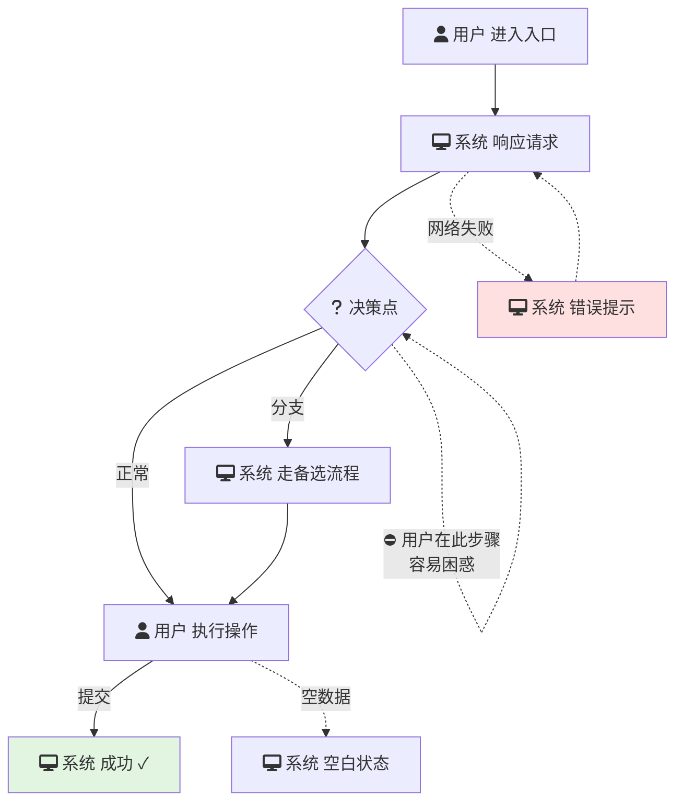

```
# 用户旅程审查报告

{如果是存量场景} **审查类型**：增量审查（只审查新增用户旅程） | 存量PRD参考：{存量PRD文件名}

## 基本信息
- **审查功能**：{功能名称}
- **简报文件**：{简报文件名}
- **审查日期**：当前日期
- **审查者**：AI用户体验分析师

## 用户路径模型

用 Mermaid 流程图展示用户从头到尾的完整路径，标注分支、状态和摩擦点：



**标注规范（保存报告中的 Mermaid 图）：**
- 角色图标：`fa:fa-user` = 用户操作，`fa:fa-desktop` = 系统响应，`fa:fa-question` = 决策节点
- 实线箭头 = 主流程路径
- 虚线箭头 = 异常/分支路径
- ⛔ 标记 = 摩擦点位置
- 颜色区分：绿色背景 = 成功状态，红色背景 = 错误状态
- 增量审查时：新增路径用蓝色标注，存量路径用灰色标注

**对话中展示的树形缩进图标注：**
- `→` = 流程推进方向
- `[异常]` = 异常/分支路径
- `⛔` = 摩擦点位置
- `[新增]` = 增量审查中的新增路径
- `[存量]` = 增量审查中的存量路径

## 审查发现

### 高优先级问题（需立即解决）
1. **{问题类型}** {问题描述} (若为存量衔接问题，标注"存量衔接")
   - **位置**：{路径节点}
   - **影响**：{对用户的影响}
   - **建议**：{具体改进建议}
   - **置信度**：（摩擦点类型必填）✅ 高 / ⚠️ 中 / ❓ 低

### 中优先级问题（建议优化）
1. **{问题类型}** {问题描述}
   - **位置**：{路径节点}
   - **影响**：{对用户的影响}
   - **建议**：{具体改进建议}
   - **置信度**：（摩擦点类型必填）✅ 高 / ⚠️ 中 / ❓ 低

### 低优先级问题（可后续优化）
1. **{问题类型}** {问题描述}
   - **位置**：{路径节点}
   - **影响**：{对用户的影响}
   - **建议**：{具体改进建议}
   - **置信度**：（摩擦点类型必填）✅ 高 / ⚠️ 中 / ❓ 低

## 置信度统计（仅摩擦点问题）
- **摩擦点总数**：{数量}
- **高置信度**：{数量} | **中置信度**：{数量} | **低置信度**：{数量}
- **低置信度占比**：{百分比}
- {若低置信度占比 > 50%，重复上述阈值提示}

## 总体评估
- **路径健康度**：{良好/一般/较差}（基于问题数量和严重程度）
- **主要风险**：{总结最大的用户体验风险}
- **关键建议**：{最重要的1-3条改进建议}

## 后续行动建议
1. [ ] 与产品经理讨论高优先级问题
2. [ ] 更新需求简报以反映发现
3. [ ] 设计阶段重点关注摩擦点优化
4. [ ] 开发阶段实现状态完整性处理
```
