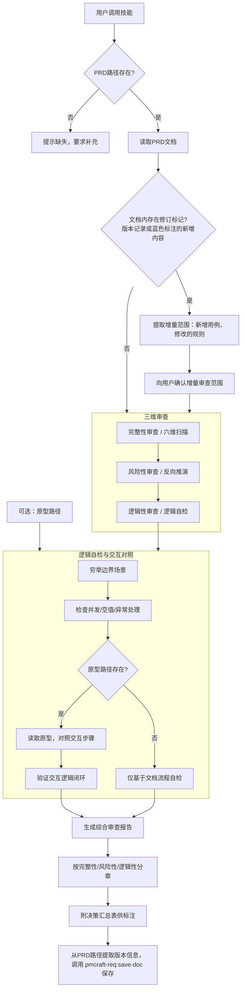

# PRD 综合审查

## 概述

review-prd 是一个综合审查技能。它基于 PRD 文档启动三维审查引擎：

1. **完整性审查（六维扫描）** — 从角色、时间、状态、权限、关联影响、反作用六个维度扫描 PRD，检查是否存在功能遗漏。
2. **风险性审查（反向推演）** — 假设"上线后效果不及预期"，逆向推导可能的失败原因，从运营、产品、技术视角列出风险场景及应对建议。
3. **逻辑性审查（逻辑自检）** — 穷举边界场景，检查并发、空值、异常处理等逻辑漏洞。若用户额外提供原型路径，则同步对照原型交互验证逻辑闭环。

**存量产品新增功能场景**：PRD 是同一份文件——即包含存量内容和新增内容的完整文档。审查引擎将通过 PRD 内部的修订标记（如蓝色标注的新增用例、文档版本记录中的修订说明）自动识别新增和修订部分，仅对新增用例、修改的规则以及关联影响进行审查。存量用例和未修改的规则不重复扫描。

审查完成后生成一份结构化的《综合审查报告》，按三大维度分章呈现问题，并附决策汇总表供逐条标注处理意见。报告通过 `pmcraft-req:save-doc` 统一按版本管理规范保存。

## Guard-Chat 守卫检查（第 0 步）

> 本小节为守卫开关检查，**不阻塞**主流程：执行完直接进入下一节。**子代理上下文**（被 spawn 执行、无法与用户交互，如 doc-reviewer/design-reviewer）整节静默跳过——不询问、不标记、不检测。

1. 运行 `node "{插件根}/_shared/scripts/guard-chat.js" status`，`{插件根}` = 从当前 SKILL.md 目录向上找第一个含 `_shared/scripts/guard-chat.js` 的祖先目录（source 环境=市场根，cache 环境=插件版本目录）。
2. 解析单行 JSON（契约：`{"status":"ok","data":{"enabled":bool,"prompted":bool,"dir":"…"}}`）：
   - `prompted=false` → 按话术库 GUARD-ASK（`enabled=false`）或 GUARD-ON（`enabled=true`）提示一次，然后运行 `node "{插件根}/_shared/scripts/guard-chat.js" mark-prompted`。用户紧随询问回复肯定意图（如「开启」），或任意轮次说「开启Guard-Chat」（路由表已注册）时，运行 `guard-chat.js enable`。
   - `prompted=true` → 跳过，不重复提示。
   - 话术库不可达（项目未跑 init-project、无大脑注入）→ 用兜底一句：「本会话可开启 Guard-Chat 守卫：开启后，你输入中可能影响判断的表述（如预设立场、权威宣称、逻辑谬误）会当场标注提醒；落盘文档中的对话填充语（如“好问题”、“希望对你有帮助”）会自动清除。说「开启Guard-Chat」开启（回复「开启」也可以），本会话只问一次。」（兜底非权威副本，有话术库时必须用话术库）
3. 脚本不可用（node 缺失/脚本缺失/JSON 解析失败）→ 静默跳过，继续主流程。
4. 本技能对话期间（仅 `enabled=true` 时）：① 每条用户消息经 `guard-chat.js detect`（stdin）检测，命中时单行简短标记，不打断流程；② 文档落盘前（save-doc 保存、直接写入报告文件）经 `guard-chat.js purify`（stdin）净化。规则见路由大脑「Guard-Chat 守卫行为」节。对话回复文风遵循 agent 定义的文风底线（无需脚本）。

## 输入

| 参数 | 类型 | 必选 | 说明 | 示例 |
| :--- | :--- | :--- | :--- | :--- |
| PRD路径 | 文件路径 | 是 | 符合模板格式的PRD文档路径 | `./账号系统/1.0.0/prd/账号系统_1.0.0_PRD_E1.md` |
| 原型路径 | 文件或目录路径 | 否 | 原型文件夹或文件路径，用于辅助逻辑审查交互对照 | `./账号系统/1.0.0/prototype/` |

## 使用方式

调用时传入 PRD 路径和可选的 原型路径：

- **PRD路径**：必选。PRD 文档的路径。若缺失则提示用户补充后重新执行。
- **原型路径**：可选。原型文件夹或文件的路径，仅用于辅助理解 PRD 中的交互流程。若未提供，则默认从当前版本目录下的 `prototype/` 查找。

**示例：**

```
review-prd ./账号系统/1.1.0/prd/账号系统_1.1.0_PRD_E1.md
review-prd ./账号系统/1.1.0/prd/账号系统_1.1.0_PRD_E1.md ./账号系统/1.1.0/prototype/
```

## 参数处理

- 若用户未提供 PRD 路径，直接提示：
  ```
  ❌ 缺少必选参数：请提供 PRD 文档路径。
  用法：review-prd <PRD路径> [原型路径]
  ```
  要求用户补充后重新调用。

- 原型路径为可选，若未提供则逻辑审查仅基于 PRD 文档自身逻辑进行自检，不包含原型交互对照。

## 输入要求

### PRD 文档要求

PRD 文档必须严格遵循位于 `../../_shared/templates/prd_template.md` 的《产品需求文档模板》格式，包含以下完整章节：

- **1. 文档版本**：含版本、修订人、修订时间、修订简介、关联工单中心工单。
- **2. 背景**：问题或机会描述。
- **3. 产品目标**：量化目标与非量化目标子章节。
- **4. 总体规则**：专有术语表、共同规则与全局复用约定（4.3）。
- **5. 用户故事**：每个故事下挂用例表格，表格内必须包含以下字段：
  - 参与者
  - 主成功流程
  - 扩展流程
  - 用例规则
  - 权限控制
  - 验收标准

若文档结构与模板不符，审查引擎将提示格式问题并建议修正。

### 原型文件要求（可选）

- 若提供原型路径，需为本地文件夹或文件，支持 `.html`、`.vue`、`.jsx`、`.tsx` 格式。
- 原型应具备可解析的交互元素，用于辅助理解 PRD 中的交互步骤。
- **如果原型路径下没有支持格式的文件**（如纯图片目录）→ 提示 "不支持该原型格式，逻辑审查仅基于文档自检。"，跳过原型交互对照环节，仅执行文档逻辑自检，并在报告中标注"未对照原型"。

## 工作流程

该技能严格遵循以下审查流水线：



### 详细步骤说明

#### 第一步：参数校验与文档结构检查

- 检查 PRD 路径是否提供，缺失则直接提示并终止。
- **颜色标记检查**：详见 `../../_shared/templates/color_check_guideline.md` 中定义的检查流程。**如果读取失败** → 执行核心检查项：扫描 PRD 中残留蓝色标记的配对完整性，发现异常时向 PM 提示，并在报告中标注"颜色标记检查降级执行"。
- 若 PRD 路径存在，读取文档内容。**如果文件不存在或无法读取** → 提示 "❌ PRD 文件不存在：请检查路径后重试。"，终止本次执行。
- **如果读取后文档内容为空或无法解析**（如仅含标题无正文）→ 提示 "PRD内容为空或无法解析，请确认文档已保存完整内容。"，终止本次执行。
- 从 PRD 路径中提取功能顶级文件夹和当前功能版本号（无V前缀格式）。例如路径为 `./账号系统/1.0.0/prd/...`，则功能顶级文件夹为 `./账号系统`，当前版本为 `1.0.0`。
- **场景识别**：检查 PRD 文档是否存在存量产品新增功能的修订标记。通过以下方式自动识别：
  - 文档版本章节中是否包含"新增：XXX"或类似修订说明（如 1.1 的修订简介标注了"新增：人脸识别验证功能"）。
  - 用户故事章节中是否存在蓝色标注或"新增"标识的新增用例。
  - 总体规则章节中是否存在蓝色标注或"新增"标识的新增规则。
  - 若识别到以上任何一种标记，则判定为**存量产品新增功能场景**。
  > ⚠️ **注意**：若此 PRD 先经 `pmcraft-req:revise-prd` 或 `pmcraft-req:revise-from-meeting` 修订（会清理旧版颜色标记），蓝色标注可能已被移除。此时自动识别可能失败，退化为全量审查。若需增量审查，可从文档版本记录的修订简介中人工确认新增范围。
- **增量范围确认**（仅存量场景）：
  - 从文档中提取所有新增用例的标题和修改的规则列表。
  - 向用户确认增量审查范围："我识别出以下新增/修改内容：{列出新增用例标题和修改的规则}。本次审查将只针对这些新增用例、修改的规则以及它们对存量模块的关联影响进行审查。是否正确？如需调整审查范围，请告知。"
  - 若用户确认无误，进入三维审查。若用户要求调整，根据用户反馈修改审查范围。
- **全新功能场景**：若未识别到存量修订标记，直接对全部内容进行三维审查。
- 对照 `../../_shared/templates/prd_template.md` 验证章节结构完整性，若缺少必要章节或字段，则作为前置问题输出警告，但仍继续后续审查（标注"结构缺失"）。
- **共同规则纯度检查**：对 4.2 共同规则逐条做两问判定——①可判定（能写成「当 X 时，系统必须/禁止/默认 Y」，或计算/契约，可被违反、可进验收）；②违反后是「错了」而非「不一致」（数据错/越权/流程错/合规违规）。不可判定的条目（模型定义/功能能力/预置数据/上线任务）与「违反仅致不一致」的条目（交互/视觉/显示约定）标记分流建议：前者按非规则分流表归位（模型/结构定义——可凝缩为一句话时随核心词词条入 4.1、仅出现一次则行内括注、整段归 2. 背景；功能能力归 5. 用户故事；预置数据/上线任务归 2. 背景），后者建议迁入 4.3 全局复用约定。发现项计入逻辑性审查结果（标注"共同规则纯度"）。
- **术语表质量检查**：对 4.1 专有术语表做质量判定（镜像"共同规则纯度检查"写法）。逐条检查：①**无词未写「无。」**——全表无词通过三门槛两问（全文实际出现 ≥2 次 / 非团队普遍秒懂的大众词 / 是"词"而非模型/规则/显示格式；会读错且读错会判错）却未写"无。"；②**非词条目占行**——整段模型定义（→随核心词词条入 4.1 或归 2. 背景）、行为句（→4.2 规则或用例流程）、显示格式（→4.3 全局复用约定）混入术语行；③**字典式注水**——大众词/项目名/百科式字典句占行（→删除）；④**解释不可当裁判**——读完无法判定某用法是否合规，缺与易混词的分界或本文档取义声明（→按写作规范补要素）；⑤**跨行指代**——解释含"同上/见上条"等指代（下游拆表后不可读，→改写为自包含）。发现项计入逻辑性审查结果（标注"术语表质量"）。

#### 第二步：完整性审查（六维扫描）

从以下六个维度扫描 PRD，识别可能遗漏的功能点。**存量场景下，只对新增用例进行六维扫描，不对存量用例重复扫描。**

| 维度 | 检查要点 | 示例问题 |
| :--- | :--- | :--- |
| **角色** | 是否遗漏次要参与者（如系统、第三方服务、管理员）？ | 是否遗漏"微信开放平台"作为次要参与者？ |
| **时间** | 是否定义了所有时效性规则（过期、倒计时、定时任务）？ | 拼团结束后的页面状态是否定义？ |
| **状态** | 遍历每个用户故事的主成功流程和扩展流程，沿途模拟检查：
1. 每个步骤之后用户到达什么状态？
2. 成功/失败/等待/异常四类状态是否都有定义？
3. 状态流转是否存在遗漏环节（如从 A 直接跳到 C，跳过 B）？ | 订单的"待支付→已支付→已取消"流转是否完整？支付成功后页面是否定义了跳转目标？ |
| **权限** | 是否覆盖了所有角色的功能权限与数据权限？ | 普通管理员能否查看用户手机号明文？ |
| **关联影响** | 本功能是否会影响其他模块？**存量场景特别关注：新增用例是否会对存量模块产生影响的联动效应。** | 新增人脸识别环节后，存量密码找回流程是否会受影响？ |
| **反作用** | 沿用户路径模拟反向操作：每一步用户能否取消、回退、关闭？反向操作后：
1. 数据状态如何回滚或清理？
2. 用户被引导到哪里？
3. 是否存在只能进不能退的死胡同？ | 用户中途退出绑定流程，数据如何清理？用户点击返回按钮后回到哪个页面？ |

扫描结果以清单形式列出"疑似遗漏项"，并说明遗漏维度及建议补充内容。

#### 第三步：风险性审查（反向推演）

采用反向推演方法：假设"上线后效果不及预期"，从结果倒推可能原因。**存量场景下，只针对新增功能和新增规则进行反向推演，分析新增部分独有的风险。**

- 从三个视角模拟失败场景：
  - **运营视角**：用户不理解、功能入口深、转化漏斗断裂。
  - **产品视角**：需求与用户痛点错位、核心指标未达成。
  - **技术视角**：性能瓶颈、数据不一致、外部依赖故障。
- 对每个风险场景，生成：
  - **风险描述**：具体场景及影响。
  - **发生概率**：高/中/低（基于经验推断）。
  - **影响程度**：高/中/低。
  - **应对建议**：规避或缓解措施。

#### 第四步：逻辑性审查（逻辑自检）

穷举边界场景，检验 PRD 的逻辑闭环性。**存量场景下，只对新增用例和修改的规则进行逻辑自检。**

- **边界条件**：输入空值、极值、特殊字符、超长文本。
- **并发冲突**：多用户同时操作同一资源（如同时绑定同一手机号）。
- **异常处理**：网络超时、接口报错、数据返回异常。
- **状态一致性**：操作中断后的状态回滚。

**同类问题合并要求**：上述边界场景排查出的同类问题必须合并为一条记录，不可拆分为多个独立问题。例如"输入框 A 未限制长度"和"输入框 B 未限制特殊字符"不应作为 2 条独立问题，应合并为"多个输入框缺少防呆校验（未限制长度/特殊字符），建议统一补充白名单规则"。这是为了阻止同类问题在迭代中被逐个发现、造成"修不完"的假象。

**边界穷举完成性自检**：在输出逻辑性审查结果前，AI 必须内部执行以下完成性检查（不输出给用户）：

1. 是否已覆盖空值、超长、特殊字符、并发、网络超时、服务降级、权限不足、数据冲突共 8 类基础边界？如有遗漏则补充后再输出。
2. 同类问题是否已合并？如发现"同一类别（如输入校验）下拆出多条"则合并后再输出。
3. 如果此刻结束审查不再返回，是否会遗漏任何非低严重度的问题？如是则补充后再输出。

**交互逻辑审查为独立环节**：若用户提供了原型路径，审查引擎将额外执行：

- 读取原型文件，解析交互元素与状态变化。**交互元素清单以源码静态解析（分层取材）为枚举基线；Playwright 仅做渲染校验与运行时抽验**（见下）。
- 将 PRD 用例中描述的主成功流程、扩展流程步骤与原型实际交互组件进行对照。
- 识别交互性差异（PRD 描述但原型未体现）及规则性差异（业务规则在原型中无法直观体现）。
- 输出对照结论，辅助判断交互逻辑是否闭环。

**Playwright 渲染校验与运行时抽验（默认必选，仅当提供原型路径时）**：

> **定位**：只做**渲染校验**（原型能否跑起来 / 白屏 / JS 报错 / 声明元素是否真渲染）与**运行时真值抽验**（与源码声明冲突时以渲染为准），**不承担交互元素枚举**——枚举基线来自第四步的静态解析（分层取材，排除 `annotations*/`、`demo*/` 等工具层前缀）。截图仅作逻辑闭环存疑处的留证（**默认 0 张，上限 3 张**）。执行契约见 `../../_shared/reference/prototype-verification.md`；**如果读取失败** → 按本清单执行：逐页渲染校验改用 `browser_snapshot` 观察 + 每页 ≤3 点抽验，枚举基线按四类取材（页面清单 / 交互元素 / 状态 / 跳转链）与工具层前缀排除（`annotations*/`、`demo*/` 等）自行执行，截图按 0 张处理并标注"运行时验证降级执行"；本节及执行清单中所有「共享契约 §N」引用一并按此降级执行。

- **【强制】检测 Playwright MCP 可用性**（第一步，不可跳过）：使用 `ToolSearch` 查询 `mcp__playwright__` 相关工具（`browser_navigate` / `browser_evaluate` / `browser_snapshot` / `browser_console_messages` / `browser_click` / `browser_take_screenshot` / `browser_wait_for` / `browser_close`）。
- **若 Playwright 可用**（按完整执行清单执行）：
  1. 为原型目录启动本地 HTTP 服务器（`python -m http.server` 或 `npx serve`）。**页面集合取静态解析产出的清单，不靠浏览器遍历发现。**
  2. **逐页渲染校验**：`browser_navigate` 导航 → 执行共享契约 §1 的 `browser_evaluate` payload（**逐字执行，每页恰 1 次**）→ 用 `browser_console_messages` 检查 JS 报错 → 按共享契约 §3 判定白屏 / 渲染异常。`browser_snapshot` 仅用于标题与渲染的交叉确认，**不作枚举来源**。
  3. **运行时真值抽验（每页 ≤3 点）**：只验①用例主成功流程依赖的元素 ②源码声明与运行时不符的元素（如失败弹窗、降级切换、加载态）。用 `browser_click` 触发后复看 payload 或 snapshot 复核。冲突以渲染为准并标注。
  4. **留证截图（默认 0 张，上限 3 张）**：仅在逻辑闭环存疑处需视觉留证时拍。**截图路径规范**：`filename` 必须传**绝对路径**存至 `{version_dir}/screenshots/`（目录不存在则先用 `Bash` 创建，如 `mkdir -p 1.0.0/screenshots`），文件名含场景标识。Playwright MCP 用相对文件名会保存到其 cwd（项目根目录），**禁止**裸文件名散落根目录。
  5. 使用 `browser_close` 关闭浏览器，**清理检查**：自查项目根目录散落 `*.png`，移至 `{version_dir}/screenshots/` 或删除。
  6. 将渲染校验与抽验结果与 PRD 用例交互进行对照，验证交互逻辑闭环；差异在报告中标注"浏览器验证确认"提升可信度。

> **比对前置排除（硬约束）**：`truncated: true` 与 `unanchored` 两类**必须先排除**再做「缺失」判定——它们代表"未纳入清单"，不代表"未渲染"（见共享契约 §3）。
- **若 Playwright 不可用**（降级标注路径，不可静默）：
  - 回退到 DOM 静态分析，但必须降级标注：
    1. 报告「对照原型」/逻辑审查结论中注明"基于静态源码分析，未获取运行时渲染验证"及降级原因（如"MCP 未配置/连接失败"）
    2. 交互性差异标注"中可信度，建议运行时补验"
    3. 报告末尾提示 PM："Playwright 不可用，本次交互对照为纯静态分析。建议配置 Playwright MCP 后补做运行时验证，或人工在浏览器中核对关键交互。"

若未提供原型路径，逻辑性审查仅基于文档自身描述进行逻辑推演。

#### 第五步：生成综合审查报告

报告结构如下：

1. **审查概览**：审查时间、PRD 版本（如 `1.0.0`）、是否对照原型、问题总数统计。**存量场景增加审查类型标识和增量范围说明。**
2. **完整性审查结果**：六维扫描发现的问题清单。
3. **风险性审查结果**：反向推演识别的风险清单。
4. **逻辑性审查结果**：逻辑自检发现的问题清单（若有原型对照，则包含交互逻辑验证结论）。
5. **决策汇总表**：汇总所有问题及风险，提供 `[采纳]`、`[监控]`、`[忽略]` 标注列，供产品经理逐条决策。表格包含「影响等级」列（高/中/低，标注规则见第七步）。

#### 第六步：保存报告

- 将生成的完整审查报告写入临时文件，位置统一为**项目根 `pmcraft/temp/`**（若不存在则先创建；命名 `{功能名}_综合审查报告_{yyyy-MM-dd}.md`）。**禁止写入系统 Temp 或 cwd**——save-doc 复制后临时文件即被删除，写入项目内临时区确保中途失败时产物可追踪。
- AI 根据审查结论自动生成内容摘要（如"PRD审查：发现4个风险项，建议采纳3条"），从用户信息中获取负责人。
- 调用 `pmcraft-req:save-doc` 技能，传入参数：
  - 功能顶级文件夹路径（从 PRD 路径中提取）
  - 当前功能版本号（从 PRD 路径中提取，如 `1.0.0`，与待审查的 PRD 版本一致）
  - 文档类型 `综合审查报告`
  - 临时文件路径
  - 内容摘要与负责人分别以 `--summary` 和 `--author` 参数传入（参数说明见 `../save-doc/SKILL.md` 参数表）
- `pmcraft-req:save-doc` 将自动创建目标目录、确定 E编号、完成保存、更新 `_index.md`，并返回最终路径。
- 向用户展示保存结果：
  ```
  ✅ 综合审查报告已保存。
  📁 保存路径：{pmcraft-req:save-doc 返回的路径}
  📝 功能版本：{版本号，如 1.0.0} | 报告版本：{E编号}
  ```

#### 第七步：对话式决策

报告保存后，将决策从报告搬到对话内，AI 代填回写：

1. **生成分层决策清单**：AI 在对话中展示分层决策清单：
   - 格式：`[序号] [影响等级] [问题一句话]`（按影响等级高→低排序）
   - 高/中影响全量展示；低影响折叠为一组（标注数量），PM 可"全部忽略"或展开
2. **影响等级标注规则**（客观信息，不含处理意见）：
   - 风险性条目：由报告已有的"概率 × 影响"综合得出（高/中/低）
   - 完整性/逻辑性条目：按问题严重度标注（阻塞/重要/轻微 → 高/中/低）
3. **PM 批量决策**，支持多种回复：
   - "1,3,5 采纳；2 监控；其余忽略"（低影响默认忽略）
   - "全部采纳" / "全部忽略" / "采纳高影响的"
4. **AI 解析决策后回填报告决策汇总表**（[ ] → [x]），报告成为权威决策记录。回填为对已保存报告的原地更新（决策表本就是为 PM 标注预留的字段，不产生新 E 编号，不走 save-doc）。
5. **衔接收敛循环**：回填完成后提示"是否调用 `pmcraft-req:revise-prd` 应用 [采纳] 条目？"
6. **待办登记（采纳未应用时，话术库 FLOW 族）**：若 [采纳] 计数 >0 且用户未立即应用（答"否"或会话在此结束）→ 按 CLAUDE.md「流程清单（进度与待办）」节登记协议，将「采纳待应用：{N} 条（综合审查报告 E{M}）」登记到 `{版本目录}/_进度清单.md` 登记区（行键 `report|E{M}|采纳`，M = 本次报告 E 编号；登记行 7 列格式见该节「微观待办登记协议」），并按话术库 **FLOW-REG** 播报单行（关闭条件：revise-prd 应用该报告后由修订技能显式关闭，说「修订PRD」可触发）。

**展示格式示例**：

```markdown
📋 综合审查报告决策清单（共 22 项，按影响等级排序）

🔴 高影响（5 项）
[1] WiFi 用户占比高导致覆盖率低（风险性·运营）
[3] 自动注册无密码导致换设备登录困难（风险性·产品）
[13] 取号超时 180 秒过长（风险性·产品）
...
🟡 中影响（6 项）
[2] 用户对一键登录存在隐私顾虑（风险性·运营）
...
⚪ 低影响（11 项，默认忽略）
[4] 登录成功过渡界面停留时长未定义（完整性·时间）
...
请回复决策，如："1,3,5采纳；2监控；其余忽略"（低影响默认忽略，如需调整请指出）
```

## 输出示例（片段）

```markdown
## 综合审查报告

**审查时间**：2026-04-21 14:30:00  
**PRD 版本**：账号中心绑定手机号_1.0  
{如果是存量场景} **审查类型**：增量审查（只审查新增用例与关联影响） | **增量范围**：{列出新增用例标题}  
**对照原型**：是（./账号系统/1.0.0/prototype/）  
**问题总数**：完整性 3 项，风险性 2 项，逻辑性 4 项

### 一、完整性审查（六维扫描）

| 序号 | 维度 | 问题描述 | 建议补充 |
| :--- | :--- | :--- | :--- |
| 1 | 角色 | 未明确"短信服务商"作为次要参与者在验证码下发失败时的处理机制 | 补充扩展流程：短信服务商返回失败时的系统降级方案 |
| 2 | 时间 | 未定义验证码获取倒计时结束后用户再次获取的行为 | 明确倒计时结束后按钮文案恢复为"获取验证码"，可再次点击 |
| 3 | 关联影响 | 绑定手机号后，账号注销流程是否受影响未说明 | 补充规则：已绑定手机号的账号注销时，手机号自动释放 |

### 二、风险性审查（反向推演）

| 序号 | 风险描述 | 概率 | 影响 | 应对建议 |
| :--- | :--- | :--- | :--- | :--- |
| 1 | 用户因收不到短信验证码而放弃绑定，导致绑定转化率低（运营风险） | 中 | 高 | 增加"60秒后未收到验证码？尝试语音验证码"入口 |
| 2 | 高并发场景下短信接口限流，导致用户无法获取验证码（技术风险） | 低 | 中 | 前端增加排队提示，后端实现请求队列与重试机制 |

### 三、逻辑性审查（逻辑自检）

| 序号 | 场景 | 问题描述 | 原型对照结论 |
| :--- | :--- | :--- | :--- |
| 1 | 并发绑定同一手机号 | PRD 未说明两个用户同时提交绑定同一手机号时的处理逻辑 | — |
| 2 | 验证码输入错误次数超限 | PRD 定义了"错误5次锁定"，但未说明锁定后用户界面如何反馈 | 原型中无锁定状态提示，需补充 |
| 3 | 网络请求超时 | PRD 扩展流程中有超时提示，但未说明超时后用户是否可立即重试 | 原型中重试按钮可用，与文档一致 |

### 四、决策汇总表

| 序号 | 问题/风险简述 | 类别 | 影响等级 | 处理决策 |
| :--- | :--- | :--- | :--- | :--- |
| 1 | 未明确短信服务商失败处理 | 完整性 | 高 | [ ] 采纳 [ ] 监控 [ ] 忽略 |
| 2 | 未定义倒计时结束后行为 | 完整性 | 中 | [ ] 采纳 [ ] 监控 [ ] 忽略 |
| 3 | 收不到短信导致转化率低 | 风险性 | 中 | [ ] 采纳 [ ] 监控 [ ] 忽略 |
| ... | ... | ... | ... | ... |
```

## 正误示例

### 正确示例

**全新功能全量审查**:
```
review-prd ./账号系统/1.0.0/prd/账号系统_1.0.0_PRD_E1.md
```

**含原型交互对照**:
```
review-prd ./账号系统/1.0.0/prd/账号系统_1.0.0_PRD_E1.md ./账号系统/1.0.0/prototype/
```
预期：三维审查（完整性/风险性/逻辑性），生成综合审查报告并通过 `pmcraft-req:save-doc` 保存。

### 错误示例

**错误**: 传入需求简报而非PRD
```
review-prd ./账号系统/1.0.0/brief/账号系统_1.0.0_需求简报_E1.md
```
- 问题：简报缺少PRD模板的用例表格格式，审查引擎无法执行六维扫描和逻辑自检。
- 正确做法：先通过 `pmcraft-req:generate-prd` 生成PRD，再对PRD执行审查。

**错误**: 原型路径有效但与PRD不匹配
```
review-prd ./账号系统/1.0.0/prd/PRD.md ./无关项目的原型/
```
- 问题：原型与PRD不匹配时，交互对照结果会全部异常，报告质量大幅下降。
- 正确做法：确保原型路径与PRD属于同一功能。

## 边缘情况处理

| 场景 | 触发条件 | 处理方式 | 示例回复 |
| :--- | :--- | :--- | :--- |
| 审查后零问题发现 | 三维审查均未发现任何问题或风险 | 输出正面结论，但仍标注模板遵循度和原型对照状态 | "✅ 三维审查未发现明显问题。PRD质量良好，建议进入评审会确认。如后续补充原型，可执行含交互对照的审查。" |
| PRD章节结构不完整 | 缺少模板要求的必要章节（如无扩展流程、无验收标准） | 作为前置问题输出警告，标注"结构缺失"，仍继续审查可使用章节 | "以下章节缺失：[列表]。缺失章节的审查维度将无法覆盖，建议补全后重新审查。" |
| 存量场景增量范围为空 | 未识别到蓝色标注或修订标记 | 按全量审查处理，并提示用户原因 | "未在PRD中检测到修订标记，已按全量审查处理。如需增量审查，请确认PRD中新增/修改内容已用蓝色标注。" |
| PRD文件不存在 | 参数路径指向不存在的文件 | 提示错误并终止执行，不进入后续流程 | "❌ PRD 文件不存在：请检查路径后重试。" |
| PRD内容为空或无法解析 | 文档仅含标题、空白或无有效内容 | 提示错误并终止执行，不进入后续流程 | "PRD内容为空或无法解析，请确认文档已保存完整内容。" |
| 原型格式不支持 | 原型路径下无 .html/.vue/.jsx/.tsx 文件（如纯图片目录） | 跳过原型交互对照，仅执行文档逻辑自检，并在报告中标注"未对照原型" | "不支持该原型格式，逻辑审查仅基于文档自检。已跳过原型交互对照。" |

## 常见错误

1. **传入需求简报而非 PRD** — 简报缺少用例表格格式，审查引擎无法执行六维扫描。
2. **原型与 PRD 不匹配** — 交互对照结果全部异常，报告质量大幅下降。
3. **PRD 章节结构不完整** — 缺失章节的审查维度无法覆盖，建议补全后重新审查。
4. **PRD 路径错误或内容为空** — 直接提示错误并终止执行，不会生成审查报告。

## 快速参考

| 审查维度 | 方法 | 关注点 |
|:---|:---|:---|
| 完整性 | 六维扫描 | 角色/时间/状态/权限/关联/反作用 |
| 风险性 | 反向推演 | 运营/产品/技术三视角失败场景 |
| 逻辑性 | 逻辑自检 | 边界/并发/异常/状态一致性 |
| 交互对照 | 原型匹配 | （可选）PRD 流程 vs 原型交互 |

## 评价测试用例

### 正向触发（5条）
1. 传入全新功能的PRD路径，无原型 — 预期：三维审查，仅文档逻辑自检
2. 传入全新功能的PRD路径，含原型 — 预期：三维审查+原型交互对照
3. 传入存量新增PRD路径，文档含蓝色标注 — 预期：自动识别增量范围，仅审查新增和修改部分
4. PRD符合模板格式，含完整六维信息 — 预期：完整性审查六维全覆盖
5. 决策汇总表中产品经理标注了[采纳]/[监控]/[忽略] — 预期：汇总表供逐条决策

### 负向触发（5条）
1. 无参数调用 — 预期：提示"缺少必选参数：请提供PRD文档路径"
2. 传入不存在的PRD文件路径 — 预期：报错"PRD文件不存在"
3. 传入需求简报文件路径 — 预期：提示"文档结构不符，请提供符合模板格式的PRD"
4. 原型路径为纯图片目录 — 预期：提示"不支持该原型格式，逻辑审查仅基于文档自检"
5. PRD仅含标题无内容 — 预期：提示"PRD内容为空或无法解析"

### 边界查询（3条）
1. PRD超过5000行，含20+用户故事 — 预期：全部审查完成，报告按维度合理组织，不截断
2. PRD中多处使用非标准格式的表格和列表 — 预期：尽力解析，标注"部分内容格式不规范，审查覆盖可能不全"
3. 原型为Vue/React组件但未构建为可预览HTML — 预期：基于静态源码分析进行交互对照，标注"原型未运行时状态"

## 禁止行为

1. **禁止跳过参数校验** — PRD 路径缺失时直接提示终止，不能进入后续流程。
2. **禁止替 PM 做决策** — AI 不得预设 [采纳]/[监控]/[忽略] 处理意见。**允许标注影响等级（高/中/低）作为客观辅助信息**，最终决策权在 PM。
3. **禁止在 PRD 格式不符时强行全量审查** — 缺少必要章节时标注"结构缺失"并说明覆盖范围受限。
4. **禁止在增量场景下审查存量内容** — 识别到增量标记后只审查新增用例和修改规则，不重复扫描存量。
5. **禁止跳过交互逻辑审查环节** — 若提供了原型路径，必须执行 PRD 流程与原型交互的对照验证。
6. **禁止跳过 Playwright 可用性检测** — 提供原型路径时，ToolSearch 检测 Playwright MCP 为强制第一步，不得直接进入静态交互对照。
7. **禁止 Playwright 可用时跳过运行时验证** — MCP 可用时必须执行完整执行清单（逐页 payload 渲染校验 + 报错检查 + ≤3 点抽验），除非 PM 明确要求跳过并说明原因。
8. **禁止回退静态时不做降级标注** — Playwright 不可用时，报告必须标注降级原因 + 可信度降级 + PM 提示三要素。
9. **禁止用浏览器做交互元素枚举或页面遍历发现** — 枚举基线唯一来源是第四步静态解析；页面集合取其产出清单，不得把 `browser_snapshot` 当枚举来源。
10. **禁止用截图或多模态读图做交互元素枚举与页面结构分析** — 截图仅作逻辑闭环存疑处的视觉留证（默认 0 张、上限 3 张）。
11. **禁止整文件读原型源码** — 按分层取材口径定点读取，并排除工具层（`annotations*/`、`demo*/` 等前缀），否则会把标注层当成原型功能参与交互对照。
12. **禁止把 `truncated` / `unanchored` 当作"未渲染"** — 比对前必须先排除，它们代表"未纳入清单"而非"未渲染"。

## 注意事项

1. **审查结果非终局性**：报告中的问题与风险均为 AI 基于最佳实践的推断，产品经理需结合业务实际进行决策。
2. **原型仅辅助理解**：原型对照旨在帮助发现交互逻辑差异，PRD 是唯一事实来源。若两者冲突，以 PRD 为准并建议更新原型。
3. **交互逻辑审查独立**：逻辑性审查包含文档自身逻辑推演，原型对照作为补充验证手段，二者结论在报告中分别体现。
4. **决策汇总表必填**：建议在评审会前完成决策汇总表的勾选，以便高效推进。
5. **模板遵循要求**：PRD 必须符合 `../../_shared/templates/prd_template.md` 格式，审查引擎将据此提取信息。若格式不符，部分审查维度可能无法覆盖。
6. **存量场景**：审查引擎通过 PRD 内部的修订标记（版本记录中的修订说明、蓝色标注的新增用例、新增规则的标注）自动识别增量范围。识别后只对新增用例、修改的规则进行审查。存量用例和未修改的规则不重复扫描；但关联影响审查需检查新增内容对存量模块的潜在影响。
7. **保存规范**：审查报告通过 `pmcraft-req:save-doc` 保存到与 PRD 相同的版本目录下。功能顶级文件夹和版本号（如 1.0.0 格式）从 PRD 路径中自动提取，无需用户手动指定。文档类型参数使用 `综合审查报告`。报告版本号（E编号）由 `pmcraft-req:save-doc` 自动管理。
8. **原型工具层须排除**：原型页面引用中混有 pmcraft 的标注层与演示面板（`annotations*/`、`demo*/` 等前缀，实测约占页面本体一半），它们是工具层不是原型功能，读源码时必须按前缀排除——否则会把标注层当成原型功能参与交互对照，产出假差异。

## 参考文档

本技能自身无 `references/`；以下为按需加载的 `_shared/` 公共文件（req 域共用一份，禁双写）：

| 文件 | 内容 | 加载位置 | 加载失败 fallback |
| :--- | :--- | :--- | :--- |
| `../../_shared/reference/prototype-verification.md` | 原型读取与运行时验证契约（三源分工、源码分层取材与工具层排除、`browser_evaluate` payload、渲染校验判定、截图限量规则） | 第四步「Playwright 渲染校验与运行时抽验」入口 | 逐页渲染校验改用 `browser_snapshot` 观察 + 每页 ≤3 点抽验；枚举基线按四类取材（页面清单/交互元素/状态/跳转链）与工具层前缀排除自行执行；截图按 0 张处理并标注"运行时验证降级执行" |
| `../../_shared/templates/prd_template.md` | 《产品需求文档模板》（PRD 章节结构与用例字段规范） | 第一步「文档结构检查」、输入要求 | 凭模板章节清单核对结构完整性，缺失项标注"结构缺失" |
| `../../_shared/templates/color_check_guideline.md` | 蓝色标注（新增/修订标记）检查流程 | 第一步「颜色标记检查」 | 扫描 PRD 中蓝色标记配对完整性，异常时提示并标注"颜色标记检查降级执行" |
