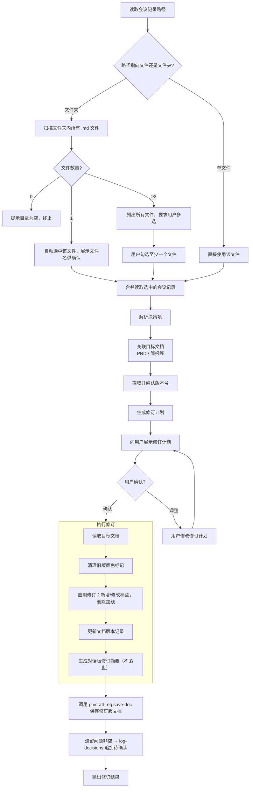

# 会议评审修订 (revise-from-meeting)

## 概述

产品经理参加各类评审会（技术评审、产品集体评审、设计评审、运营评审等），会后将会议记录 `.md` 文件归档到项目版本目录的 `meeting/` 子目录下。`revise-from-meeting` 技能读取这些会议记录，自动解析出影响现有文档的决策项，生成一份 **修订计划** 供产品经理审核确认，确认后自动对 PRD、需求简报等文档执行修订，并通过 `pmcraft-req:save-doc` 按版本管理规范保存。

## Guard-Chat 守卫检查（第 0 步）

> 本小节为守卫开关检查，**不阻塞**主流程：执行完直接进入下一节。**子代理上下文**（被 spawn 执行、无法与用户交互，如 doc-reviewer/design-reviewer）整节静默跳过——不询问、不标记、不检测。

1. 运行 `node "{插件根}/_shared/scripts/guard-chat.js" status`，`{插件根}` = 从当前 SKILL.md 目录向上找第一个含 `_shared/scripts/guard-chat.js` 的祖先目录（source 环境=市场根，cache 环境=插件版本目录）。
2. 解析单行 JSON（契约：`{"status":"ok","data":{"enabled":bool,"prompted":bool,"dir":"…"}}`）：
   - `prompted=false` → 按话术库 GUARD-ASK（`enabled=false`）或 GUARD-ON（`enabled=true`）提示一次，然后运行 `node "{插件根}/_shared/scripts/guard-chat.js" mark-prompted`。用户紧随询问回复肯定意图（如「开启」），或任意轮次说「开启Guard-Chat」（路由表已注册）时，运行 `guard-chat.js enable`。
   - `prompted=true` → 跳过，不重复提示。
   - 话术库不可达（项目未跑 init-project、无大脑注入）→ 用兜底一句：「本会话可开启 Guard-Chat 守卫：开启后，你输入中可能影响判断的表述（如预设立场、权威宣称、逻辑谬误）会当场标注提醒；落盘文档中的对话填充语（如“好问题”、“希望对你有帮助”）会自动清除。说「开启Guard-Chat」开启（回复「开启」也可以），本会话只问一次。」（兜底非权威副本，有话术库时必须用话术库）
3. 脚本不可用（node 缺失/脚本缺失/JSON 解析失败）→ 静默跳过，继续主流程。
4. 本技能对话期间（仅 `enabled=true` 时）：① 每条用户消息经 `guard-chat.js detect`（stdin）检测，命中时单行简短标记，不打断流程；② 文档落盘前（save-doc 保存、直接写入报告文件）经 `guard-chat.js purify`（stdin）净化。规则见路由大脑「Guard-Chat 守卫行为」节。对话回复文风遵循 agent 定义的文风底线（无需脚本）。

## 用户故事

> **作为** 刚结束多场评审会的产品经理  
> **我希望** 将散落在各份会议记录里的决策结论交给 AI，AI 自动提取、归类、生成修订计划，我确认后一次性把 PRD 和简报修订到位  
> **以便** 评审结论不堆积、不遗忘，文档始终反映团队各方达成的最新共识

## 输入

| 参数 | 类型 | 必选 | 说明 | 示例 |
| :--- | :--- | :--- | :--- | :--- |
| 会议记录路径 | 文件或目录路径 | 是 | 单个 .md 文件或包含多份会议记录的文件夹 | `./账号系统/1.1.0/meeting/` |
| PRD路径 | 文件路径 | 否 | 要修订的PRD文件；未提供时从会议记录内容推断 | `./账号系统/1.1.0/prd/账号系统_1.1.0_PRD_E2.md` |
| 简报路径 | 文件路径 | 否 | 要修订的需求简报；未提供时从会议记录内容推断 | `./账号系统/1.1.0/brief/账号系统_1.1.0_需求简报_E1.md` |

## 调用方式

```
revise-from-meeting <会议记录路径> [PRD路径] [简报路径]
```

- **会议记录路径**：必填。指向会议记录的单个 `.md` 文件，或包含多份会议记录的文件夹（推荐使用版本目录下的 `meeting/` 文件夹，如 `./账号系统/1.1.0/meeting/`）。若为文件夹，将递归扫描所有 `.md` 文件。
- **PRD 路径**（可选）：指定要修订的 PRD 文件路径。若未提供，技能将从会议记录路径中提取：
  - 路径匹配 `<顶级文件夹>/<主>.<次>.<修订>/meeting/` 模式时，自动推断版本号为 `<主>.<次>.<修订>`（如 1.0.0 格式），并从版本目录下的 `prd/` 中查找最新 E 编号的 PRD 文件。
  - 若无法从路径推断（如路径不包含 meeting/ 子目录），则从版本目录 `prd/` 下扫描最新 E 编号的 PRD 文件。
- **简报路径**（可选）：指定要修订的需求简报文件路径。若未提供，从版本目录的 `brief/` 中查找最新 E 编号的简报文件。

**示例：**
```
revise-from-meeting ./电子发票开具/1.0.0/meeting/
revise-from-meeting ./账号系统/1.1.0/meeting/ ./账号系统/1.1.0/prd/账号系统_1.1.0_PRD_E2.md
```

## 退出机制

在任何步骤中，输入 **退出** 或 **取消** 即可安全终止当前流程。AI 将汇总已完成的进度、告知已保存的中间结果（如有），不会强制继续追问。

## 执行步骤

按以下步骤顺序执行，每步只做一件事；条件判断按“如果…否则…”分支处理。

1. **读取会议记录路径**：读取输入参数中的会议记录路径。如果未提供，提示“请提供会议记录路径（单个 `.md` 文件或 meeting/ 目录）”并终止流程。
2. **判断路径类型**：如果路径不存在，提示“路径不存在”并终止流程；否则如果路径指向单个 `.md` 文件，直接使用该文件；否则如果指向文件夹，递归扫描其中所有 `.md` 文件；如果目录为空或没有 `.md` 文件，提示“未发现会议记录”并终止流程。
3. **多选文件**：如果扫描到多个 `.md` 文件，列出全部文件（含大小），要求用户输入序号（空格分隔，至少选 1 个）后再继续；如果用户输入的序号无效（越界、重复、非数字或未选任何文件），提示“请输入有效序号（空格分隔，至少 1 个）”并重新要求输入；如果只有一个文件，自动选中并展示文件名供确认。
4. **合并读取**：合并读取选中的会议记录。如果文件编码非 UTF-8 导致乱码，提示用户检查编码并终止本次修订。
5. **解析决策项**：按“会议记录格式建议”节的半结构化字段（结论/影响/行动）或自由文本降级规则解析决策项，并按命中关键词数量标注置信度（高/中/低，规则见该节）。
6. **关联目标文档与版本**：如果提供了 PRD 路径但该文件不存在，提示“目标PRD不存在”并终止流程；如果提供了简报路径但该文件不存在，提示“目标简报不存在”并终止流程；如果未提供 PRD 路径，从会议记录路径推断版本号（路径匹配 `<顶级文件夹>/<主>.<次>.<修订>/meeting/` 时提取，否则从版本目录 `prd/` 扫描最新 E 编号）；如果未提供简报路径，从版本目录 `brief/` 查找最新 E 编号简报。向用户展示版本号与目标文档，如与实际不符，按用户指定的版本执行。
7. **生成并确认修订计划**：先 Read `references/revision-plan-template.md` 获取修订计划填充示例与骨架模板，按模板生成修订计划并展示。**如果 Read 失败**，依据「修订计划展示与确认」节保留的变更类型说明表与修订计划填充规则自行构建计划骨架。如果用户提出调整，更新计划后再次展示；否则如果用户回复”确认执行”，继续下一步；如果用户回复”退出”或”取消”，终止流程且不生成修订版文档。
8. **执行修订并保存**：读取目标文档 → 按”修订执行规则”执行颜色标记检查（失败则降级为直接清理）→ 应用修订（新增/修改标蓝、删除加删除线、状态更新不标色）→ 更新文档版本记录 → 按「评审修订摘要对话模板」生成对话版修订摘要（不落盘）→ 调用 `pmcraft-req:save-doc` 保存修订版文档 → 在对话中输出修订结果（对话版摘要 + 保存位置）。
9. **追加决策记录**：按“追加决策记录”节筛选可转化的高置信度决策项，调用 `pmcraft-req:log-decisions` 追加并更新决策状态。
10. **收尾衔接**：按“Gate 2 审查关隘入口”节展示审查建议；按“出口衔接（话术库 NEXT-TAIL）”节输出收尾序列话术。

**加载策略总览**（按需加载，禁止预读）：

| 内容 | 加载时机 | fallback |
|:---|:---|:---|
| `references/revision-plan-template.md`（修订计划填充示例 + 骨架模板） | 步骤 7 生成并确认修订计划时 | 依据「修订计划展示与确认」节保留的变更类型说明表与修订计划填充规则自行构建计划骨架 |

## 会议记录格式建议

为达到最高解析精度，建议会议记录按以下半结构化格式编写。即使格式不完全匹配，技能仍会尽力提取。

```markdown
# [功能名称] - [评审会名称] [日期]

## 议题1：[议题标题]
**结论**：[最终决策结论]
**影响**：[对哪些文档/章节/用例有影响]
**行动**：[需要具体修改文档的哪些内容]

## 议题2：[议题标题]
**结论**：
**影响**：
**行动**：
```

若使用纯自由文本，技能会基于自然语言理解抽取关键决策。**自由文本降级规则**：
- 扫描全文，按以下关键词及其同义词定位决策块：`结论`、`决定`、`确认`、`通过`、`否决`、`暂缓`、`改为` > `行动`、`修改`、`更新`、`补充`、`删除` > `影响`、`涉及`、`关联`
- **判定置信度**：
  - 同时命中"结论关键词 + 行动关键词 + 影响关键词"三项 → 高置信度，直接列入修订计划
  - 仅命中两项（如"结论+行动"但无"影响"） → 中置信度，列入计划并标注"`[影响范围未指明，已由 AI 推断]`"
  - 仅命中一项（如仅有"结论"但无"行动"和"影响"） → 低置信度，列入修订计划但标注"`[置信度低，建议确认]`"
- 无法匹配任何关键词的段落 → 跳过，不列入修订计划

## 工作流程



## 交互细节

### 多选会议记录

当传入文件夹且包含多个 `.md` 文件时，技能列出所有文件供您选择：

```
AI：检测到 meeting/ 目录下有 3 份会议记录：
  1. 技术评审会_2026-05-14.md      (5.3 KB)
  2. 产品集体评审_2026-05-15.md    (3.1 KB)
  3. 运营对齐会_2026-05-16.md      (2.8 KB)

请输入要处理的文件序号，多选用空格分隔（至少选 1 个）：
```

输入示例：`1 2`

### 提取并确认版本号

选定会议记录并关联目标文档后，从会议记录路径中提取功能版本号：

- 路径匹配 `<顶级文件夹>/<数字>.<数字>.<数字>/meeting/` 模式时，自动提取版本号（如 `./账号系统/1.1.0/meeting/` → `1.1.0`）。
- 向用户展示确认：
  > "检测到当前版本目录 **1.1.0**，本次修订将作用于该版本的以下文档：[PRD E2]、[简报 E1]。是否继续？"
- 用户可确认或指定其他版本。

### 修订计划展示与确认

AI 解析选定会议记录后，生成修订计划预览（填充示例与骨架模板见步骤 7 加载的 `references/revision-plan-template.md`）。

**变更类型说明**（执行内核，如果 Read 失败时据此构建计划骨架）：

| 类型 | 含义 | 操作方式 |
|:---|:---|:---|
| **内容修改** | 存量章节的步骤/规则/权限/验收标准变更 | 在原位置插入或修改，蓝色标注 |
| **内容新增** | 全新的用户故事/用例/规则/章节 | 追加新内容，蓝色标注 |
| **内容删除** | 现有功能/规则/用例因评审结论需要废弃 | 保留原文并加删除线，后附原因 |
| **状态更新** | 简报中”待确认”规则的确认/变更/关闭 | 更新状态文字，不标色 |

**骨架填充规则**：某类变更无条目时保留表头并写明“本次无{该类}项”；四类均无条目且无待确认项时按“禁止行为”第 3 条终止；无法定位的条目标注“定位失败”。

**修订计划填充规则**：
- 每个决策项必须填满其所属变更类型表格的全部列（①-③ 为“编号/决策摘要/定位章节/修改内容/说明”，④ 为“编号/决策摘要/定位章节/旧状态 → 新状态”）；无法定位章节的条目标注“定位失败”，并要求用户手动指定目标位置。
- 决策摘要只能来自会议记录中的原始结论，不得臆造或扩展会议记录未提及的内容。
- 某类变更无条目时，保留表头并写明“本次无{该类}项”。
- 待确认项逐条列出，格式：`编号{n}（{变更类型}）：{待确认问题}`。
- 多份会议记录对同一章节有冲突结论时，冲突条目必须并排列出并标注来源会议（见“禁止行为”第 4 条）。

您可以自由调整计划中的任何条目，例如“删除编号2的删除操作，改为标注‘一期不实现’”，或“将编号1的预计等待时间改为具体秒数”。AI 会根据您的反馈更新计划并再次展示，直到您确认执行（回复 **退出** 或 **取消** 可随时终止本次修订，不生成修订版文档）。

## 修订执行规则

**重要**：不要直接修改现有文档。以下所有变更在 AI 上下文中构建完整内容，通过临时文件和 pmcraft-req:save-doc 保存为新文件（E编号递增），原文件始终保持不变。临时文件统一写入**项目根 `pmcraft/temp/`**（若不存在则先创建；命名 `{功能名}_会议评审修订_{yyyy-MM-dd}.draft.md`）。**禁止写入系统 Temp 或 cwd**——save-doc 复制后临时文件即被删除，写入项目内临时区确保中途失败时产物可追踪。

**颜色标记检查**：执行修订前，读取目标文档（PRD、简报等），检查流程详见 `../../_shared/templates/color_check_guideline.md`。**如果读取失败** → 直接执行下方"清理旧版颜色"步骤（扫描全文移除所有 `<span style="color:...;">` 及对应 `</span>` 闭合标签，仅保留纯文本），并标注"颜色标记检查降级为直接清理"。

**清理旧版颜色**：
- 执行修订前，扫描目标文档（PRD、简报等）全文，移除所有 `<span style="color:...;">` 及对应 `</span>` 闭合标签，**仅保留纯文本内容**。
- 此步骤确保本次修订的蓝色标注不会与旧版颜色混淆，使产品经理能清晰识别本次会议带来的变更。

| 操作类型 | 文档处理方式 | 视觉效果 |
| :--- | :--- | :--- |
| **新增内容** | 在原章节相应位置追加 | <span style="color:blue">蓝色文字</span> |
| **修改内容** | 替换原有文字 | <span style="color:blue">蓝色文字</span> |
| **删除内容** | 保留原文并加删除线，后附原因说明 | ~~原内容~~ （原因：XXX） |
| **状态更新** | 简报中“待确认”改为“已确认”，并记录结论 | 不标色 |
| **文档版本记录** | 在 **PRD** 的版本表格顶部新增一条修订记录（最新记录放最前，修订简介含"来源：会议评审（{会议文件名}）"）；**需求简报无版本表**——仅更新基本信息中的单值字段（如"文档修订""状态"，见 `../../_shared/templates/brief_template.md`），变更轨迹由决策记录、新 E 编号文件与蓝色标注承担 | — |

## 禁止行为

1. **禁止直接修改原文件** — 所有变更在 AI 上下文中构建完整内容，通过临时文件和 pmcraft-req:save-doc 保存为新文件（E 编号递增），不得直接使用 Write 工具修改现有文档
2. **禁止跳过修订计划确认环节** — 必须逐条向用户展示修订计划并获取明确确认（"确认执行"），不得在用户未确认的情况下直接执行修订
3. **禁止在修订计划为空时强行保存** — 若解析结果无任何可操作决策项，直接终止流程并告知用户，不生成空修订摘要（对话版亦不输出）
4. **禁止在多源冲突时自行选边** — 当多份会议记录对同一 PRD 章节有不同结论时，必须在修订计划中并排列出所有冲突项并标注来源会议，等待用户裁决
5. **禁止忽略会议记录格式异常** — 若会议记录文件编码非 UTF-8 导致乱码、文件无法正常读取，须立即提示用户检查编码并终止本次修订
6. **禁止对不确定项做确定修订** — 若某条决策项结论内容模糊（关键词匹配得分 < 2 条匹配），在修订计划中标注"[置信度低，建议确认]"而非直接执行
7. **禁止臆造会议内容** — 修订计划中的每一条变更都必须能追溯到会议记录中的实际决策，不得编造或放大会议记录中不存在的结论、数字或行动项
8. **禁止修改会议记录源文件** — 会议记录是本技能只读输入，修订只作用于 PRD/简报；不得改写、删除或重命名 `meeting/` 下的任何会议记录文件
9. **禁止遗留问题未记入决策记录即结束流程** — 遗留问题非空时必须按「追加决策记录」节调用 `pmcraft-req:log-decisions` 追加为 status `待确认` 条目（每项一条），不得遗漏或仅停留在对话摘要中

## 约束

1. **修订摘要不落盘** — 会议评审修订摘要仅在对话中展示，禁止写入临时文件、禁止调用 `pmcraft-req:save-doc`、禁止保存到 `report/`；变更轨迹由 PRD 第 1 章修订简介（"来源：会议评审（{会议文件名}）"）与决策记录承担。
2. **临时文件必须写入项目根 `pmcraft/temp/`** — 命名 `{功能名}_会议评审修订_{yyyy-MM-dd}.draft.md`（目录不存在先创建），禁止写入系统 Temp 或 cwd。
3. **会议记录为只读输入** — 修订只作用于 PRD/简报，不得改写、删除或重命名 `meeting/` 下的任何会议记录文件。
4. **修订版文档必须经 `pmcraft-req:save-doc` 落盘** — 所有变更在 AI 上下文中构建完整内容，经临时文件与 save-doc 保存为新文件（E 编号递增并更新 `_index.md`），禁止直接 Write 原文件。
5. **遗留问题必须逐条记入决策记录** — 遗留问题（待确认项/未解决冲突）非空时，每项追加一条 status `待确认` 决策条目，不得仅停留在对话摘要。

## 产出物

保存时，AI 根据修订内容自动生成内容摘要，从用户信息中获取负责人。调用 `pmcraft-req:save-doc` 前须执行预保存质量检查（详见 `../save-doc/SKILL.md#预保存质量检查`），包括 Mermaid 闭合、蓝色标签配对、占位符替换、版本号格式四项。在调用 `pmcraft-req:save-doc` 时，内容摘要与负责人分别以 `--summary` 和 `--author` 参数传入（参数说明见 `../save-doc/SKILL.md` 参数表）。

1. **修订版 PRD**（若有修改）：通过 `pmcraft-req:save-doc` 保存到同版本 `prd/` 目录，文档类型为 `"PRD"`，E 编号自动递增，更新 `_index.md`。
2. **修订版需求简报**（若有修改）：通过 `pmcraft-req:save-doc` 保存到同版本 `brief/` 目录，文档类型根据简报类型使用 `"需求简报"` 或 `"功能优化简报"`，E 编号自动递增，更新 `_index.md`。
3. **对话版评审修订摘要**：整合所有会议记录来源、修改清单、遗留问题，**在对话中展示**（骨架见下方「评审修订摘要对话模板」）。**禁止写入临时文件，禁止调用 `pmcraft-req:save-doc`，禁止保存到 `report/`**——变更轨迹已并入 PRD 第 1 章修订简介（”来源：会议评审（{会议文件名}）”）；遗留问题非空时按「追加决策记录」节转为待确认决策条目。

**评审修订摘要对话模板**（仅在对话中展示，禁止落盘）：

```markdown
## 会议评审修订摘要

**来源会议**：{会议记录文件名，逗号分隔}
**目标文档**：{修订后的 PRD/简报文件名}
**文档版本变更**：{PRD：E{旧}→E{新}；简报：E{旧}→E{新}（如有）}
**变更清单**：内容修改 {n} 项 / 内容新增 {n} 项 / 内容删除 {n} 项 / 状态更新 {n} 项
**遗留问题**：{待确认项与未解决冲突，无则写”无”；非空时逐条记入决策记录（待确认）}
**负责人**：{从用户信息获取}
```

## Gate 2 审查关隘入口

所有文档修订保存完成后，向用户展示 **GATE-2 模板**（话术库，见 CLAUDE.md「话术模板库」节）：

> "【PRD 审查】修订版 PRD 已完成。根据审查把关线（Gate 2），建议执行审查：
>
> - **PRD 审查（review-prd）**：对修订后的 PRD 进行完整性、风险性、逻辑性三维审查
> - **一致性检查（check-consistency）**：验证修订版 PRD 与原型之间的一致性（**仅在本次会议修订涉及 UI/交互变更时推荐**）
>
> 请选择（可多选，如「1+2」）或回复 **跳过**：
>
> （评审提示：版本目录 `_README/`《评审与开发必读指南》由 save-doc 自动维护（双击 _README/README.html 门户即读），评审前可先打开获取全貌）"

- 用户选择后，对每个选中的审查，通过 `Agent` 工具 spawn **doc-reviewer** 子智能体：
  - `subagent_type`: `"doc-reviewer"`
  - `prompt`: 传入审查技能名（`pmcraft-req:review-prd` / `pmcraft-req:check-consistency`）+ 修订后的 PRD 文件路径 + 原型路径（若适用）
  - **正式落盘指令**（必须，区分审查类型）：
    - **review-prd**（综合审查）：prompt 明确"审查报告完成编写后，**必须调用 `pmcraft-req:save-doc` 正式保存**（文档类型 `综合审查报告`，功能顶级文件夹与版本号从传入的 PRD 路径推断——其为正式路径，含 `<顶级文件夹>/<版本号>/` 结构）。**禁止只写临时区不落盘**——综合审查报告的正式保存是流程硬性要求，主对话不再补做"
    - **check-consistency**（一致性检查）：prompt 明确"审查报告写入**项目根 `pmcraft/temp/`**（若不存在则先创建），文件名 `{功能名}_一致性检查报告_{yyyy-MM-dd}.md`；若当天已存在同名文件，追加轮次后缀 `_r{N}`（N 从 2 递增），**禁止覆盖早轮报告**——收敛小循环同日多轮需保留每轮差异清单供单调性对比。**写入 `pmcraft/temp/` 即为最终产物，不再调用 `pmcraft-req:save-doc`**——无 E 编号、不进 `_index.md`"
  - **先后顺序（禁止并行）**：一致性检查的对象必须是定稿 PRD（见 CLAUDE.md「Gate 2 收敛小循环」），**禁止并行 spawn review-prd 与 check-consistency**——并行执行会导致修订后报告作废。先 spawn review-prd；若用户选择基于审查发现再次修订（本技能新一轮修订），定稿后再 spawn check-consistency；收敛复查最多 3 轮，超限输出剩余差异清单停止循环。
- 如果用户回复"跳过"：进入后续流程
- 审查完成后，展示报告路径，询问："是否基于审查发现再次修订文档？"
  - 若是：可再次调用本技能进行新一轮修订
  - 若否：流程结束

## 出口衔接（话术库 NEXT-TAIL）

修订完成并保存后，输出收尾序列下一环（已产出环节跳过，按 流程图→时序图→测试用例 顺序）：

> "会议评审修订已完成。req 域剩余收尾：流程图（若 flowchart/ 为空或已过期）→ 时序图（若 PRD 第 8 章待补充）→ 测试用例（若 testcase/ 为空或已过期）。直接说「继续收尾」即可。"（**NEXT-TAIL 模板**，话术库，见 CLAUDE.md「话术模板库」节）

## 目录初始化更新

`pmcraft-req:save-doc` 技能在创建新版本目录时，标准子目录列表将增加 `meeting/`，确保每个版本目录天然包含会议记录归档位置：

```
1.1.0/
├── brief/
├── prd/
├── report/
├── testcase/
├── meeting/          ← 自动创建
├── planning/
├── decision/
├── flowchart/
├── sequence/
├── survey/
├── analysis/
├── development/
├── prototype/
```

## 正误示例

### 正确示例
```
revise-from-meeting ./电子发票开具/1.0.0/meeting/
revise-from-meeting ./账号系统/1.1.0/meeting/ ./账号系统/1.1.0/prd/账号系统_1.1.0_PRD_E2.md
```
预期：读取会议记录，解析决策项，生成修订计划，经确认后执行修订并保存。

**完整流程示例**（输入 → 修订计划 → 确认 → 修订结果）：
- 输入：`revise-from-meeting ./电子发票开具/1.0.0/meeting/技术评审会_2026-05-14.md`
- 会议记录含决策：“税号校验接口增加异步队列”（含结论/影响/行动字段，高置信度）
- 预期：修订计划中出现 1 条内容修改项（用例3-主成功流程·步骤2后插入队列状态检测），用户回复“确认执行”后，PRD E2 → E3 保存到 `prd/`（经 `pmcraft-req:save-doc`，E 编号递增并更新 `_index.md`）；评审修订摘要在对话中展示（不落盘）；遗留问题追加为待确认决策条目。

### 错误示例

**错误**: 会议目录中没有任何 .md 文件
```
revise-from-meeting ./账号系统/1.1.0/meeting/
```
- 问题：目录为空或只有非 .md 文件，无内容可解析。
- 正确做法：先将会议记录 .md 文件归档到 `meeting/` 目录。

**错误**: 使用纯自由文本会议记录但期望一次性全部自动修订
- 问题：自由文本解析准确率有限，可能误判、漏判决策项。
- 正确做法：尽量按半结构化格式编写会议记录（包含"结论""影响""行动"字段），或接受修订计划中需要多轮手动调整。

**错误**: 修订完成后将《评审修订摘要》保存到 `report/` 或调用 save-doc 落盘
- 问题：修订摘要已改为对话展示（不落盘），落盘会污染 `report/` 目录，且与变更轨迹（PRD 修订简介）重复。
- 正确做法：摘要仅在对话中展示；变更轨迹由 PRD 第 1 章修订简介（"来源：会议评审（{会议文件名}）"）承担，遗留问题按「追加决策记录」节记入决策记录（status 待确认）。

## 边缘情况处理

| 场景 | 触发条件 | 处理方式 | 示例回复 |
| :--- | :--- | :--- | :--- |
| 输入路径不存在 | 会议记录路径或目标文档（PRD/简报）路径指向不存在的文件/文件夹 | 按对象提示“路径不存在”/“目标PRD不存在”/“目标简报不存在”并终止流程，不进入解析 | “路径不存在，请确认会议记录与目标文档路径后重试。” |
| 会议记录引用不存在的用例 | 决策项定位到 PRD 中不存在的章节或用例 | 在修订计划中标注”定位失败”，提示用户手动指定目标位置 | “以下决策项无法自动定位到 PRD：[列表]。请手动告知对应章节或用例位置。” |
| 多份会议记录决策冲突 | 两份记录对同一 PRD 章节有不同修改意见 | 在修订计划中并排列出冲突，标注来源会议，等待用户裁决 | “检测到冲突决策：[会议A结论] vs [会议B结论]。请确认以哪份会议记录为准。” |
| 会议记录无任何可操作决策 | 全部为讨论性质，无明确”结论””行动” | 输出提示，不生成修订计划 | “未检测到可操作决策项。会议记录内容均为讨论，无明确结论和行动。如需修订，请补充结论后重新执行。” |
| 决策项无法归类到四种变更类型 | 会议结论不涉及文档修改（如决策”暂不讨论”） | 在修订计划中标注”无需操作”，排除在计划之外 | “以下决策项属于讨论记录，不涉及文档修改，已跳过：[列表]” |
| 会议记录文件编码非 UTF-8 | 读取时出现乱码或解析失败 | 提示用户检查文件编码，建议使用 UTF-8 重新保存后重试 | “会议记录文件编码异常（非 UTF-8），导致内容乱码无法解析。请将文件转换为 UTF-8 编码后重新执行。” |
| 会议记录格式非项目标准 | 会议记录为其他团队/第三方格式，无“结论/影响/行动”结构 | 按自由文本降级规则尽力解析并标注置信度，提示格式不匹配 | “格式不匹配，解析结果可能不全。请核对修订计划中的置信度标注，必要时手动补充。” |
| 会议记录含大量截图/附件引用 | 会议记录中大量内容以截图形式内嵌，文本量极少 | 提示当前记录文本信息不足以解析，建议补充文字版结论 | “当前会议记录中以截图为主，文本信息不足以提取决策项。建议将截图中的结论和行动项摘录为文字后再执行。” |
| 首次写入决策记录 | 同版本 `decision/` 目录下尚无决策记录文件 | 先以 `action=create` 创建（首条即本次条目），再以 `action=append` 追加其余条目 | “当前无存量决策记录，已创建首条记录并追加 {N} 条条目。” |

## 追加决策记录

在修订计划和对话版修订摘要输出完成后：

1. **提取可转化为决策的会议结论**：
   - 在阶段 B（解析决策项）已提取的会议结论中，筛选需加入决策记录的高置信度项：
     - 直接推翻之前版本决策的结论
     - 新增约束条件（如「精度从 99% 降至 95%」）
     - 明确排除某项（如「首期不做审批集成」）
     - 确认之前标记为「待确认」的规则
     - **遗留问题**（修订计划「待确认项」、未解决冲突及需人工确认的结论）→ 追加为 status `待确认` 的决策条目，每项一条（内容模板见「遗留问题决策条目」）
   - 纯内容修改（如措辞优化、步骤微调）不转化为决策条目。

2. **现有决策状态更新**：
   - 读取同版本目录 `decision/` 下的现有决策记录（取最大 E 编号）。
   - 若本次会议结论明确了之前「条件触发」决策的触发条件已满足 → 更新状态为「已确认」。
   - 若本次会议结论推翻了某条已有决策 → 准备 `state_updates` 将该条目标记为「已推翻」并填写推翻记录。

3. **调用 pmcraft-req:log-decisions 技能**：技能名称为 `pmcraft-req:log-decisions`，传入 `action=append`、`version_dir`（当前版本目录）、`decisions_file`（新决策条目 JSON 路径）、`state_updates_file`（状态更新 JSON 路径，无则不传）、`source=revise-from-meeting`。E 编号递增。
   - **若 `decision/` 目录下尚无决策记录文件**（首次调用）：先以 `action=create` 创建决策记录（首条即本次条目），再以 `action=append` 追加其余条目——append-decisions.js 在无存量决策记录时会拒绝执行，必须先 create。

4. **展示摘要**：
   > 📝 已追加 {N} 条评审决策（含 {K} 条遗留问题）到决策记录（{路径}），更新 {M} 条已有决策状态。

## 遗留问题决策条目

「遗留问题」（修订计划「待确认项」、未解决冲突及需人工确认的结论）非空时，每项追加一条决策记录（status `待确认`），使用以下 JSON 模板（写入 `pmcraft/temp/` 后经 `pmcraft-req:log-decisions` 传入：调用参数 `source` 取 `revise-from-meeting`，条目内 `source` 字段按模板固定 `会议遗留问题`）：

```json
{
  "title": "遗留问题：{待确认项/未解决冲突一句话}",
  "source": "会议遗留问题",
  "status": "待确认",
  "background": "会议评审修订（{会议记录文件名}）后遗留的待确认项或未解决冲突。",
  "options": [
    "后续会议或人工确认后处理",
    "维持现状"
  ],
  "decision": "待确认：{具体问题描述}",
  "reason": "本次会议未达成一致或信息不足，记录待后续确认。",
  "cost": "未确认前相关规则按现状执行。",
  "assumptions": [],
  "links": "{会议记录文件名}",
  "trigger_condition": null,
  "superseded_by": null
}
```

**填充规则**：每项遗留问题一条条目；`source` 字段固定 `会议遗留问题`；`status` 固定 `待确认`；`links` 指向会议记录文件名。**遗留问题为空时禁止产生条目。**

## 常见错误

1. **meeting/ 目录下无 .md 文件** — 无内容可解析，先归档会议记录。
2. **纯自由文本会议记录期望完全自动化** — 解析准确率有限，注意核验修订计划。
3. **多份记录决策冲突** — 并排列出冲突项，等待用户裁决而非自行选边。

## 快速参考

| 操作 | 命令 |
|:---|:---|
| 读取单份会议记录 | `revise-from-meeting <文件路径>` |
| 读取整个目录 | `revise-from-meeting <meeting/目录>` |
| 指定 PRD/简报 | 追加路径参数跳过自动推断 |

## 评价测试用例

### 正向触发（5条，各含预期输出断言）
1. `revise-from-meeting ./账号系统/1.1.0/meeting/`（单个会议文件，半结构化格式）
   - 断言：输出「评审修订计划」，含"来源/目标文档"头与 ①-④ 变更表骨架；目标文档按路径推断为 1.1.0 版本最新 E 编号 PRD/简报
2. `revise-from-meeting ./账号系统/1.1.0/meeting/ ./账号系统/1.1.0/prd/账号系统_1.1.0_PRD_E2.md`（指定PRD）
   - 断言：修订仅作用于指定 PRD E2，简报仍自动推断；计划"目标文档"如实列出
3. 会议记录含多个议题，每个议题含结论/影响/行动
   - 断言：决策项全部解析，均按高置信度处理（无"[置信度低，建议确认]"标注），按 PRD 章节分组填入变更表
4. 多份会议记录涉及同一 PRD 不同章节
   - 断言：合并为一份修订计划，"来源"列出全部文件名；冲突条目并排标注来源会议，等待用户裁决
5. 会议记录仅影响需求简报不涉及 PRD，用户回复"确认执行"
   - 断言：修订计划仅列简报修改项；经 `pmcraft-req:save-doc` 保存（E 编号递增、更新 `_index.md`）；对话输出「会议评审修订摘要」（来源会议/目标文档/变更清单/遗留问题/负责人字段齐全）；`report/` 与 `pmcraft/temp/` 下不产生摘要文件

### 负向触发（5条，各含预期输出断言）
1. `revise-from-meeting`（无参数）
   - 断言：提示"请提供会议记录路径（单个 `.md` 文件或 meeting/ 目录）"并终止，无任何文档改动
2. `revise-from-meeting ./不存在的目录/`
   - 断言：提示"路径不存在"并终止，不进入解析
3. `revise-from-meeting ./账号系统/1.1.0/meeting/`（目录内无 .md 文件）
   - 断言：提示"未发现会议记录"并终止流程
4. 指定的 PRD 路径不存在
   - 断言：提示"目标PRD不存在"，终止且不生成修订版文档
5. 指定的简报路径不存在
   - 断言：提示"目标简报不存在"，终止且不生成修订版文档

### 边界查询（4条，各含预期输出断言）
1. 会议记录为其他团队的评审记录格式（非项目标准格式）
   - 断言：按自由文本降级规则尽力解析并标注置信度，提示"格式不匹配，解析结果可能不全"
2. 修订计划被用户全部拒绝（回复"退出"/"取消"）
   - 断言：不执行任何修订、不调用 save-doc、不输出对话版摘要，安全终止
3. 会议记录中含大量技术术语和代码片段
   - 断言：不影响自然语言解析，正确识别结论和行动，无臆造条目（每条变更可溯源）
4. 会议修订含遗留问题（待确认项/未解决冲突）
   - 断言：对话版摘要"遗留问题"逐条列出；每条追加为决策记录 status `待确认` 条目（source `会议遗留问题`、links 指向会议记录）；`report/` 下不产生任何新文件

## 注意事项

1. **会议记录需提前放入**：技能不会自动生成会议记录，需要您（或会议组织者）在会后将 `.md` 文件放入对应版本的 `meeting/` 目录。
2. **修订计划是审核关口**：所有修改在计划阶段需您逐条确认，AI 不会直接修改文档。只有您回复“确认执行”后才会应用修订。
3. **删除内容保留痕迹**：被删除的功能/规则不会从文档中消失，而是保留并加删除线，确保历史可追溯。
4. **多版本会议分别存放**：`meeting/` 目录按版本隔离，如 1.0.0 和 1.1.0 的评审会分别归档，修订也仅作用于对应版本的文档。
5. **自由文本解析局限性**：如果会议记录将结论、影响、行动混在纯文本中，AI 提取的准确率下降，此时修订计划中需要手动调整的条目会增多。
6. **禁止直接修改原文件**：所有变更在 AI 上下文中构建完整内容，通过临时文件和 pmcraft-req:save-doc 保存为新文件（E编号递增），不得直接使用 Write 工具修改现有文档。

## 参考文档表

| 文件 | 用途 | 加载时机 | 加载方式 |
|:---|:---|:---|:---|
| `references/revision-plan-template.md` | 修订计划填充示例与骨架模板（变更四表列头、占位符、待确认项格式） | 步骤 7 生成并确认修订计划时 | Read + fallback（Read 失败时依据「修订计划展示与确认」节变更类型说明表与填充规则自行构建） |
