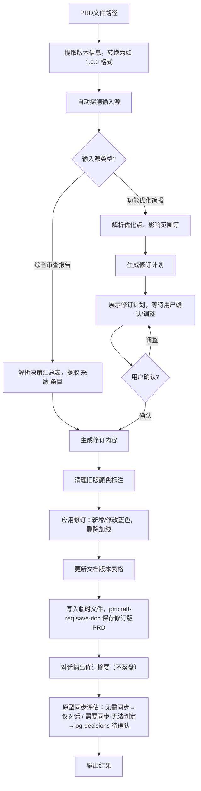

# PRD 修订 (revise-prd)

## 概述

`revise-prd` 是 PRD 质量闭环与优化落地的核心修订技能。它支持两种输入源，可根据来源自动适配修订逻辑：

1. **综合审查报告**（来自 `pmcraft-req:review-prd`）：提取决策汇总表中标注 `[采纳]` 的条目，修订 PRD 中对应的质量缺陷。
2. **功能优化简报**（来自 `pmcraft-req:write-brief --optimize` 或语义自动识别的优化模式）：读取优化简报中的现状痛点、优化目标、影响范围及具体修改点，生成修订计划并执行。

修订完成后：
- 清理旧版颜色标记，新增或修改内容用蓝色字体标注，删除内容加删除线并注明原因。
- 更新 PRD 第 1 章“文档版本”记录（修订简介含来源与章节定位，见 prd_template.md 填写说明）。
- 通过 `pmcraft-req:save-doc` 保存修订版 PRD（E 编号递增）。
- 在对话中输出《修订摘要》（不保存到 report/）；原型同步评估结论在「需要同步/无法判定」时记入决策记录（待确认）。

## Guard-Chat 守卫检查（第 0 步）

> 本小节为守卫开关检查，**不阻塞**主流程：执行完直接进入下一节。**子代理上下文**（被 spawn 执行、无法与用户交互，如 doc-reviewer/design-reviewer）整节静默跳过——不询问、不标记、不检测。

1. 运行 `node "{插件根}/_shared/scripts/guard-chat.js" status`，`{插件根}` = 从当前 SKILL.md 目录向上找第一个含 `_shared/scripts/guard-chat.js` 的祖先目录（source 环境=市场根，cache 环境=插件版本目录）。
2. 解析单行 JSON（契约：`{"status":"ok","data":{"enabled":bool,"prompted":bool,"dir":"…"}}`）：
   - `prompted=false` → 按话术库 GUARD-ASK（`enabled=false`）或 GUARD-ON（`enabled=true`）提示一次，然后运行 `node "{插件根}/_shared/scripts/guard-chat.js" mark-prompted`。用户紧随询问回复肯定意图（如「开启」），或任意轮次说「开启Guard-Chat」（路由表已注册）时，运行 `guard-chat.js enable`。
   - `prompted=true` → 跳过，不重复提示。
   - 话术库不可达（项目未跑 init-project、无大脑注入）→ 用兜底一句：「本会话可开启 Guard-Chat 守卫：开启后，你输入中可能影响判断的表述（如预设立场、权威宣称、逻辑谬误）会当场标注提醒；落盘文档中的对话填充语（如“好问题”、“希望对你有帮助”）会自动清除。说「开启Guard-Chat」开启（回复「开启」也可以），本会话只问一次。」（兜底非权威副本，有话术库时必须用话术库）
3. 脚本不可用（node 缺失/脚本缺失/JSON 解析失败）→ 静默跳过，继续主流程。
4. 本技能对话期间（仅 `enabled=true` 时）：① 每条用户消息经 `guard-chat.js detect`（stdin）检测，命中时单行简短标记，不打断流程；② 文档落盘前（save-doc 保存、直接写入报告文件）经 `guard-chat.js purify`（stdin）净化。规则见路由大脑「Guard-Chat 守卫行为」节。对话回复文风遵循 agent 定义的文风底线（无需脚本）。

## 输入

| 参数 | 类型 | 必选 | 说明 | 示例 |
| :--- | :--- | :--- | :--- | :--- |
| PRD路径 | 文件路径 | 是 | 待修订的PRD文件路径，同版本目录下需存在可用的输入源 | `./账号系统/1.0.0/prd/账号系统_1.0.0_PRD_E1.md` |
| --source | 字符串 | 否 | `review`（审查报告）或 `optimize`（优化简报），不传则自动探测 | `--source review` |

## 调用方式

```
revise-prd <PRD路径>
```

**示例：**
```
revise-prd ./账号系统/1.0.0/prd/账号系统_1.0.0_PRD_E1.md
```

**指定输入源示例：**
```
revise-prd ./账号系统/1.0.0/prd/账号系统_1.0.0_PRD_E2.md --source review
revise-prd ./账号系统/1.0.0/prd/账号系统_1.0.0_PRD_E2.md --source optimize
```

技能会**自动在同版本目录下按以下优先级查找输入源**：
1. 优先查找 `report/` 下最新的综合审查报告（文件名含“综合审查报告”），若决策汇总表中有 `[采纳]` 条目则使用。
2. 若无采纳条目或未找到审查报告，则查找 `brief/` 下的功能优化简报（文件名含“功能优化简报”或“需求简报”，且内容包含优化相关章节）。
3. 若两者均未找到，提示用户先执行 `pmcraft-req:review-prd` 或 `pmcraft-req:write-brief --optimize`。

> **另**：Gate 2 收敛循环中由 `pmcraft-req:check-consistency` 定位的规则性差异，由收敛编排将差异清单直接注入修订上下文（无需文件探测）；此类修订的第 1 章修订简介来源写“一致性检查报告（{yyyy-MM-dd}）”（见 prd_template.md 第 1 章填写说明）。

用户也可通过在命令后附加 `--source review` 或 `--source optimize` 指定输入源类型。

## 输入要求

### PRD 文档要求

- 严格遵循 `../../_shared/templates/prd_template.md` 格式，包含完整的章节结构。
- 同版本目录下需存在可用的输入源。

### 综合审查报告要求（输入源一）

- 决策汇总表中包含 `[采纳]` 标记的条目。
- 条目描述需包含清晰的问题描述，以便定位章节。

### 功能优化简报要求（输入源二）

- 由 `pmcraft-req:write-brief` 在优化模式下产出，或手动编写。
- 需包含以下优化专属章节（至少一项）：
  - **现状痛点**
  - **根因分析**
  - **优化目标**
  - **影响范围**（受影响的用例、规则等）
  - **具体优化点**（期望的变更描述）
- 格式可参考 `../../_shared/templates/optimize_brief_template.md`。

## 输出

| 产物 | 落盘位置 | 说明 |
| :--- | :--- | :--- |
| 修订版 PRD | 版本目录 `prd/`，经 `pmcraft-req:save-doc` 保存（E 编号递增） | 最终交付物；原 PRD 文件保持不变 |
| 《修订摘要》 | 不落盘（仅对话展示） | 含修订时间、文档版本变更、修订来源、修订清单、复核要点 |
| 决策记录条目 | 版本目录 `decision/`，经 `pmcraft-req:log-decisions` 追加 | 仅原型同步评估「需要同步/无法判定」时产生，status `待确认` |
| 审查子任务报告 | review-prd → `report/`（经 save-doc）；check-consistency → 项目根 `pmcraft/temp/` | 第七步 spawn 子智能体的产物，按各自落盘约定执行 |

## 工作流程



### 详细步骤

#### 第一步：提取版本信息并探测输入源

1. 从 PRD 文件路径提取功能顶级文件夹和当前功能版本号（原始大小写）。
2. 统一版本号格式（如 `v1.0.0` → `1.0.0`）。
3. 在同版本目录 `decision/` 下检查是否存在决策记录文件（取最大 E 编号）。若存在，读取状态索引表，提取其中标记为「条件触发」或「待确认」的决策，作为修订上下文注入——这些决策可能在本轮修订中被确认或推翻。
4. 在同版本目录下自动探测：
   - 扫描 `report/` 下最新的综合审查报告，检查是否有 `[采纳]` 条目。
   - 若报告不存在或其中无 [采纳] 条目，扫描 `brief/` 下是否包含优化简报（通过关键词判断：”优化简报””现状痛点””根因分析””影响范围”等）。
5. 若两者均找到且用户未指定，向用户确认：”检测到综合审查报告和功能优化简报均存在，请选择本次修订来源：1）审查报告采纳条目；2）优化简报。”
6. 若均未找到，提示用户并终止。

#### 第二步：解析输入源并生成修订内容/计划

**输入源一：综合审查报告**
- **颜色标记检查**：详见 `../../_shared/templates/color_check_guideline.md` 中定义的检查流程。**如果读取失败** → 执行核心检查项：扫描 PRD 中残留蓝色标记的配对完整性，发现异常时向 PM 提示并标注降级执行。
- **防重复修订检查**：读取 PRD 第 1 章文档版本表的最新修订记录（表格第一行数据），检查修订简介中是否包含"来源：综合审查报告"或"来源：功能优化简报"（新格式）或类似措辞。若 PRD 文档修订的修订时间晚于审查报告的制作/保存时间，说明审查报告中的 `[采纳]` 条目已被应用过。此时向用户提示：
  > "检测到 PRD 可能在审查报告生成后已被修订过（PRD 最新修订时间：{PRD最新修订时间}，审查报告时间：{报告时间}）。审查报告的 [采纳] 条目可能已在上次 revise-prd 中应用。确认继续执行吗？重复应用同一批修订可能导致内容重复或蓝色标注紊乱。"
  若用户确认继续，按标准流程执行。若用户提供新的审查报告路径，则使用新报告。
- 提取所有 `[采纳]` 条目的问题描述与类别。
- 智能匹配 PRD 中应修改的章节（定位逻辑与旧版一致）。
- 逐条生成修订文本，直接进入执行状态（无需确认计划，因为采纳条目已在审查阶段确认）。

**输入源二：功能优化简报**
- 解析简报中的优化点、影响范围、根因等。
- 结合存量 PRD 内容，生成一份**修订计划**，格式如下：

```markdown
## 优化修订计划
**来源**：[功能优化简报文件名]
**目标文档**：PRD E[X]

### 计划修改内容
| 编号 | 优化项 | 定位章节 | 操作 | 修改详情 |
| :--- | :--- | :--- | :--- | :--- |
| 1 | [优化点简述] | 用例X - 主成功流程 | 修改 | [原步骤X] 修改为 [新步骤X] |
| 2 | [优化点简述] | 4.2 共同规则 | 新增 | 新增规则：[规则内容] |
| 3 | [优化点简述] | 用例Y - 扩展流程 | 删除 | 删除扩展Xa，原因：[说明] |
| ... | ... | ... | ... | ... |
```

**填充规则**：
- 操作列仅允许 `新增` / `修改` / `删除` 三种取值，与修订执行阶段的标注方式一一对应。
- 定位章节必须与 PRD 实际章节标题一致；无法定位时在"定位章节"列标注"定位失败"，并提示用户确认。
- 修改详情须写明变更前后对照（如"原步骤X 修改为 新步骤X"），便于执行阶段直接应用。

**修订计划示例（已填充）**：

```markdown
## 优化修订计划
**来源**：功能优化简报_优化开票流程_1.0.0.md
**目标文档**：PRD E2

### 计划修改内容
| 编号 | 优化项 | 定位章节 | 操作 | 修改详情 |
| :--- | :--- | :--- | :--- | :--- |
| 1 | 开票响应慢，缺少排队提示 | 用例3 - 主成功流程 | 新增 | 主成功流程步骤5后新增步骤6：显示"排队中，预计N秒"提示 |
| 2 | 拍照识别易失败 | 用例2 - 主成功流程 | 修改 | 原步骤2"拍照识别" 修改为 "手动输入，附示例引导" |
| 3 | 拍照识别规则过时 | 4.2 共同规则 | 删除 | 删除规则2.1 拍照识别，原因：OCR 服务未采购 |
```

- 将修订计划展示给用户，等待确认或调整。用户可逐条修改、删除或补充。
- 用户确认后，进入执行修订阶段。

#### 第三步：执行修订

**重要**：不要直接修改现有 PRD 文件。以下所有变更在 AI 上下文中构建完整内容，通过临时文件和 pmcraft-req:save-doc 保存为新文件（E编号递增），原文件始终保持不变。

1. **清理旧版颜色**：扫描原 PRD 全文，移除所有 `<span style="color:...;">` 标签及对应闭合标签，仅保留纯文本。
2. **应用修订**：根据修订内容或计划，逐条修改 PRD，按操作类型执行：
   - 如果操作类型为**新增**：在指定位置追加内容，用 `<span style="color:blue;">...</span>` 标注。
   - 如果操作类型为**修改**：替换原有文字，新文字用蓝色标注。
   - 如果操作类型为**删除**：保留原文并加删除线，后附原因（如 `~~原内容~~（原因：流程简化）`）。
   - 如果优化简报要求更新待确认规则状态：直接更新并标注结论。
3. 如果修订涉及多章节协同：检查上下文一致性，必要时联动调整关联章节。
4. **更新文档版本记录**：
- 在 PRD 第 1 章”文档版本”表格顶部新增一行（最新记录放最前）。
- **功能版本**：保持当前功能版本号不变（如 1.0.0）。
- **文档修订**：从当前 PRD 文件名中提取 E 编号并 +1。例如当前文件为 `账号系统_1.0.0_PRD_E2.md`，则提取 `E2`，新文档修订为 `E3`。推算出的 E 编号同时写入表格和传递给 `pmcraft-req:save-doc`。
- 修订人：当前昵称或”AI”。
- 修订时间：当前日期。
- 修订简介：按新格式”来源：{输入源}<br>新增（{章节定位}）：…<br>修改（{章节定位}）：…<br>删除（{章节定位}）：…”整合本次所有变更（格式规则见 `../../_shared/templates/prd_template.md` 第 1 章填写说明），例如：
  > 来源：功能优化简报E1<br>新增（用例3主成功流程）：补充异步处理提示。  
  > 修改（用例2主成功流程）：将拍照识别改为手动输入。  
  > 删除（用例2）：拍照识别步骤（因OCR服务预算未批）。

#### 第四步：保存修订版 PRD

- 调用 `pmcraft-req:save-doc` 前须执行预保存质量检查（详见 `../save-doc/SKILL.md#预保存质量检查`），包括 Mermaid 闭合、蓝色标签配对、占位符替换、版本号格式四项。

1. 将修订后的完整 PRD 写入临时文件，位置统一为**项目根 `pmcraft/temp/`**（若不存在则先创建；命名 `{功能名}_PRD_修订_{yyyy-MM-dd}.draft.md`）。**禁止写入系统 Temp 或 cwd**——save-doc 复制后临时文件即被删除，写入项目内临时区确保中途失败时产物可追踪。
2. AI 根据修订内容自动生成内容摘要（如"采纳审查报告第3条：修订分润规则"），从用户信息中获取负责人。
3. 调用 `Skill` 工具，技能名称为 `pmcraft-req:save-doc`，传入参数：
   - 功能顶级文件夹路径
   - 当前功能版本号（如 1.0.0 格式）
   - 文档类型 `PRD`
   - 临时文件路径
   - 内容摘要与负责人分别以 `--summary` 和 `--author` 参数传入（参数说明见 `../save-doc/SKILL.md` 参数表）
4. `pmcraft-req:save-doc` 自动在同一版本目录下确定下一个 E 编号，保存并返回路径，更新 `_index.md`。
5. 展示结果：
   ```
   ✅ 修订版 PRD 已保存。

   📁 保存路径：[路径]
   📝 功能版本：[版本号] | 文档修订：[E编号]
   ```

#### 第五步：对话输出修订摘要

1. 在对话中输出《修订摘要》（骨架见「修订摘要对话输出模板」），包含：修订时间、功能版本、文档版本变更、修订来源、修订清单、复核要点。
2. **禁止写入任何临时文件，禁止调用 `pmcraft-req:save-doc`，禁止保存到 `report/`**。修订来源与变更轨迹已在第三步写入 PRD 第 1 章修订简介，无需独立文档留存。
3. 提示用户复核蓝色标注，确认后改黑。
4. **待办关闭（话术库 FLOW 族）**：若本次修订的输入源是某份综合审查报告（`report/*_综合审查报告_E{M}.md`，从本次修订输入解析所得）→ 按 CLAUDE.md「流程清单（进度与待办）」节登记协议，将 `{版本目录}/_进度清单.md` 登记区 `report|E{M}|采纳` 行移入已关闭小节（方式：技能出口应用完成，PRD 已至 E{新}），并按 **FLOW-CLOSE** 播报单行；无该行则跳过。清单文件不存在时跳过（未启用流程清单的项目不受影响）。

#### 第六步：原型同步评估

修订版 PRD 保存完成后，评估原型是否需要同步：

1. 读取当前版本目录下 `prototype/` 中的最新原型（优先 `E{max}/`，降级 `working/`）。
2. 对照本次修订涉及的章节，检查新增/改变的交互描述（页面跳转、弹窗、按钮、状态变化、文案提示）在原型中是否有对应实现。
3. 输出三类结论，按分支处理：
   - **无需同步**（修订为纯规则/后端逻辑/术语，不影响原型交互）：仅在对话中说明结论，**不追加决策条目**。
   - **需要同步**：对话中列出具体差异条目和对应原型页面/组件，并追加一条决策记录（status `待确认`）。
   - **无法判定**（原型为静态文件无法覆盖动态行为）：对话中说明并标注需人工确认，追加一条决策记录（status `待确认`）。
4. **追加决策记录**：调用 `Skill` 工具 `pmcraft-req:log-decisions`，参数 `action=append`、`version_dir` 为当前版本目录、`decisions_file` 为写入 `pmcraft/temp/` 的条目 JSON（内容模板见「原型同步评估决策条目」节）、`source=revise-prd`；不传 `state_updates_file`。
   - **若 `decision/` 目录下尚无决策记录文件**（首次调用）：先以 `action=create` 创建决策记录（首条即本次条目），再以 `action=append` 追加其余条目——append-decisions.js 在无存量决策记录时会拒绝执行，必须先 create。
   - E 编号由 append-decisions.js 自动递增。

#### 第七步：Gate 2 审查关隘入口

修订版 PRD 保存完成、修订摘要已在对话中输出后，向用户展示 **GATE-2 模板**（话术库，见 CLAUDE.md「话术模板库」节）：

> "【PRD 审查】修订版 PRD 已完成。根据审查把关线（Gate 2），建议执行审查：
>
> - **PRD 审查（review-prd）**：对修订版 PRD 进行完整性、风险性、逻辑性三维审查
> - **一致性检查（check-consistency）**：验证修订版 PRD 与原型之间的一致性（需原型已产出）
>
> 请选择（可多选，如「1+2」）或回复 **跳过**：
>
> （评审提示：版本目录 `_README/`《评审与开发必读指南》由 save-doc 自动维护（双击 _README/README.html 门户即读），评审前可先打开获取全貌）"

- 用户选择后，对每个选中的审查，通过 `Agent` 工具 spawn **doc-reviewer** 子智能体：
  - `subagent_type`: `"doc-reviewer"`
  - `prompt`: 传入审查技能名（`pmcraft-req:review-prd` / `pmcraft-req:check-consistency`）+ 刚保存的修订版 PRD 文件路径 + 原型路径（若适用）
  - **正式落盘指令**（必须，区分审查类型）：
    - **review-prd**（综合审查）：prompt 明确"审查报告完成编写后，**必须调用 `pmcraft-req:save-doc` 正式保存**（文档类型 `综合审查报告`，功能顶级文件夹与版本号从传入的 PRD 路径推断——其为正式路径，含 `<顶级文件夹>/<版本号>/` 结构）。**禁止只写临时区不落盘**——综合审查报告的正式保存是流程硬性要求，主对话不再补做"
    - **check-consistency**（一致性检查）：prompt 明确"审查报告写入**项目根 `pmcraft/temp/`**（若不存在则先创建），文件名 `{功能名}_一致性检查报告_{yyyy-MM-dd}.md`；若当天已存在同名文件，追加轮次后缀 `_r{N}`（N 从 2 递增），**禁止覆盖早轮报告**——收敛小循环同日多轮需保留每轮差异清单供单调性对比。**写入 `pmcraft/temp/` 即为最终产物，不再调用 `pmcraft-req:save-doc`**——无 E 编号、不进 `_index.md`"
  - **先后顺序（禁止并行）**：一致性检查的对象必须是定稿 PRD（见 CLAUDE.md「Gate 2 收敛小循环」），**禁止并行 spawn review-prd 与 check-consistency**——并行执行会导致修订后报告作废。先 spawn review-prd；若用户选择基于审查发现再次修订（本技能新一轮修订），定稿后再 spawn check-consistency；收敛复查最多 3 轮，超限输出剩余差异清单停止循环。
- 如果用户回复"跳过"：流程结束
- 审查完成后，展示报告路径，询问："是否基于审查发现再次修订 PRD？"
  - 若是：可再次调用本技能进行新一轮修订
  - 若否：流程结束

#### 第八步：出口衔接（话术库 NEXT-TAIL）

修订完成后，输出收尾序列下一环（已产出环节跳过，按 流程图→时序图→测试用例 顺序）：

> "PRD 修订已完成。req 域剩余收尾：流程图（若 flowchart/ 为空或已过期）→ 时序图（若 PRD 第 8 章待补充）→ 测试用例（若 testcase/ 为空或已过期）。直接说「继续收尾」即可。"

## 修订摘要对话输出模板

第五步在对话中输出的《修订摘要》必须使用以下骨架（**仅在对话中展示；禁止写入临时文件，禁止调用 pmcraft-req:save-doc，禁止保存到 report/**）：

```markdown
## PRD 修订摘要

**修订时间**：{yyyy-MM-dd HH:mm:ss}
**功能版本**：{当前功能版本号，如 1.0.0}
**文档版本变更**：E{原编号} → E{新编号}
**修订来源**：{综合审查报告 / 功能优化简报 + 文件名}

### 修订清单

| 序号 | 定位章节 | 操作 | 修订内容摘要 |
| :--- | :--- | :--- | :--- |
| 1 | {章节定位} | {新增/修改/删除} | {变更内容摘要} |

### 复核要点

- 蓝色标注为本次修改内容，确认后可去除颜色标签。
- 删除内容已保留痕迹，便于回溯。
```

**填充规则**：
- 修订时间：取执行时刻的当前日期时间。
- 操作列仅允许 `新增` / `修改` / `删除` 三种取值，与修订计划条目一一对应。
- 修订来源必须写明输入源类型与 E 编号（如"综合审查报告E2"），与 PRD 第 1 章修订简介的"来源：…"保持一致。
- 修订清单条目数必须与本次实际变更数一致，不得遗漏或虚增。
- 原型同步评估按第六步分支处理：无需同步 → 仅对话说明；需要同步/无法判定 → 追加待确认决策条目（对话版摘要中不再另立「原型同步评估」章节）。

## 修订摘要示例（优化来源）

（以下为对话展示示例，不落盘）

```markdown
## PRD 修订摘要

**修订时间**：2026-05-14 10:00:00
**功能版本**：1.0.0
**文档版本变更**：E2 → E3
**修订来源**：功能优化简报（优化开票流程）

### 修订清单

| 序号 | 定位章节 | 操作 | 修订内容摘要 |
| :--- | :--- | :--- | :--- |
| 1 | 用例3 - 主成功流程 | 新增 | 补充异步排队提示步骤 |
| 2 | 用例2 - 主成功流程 | 修改 | 拍照识别改为手动输入，增加示例引导 |
| 3 | 用例4 - 扩展流程 | 新增 | 增加税务系统回调轮询分支 |
| 4 | 4.2 共同规则 | 删除 | 删除拍照识别的相关规则（原因：OCR服务未采购） |

### 复核要点
- 蓝色标注为本次修改内容，确认后可去除颜色标签。
- 删除内容已保留痕迹，便于回溯。
```

## 修订摘要示例（审查来源）

（以下为对话展示示例，不落盘）

```markdown
## PRD 修订摘要

**修订时间**：2026-06-20 14:30:00
**功能版本**：1.0.0
**文档版本变更**：E2 → E3
**修订来源**：综合审查报告E2

### 修订清单

| 序号 | 定位章节 | 操作 | 修订内容摘要 |
| :--- | :--- | :--- | :--- |
| 1 | 用例1 - 扩展流程 | 修改 | 修正边界条件：余额不足时提示文案与重试入口 |
| 2 | 5.2 状态定义 | 修改 | 补充"待审核"状态的流转规则 |

### 复核要点
- 蓝色标注为本次修改内容，确认后可去除颜色标签。
- 删除内容已保留痕迹，便于回溯。
```

## 原型同步评估决策条目

第六步在「需要同步」或「无法判定」时追加一条决策记录（status `待确认`），使用以下 JSON 模板（写入 `pmcraft/temp/` 后经 `pmcraft-req:log-decisions` 传入：调用参数 `source` 取 `revise-prd`，条目内 `source` 字段按模板固定 `原型同步评估`）：

```json
{
  "title": "原型同步评估：{功能名} {版本号} E{旧编号}→E{新编号}",
  "source": "原型同步评估",
  "status": "待确认",
  "background": "本次 PRD 修订（E{旧编号}→E{新编号}，来源：{输入源}）涉及交互性变更，需确认原型是否同步。",
  "options": [
    "同步原型（调用 pmcraft-proto:build-prototype 按修订内容补原型）",
    "暂不同步（人工评估影响后决定）"
  ],
  "decision": "待确认：{结论分支}——{具体差异条目 / 无法覆盖的动态行为说明}",
  "reason": "原型同步评估结论：{需要同步 / 无法判定}（{依据简述}）。",
  "cost": "不同步将导致 PRD 与原型不一致，后续 check-consistency 将报告差异。",
  "assumptions": [],
  "links": "{修订版 PRD 文件名}（E{新编号}）",
  "trigger_condition": null,
  "superseded_by": null
}
```

**填充规则**：
- `title` 含功能名/版本号/E 编号变更；`source` 字段固定 `原型同步评估`；`status` 固定 `待确认`。
- `decision` 与 `reason` 按结论分支填写：需要同步 → 具体差异条目（如"用例3主流程新增异步排队提示，原型缺排队提示弹层"）；无法判定 → "静态原型无法覆盖动态行为（{行为}），需人工确认"。
- `links` 指向修订版 PRD 文件名（E{新编号}）。
- **无需同步时禁止产生条目**——仅对话说明。

**已填充示例**（「需要同步」分支）：

```json
{
  "title": "原型同步评估：账号系统 1.0.0 E2→E3",
  "source": "原型同步评估",
  "status": "待确认",
  "background": "本次 PRD 修订（E2→E3，来源：综合审查报告E2）涉及交互性变更，需确认原型是否同步。",
  "options": [
    "同步原型（调用 pmcraft-proto:build-prototype 按修订内容补原型）",
    "暂不同步（人工评估影响后决定）"
  ],
  "decision": "待确认：需要同步——用例3主流程新增异步排队提示，原型缺排队提示弹层",
  "reason": "原型同步评估结论：需要同步（原型缺少新增交互的对应实现）。",
  "cost": "不同步将导致 PRD 与原型不一致，后续 check-consistency 将报告差异。",
  "assumptions": [],
  "links": "账号系统_1.0.0_PRD_E3.md（E3）",
  "trigger_condition": null,
  "superseded_by": null
}
```

## 正误示例

### 正确示例

**来源为审查报告**:
```
revise-prd ./账号系统/1.0.0/prd/账号系统_1.0.0_PRD_E2.md
```
预期：自动探测同版本 `report/` 下综合审查报告，提取 `[采纳]` 条目，执行修订并保存。

**来源为优化简报**:
```
revise-prd ./账号系统/1.0.0/prd/账号系统_1.0.0_PRD_E2.md --source optimize
```
预期：读取优化简报，生成修订计划，经确认后执行修订。

### 错误示例

**错误**: 同版本目录下无任何输入源
```
revise-prd ./账号系统/1.0.0/prd/账号系统_1.0.0_PRD_E1.md
```
- 问题：`report/` 下无综合审查报告，`brief/` 下无优化简报，无法确定修订内容。
- 正确做法：先执行 `pmcraft-req:review-prd` 或 `pmcraft-req:write-brief --optimize` 生成输入源。

**错误**: 传入的PRD路径不符合模板格式
```
revise-prd ./自由格式文档.md
```
- 问题：非模板格式PRD，章节定位逻辑可能失效，修订可能应用到错误位置。
- 正确做法：确认 PRD 符合 `../../_shared/templates/prd_template.md` 格式。

## 边缘情况处理

| 场景 | 触发条件 | 处理方式 | 示例回复 |
| :--- | :--- | :--- | :--- |
| 审查报告和优化简报同时存在 | 同版本目录下两种输入源都有 | 向用户确认选择哪种来源 | "检测到综合审查报告和功能优化简报均存在，请选择本次修订来源：1）审查报告采纳条目；2）优化简报。" |
| 审查报告中所有条目均为 [忽略] 或 [监控] | 无 `[采纳]` 条目 | 提示无待修订项，不执行修订 | "综合审查报告中无 [采纳] 条目，无需执行修订。" |
| 优化简报的影响范围超出PRD章节 | 优化点指向的章节在PRD中不存在 | 在修订计划中标注"定位失败"，提示用户确认 | "以下优化点无法定位到PRD：[列表]。请手动确认这些变更应在PRD的何处生效。" |
| 审查报告可能已被应用 | PRD最新修订时间晚于审查报告时间 | 提示用户确认是否继续，防止重复修订 | "检测到 PRD 可能在审查报告生成后已被修订过。确认继续执行吗？重复应用同一批修订可能导致内容重复。" |
| PRD 文件不存在 | 传入路径下找不到 PRD 文件 | 报错并终止，不进入探测流程 | "PRD文件不存在，请核对路径后再执行。" |
| PRD 不符合模板格式 | PRD 缺少必要章节或结构异常 | 提示格式要求，由用户确认继续或先修复格式 | "PRD 不符合 prd_template.md 格式，章节定位逻辑可能失效。请确认继续执行，或先修复 PRD 格式。" |
| 修订计划被全部放弃 | 用户确认时删除了所有条目 | 不执行任何修订，直接结束，不调用 save-doc | "修订计划无确认条目，本次不执行修订。" |
| 修订执行中用户中止 | 修订过程中用户要求停止 | 丢弃临时文件，不调用 save-doc，提示已中止 | "已中止修订。临时文件已丢弃，未产生新E编号。" |
| 原型目录不存在或无快照 | 第六步读取 `prototype/` 失败 | 对话说明跳过原型同步评估，不追加决策条目 | "版本目录下无可用原型（prototype/ 为空或不存在），跳过原型同步评估。" |
| save-doc 保存失败 | 调用 save-doc 返回失败 | 保留临时文件（项目根 `pmcraft/temp/`），说明原因并提示重试 | "保存失败：{原因}。临时文件已保留在 pmcraft/temp/，可重试保存。" |
| 优化简报无有效优化点 | 简报存在但缺少「具体优化点」等优化章节 | 提示简报无效，改用审查报告源或重新生成简报 | "优化简报缺少具体优化点，无法生成修订计划。请重新执行 write-brief --optimize，或改用 --source review。" |

## 常见错误

1. **同版本目录下无输入源（审查报告或优化简报）** — 先执行 `pmcraft-req:review-prd` 或 `pmcraft-req:write-brief --optimize` 生成输入源。
2. **PRD 不符合模板格式** — 章节定位逻辑失效，修订可能应用到错误位置。
3. **忽略旧版颜色标记清理** — 修订前自动清理旧蓝色标注，确保仅本次修订标蓝。
4. **遗漏原型同步评估** — 修订完成后必须评估原型同步；「需要同步/无法判定」须追加 status=待确认 决策条目，「无需同步」仅对话说明。

## 快速参考

| 来源 | 是否需要确认 | 典型场景 |
|:---|:---|:---|
| 综合审查报告 `[采纳]` | 否（直接执行） | 修复审查发现的质量缺陷 |
| 功能优化简报 | 是（需确认修订计划） | 应用优化变更到 PRD |

## 评价测试用例

### 正向触发（5条）

| # | 触发输入 | 预期输出断言 |
| :--- | :--- | :--- |
| 1 | `revise-prd ./账号系统/1.0.0/prd/账号系统_1.0.0_PRD_E2.md`（report/ 下综合审查报告含 [采纳] 条目） | 直接提取采纳条目执行修订，不展示修订计划；对话输出修订摘要；经 save-doc 保存为 E3，原 E2 文件保持不变 |
| 2 | `revise-prd ./账号系统/1.0.0/prd/账号系统_1.0.0_PRD_E2.md --source optimize`（brief/ 下优化简报存在） | 生成《优化修订计划》并等待用户确认；确认后逐条执行修订并保存 |
| 3 | 审查报告含多个 [采纳] 条目且涉及不同章节 | 逐一定位并修订各章节；第 1 章文档版本表新增一行，修订简介含"来源：综合审查报告"及各章节定位 |
| 4 | 优化简报含"新增/修改/删除"混合操作 | 修订计划操作列仅含 `新增`/`修改`/`删除` 三种取值；删除项保留删除线并注明原因 |
| 5 | 修订前 PRD 含旧版蓝色标注 | 旧颜色标记全部清除，仅本次修订内容为蓝色 |

### 负向触发（5条）

| # | 触发输入 | 预期输出断言 |
| :--- | :--- | :--- |
| 1 | `revise-prd`（无参数） | 提示需要 PRD 路径，流程终止，不产生任何文件 |
| 2 | `revise-prd ./不存在的PRD.md` | 报错"PRD文件不存在"，不进入输入源探测 |
| 3 | `revise-prd ./账号系统/1.0.0/prd/账号系统_1.0.0_PRD_E1.md`（report/ 与 brief/ 均无输入源） | 提示"未找到输入源"，引导执行 review-prd 或 write-brief --optimize，不执行修订 |
| 4 | `revise-prd ./账号系统/1.0.0/prd/账号系统_1.0.0_PRD_E1.md --source invalid` | 提示无效的 source 参数（仅接受 review/optimize），流程终止 |
| 5 | 用户确认修订计划时全部删除条目 | 不执行任何修订、不调用 save-doc，对话说明"修订计划无确认条目" |

### 边界查询（5条）

| # | 边界场景 | 预期输出断言 |
| :--- | :--- | :--- |
| 1 | PRD 中存在多处历史蓝色标注 | 清理全部旧颜色标记后再应用新修订，最终仅本次内容为蓝色 |
| 2 | 修订涉及关联章节联动（如第 4 章规则修改需同步第 5 章用例） | 在对话版修订摘要中提醒用户检查关联影响 |
| 3 | 当前 E 编号为 E9 | 新文档修订为 E10，E9 文件不被覆盖 |
| 4 | 原型同步评估结论为「需要同步」 | 对话说明差异条目；追加一条 status=待确认 的决策条目（D 编号接续决策记录序列）；report/ 下不产生任何新文件 |
| 5 | 原型同步评估结论为「无需同步」 | 仅对话说明，不追加决策条目，不产生任何文件 |

## 禁止行为

1. **禁止跳过输入源探测** — 必须先按优先级查找综合审查报告或功能优化简报，两者均未找到时提示用户先执行 `pmcraft-req:review-prd` 或 `pmcraft-req:write-brief --optimize`，不得在无输入源时强行修订
2. **禁止跳过防重复修订检查** — 读取 PRD 文档版本表最新修订时间，若晚于审查报告生成时间则提示用户确认是否继续，防止同一批 `[采纳]` 条目被重复应用
3. **禁止跳过旧版颜色清理** — 每次修订前统一清理 PRD 中已有的蓝色标记，确保只有本次修改为蓝色
4. **禁止直接修改原文件** — 所有变更在 AI 上下文中构建完整内容，通过临时文件和 pmcraft-req:save-doc 保存为新文件（E编号递增），不得直接使用 Write 工具修改现有 PRD 文件
5. **禁止跳过用户确认** — 优化简报产生的修订计划必须经用户确认后才执行
6. **禁止忽略关联影响** — 若优化简报中标注了影响范围，修订时需同步检查关联章节是否需要联动调整，必要时在对话版修订摘要中提醒用户
7. **禁止删除不留痕迹** — 所有删除内容均在 PRD 中保留原文（加删除线并注明原因），不可直接移除
8. **禁止跳过 Mermaid 闭合检查** — 修订内容涉及 Mermaid 流程图时，调用 `pmcraft-req:save-doc` 前必须验证 Mermaid 代码块闭合
9. **禁止落盘修订摘要** — 修订摘要仅在对话中展示，不得写入临时文件、不得调用 pmcraft-req:save-doc 保存到 report/；变更轨迹通过 PRD 第 1 章修订简介与决策记录留存
10. **禁止跳过原型同步评估** — 第六步必须执行：读取 prototype/ 快照并输出三类结论之一；原型缺失时须在对话中说明跳过原因，不得静默省略

## 注意事项

1. **输入源优先级**：综合审查报告优先于优化简报，但用户可覆盖。
2. **E 编号规则**：同一功能版本内多次修订，E 编号持续递增，不覆盖历史文件；修订摘要不再保存到 report/，无独立 E 编号——变更轨迹并入 PRD 修订简介与决策记录。
3. **保存规范**：所有输出均通过 `pmcraft-req:save-doc` 管理，版本号统一使用如 1.0.0 格式传递。
