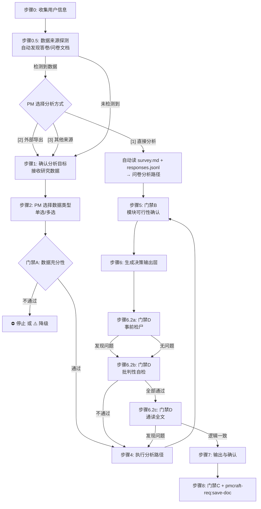

# 研究整理 (synthesize-research)

## 概述

将原始用户研究数据转化为结构化、可追溯、可驱动决策的洞察报告。

**核心原则：**
- PM 选择数据类型 → AI 按类型走两阶段分析路径（机械核查 → 模式识别）→ 统一输出执行摘要 + 调研背景 + 决策输入摘要 + 证据链详报 + 质量声明 + 下游连接指引 + 数据附录
- 不同数据类型的分析方法不同：访谈走标引-聚类-命名，问卷有描述统计+交叉分析，工单有频率分析+根因聚类
- 区分用户所说的（自述）和用户所做的（行为数据）——行为数据通常更可靠
- 每条洞察可追溯到原始数据的特定位置
- 每个发现标注证据强度，PM 能分辨"确定"和"推测"
- 事实数据黑色，AI 推断蓝色标注
- 数据不支持时降级输出而非硬生成——降级输出是"诚实清单"，不是"劣化版"

## Guard-Chat 守卫检查（第 0 步）

> 本小节为守卫开关检查，**不阻塞**主流程：执行完直接进入下一节。**子代理上下文**（被 spawn 执行、无法与用户交互，如 doc-reviewer/design-reviewer）整节静默跳过——不询问、不标记、不检测。

1. 运行 `node "{插件根}/_shared/scripts/guard-chat.js" status`，`{插件根}` = 从当前 SKILL.md 目录向上找第一个含 `_shared/scripts/guard-chat.js` 的祖先目录（source 环境=市场根，cache 环境=插件版本目录）。
2. 解析单行 JSON（契约：`{"status":"ok","data":{"enabled":bool,"prompted":bool,"dir":"…"}}`）：
   - `prompted=false` → 按话术库 GUARD-ASK（`enabled=false`）或 GUARD-ON（`enabled=true`）提示一次，然后运行 `node "{插件根}/_shared/scripts/guard-chat.js" mark-prompted`。用户紧随询问回复肯定意图（如「开启」），或任意轮次说「开启Guard-Chat」（路由表已注册）时，运行 `guard-chat.js enable`。
   - `prompted=true` → 跳过，不重复提示。
   - 话术库不可达（项目未跑 init-project、无大脑注入）→ 用兜底一句：「本会话可开启 Guard-Chat 守卫：开启后，你输入中可能影响判断的表述（如预设立场、权威宣称、逻辑谬误）会当场标注提醒；落盘文档中的对话填充语（如“好问题”、“希望对你有帮助”）会自动清除。说「开启Guard-Chat」开启（回复「开启」也可以），本会话只问一次。」（兜底非权威副本，有话术库时必须用话术库）
3. 脚本不可用（node 缺失/脚本缺失/JSON 解析失败）→ 静默跳过，继续主流程。
4. 本技能对话期间（仅 `enabled=true` 时）：① 每条用户消息经 `guard-chat.js detect`（stdin）检测，命中时单行简短标记，不打断流程；② 文档落盘前（save-doc 保存、直接写入报告文件）经 `guard-chat.js purify`（stdin）净化。规则见路由大脑「Guard-Chat 守卫行为」节。对话回复文风遵循 agent 定义的文风底线（无需脚本）。

## 输入

PM 提供以下任意一种或多种来源：
- 客户访谈记录或笔记
- 问卷调查结果（定量或开放式问题）
- 客服工单日志或客户投诉主题
- 可用性测试录音或观察记录
- 显示用户行为模式的分析数据
- 内部反馈（销售、客户成功等团队）

## 调用方式

```
synthesize-research（直接粘贴研究数据后启动处理）
```

**示例：**

> 用户：以下是我收集的 10 份用户访谈记录，请帮我分析
> AI：感谢提供数据。你这次提供的研究数据属于哪些类型？（可多选）……

## 颜色标记规则

- 用户原话、问卷数据、工单记录等**事实性内容** → 黑色正文
- AI 归纳的模式、推断、启示、根因推测 → 同时使用 `<span style="color:blue">蓝色样式</span>` 和 `[AI推断]` 文本前缀标注，确保在纯文本渲染中蓝色失效时仍可区分推断与事实
- 每条洞察标注来源类型：`[用户自述]` / `[行为数据]` / `[间接数据]` / `[交叉验证]`
- 每条洞察标注证据强度：强 / 中 / 弱

## 禁止行为

1. **禁止在数据不足时做定量结论** — 样本量 < 30 份（问卷）或 < 5 份（访谈）时，仅输出定性洞察，标注样本量不足。
2. **禁止混合事实与推断** — AI 推断内容必须同时使用蓝色样式和 `[AI推断]` 文本前缀，与黑色事实明确区分。
3. **禁止忽略来源矛盾** — 不同来源数据矛盾时必须标注 `[来源矛盾]`，不强求统一。
4. **禁止在单一样本上过度归纳** — 仅 1 位受访者提出的观点不得作为"共同主题"，必须标注为"个案"。
5. **禁止编造用户画像** — 用户画像必须基于实际数据中的角色分类，不得凭空虚构不存在的用户类型。若数据中仅能识别 1 类用户，只输出 1 个画像。
6. **禁止跳过数据质量评估直接输出** — 必须先执行第三步"数据质量评估"并注明局限性标注，再进入分析步骤。
7. **禁止跳过洞察 Specificity 检查** — 每条洞察必须揭示产品含义，而非仅重述用户原话。如果一条洞察可以被没读报告的人复述为"用户想要更好的 X"，退回重写。
8. **禁止在证据不足时生成条件产出物** — 画像/痛点排序/机会点陈述在不满足门禁条件时，必须降级输出，不强行生成。
9. **禁止不标注中文对应词** — 非专有名词的英文术语首次出现时必须标注中文对应词，后续统一使用中文。NPS（净推荐值）、P0/P1 等已通行缩写首次标注全称后可保留。命令名（如 write-brief）、产品名（如 pmcraft-req）为专有名词，不适用此规则。
10. **禁止单点数据跨模块双引** — 同一原始数据点（同一位受访者回答/同一条工单/同一条开放题）最多在报告中出现一次作为核心论据。若已在洞察中作为数据点引用，则不得同时作为痛点排序或决策建议的独立论据。**确需多模块引用时**，在**次要引用处**（即第二次出现的位置）标注 `[此条已在洞察#N引用，同源数据]`。
    - ✅ 正确：数据点在洞察 #3 中已使用，决策输入摘要再次引用 → 在**决策输入摘要**处标注 `[此条已在洞察#3引用，同源数据]`
    - ❌ 错误：在洞察 #3 处标注 `[此条已在决策输入摘要#3引用，同源数据]`（位置反了，且格式用了节名而非洞察编号）
11. **禁止决策-证据脱节** — 决策输入摘要中每条建议的"支撑洞察"列引用的洞察 #N，在洞察 #N 的数据点或模式描述中必须有明确支撑该建议的内容。不允许将一条洞察用作"通用引用"（如洞察 #5 只讨论了简报→原型，但用它来支撑"小需求场景"结论）。

## 工作流程

按顺序执行以下步骤：



---

**加载策略总览**（按需加载，禁止预读全部参考文件）：

| 参考文件 | 加载时机 | fallback |
|:---|:---|:---|
| `references/interview-path.md` / `survey-path.md` / `ticket-path.md` / `behavioral-path.md` / `mixed-path.md`（5 份路径手册） | 步骤 4 入口（按步骤 2 路由结果） | 按本 SKILL.md 内嵌核心规则执行（阶段一机械核查 + 阶段二模式识别），并标注"分析手册缺失，已按内嵌核心规则执行" |
| `references/quality-gates.md` | 步骤 3 入口（门禁 A/B/C 共用，步骤 5、8 沿用） | 按步骤 3「核心规则」表、步骤 5 可行性判断、步骤 8 检查表执行，并标注"门禁细则缺失，已按内嵌规则执行" |
| `references/decision-output-guide.md` | 步骤 6 入口 | 按本 SKILL.md「输出格式」节模板与占位符填充规则执行，并标注"写作指南缺失，已按内嵌模板执行" |

#### 步骤 0：用户信息收集

询问用户的昵称和工号，用于记录报告负责人信息。

---

#### 步骤 0.5：数据来源探测

在接收 PM 粘贴数据之前，先自动探测项目目录中是否已有可分析的数据。

**探测逻辑**：

1. 从当前对话上下文或 PM 的项目目录中，扫描 `{版本号}/survey/web/mock/responses.jsonl` 是否存在且有数据
2. 若找到 → 统计答卷数量，同时检查同版本 `survey/` 下是否存在 `*调研计划与问卷*.md`
3. 若有问卷文档 → 预读调研标题、核心假设、构念列表

**若检测到数据**，向 PM 展示：

> "检测到 {项目}/{版本号}/survey/web/mock/ 下有 **{X} 份答卷**。
> 问卷是"{问卷标题}"，设计时提出了 {N} 个核心假设待验证。
>
> 怎么处理？
> [1] 直接分析这 {X} 份
> [2] 我从其他渠道导出了数据，用那个
> [3] 分析其他来源的数据（访谈/工单/行为数据等）"

| 选项 | 行为 | 后续步骤 |
|:---|:---|:---|
| [1] 直接分析 | 自动读取 survey.md 做合约解析（提取假设清单、构念→研究问题映射）→ 读取 responses.jsonl → 数据类型自动判定为 B（问卷）→ 进入步骤 4 问卷分析路径 | 跳过步骤 1、2，直接进分析 |
| [2] 外部导出 | 询问 PM 文件路径 → 读取文件（CSV/Excel/JSONL） → 自动判断数据类型 → 可选指定 survey.md 路径做合约解析 | 跳过步骤 2（类型已判定），进入步骤 3 |
| [3] 其他来源 | 回退到现有流程 | 进入步骤 1（PM 粘贴数据 + 选类型） |

**合约解析**（[1] 和 [2] 中可选执行）：
- 从 survey.md 提取：调研目标、构念→研究问题映射、核心假设清单（H1/H2/…）
- 这些信息在步骤 4 中用于：交叉表维度、假设验证、合约对账

**若未检测到任何数据**，回退到现有流程，进入步骤 1。

---

#### 步骤 1：确认分析目标与数据来源

接收 PM 提供的研究数据。若已在步骤 0.5 中通过 [1] 或 [2] 自动获取了数据，跳过本步骤。

确认分析目标：

> "你希望侧重什么方向？"
> - 完整分析（默认）：覆盖所有可行的产出物
> - 只看痛点：聚焦痛点排序，简化其他模块
> - 只看机会点：聚焦机会点陈述，简化其他模块
> - 自定义侧重：PM 指定关注的维度

若未说明则默认输出完整报告。

---

#### 步骤 2：数据类型选择与路径路由

若已在步骤 0.5 中自动判定了数据类型，跳过本步骤，直接使用判定的类型进入步骤 3。

询问 PM 数据类型（可多选）：

> "你这次提供的研究数据属于哪些类型？（可多选）
> - A. 用户访谈记录 / 可用性测试
> - B. 问卷调查结果
> - C. 客服工单 / 投诉汇总
> - D. 产品使用数据 / 行为分析数据"

PM 选择后，按以下规则路由：

如果 PM 仅选择了一项（A/B/C/D 单选），则走对应的单一分析路径。如果 PM 选择了多项（≥2 种），则走混合分析路径——定性来源（访谈 + 工单 + 问卷开放题）共享标引-聚类流水线，定量来源（问卷封闭题 / 行为数据）独立分析，最后交叉验证。

| PM 选择 | 路由路径 | 参考文件 |
|:---|:---|:---|
| 仅 A | 访谈分析路径 | `references/interview-path.md` |
| 仅 B | 问卷分析路径 | `references/survey-path.md` |
| 仅 C | 工单分析路径 | `references/ticket-path.md` |
| 仅 D | 行为数据分析路径 | `references/behavioral-path.md` |
| 多选（≥2 种） | 混合分析路径 | `references/mixed-path.md` |

**混合路径的核心逻辑**：定性来源（访谈 + 工单 + 问卷开放题）共享一套标引-聚类流水线——所有标签放在同一个池子里，不按来源区分。定量来源（问卷封闭题 / 行为数据）独立分析。最后交叉验证：定量发现与定性模式匹配——匹配成功 → `[交叉验证]` 可信度升级，匹配不上 → 标注待验证。详细方法见 `references/mixed-path.md`。

---

#### 步骤 3：门禁 A — 数据充分性评估

根据 PM 选择的数据类型和样本量，判断能否启动分析。如果数据不足则停止并提示补充数据；如果数据可降级使用则标注局限性后进入步骤 4；如果数据充足则直接放行。

先 Read `references/quality-gates.md` 获取门禁 A 判定细则。**如果 Read 失败** → 按下方「核心规则」表执行（该表为内嵌基线，已覆盖常见场景），并标注"门禁细则缺失，已按内嵌规则执行"。

详细判定标准见 `references/quality-gates.md`。

**核心规则：**

| 场景 | 动作 |
|:---|:---|
| 访谈 < 3 份且无其他来源 | ⛔ 停止分析，提示补充数据 |
| 访谈 3-4 份 | ⚠️ 降级：仅输出洞察总结+关键特征摘要 |
| 问卷 < 20 份 | ⚠️ 降级：仅描述统计，不做交叉分析 |
| 工单 < 10 条 | ⚠️ 降级：仅问题列表，不做频率分析 |
| 仅 1 份任何类型数据 | ⛔ 停止，仅输出关键引用 |
| 行为数据无具体指标 | ⚠️ 降级：仅输出数据概览，不做模式发现 |
| 多来源但每个来源都低于最低阈值 | ⛔ 停止，同"仅 1 份" |
| 数据充足 | ✅ 放行，进入步骤 4 |

详细判定标准及边缘情况见 `references/quality-gates.md`。

评估结果以数据质量声明形式输出给 PM 确认：

<!-- AI 注意：以下为输出格式模板，输出时不要用 ``` 包裹 -->

### 数据质量初步评估

| 维度 | 评估 |
|:---|:---|
| 数据来源 | {A/B/C/D} |
| 样本量 | {具体数字} |
| 充分性判定 | {✅ 通过 / ⚠️ 降级 / ⛔ 停止} |
| 降级影响 | {哪些模块会受影响} |

---

#### 步骤 4：执行分析路径

4.1 根据步骤 2 的路由结果，打开对应的 reference 文件作为分析手册。**如果读取失败** → 按本 SKILL.md 内嵌核心规则执行：阶段一（机械核查）= 逐题频次分布表 + 交叉表 + 异常标记 + 全员/100%/0人 声明反例检索；阶段二（模式识别）= 基于已验证事实做 Pattern→Insight 推理，禁止重新计数，每条洞察过 Specificity 自检；产出物框架统一为数据概览 + 洞察列表（含数据点→模式→洞察→决策建议→决策逻辑链条）+ 条件产出物。同时在报告中标注"分析手册缺失，已按内嵌核心规则执行"。

4.2 如果路由到问卷路径或混合路径，且 PM 提供了调研计划 → 先执行合约解析（Phase 0），抽取假设清单、分层对比要求、偏差规则和置信边界。

4.3 执行**阶段一（机械核查）**：
- 逐题产出频次分布表（每题必出表）
- 按调研计划要求的维度生成交叉表
- 标记异常：内部回答矛盾、答题时长异常、注意力检测结果
- 验证所有"全员 / 100% / 0人"类声明——逐条检索反例

4.4 执行**阶段二（模式识别）**：
- 基于阶段一的已验证事实做 Pattern → Insight 推理
- 禁止重新计数——所有数字引用阶段一的产出
- 每条洞察完成 Specificity 自检：是否揭示了产品含义？

4.5 如果执行了合约解析 → 执行合约对账，逐项标注完成状态（✅ 已完成 / ⏭️ 跳过 / ⚠️ 无法执行）。

4.6 按各路径的门禁表判断用户画像、痛点排序、机会点陈述三个条件产出物的可行性（正常生成 / 降级输出）。

无论走哪条路径，产出物框架统一：数据概览 + 洞察列表（含完整 数据点→模式→洞察→决策建议→决策逻辑 链条）+ 条件产出物（含门禁判定）。

---

#### 步骤 5：门禁 B — 模块可行性确认

分析完成后，基于分析结果判断画像/痛点排序/机会点陈述三个条件模块的可行性。此阶段不是"拦截"（分析已完成），而是确认哪些模块正常生成、哪些降级——PM 有权接受降级或要求调整后重新分析。

使用步骤 3 已加载的 `references/quality-gates.md`「门禁 B」节判定各模块可行性；若未加载，Read `references/quality-gates.md`。**如果 Read 失败** → 依据本 SKILL.md「快速参考」降级输出规则（画像→特征摘要；痛点→问题记录；机会点→待验证假设）自行判定，并标注"门禁 B 细则缺失，已按内嵌规则执行"。

向 PM 展示模块可行性声明（详细判定标准见 `references/quality-gates.md`）：

<!-- AI 注意：以下为输出格式模板，输出时不要用 ``` 包裹 -->

### 模块可行性声明

| 模块 | 可行性 | 依据 |
|:---|:---|:---|
| 用户画像 | {✅ 生成 / ⚠️ 降级} | {具体原因} |
| 痛点排序 | {✅ 生成 / ⚠️ 降级} | {具体原因} |
| 机会点陈述 | {✅ 生成 / ⚠️ 降级} | {具体原因} |

PM 确认后进入步骤 6 生成最终报告。不满足条件的模块按降级输出格式处理（详见各路径 reference 中的"条件产出物门禁"表）。

---

#### 步骤 6：生成决策输出层

为最终报告组装六个统一部分（A-F）和 数据附录（G）。进入本步骤时，Read `references/decision-output-guide.md` 获取 A-G 各部分的格式与写作规则。**如果 Read 失败** → 按本 SKILL.md「输出格式」节的模板与占位符填充规则执行，并标注"写作指南缺失，已按内嵌输出模板执行"。

写作指南见 `references/decision-output-guide.md`。

**A. 执行摘要** — 调研目的（1句）+ 关键发现（3-5条，只给结论和数字）+ 核心建议（P0级）+ 最大风险/盲区。主管只读此节即可形成判断。不展开推理，不引证据链编号。

**B. 调研背景** — 调研对象与范围 + 方法 + 核心决策问题 + 假设清单。若输入包含调研计划则从中抽取，不含则标注"未提供调研计划"。确保报告不依赖外部文件可独立阅读。

**C. 决策输入摘要** — P0/P1 行动建议 + 建议不做的事 + 盲区

**D. 证据链详报** — 每条洞察独立成节，含完整 数据点→模式→洞察→决策建议→决策逻辑 链条，源头工件标注，证据强度和可信度标记

**E. 质量声明** — 样本充分性 / 来源偏差 / 缺失数据 / 数据矛盾 / 异质性 / 推断比例 / 模块完整性

**F. 下游连接指引** — 对产品决策类下游技能的具体输入

**G. 数据附录** — 阶段一产出的频次分布表、交叉表、异常标记。仅呈现数据，不做推断。

**6.1 节间一致性复审**（草稿生成后、门禁 D 前执行）：

1. 决策输入摘要引用的所有洞察 #N 在证据链详报中是否有对应节？
2. 被引用洞察的数据点是否真实支撑该建议的内容？
3. 同一原始数据是否在多个模块重复出现？如有，检查是否已标注"同源"。
4. 各节的同一数字（如 NPS）是否一致，无书写偏差。

---

#### 步骤 6.2：门禁 D — 事前检尸 + 批判性自检与修正循环

报告草稿完成后，AI 执行两份自检：事前检尸（预判盲区）→ 批判性自检（逐条深入验证）。**两者均不通过则不允许进入步骤 7。**

##### 步骤 6.2a：事前检尸（Pre-mortem）

在逐一检查报告细节之前，先做高位预判——假设"这份报告存在严重偏误"，反向推导最可能的原因。

**固定盲区清单**（必须逐项过，不得跳过）：

```
① 样本代表性偏差
   - 样本是否能代表目标人群？还是仅覆盖了特定子群体（如深度用户/上级下属）？
   - 存在哪些"没被听到的声音"（弃用者/偶尔使用者/沉默用户）？

② 社会称许性方向
   - 数据收集场景是否让受访者有"说好话"的压力（如组长调研下属）？
   - 如果有，哪些结论（NPS、满意度、提效幅度）最可能虚高？

③ 单一来源过度依赖
   - 核心结论是否只依赖一种数据类型支撑（如只有自述，无行为数据）？
   - 如果是，标注 `[仅单来源]` 而非默认为可信。

④ 负向案例淹没风险
   - 唯一的贬损者/异议者的观点，在报告中被充分呈现还是被多数意见淹没？
   - 找到报告中所有"唯一反对者"的原文引用，确认它们未被弱化处理。

⑤ 个案升格为模式
   - 检查每条洞察是否真的有 ≥2 条独立数据点支撑。
   - 仅 1 人提出的观点——是否已被标注为"个案"而非"共同主题"？
```

**"如果此刻输出"穷尽性检查**：

> 如果这份报告现在就发给 PM，最可能被质疑的是哪条结论？最可能遗漏的是什么？
>
> AI 自答后，定位到具体洞察或模块，标记为待加强项，进入后续详细自检优先核查。

##### 步骤 6.2b：批判性自检清单

事前检尸定位的盲区，在此步骤中做针对性深入验证。同时逐条过以下清单：

```
① 逆向验证（每条洞察问一遍）
   - 如果结论反过来，是否有同样强的数据支撑？
   - 我是否只引用了支持结论的数据点，而忽略了相反的数据？
   - 唯一的贬损者/反对者是否被我充分呈现，还是被我弱化处理了？

② 替代解释检查（每条蓝色推断）
   - 是否存在一个同样合理的替代解释？
   - 如果有，为什么我选择了当前解释而非替代解释？判断依据是什么？

③ 绝对化结论再扫描
   - 是否存在"用户普遍认为"、"多数用户反映"等无明确分母的表述？
   - 如果是 "5/8 用户"——剩下 3 人的情况是否已写？

④ 宣称强度校准（每条洞察 + 每条决策建议）
   - 这条洞察的宣称等级是什么？（发现/趋势/分化/推翻假设？）
   - 支撑它的证据强度是多少？（强/中/弱/个案？）
   - 宣称和证据是否匹配？
     · 证据=弱但宣称="推翻假设" → 不匹配，降低宣称强度
     · 证据=个案 → 最多给出 P2 建议，不可产生 P0/P1
   - 每条 P0 建议的支撑洞察证据强度是否为"强"或"中"？
     · 若 P0 建议仅由"弱"支撑 → 降级为 P1 或标注"基于有限证据"

⑤ 知识边界声明
   - 有哪些结论是根据行业常识而非本次数据直接支持的？
   - 须在该洞察中标注 `[此判断基于行业常识，非本次数据直接支持]`
```

**不通过处理**：

| 发现问题类型 | 处理方式 |
|:---|:---|
| 事前检尸发现盲区 | 定位到具体洞察或模块，在详细自检中优先核查。核查后修正或标注，然后重新执行事前检尸确认盲区已覆盖。 |
| 替代解释未标注 | 回退至步骤 4，在该洞察中补充反方向证据或替代解释说明。若数据不足以区分，标记可信度降级。重新自检。 |
| 绝对化结论/遗漏异质性 | 回退修正该洞察的数据点和模式描述，确保分母和异质性完整呈现。重新自检。 |
| 结论被叙事偏好驱动 | 重写该洞察，从数据点出发重新推理，而非从预设结论选择支撑数据。重新自检。 |
| 判断含行业常识未标注 | 在该洞察中增加"此判断基于行业常识"标注。重新自检。 |
| 宣称强度不匹配 | 降低宣称强度（如"推翻 H3"→"与预期不一致"）或提高证据强度标注。若 P0/P1 建议由弱证据支撑，降级建议。重新自检。 |
| 全部通过（含事前检尸无盲区） | → 进入步骤 6.2c 通读全文 |

**循环纪律**：AI 不能在对自己的推理质量有不确定的状态下进入步骤 7。每次修正后必须重新执行事前检尸 → 批判性自检 → 通读全文完整流程。**最多 3 轮**——第 3 轮后仍有未消除的硬伤（🔴），标注为 `[自检未通过]` 后进入步骤 7，不得继续循环。

---

#### 步骤 6.2c：通读全文 — 逻辑一致性检查

逐条自检通过后，**像人类编辑一样通读整份报告**，从全文视角判断各节是否自洽。**发现问题后回退修正。**

```
① 宣称一致性
   - 执行摘要中的关键发现，是否在证据链详报中有对应洞察支撑？
   - 各节对同一件事的描述是否一致？
     （如洞察说"推翻了假设 H3"，质量声明却说"推断比例约 25%"——矛盾）

② 色调一致性
   - 报告整体的取态是乐观还是谨慎？这个取态与数据是否匹配？
   - 如果某条洞察是"弱"证据，但它旁边的建议是"P0"——读起来是否违和？

③ 叙事一致性
   - 从执行摘要到决策建议到下游连接，同一个故事是否在重复讲？
   - 有没有任何一节单独读起来逻辑通顺，但与其他节放在一起自相矛盾？

④ "如果我是一个没看过数据的读者"
   - 读完全文后，我对"该做什么"有清晰的判断吗？
   - 还是各节的建议互相打架，让我不知道该听谁的？
```

**不通过处理**：定位矛盾所在节，修正语言/降级宣称/统一术语，然后重新通读。通过后进入步骤 7。**最多 3 轮**——第 3 轮后仍有问题则标注 `[全文一致性自检未通过]` 并进入步骤 7。

---

#### 步骤 7：输出与确认

向 PM 展示完整报告。报告正文末尾（下游连接指引之后）附加自检摘要：

```markdown
---

**自检摘要**（门禁 D 结论）：

| 检查项 | 结果 | 发现的问题 |
|:---|:---:|:---|
| 事前检尸—样本代表性 | ✅/⚠️ | {盲区及处理} |
| 事前检尸—社会称许性 | ✅/⚠️ | {同上} |
| 事前检尸—单一来源 | ✅/⚠️ | {同上} |
| 事前检尸—个案升格 | ✅/⚠️ | {同上} |
| 逆向验证 | ✅/⚠️ | {发现了什么} |
| 替代解释 | ✅/⚠️ | {发现了几条替代解释及处理} |
| 宣称强度校准 | ✅/⚠️ | {是否有不匹配的宣称及修正} |
| 通读全文 | ✅/⚠️ | {是否发现矛盾及修正} |

**总评**：{已全部通过 / 已完成 N 处修正后通过}
```

确认问题：

1. "决策建议是否符合你了解的实际情况？"
2. "是否有遗漏的模式需要补充？"
3. "降级输出的部分是否需要后续补数据来升级？"

PM 确认或提出修改后，进入保存流程。

---

#### 步骤 8：门禁 C + pmcraft-req:save-doc

执行预保存质量检查。使用步骤 3 已加载的 `references/quality-gates.md`「门禁 C」节的检查方法；若未加载，Read `references/quality-gates.md`。**如果 Read 失败** → 按下方 13 项检查表执行（已含检查项与不通过处理）。

检查项（详见 `references/quality-gates.md`）：

| # | 检查项 | 不通过处理 |
|:---|:---|:---|
| 1 | Mermaid 代码块闭合 | 补全 |
| 2 | 蓝色标签配对 | 补全 |
| 3 | 占位符已替换 | 替换 |
| 4 | 版本号格式正确 | 修正 |
| 5 | 证据链完整性（每条洞察标注了来源工件？） | 补全 |
| 6 | 决策输入存在性（至少一条 P0 建议？） | 退回 |
| 7 | 洞察 Specificity（揭示了产品含义，而非仅重述？） | 退回重写 |
| 8 | 绝对化结论验证（"全员/100%/0人"类声明逐条检索反例） | 修正 |
| 9 | 内部一致性标记（同一受访者逻辑互斥回答标注） | 在质量声明中标注 |
| 10 | 答题时长异常标记 | 在数据质量评估中讨论 |
| 11 | **决策-证据对齐**（每条建议的"支撑洞察"引用，在对应洞察中是否有明确支撑？） | 补全数据点或修正引用 |
| 12 | **跨节数字一致性**（各节的同一数字是否一致，无书写偏差） | 修正不一致的数字 |
| 13 | **附录完整性**（是否包含数据概览、原始文本汇总、异常详表等？） | 补全缺失的附录节 |

全部通过后：

1. **确定项目文件夹**：引导输入功能顶级文件夹路径（如 `./电视比价`），不存在则自动创建 `.feature-name`。
2. **确定版本号**：扫描已有版本目录，展示版本策略选择（同版本 / 递增 / 自定义）。
3. **生成内容摘要**：AI 根据报告内容自动生成一句话摘要，从用户信息中获取负责人。
4. **调用 pmcraft-req:save-doc**：文档类型为 `研究洞察报告`，保存到 `analysis/` 目录。内容摘要与负责人分别以 `--summary` 和 `--author` 参数传入（参数说明见 `../save-doc/SKILL.md` 参数表）。

---

## 输出格式

完整报告包含以下部分（所有路径共用）。详细写作指南见 `references/decision-output-guide.md`。

### 执行摘要

<!-- AI 注意：以下为输出格式模板，输出时不要用 ``` 包裹 -->

# {报告标题}

## 执行摘要

**调研目的**：{1 句话，本次调研要支撑什么决策}

**关键发现**：
- {发现 1，含关键数字}
- {发现 2，含关键数字}
- {发现 3，含关键数字}
- {发现 4}
- {发现 5}

**核心建议**：{P0 级建议，1-2 句}

**最大风险/盲区**：{1 句话}

> 主管仅需阅读本节即可形成判断。详细证据见正文。

### 调研背景

<!-- AI 注意：以下为输出格式模板，输出时不要用 ``` 包裹 -->

## 调研背景

| 维度 | 内容 |
|:---|:---|
| 调研对象 | {目标人群，样本量} |
| 调研方法 | {问卷/访谈/工单/行为数据} |
| 核心决策问题 | {本次调研要回答的决策问题} |
| 假设清单 | {H1/H2/H3，若调研计划提供了假设} |

> 调研计划原文见 `{路径}`。

### 一、决策输入摘要

**占位符填充规则：**
- `{数据类型}` → 填入 PM 选择的类型字母和名称，如 "A（访谈）+ B（问卷）"
- `{样本量}` → 填入各来源的样本量，如 "8 份访谈 + 50 份问卷"
- `{N}` → 填入实际洞察总数
- 表格行的 `{具体行动}` 等 → 填入分析实际产出的内容

<!-- AI 注意：以下为输出格式模板，输出时不要用 ``` 包裹 -->

## 一、决策输入摘要

本次分析基于 {数据类型}，{样本量}，共产生 {N} 条洞察。

### 1.1 建议做的事
| 优先级 | 决策建议 | 支撑洞察 | 证据强度 |
|:---:|:---|:---|:---:|
| P0 | {具体行动} | 洞察 #3, #5 | 强 |
| P1 | {具体行动} | 洞察 #1 | 中 |

### 1.2 建议不做的事
| 建议搁置 | 理由 | 支撑洞察 |
|:---|:---|:---|

### 1.3 建议补数据的盲区
| 盲区 | 为什么重要 | 建议补充方式 |
|:---|:---|:---|
```

### 二、证据链详报

**每条洞察的占位符填充规则：**
- `洞察 #N` → 按顺序编号，从 1 开始；`{一句话洞察名}` → 填入 15-30 字的具体模式描述
- `{原始证据 1}` → 填入直接引用，不可转述；`[{来源工件}]` → 填入格式 `[受访者#N, 日期]` 或 `[工单#N]` 或 `[问卷 Q{N}]`
- `{N/M 工件类型 → 重复模式描述}` → 填入跨工件统计，如 "5/8 受访者 + 12/200 工单"
- `{AI 推断的产品含义}` → 同时使用蓝色样式和 `[AI推断]` 文本前缀；若仅重述 Pattern 则退回重写
- `{决策类型}` → 加固 / 新建 / 停止 / 验证 / 调整，必选其一
- `{因果链条}` → "因为 A → 所以 B → 因此决策为 C"
- `证据强度` → 强（多来源交叉验证）/ 中（单来源但样本充足）/ 弱（仅指示性）
- `证据类型` → `[用户自述]` / `[行为数据]` / `[交叉验证]` / `[间接数据]`

<!-- AI 注意：以下为输出格式模板，输出时不要用 ``` 包裹。`<span style="color:blue">` 需要用代码块就会失效。 -->

### 洞察 #N：{一句话洞察名}

├─ 📊 数据点：{原始证据 1} [{来源工件}]
├─ 📊 数据点：{原始证据 2} [{来源工件}]
├─ 🔗 模式：{N/M 工件类型 → 重复模式描述}
├─ 💡 洞察：[AI推断] <span style="color:blue">{AI 推断的产品含义}</span>
├─ 🎯 决策建议：→ {对应的决策建议}
├─ 📐 决策逻辑：{决策类型} → {因果链条}
│
├─ 证据强度: {强/中/弱}（{理由}）
├─ 可信度: {高/中/低}
├─ 证据类型: {[用户自述] / [行为数据] / [交叉验证]}
└─ 下游连接: → {下游环节名}（{具体输入}）

### 三、分析质量声明

**占位符填充规则：** 每个维度填入 ✅（通过）/ ⚠️（降级/有风险）/ ⛔（阻断），后接具体数值或描述。`{N}` 填入实际百分比或数量。

<!-- AI 注意：以下为输出格式模板，输出时不要用 ``` 包裹 -->

## 三、分析质量声明

| 维度 | 评估 | 说明 |
|:---|:---|:---|
| 样本充分性 | ✅/⚠️/⛔ | {具体判断} |
| 来源偏差 | ✅/⚠️ | {偏差描述} |
| 缺失数据 | ✅/⚠️ | {缺失了哪种数据类型，意味着什么} |
| 数据矛盾 | ✅/⚠️ | {矛盾及可能原因} |
| 异质性 | ✅/⚠️ | {N/M 人提及，M-N 人未提及或持不同观点} |
| 推断比例 | 约 {N}% | {哪些部分推断较多} |
| 模块完整性 | 各模块生成状态 | {降级输出及原因} |
```

### 四、下游连接指引

**占位符填充规则：** 每个下游环节列出一条具体输入（而非笼统的"可用"）。只连接**产品决策类技能**（如 write-brief、plan-iteration、generate-prd、build-prototype 等），不连接**数据收集类技能**（如 design-survey、design-interview）——补数据需求统一放在决策输入摘要的"建议补数据的盲区"中。优先级：🔴 立即使用 / 🟡 下一步决策中使用 / 🟢 可选参考。

<!-- AI 注意：以下为输出格式模板，输出时不要用 ``` 包裹 -->

## 四、下游连接指引

| 下游环节 | 可输入内容 | 建议优先级 |
|:---|:---|:---|
| write-brief | 洞察 #1, #3 → 用户故事和痛点 | 🔴 立即 |
| plan-iteration | 痛点排序 → MVP 范围决策 | 🟡 简报定稿后 |
| analyze-business | 机会点 #2 → 用户需求维度 | 🟢 可选 |

### 附：原始数据统计

**来源**：阶段一（机械核查）产出的结构化事实表 + 原始文本数据。仅呈现数据，不做推断或解释。

**包含两类数据**：

① **结构化数据**：数据概览表 + 频次分布表 + 交叉表 + 异常详表 + 合约对账表（如有执行）。类型因分析路径而异。

② **原始文本数据**：用户填入的文字原文，按来源类型汇总，每条标注受访者/工件编号。供读者独立交叉验证，不受 AI 选择性引用的限制。

<!-- AI 注意：以下为输出格式模板，输出时不要用 ``` 包裹 -->

## 附：原始数据统计

### 数据概览（所有路径）

| 维度 | 内容 |
|:---|:---|

### 频次分布表（问卷/工单路径）

### Q{N}. {题目标题} （N = {X}）

| 选项 | 人数 | 占比 |
|:---|:---:|:---:|
| {选项1} | {N1} | {P1}% |
| ... | ... | ... |

分布形态：{单峰/双峰/偏态/均匀}。中位数：{M}。

### 原始文本汇总（所有路径）

**问卷开放题原文**：
| 受访者 | 关键特征 | 原回答 |
|:---|:---|:---|
| {别名} | {角色/使用频率等} | {全文} |

**访谈原话摘要**：
| 受访者 | 角色 | 核心话题 | 关键原话 | 情绪基调 |
|:---|:---|:---|:---|:---|

**工单原文摘要**：
| 工单编号 | 问题类型 | 用户描述摘要 |
|:---|:---|:---|

### 交叉分析（如有执行）
### 异常详表（如有发现）
### 合约对账表（如有执行合约解析）

---

## 正误示例

### 正确示例

**输入**：5份用户访谈记录 + 30份问卷结果
**类型选择**：PM 选择 A + B（访谈+问卷）
**路由**：混合分析路径
**门禁 A**：访谈 5 份 → ⚠️ 降级（< 5 标注样本极小），问卷 30 份 → ⚠️ 仅定性
**执行**：访谈 + 问卷开放题 → 定性流统一标引-聚类；问卷封闭题 → 描述统计（不做交叉分析，样本量不足）
**门禁 B**：画像降级为关键特征摘要（访谈仅 5 份，叙事信息不足），痛点排序正常生成
**输出**：执行摘要 + 调研背景 + 决策输入摘要 + 证据链详报 + 质量声明（标注样本极小和降级原因）+ 下游连接指引 + 数据附录
**说明**：数据量不足时仍可输出定性洞察和统计发现，但标注局限性，不强做交叉分析和完整画像。

### 错误示例

**错误 1**: 仅凭 3 份访谈记录就输出定量结论
- 问题：样本量过小，定量结论无统计意义。
- 正确做法：门禁 A 判定为 ⚠️ 降级，仅输出洞察总结+关键特征摘要，标注 `[样本极小]`。

**错误 2**: 不区分事实和推断，所有内容黑色正文
- 问题：PM 无法分辨哪些是数据事实、哪些是 AI 推断。
- 正确做法：AI 归纳和推断使用蓝色标注，事实内容使用黑色正文。

**错误 3**: 问卷分析只报了满意度均值 3.5，没报分布
- 问题：均值 3.5 可能是"所有人不咸不淡"也可能是"一半极满意一半极不满"——意味着完全不同的产品决策。
- 正确做法：报频次分布 + 分布形态判断（单峰 / 双峰 / 偏态）+ 中位数。

**错误 4**: 8 份访谈中 5 人提了痛点 X，报告中说"用户反映 X 问题"，没提另外 3 人
- 问题：把所有用户说成一个声音，掩盖了异质性。
- 正确做法：标注"5/8 受访者提及 X"，并注明另外 3 人的情况（未遇到 X / 不认为 X 是问题 / 有相反体验）。

**错误 5**: 洞察写"用户想要更好的导出功能"——仅重述用户原话
- 问题：这不是洞察，是 Pattern 的改写。没有揭示产品含义。
- 正确做法：退回重写。正确洞察："数据量 >100 行时导出不可用，用户会主动寻找替代方案（如调用 API）而非等待。"

---

## 边缘情况处理

| 场景 | 触发条件 | 处理方式 | 示例回复 |
| :--- | :--- | :--- | :--- |
| 数据不足以产出结论 | 所有来源的数据均极度稀疏（如仅1份访谈） | 仅输出关键引用，不做任何归纳或推断 | "数据量不足以支持可靠结论。以下仅列出原始引用供参考，建议补充收集后再分析。" |
| 多来源数据矛盾 | 访谈与问卷数据对同一问题给出相反结论 | 标注 `[来源矛盾]`，同时展示双方数据，分析可能原因（人群不同 / 说的≠做的），不强求统一 | "关于[X问题]，访谈发现[结论A]，但问卷结果显示[结论B]。可能原因：访谈样本为活跃用户而问卷覆盖了沉默用户。标注为[来源矛盾]，需进一步验证。" |
| 用户仅提供第三方间接数据 | 无一手用户数据（如只有销售团队转述） | 标注 `[间接数据]`，可信度降级 | "当前数据为销售团队转述，属于间接数据。建议后续补充直接用户访谈以获得更可靠的洞察。" |
| 用户提供混合语言数据 | 数据中包含中文、英文甚至其他语言混合的内容 | 以出现频率最高的语言为基准输出报告，关键原话保留原文并附中文意译 | "检测到多语言数据，报告以中文输出。英文关键引文保留原文并在括号内附中文意译。" |
| 用户中途追加新数据 | 在分析进行中或完成后用户又提供新的研究数据 | 询问是否将新数据合并到当前分析中重新处理，还是作为独立分析 | "检测到新增数据。是否将其合并到当前分析中重新生成报告？回复'合并'将重新处理全部数据，回复'独立'将单独分析新数据。" |
| 行为数据无定性数据配合 | 仅有行为数据，想产出决策建议 | 全部建议以假设形式输出（蓝色标注），每条假设附验证方式。提示 PM："行为数据不直接支持决策建议，以下为基于行为模式推断的待验证假设。" | "检测到仅有行为数据。分析将以'行为模式发现 + 待验证假设'的形式输出。如需转化为产品决策，建议补充定性研究验证关键假设。" |

---

## 常见错误

1. **样本不足时强行做定量结论** — 样本量 < 30 份的问卷数据不足以支撑定量分析，仅应输出定性洞察并标注局限性。
2. **不区分事实与推断** — AI 推断内容未用蓝色标注，PM 无法分辨哪些是数据事实、哪些是 AI 推测。
3. **忽略来源矛盾** — 不同来源对同一问题给出相反结论时，应标注 `[来源矛盾]` 而非选择一方采信。
4. **洞察只重述用户原话** — "用户想要更好的导出功能" 不是洞察，是 Pattern 的改写。洞察应揭示产品含义。
5. **把所有用户说成一个声音** — 报告只呈现主导模式，不标注"多少人未提及"或"相反观点的存在"。
6. **问卷只看均值不看分布** — 均值 3.5 可能是所有人不咸不淡，也可能是一半极满意一半极不满，产品含义完全不同。

---

## 快速参考

| 操作 | 说明 |
|:---|:---|
| 类型选择 | PM 多选 A/B/C/D，AI 自动路由分析路径 |
| 数据量判断 | <3 访谈 → 停止；<5 访谈 → 降级；<20 问卷 → 降级 |
| 颜色标记 | 事实=黑色；AI推断=蓝色+`[AI推断]`文本前缀 |
| 证据链 | 数据点 → 模式 → 洞察 → 决策建议 → 决策逻辑，缺一环不是洞察 |
| 决策输入 | P0 ≥1 条 ≤3 条，必须含一条"建议不做的事"；标注入库逻辑和排序冲突 |
| 质量声明 | 7 个维度：充分性/偏差/缺失数据/矛盾/异质性/推断比例/模块完整性 |
| 报告结构 | 执行摘要 → 调研背景 → 决策输入摘要 → 证据链详报 → 质量声明 → 下游连接指引 → 数据附录 |
| 降级输出 | 画像 → 特征摘要；痛点 → 问题记录；机会点 → 待验证假设 |
| 保存 | 通过 pmcraft-req:save-doc 保存到 analysis/ 目录 |

---

## 评价测试用例

### 正向触发（5条）
1. 用户提供 10 份访谈记录 + "帮我分析这些访谈" — 预期：PM 选 A，走访谈路径，输出执行摘要+调研背景+决策输入摘要+证据链详报+质量声明+下游连接指引+数据附录
2. 用户提供 50 份问卷结果（含封闭题和开放题） — 预期：PM 选 B，走问卷路径，阶段一频次分布+交叉表+异常标记，阶段二综合洞察+开放题编码，画像降级为人口统计特征摘要，含合约对账
3. 用户提供 200 条工单 — 预期：PM 选 C，走工单路径，有频率分析+问题分类+根因聚类，机会点降级为待验证假设
4. 用户提供 5 份访谈 + 30 份问卷 + "帮我综合看看" — 预期：PM 选 A+B，走混合路径，定性流统一标引-聚类 + 定量流独立分析 + 交叉验证
5. 用户提供产品行为数据 — 预期：PM 选 D，走行为数据路径，输出行为模式发现+待验证假设列表，不出画像/痛点/机会点

### 负向触发（5条）
1. 用户说"帮我写 PRD"（非研究分析请求） — 预期：不触发，提示使用 generate-prd
2. 用户提供一段代码而非研究数据 — 预期：提示"这看起来不是研究数据"
3. 用户仅提供 1 句话"用户抱怨太慢" — 预期：门禁 A ⛔ 停止，仅输出关键引用，建议补充数据
4. 用户说"分析这个竞品"（竞品分析而非用户研究） — 预期：不触发，提示使用 analyze-competitor
5. 用户提供空内容 — 预期：提示"请提供研究数据"

### 边界查询（3条）
1. 数据量极大（50+访谈记录 + 500+问卷回复） — 预期：全部处理，按产出物格式组织，不截断
2. 用户选择 A+B+C（访谈+问卷+工单），但每种数据量都极小 — 预期：门禁 A ⚠️ 整体降级，标注所有局限性
3. 用户选了 B+D（问卷+行为数据），无任何定性数据 — 预期：定量流各自独立分析，交叉验证仅限两者均涉及的维度；画像强制不出，全部以人口统计特征摘要替代

## 注意事项

- 区分用户所说的和所做的——行为数据通常更可靠。
- 一句有力的原话比一堆平均值更有价值。
- 避免虚假共识：如果只有一个重度用户说了某件事，标注为 `[样本有限，值得进一步调研]`。
- 先摆洞察，再给证据——不是反过来。
- 决策输入摘要中的 P0 建议不超过 3 条，建议不做的事至少 1 条——控制数量才能驱动真正的优先级决策。
- 不同数据类型的分析逻辑不同：不要用访谈思维分析问卷，不要用问卷思维分析工单。
- 行为数据只能告诉你"发生了什么"，不能告诉你"为什么"和"怎么想"——所有基于行为数据的产品建议都是假设。

---

## 参考文档表

| 文件 | 用途 | 加载时机 |
|:---|:---|:---|
| `references/interview-path.md` | 访谈分析路径手册（标引-聚类-命名） | 步骤 4 入口（路由=仅 A 时） |
| `references/survey-path.md` | 问卷分析路径手册（描述统计+交叉分析+开放题编码） | 步骤 4 入口（路由=仅 B 时） |
| `references/ticket-path.md` | 工单分析路径手册（频率分析+根因聚类） | 步骤 4 入口（路由=仅 C 时） |
| `references/behavioral-path.md` | 行为数据分析路径手册（行为模式发现+待验证假设） | 步骤 4 入口（路由=仅 D 时） |
| `references/mixed-path.md` | 混合分析路径手册（定性统一标引 + 定量独立分析 + 交叉验证） | 步骤 4 入口（路由=多选时） |
| `references/quality-gates.md` | 门禁 A/B/C 判定细则与边缘情况 | 步骤 3 入口（步骤 5、8 沿用） |
| `references/decision-output-guide.md` | 决策输出层 A-G 各部分的格式与写作规则 | 步骤 6 入口 |
